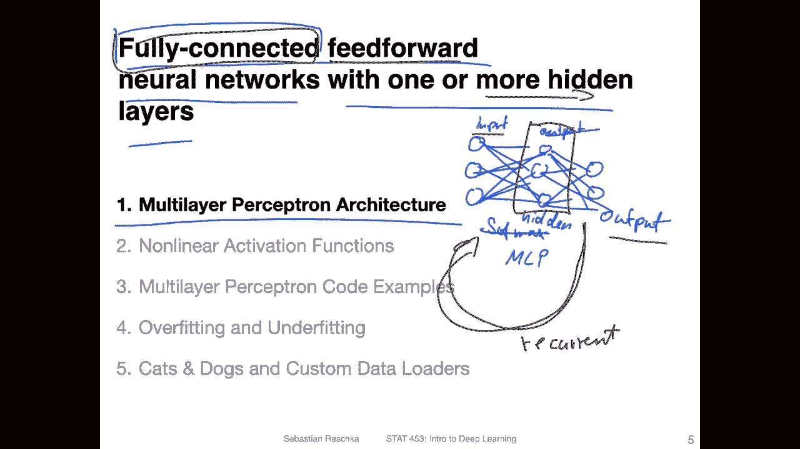
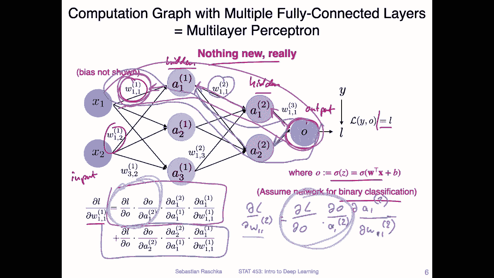
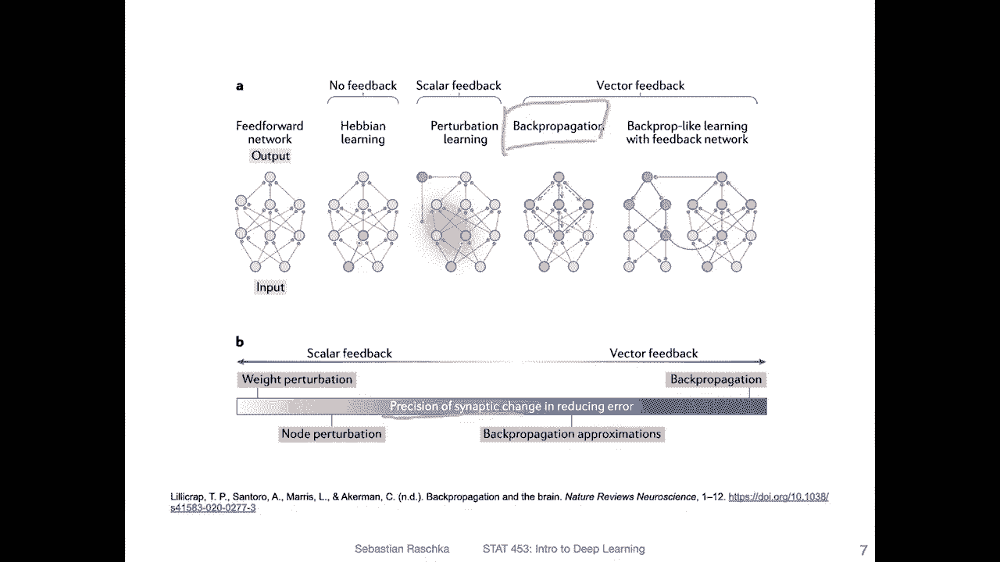
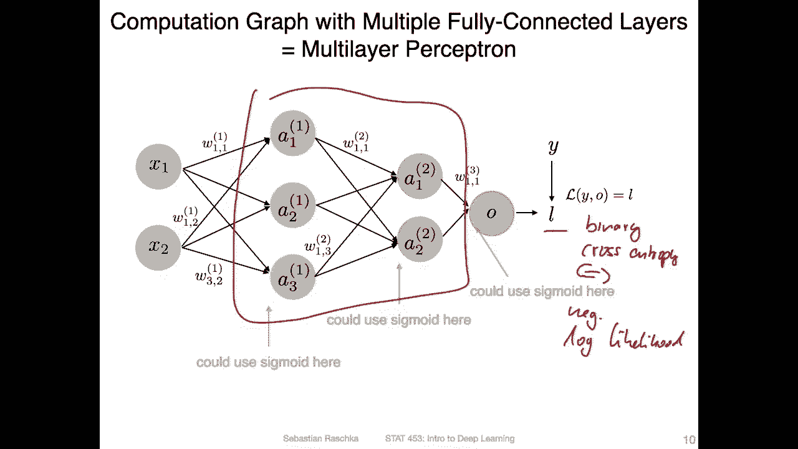
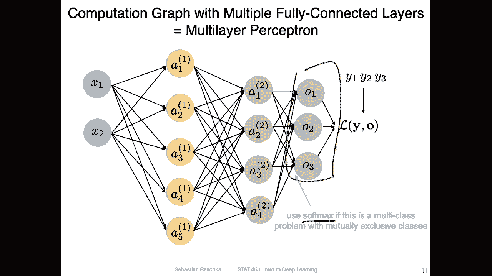
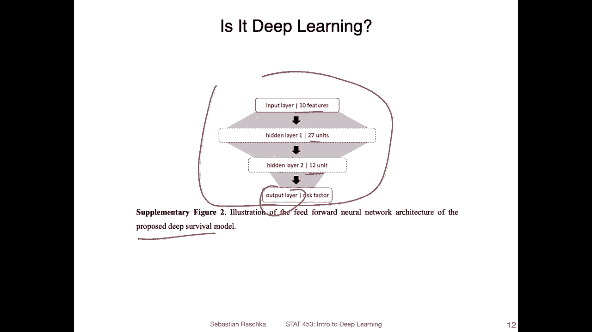
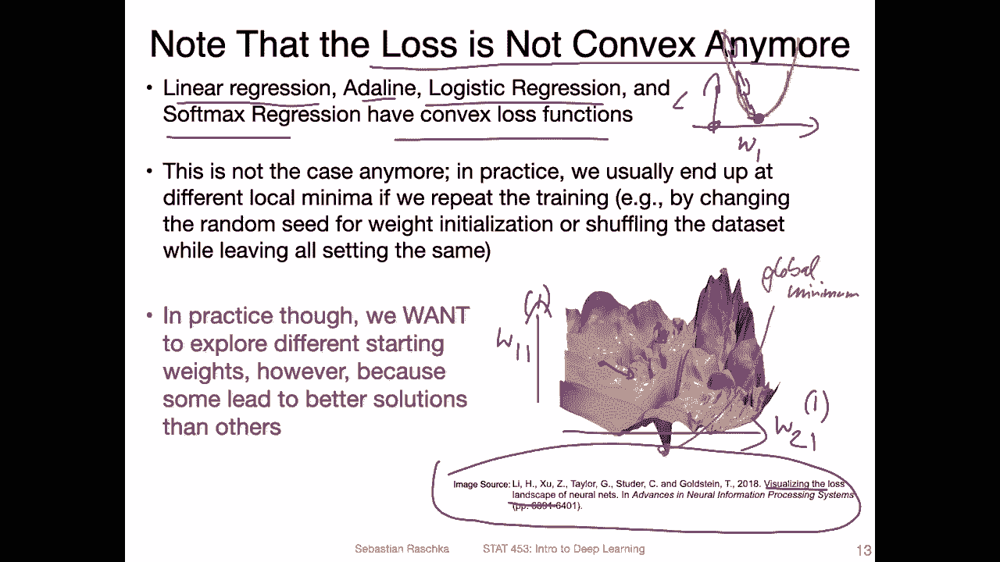
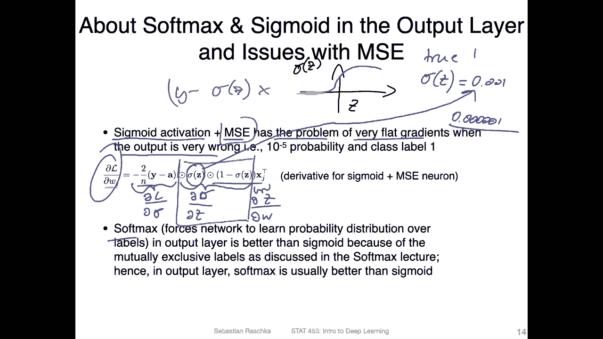
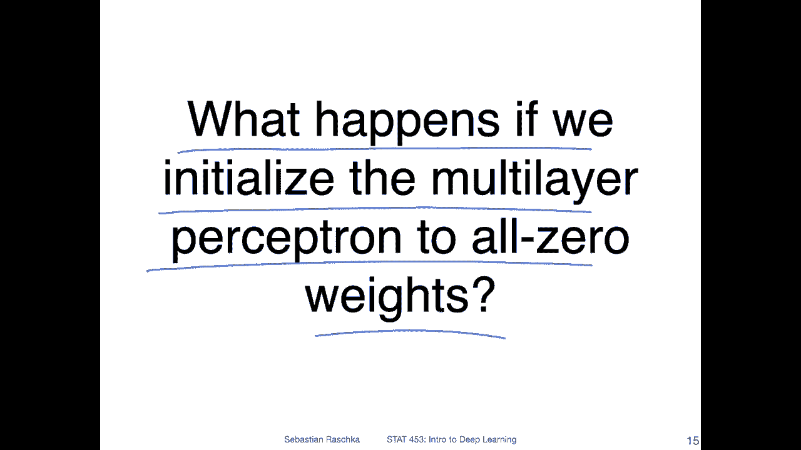
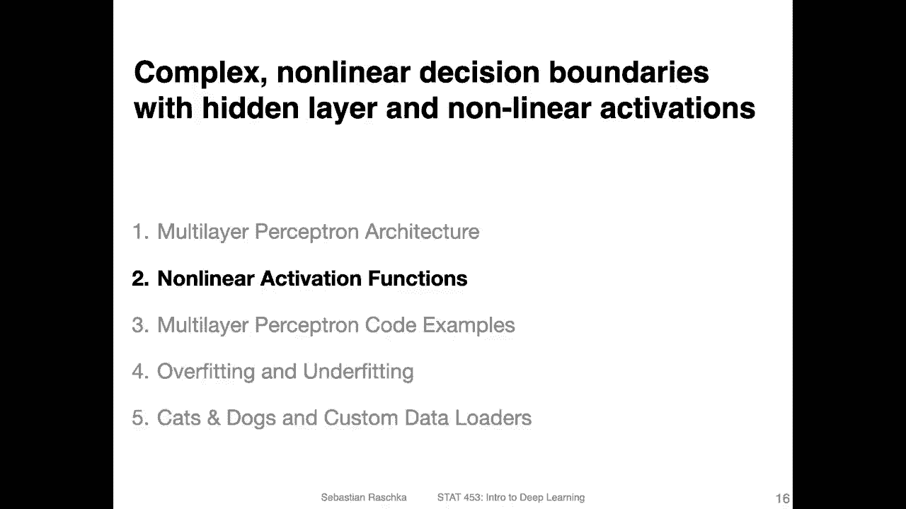

# 课程 P63：L9.1 - 多层感知器结构 🧠

在本节课中，我们将要学习多层感知器的基本结构。多层感知器是一种经典的前馈神经网络，它是构建更复杂深度学习模型的基础。我们将了解其组成部分、工作原理以及与之前学过的逻辑回归和Softmax回归的区别。

---

## 多层感知器是什么？🤔

多层感知器是一种全连接的前馈神经网络，它包含一个或多个隐藏层。

“全连接”意味着在给定层中的每个神经元，都与下一层中的所有神经元相连接。例如，在逻辑回归的上下文中，输入层的每个特征都连接到输出层，这类似于一个没有隐藏层的多层感知器。

上一节我们介绍了多层感知器的基本定义，本节中我们来看看它与Softmax回归的主要区别。

多层感知器与Softmax回归的主要区别在于，它在输入层和输出层之间引入了**隐藏层**。同时，它使用一种称为**反向传播**的学习算法，该算法本质上是使用链式法则的梯度下降法，与我们上一讲在Softmax回归中使用的原理非常相似，只是现在有了隐藏层。

“前馈”指的是信息从输入到输出单向流动（例如在本图中从左到右）。后续课程中我们将看到并非所有网络都是前馈的（例如循环神经网络），也并非所有网络都是全连接的（例如卷积神经网络）。

---

## 网络结构详解 🏗️

下图展示了一个具有两个隐藏层的多层感知器。

左侧是输入层，接着是两个隐藏层，最后是输出层。由于只有一个输出单元（类似于逻辑回归，不同于Softmax回归），这对应一个二分类问题。因此，输出层可以使用Sigmoid函数，类似于逻辑回归。

除了这些隐藏层，这里并没有太多新概念。我们仍然有连接各层神经元之间的权重。在计算用于训练网络的偏导数时，我们同样可以使用多元链式法则。

例如，如果我们想计算损失函数相对于某个权重（如 `W_11`）的偏导数，我们需要沿着从损失到该权重的所有路径使用链式法则。在下图中，我用紫色高亮显示了其中两条路径。

可以看到，路径之间是共享的。这意味着，如果你先计算了某一部分梯度，在进一步反向传播时就可以复用这部分结果，这是实际实现中的一种优化技巧。但根本上，这与应用于Softmax回归的概念是相同的。

---

## 命名与层数约定 📝

现在让我们谈谈命名约定。下图中使用了圆括号 `( )` 来表示层索引。

之前我们使用方括号 `[ ]` 通常指代第 `i` 个训练样本。而这里的圆括号 `( )` 指的是隐藏层的索引。例如，`a^(1)` 表示第一个隐藏层的激活值，`a^(2)` 表示第二个隐藏层的激活值。输出层也可以写作 `a^(3)`，因为其计算方式（如果使用Sigmoid函数）与隐藏层激活值的计算方式是相同的。

每个激活值 `a` 是基于净输入 `z` 计算得出的，而 `z` 的计算公式为：
`z = W^T * x + b`
对于第一个隐藏层，`x` 是原始输入。对于后续的层，`x` 则是前一层的激活值。

关于层数的计数方式：有时人们将输入层称为第一层，但这会导致逻辑回归被视为一个两层网络，这不太直观。更常见的做法是：
*   输入层（第0层）
*   第一个隐藏层（第1层）
*   第二个隐藏层（第2层）
*   输出层（第3层）
这样，逻辑回归就可以被视为单层神经网络。

在激活函数方面，我们可以在所有层使用逻辑Sigmoid函数。损失函数通常使用负对数似然，也称为**二元交叉熵**。对于多分类问题，输出层则使用**Softmax函数**。

---

## 这是“深度学习”吗？🤨

一个有趣的问题是：这真的算深度学习吗？多层感知器已经存在了大约50年。

根据近期的趋势，在论文中越来越常见地将多层感知器称为深度学习。传统上，“深度学习”一词刚出现时，通常指的是利用一些超越普通多层感知器的技巧进行特征学习。但如今，多层感知器本身在某种意义上已被视为深度学习。

---

## 非凸损失函数与优化挑战 ⛰️

一个非常重要的点是，对于多层感知器，**损失函数不再是凸函数**。

在线性回归、Adaline、逻辑回归和Softmax回归中，我们拥有凸损失函数。例如，线性回归的损失函数相对于一个权重是碗状的，通过梯度下降可以平滑地到达全局最小值。

然而，对于多层感知器，我们面对的是高度非凸的损失曲面。下图展示了仅考虑两个权重时的损失景观，可以看到存在许多局部最小值。

`Global Minimum` 表示全局最小值，`Local Minima` 表示局部最小值。损失值越高（颜色越暖），模型性能越差；损失值越低（颜色越冷），性能越好。

在神经网络训练中，我们通常从小的随机权重开始。根据初始权重的不同，优化过程可能收敛到不同的局部最小值，甚至可能陷入其中而无法到达全局最小值。因此，在实践中，几乎不可能找到真正的全局最小值。

常见的做法是使用不同的随机种子多次运行网络训练，然后选择最佳的几个结果进行平均和报告。在接下来的课程中，我们将讨论如何选择学习率、初始权重以及优化算法，以帮助模型跳出局部最小值。

---

## 激活函数与损失函数的选择 ⚖️

除了选择好的初始权重、学习率和优化器，选择合适的激活函数以及激活函数与损失函数的组合也至关重要。

这里用一个例子说明某些组合可能存在的问题：考虑使用**逻辑Sigmoid激活函数**和**均方误差损失函数**。

我们可能会遇到梯度消失的问题，尤其是在预测非常错误的时候。当我们希望进行大幅修正时，梯度却可能变得非常平缓，导致权重几乎不更新。

回忆一下Sigmoid函数的形状及其导数。当网络输入 `z` 为很大的负数时，Sigmoid输出接近0，其导数也接近0。如果此时真实标签是1，但预测概率极低（如0.001），损失会很大。但在计算梯度时：
`∂Loss/∂W = ∂Loss/∂a * ∂a/∂z * ∂z/∂W`
其中 `∂a/∂z`（Sigmoid的导数）会非常小，从而导致整个梯度很小，权重更新微乎其微，无法纠正错误预测。

相比之下，如果使用**二元交叉熵损失**配合Sigmoid激活，在求导时会产生良好的抵消效果，得到更合理的梯度更新规则。因此，仔细考虑激活函数和损失函数的搭配非常重要。

对于多分类问题，输出层使用Softmax激活是更自然的选择，但同样需要注意与损失函数（如分类交叉熵）的配合。

---

## 思考题 💭

作为本讲的练习或讨论点，请思考以下问题：
> 如果我们将多层感知器的所有权重初始化为0，会发生什么？

之前提到我们使用小的随机权重来帮助逃离局部最小值或获得不同的起点。但如果所有权重初始值相同（例如全为0），会对训练过程产生什么影响？为什么我们不这样做？

---

## 总结 📚

本节课中我们一起学习了：
1.  **多层感知器的定义**：它是一种全连接、前馈的神经网络，包含一个或多个隐藏层。
2.  **核心结构**：包括输入层、隐藏层和输出层，使用反向传播算法进行训练。
3.  **命名约定**：了解了层索引的表示方法和计数惯例。
4.  **与深度学习的关系**：讨论了多层感知器在现代语境下如何被归入深度学习范畴。
5.  **优化挑战**：认识到其损失函数的非凸性，以及由此带来的陷入局部最小值和训练不稳定的挑战。
6.  **组件选择的重要性**：强调了激活函数与损失函数需要谨慎搭配，以避免如梯度消失等问题。

在下一讲中，我们将探讨比逻辑Sigmoid函数更适用于多层感知器的其他激活函数。

