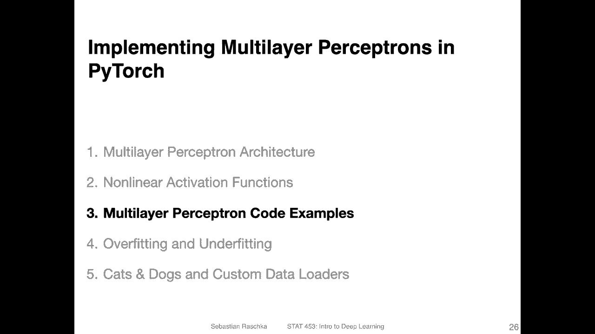
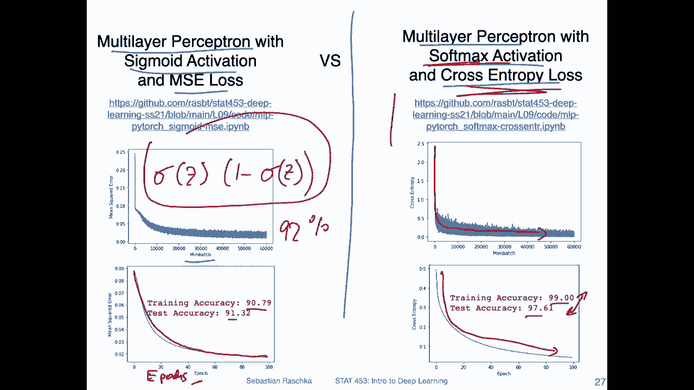
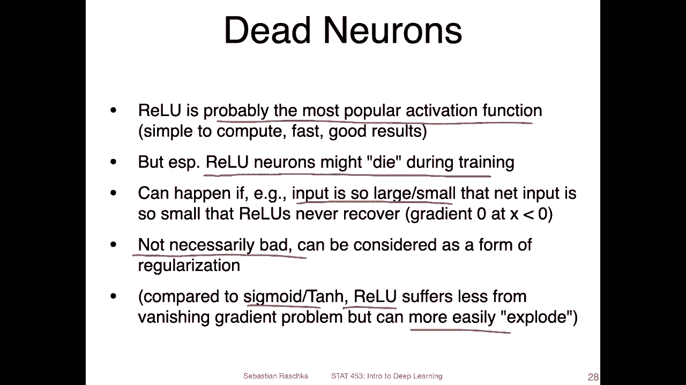
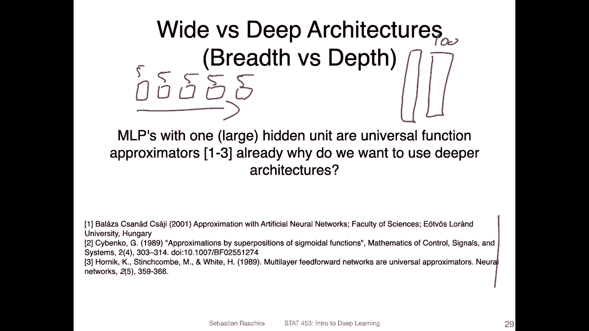
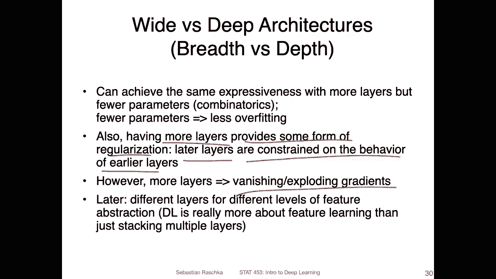

# 课程 P65：L9.3.1 - 多层感知器代码第 1/3 部分（幻灯片概述） 📚

在本节课中，我们将学习多层感知器的代码实现。首先，我们会通过几张幻灯片来总结即将在代码中看到的内容，并补充一些之前未提及的关于多层感知器的重要概念。

---

## 代码示例与性能对比 📊

上一节我们介绍了多层感知器的基本概念，本节中我们来看看具体的代码实现和不同配置下的性能表现。

我准备了两份代码笔记本，并会展示一些Python脚本作为替代方案。在这些笔记本中，我实现了一个使用Sigmoid激活函数和均方误差损失的多层感知器，以及另一个结构相同但使用Softmax激活函数和交叉熵损失的多层感知器。

以下是两张性能对比图：
*   左侧图表展示了使用Sigmoid和均方误差组合的训练过程。你可以看到每个小批量的损失在下降，这是期望的结果，但由于是随机梯度下降，更新过程存在噪声。图表底部绘制了在整个训练集上计算的损失，它在每个训练周期后计算，因此曲线更平滑。该模型最终达到约90%的训练准确率和91%的测试准确率，没有过拟合。但回想一下，在Softmax回归课程中，我们仅用Softmax回归就达到了约92%的准确率。
*   右侧图表展示了使用Softmax和交叉熵组合的训练过程。损失同样在下降，但训练准确率达到了99%，测试准确率接近98%，存在轻微的过拟合。这表明在此场景下，交叉熵损失比均方误差损失表现更好。

我认为Sigmoid与均方误差组合表现不佳的原因可能是它们不是最佳搭配。正如之前概述的，与Softmax和交叉熵（甚至Sigmoid和交叉熵）相比，它们的梯度项不能很好地抵消。在链式法则中，Sigmoid函数的导数是一个小于1的数，这可能导致梯度消失问题，使得梯度变得非常小，从而影响参数更新。

交叉熵损失通常与Sigmoid激活函数搭配更好，或者我推荐使用Softmax激活函数，因为我们处理的是互斥的类别。实际上，你可以尝试修改代码，将Softmax改为Sigmoid，但可能不会看到太大差异。

---

## 激活函数选择：ReLU与“死亡神经元” ⚡️

上一节我们对比了不同损失函数，本节我们来讨论另一个关键组件：激活函数。

我已经提到了“死亡神经元”的问题。我们也可以使用ReLU激活函数，它非常流行。你可以在代码笔记本中尝试它。正如我所说，ReLU可能是我最常使用的激活函数，因为它通常效果很好。

然而，理论上ReLU存在“死亡神经元”问题。如果在训练中，某个神经元的输入加权和（净输入）为很大的负数，那么ReLU的输出将始终为0，其梯度也为0。这意味着，如果输入过大或过小导致净输入为负，并且负得特别极端，那么该神经元可能永远无法被激活，其对应的权重也可能永远得不到更新，从而形成“死亡神经元”。

不过，这并不一定是坏事。如果你的网络有很多神经元，容易过拟合，那么“死亡神经元”实际上减少了一些参数，可能通过简化网络（类似于剪枝）来帮助提升性能。

与Sigmoid或Tanh函数相比，ReLU的一个优势是它更少受到梯度消失问题的影响，因为它的梯度要么是0，要么是1。在最坏的情况下，你得到的是死亡神经元（梯度为0）；而在其他情况下（净输入为正），你总是能得到一个强梯度1。但理论上，如果网络其他部分的值大于1，它也可能导致梯度爆炸问题。

关于梯度的消失和爆炸，我们将在讨论循环神经网络时更详细地探讨，那里是讨论这个问题的好时机。

---

## 网络结构：深度与宽度的权衡 🏗️

了解了激活函数的选择后，我们接下来思考一个结构性问题：应该使用深层还是宽层的多层感知器？

假设我们需要设计一个多层感知器。我们可以选择让每层只有少量神经元（例如每层5个），但堆叠很多层（深度网络）；或者，我们也可以选择只用一个隐藏层，但该层包含大量神经元（例如100个，宽度网络）。

那么，哪种更可取呢？理论上，存在一些关于“通用近似定理”的研究。该定理表明，一个具有单个足够大隐藏层的多层感知器，就能够近似任意函数。既然如此，为什么我们还要关心使用多层网络呢？

能够近似任意函数并不意味着训练这样的网络是实用的。首先，训练本身存在挑战，大型矩阵乘法计算量大。其次，要达到与使用更多层（但每层参数更少）的网络相同的表达能力，你可能需要更多的参数。使用更少的参数但更多的层，可以在组合上提供更多的可能性，从而获得相同的表达能力。

但是，如果你有很多层，就可能遭受前面提到的梯度消失或爆炸问题。因此，在实践中通常需要权衡。对于传统的多层感知器，你通常不会使用超过一两层的隐藏层，否则就会遇到梯度问题。

稍后我们将讨论卷积神经网络等其他类型的网络，它们可以通过一些技巧设计，使我们能够构建更深的网络而无需担心梯度问题。这基本上就是深度学习的核心之一：巧妙地设计架构，以便能够进行更深的训练。对于多层感知器这种并非真正的深度学习架构来说，一到两个隐藏层通常就足够了。如果你尝试实现一个有三到四层隐藏层的多层感知器，通常会注意到它训练得不太好，因为误差无法有效地反向传播那么远。

一个实际的考虑是，在多层感知器中通常使用一到两个隐藏层。而对于卷积层，我们可以构建多达50、100甚至200层的网络，这在当今非常普遍。

---

## 总结与预告 📝

本节课中我们一起学习了多层感知器代码实现前的理论概述。

我们对比了不同激活函数和损失函数组合的性能，分析了ReLU激活函数的优缺点及其可能导致的“死亡神经元”现象。我们还探讨了网络深度与宽度之间的权衡，理解了为什么传统的多层感知器不宜过深，以及更深网络的潜力所在。

最后，我们了解到，虽然理论上更深的网络可以用更少的参数实现相同的表达能力，并且更深的结构本身可能带来某种形式的正则化（因为后层受前层行为的约束），但我们也必须面对梯度消失和爆炸的挑战。

现在，是时候向你展示代码示例了。让我暂停这个视频，然后启动我的Jupyter笔记本。