# P67：L9.3.3 - PyTorch 中的多层感知器（脚本设置）第 3/3 部分 🧠

在本节课中，我们将学习如何将多层感知器（MLP）的训练代码组织成更模块化、可维护的脚本形式。我们将介绍如何使用独立的设置文件、辅助函数文件以及主训练脚本，来构建一个适合大型项目的代码结构。

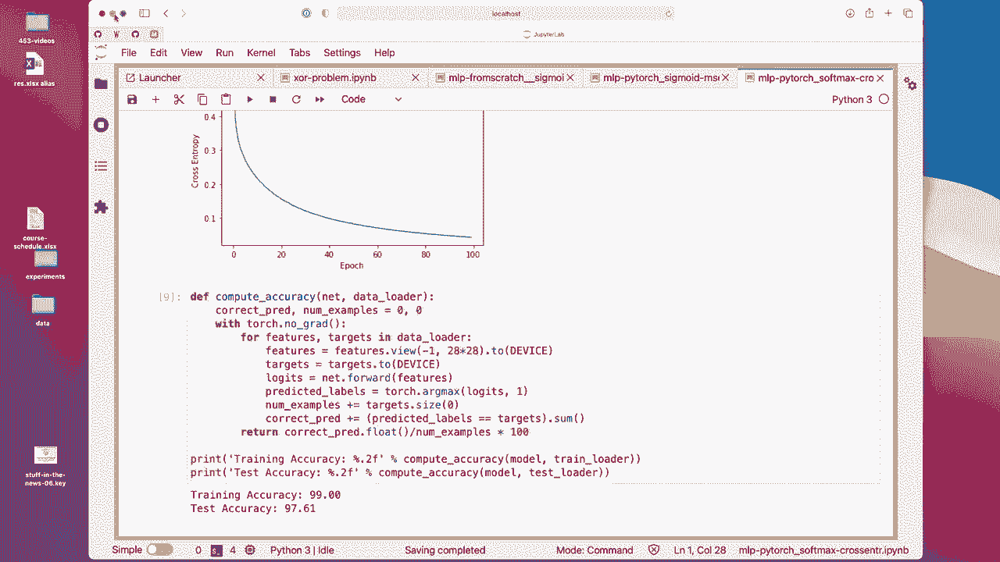

---

## 📊 回顾上一节结果

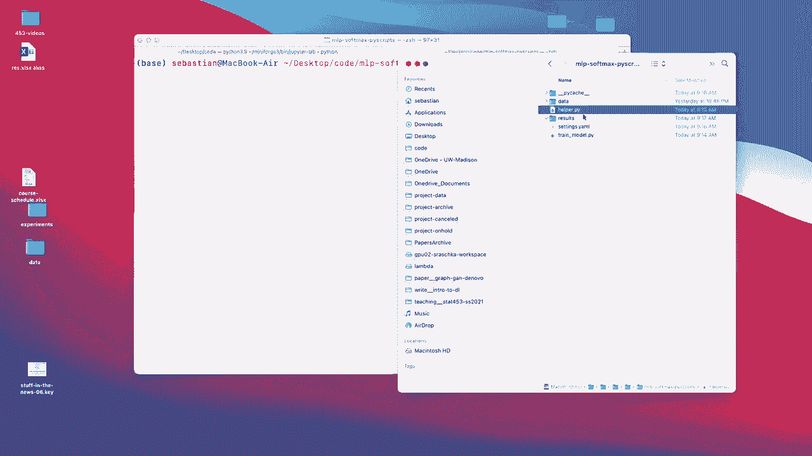

上一节我们介绍了在Jupyter Notebook中训练MLP模型。运行大约4分钟后，损失函数持续下降，模型取得了不错的准确率。这表明我们的模型训练过程是有效的。

---

## 🗂️ 项目代码组织

在大型项目或需要进行大量调优时，将代码组织成脚本形式更为高效。以下是推荐的项目文件结构：

*   **`helper.py`**：存放可复用的通用函数。
*   **`settings.yaml`**：存放模型超参数和配置。
*   **`train_model.py`**：主训练脚本。

这种结构有助于代码复用和项目管理。

---

## 🔧 详解脚本文件

接下来，我们详细看看每个文件的作用。

### `train_model.py` 主训练脚本

这个脚本是训练流程的入口。它从其他文件导入功能，并协调整个训练过程。

```python
# 示例：从helper.py导入通用函数
from helper import data_loader, set_deterministic, compute_accuracy, plot_results
```

脚本使用 `argparse` 库来接收命令行参数，例如设置文件路径和结果保存路径。这样做使得在不修改代码的情况下，能灵活地运行不同配置的实验。

```python
# 示例：解析命令行参数
parser.add_argument('--settings_path', type=str, required=True)
parser.add_argument('--results_path', type=str, required=True)
```

一个有用的技巧是同时将输出打印到控制台并写入日志文件，便于后续查看和记录。

```python
# 示例：同时打印和记录日志
import sys
sys.stdout = open('training.log', 'w')
```

### `settings.yaml` 配置文件

我们使用YAML格式文件来管理所有超参数和设置。YAML文件易于人类阅读和编写，并且可以通过 `PyYAML` 库轻松加载为Python字典。

```yaml
# settings.yaml 示例
batch_size: 64
learning_rate: 0.001
num_epochs: 10
hidden_units: [128, 64]
```

在主脚本中，我们这样加载配置：

```python
import yaml
with open(settings_path, 'r') as f:
    settings = yaml.safe_load(f)
```

这种方式的好处是，进行超参数调优时，只需修改YAML文件，而无需触及主训练代码。

### `helper.py` 辅助函数文件

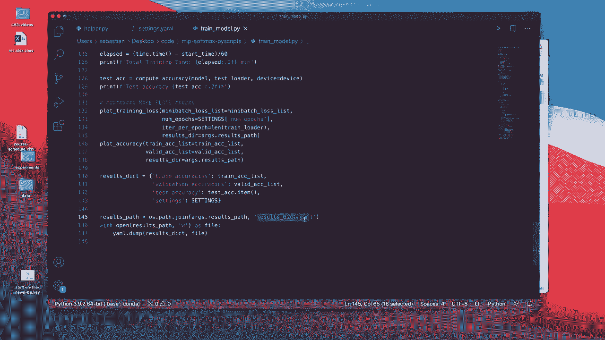

这个文件包含了在各个项目中都可能用到的通用工具函数，例如：

*   **`set_deterministic`**：设置随机种子，确保实验结果可复现。
*   **`compute_accuracy`**：计算模型准确率。
*   **`plot_results`**：绘制损失和准确率曲线图。

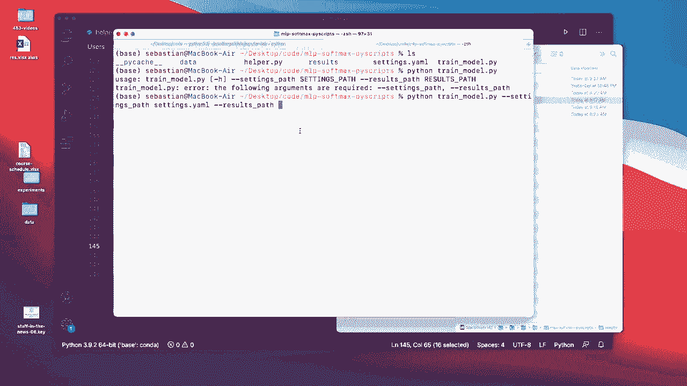

将通用功能模块化，避免了在不同项目或脚本中重复编写相同代码。

---

## 🚀 运行训练脚本

在命令行中，我们可以通过指定配置文件和结果目录来运行训练。

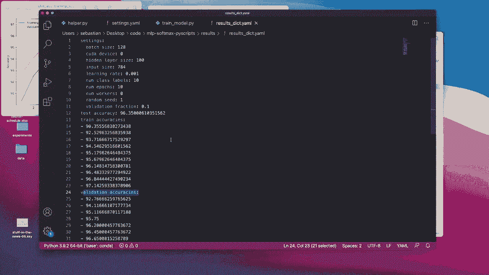

```bash
python train_model.py --settings_path ./settings.yaml --results_path ./results
```

运行过程中，控制台会输出训练信息，同时这些信息也会被实时写入 `results/training.log` 文件。训练结束后，结果字典（包含最终测试准确率、各轮次的训练/验证准确率等）会被保存为YAML文件，损失和准确率曲线图也会被保存下来。

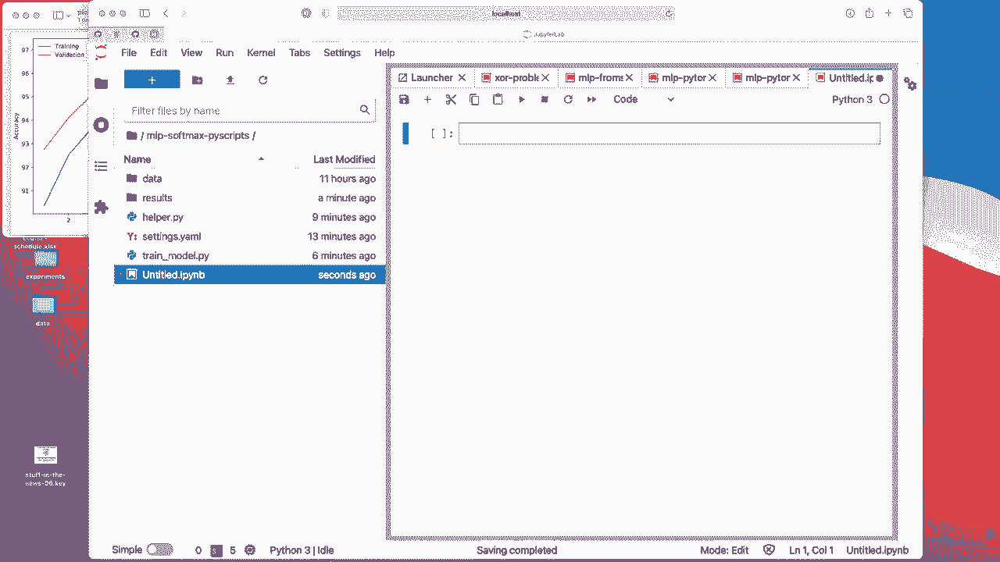

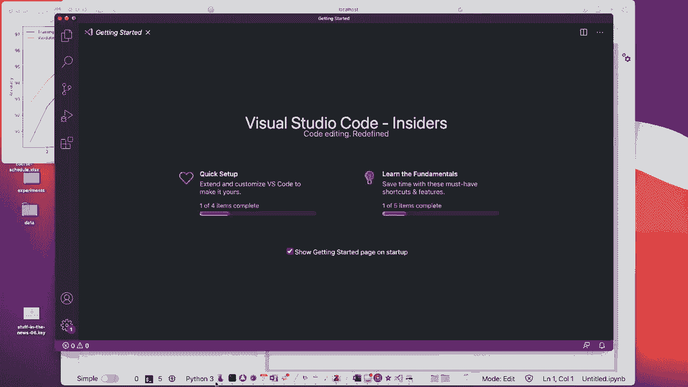

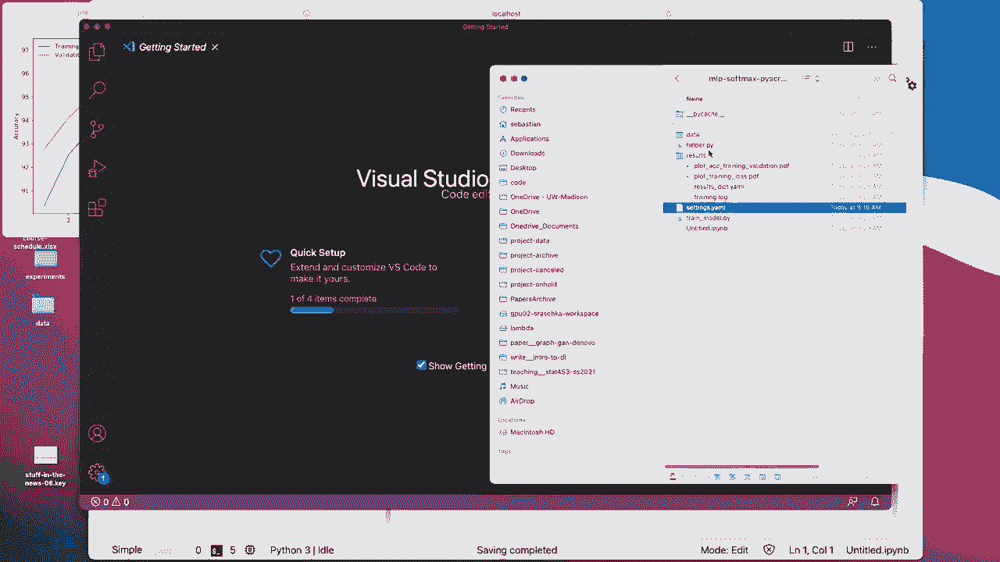

---

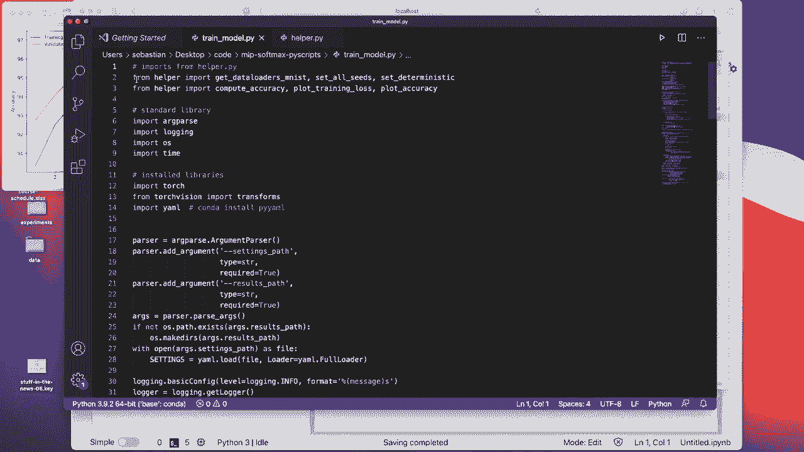

## 📓 与Jupyter Notebook的混合使用

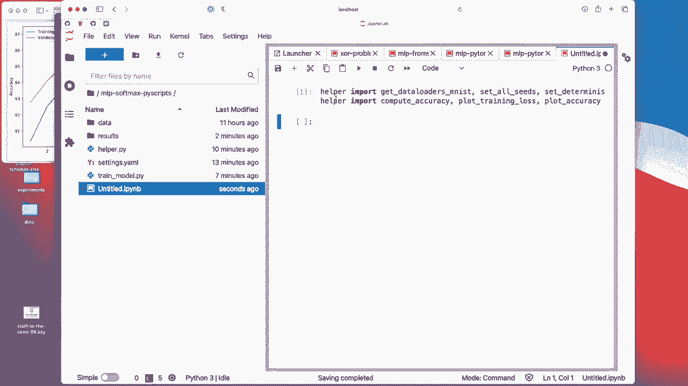

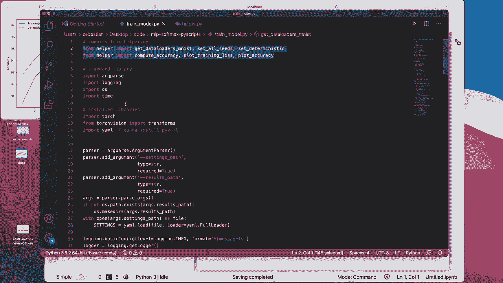

即使在使用Jupyter Notebook进行交互式开发时，我们也可以利用这种模块化思想。你可以在Notebook中导入 `helper.py` 中的函数，从而保持Notebook代码的简洁。

```python
# 在Jupyter Notebook中
from helper import data_loader, train_model
# ... 然后使用这些函数
```

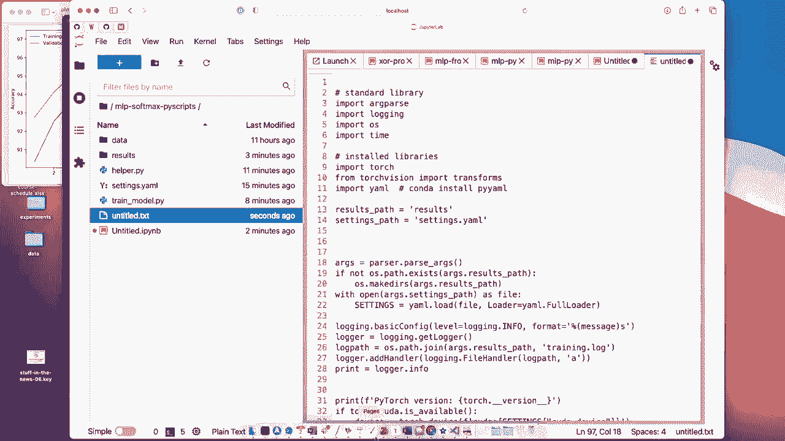

这结合了脚本的模块化优势和Notebook的交互式探索便利性。

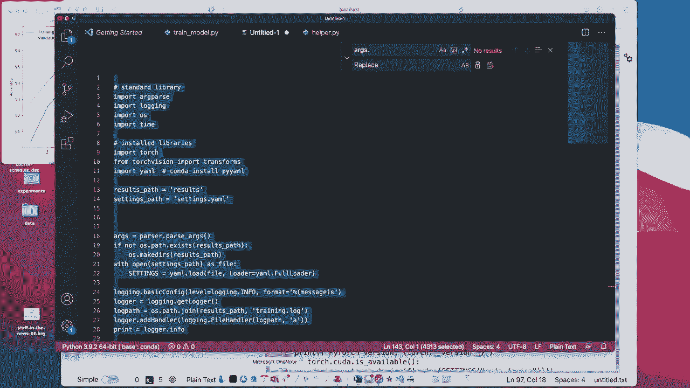

---

## 📝 本节总结

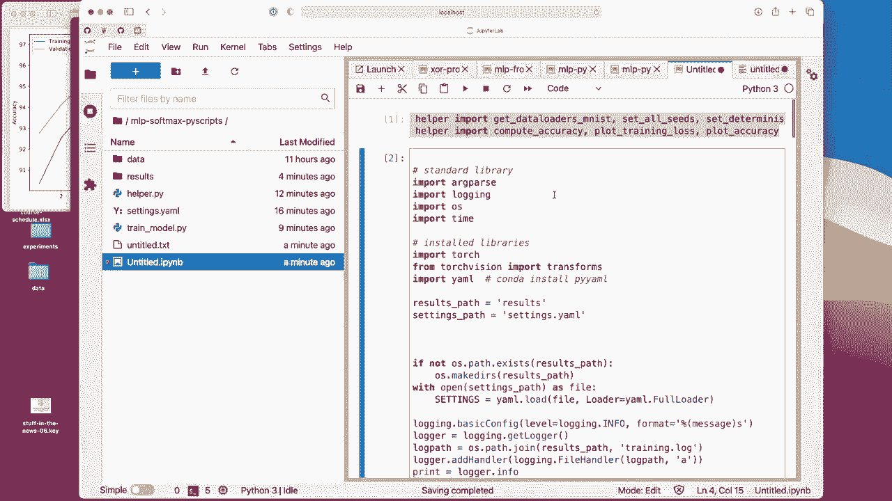

本节课我们一起学习了如何将PyTorch多层感知器的训练代码组织成更专业的脚本形式。我们介绍了使用独立配置文件（YAML）管理超参数、创建辅助函数文件封装通用逻辑、以及编写主训练脚本并通过命令行运行的方法。这种结构提高了代码的可维护性、可复用性和实验管理的便捷性，是进行严肃机器学习项目开发的良好实践。所有代码示例都将上传至Github供大家参考。接下来，我们将继续探讨多层感知器的其他方面。