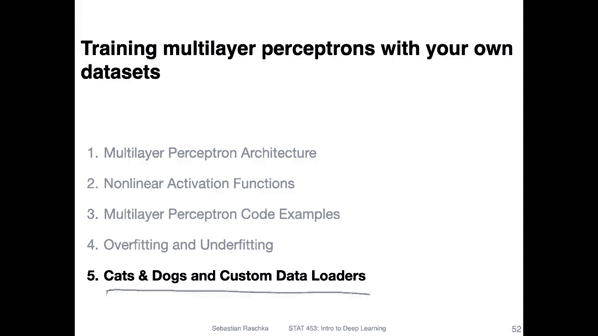
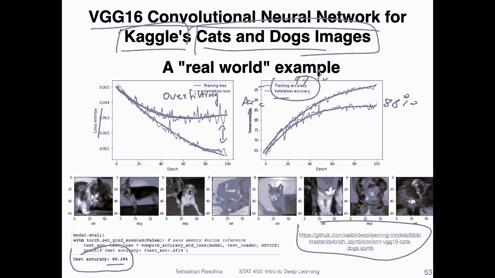
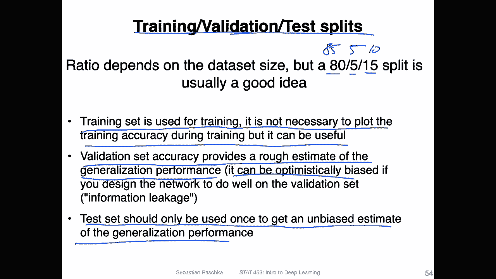
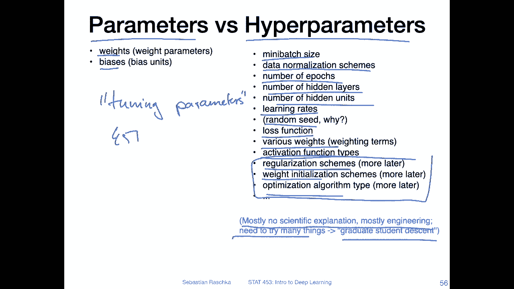
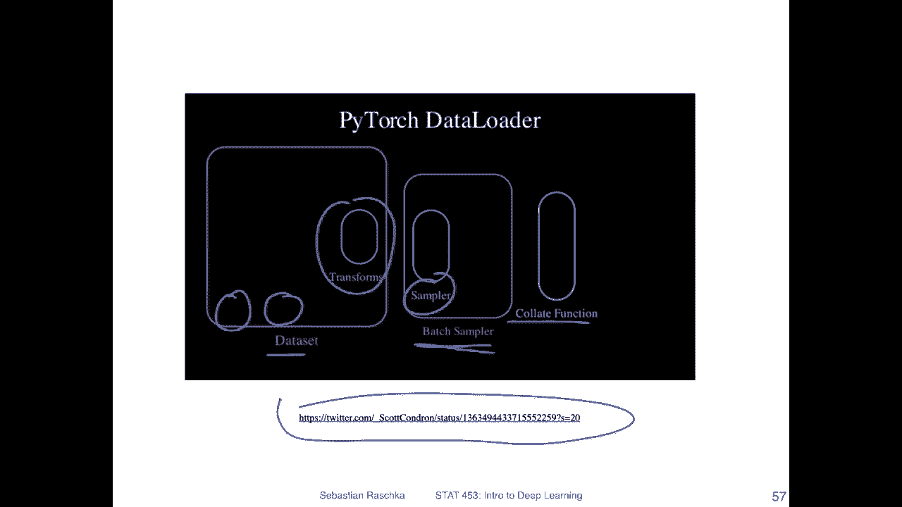
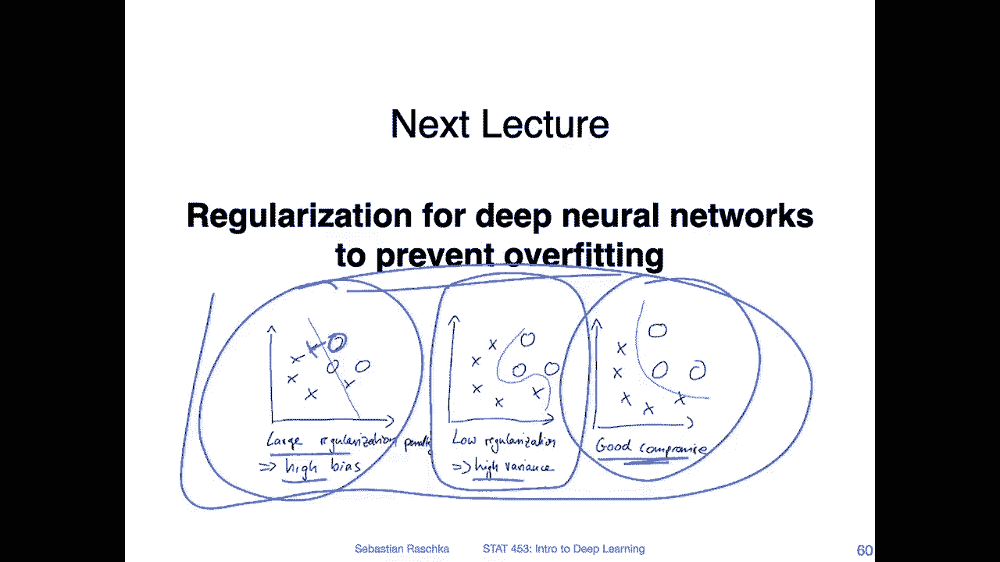

# 🐱🐶 P69：L9.5.1 - 猫狗分类与自定义数据加载器

在本节课中，我们将学习如何为猫狗图像分类任务创建一个自定义的数据加载器。我们将讨论训练、验证和测试集的作用，理解过拟合现象，并简要介绍超参数的概念。最后，我们会通过一个直观的动画了解PyTorch数据加载器的工作原理。

## 📊 模型训练与过拟合分析

上一节我们介绍了神经网络的基本概念，本节中我们来看看一个实际的猫狗分类模型训练过程。我使用Kaggle上的数据集训练了一个VGG16卷积神经网络。在训练过程中，我们绘制了损失和准确率曲线。

在左侧的交叉熵损失图中，训练损失如预期般下降。然而，在验证集上，损失最初下降，随后便停滞不前。这意味着模型在训练集上持续改进，但在验证集上不再提升，这表明出现了**过拟合**。

在右侧的准确率图中，情况类似。训练准确率持续上升，甚至可能达到97%，而验证准确率在达到约88%后便趋于稳定。在独立的测试集上评估后，也得到了约88%的准确率，这与验证集的表现一致。

验证集为我们提供了模型泛化性能的早期指示，使我们无需动用最终测试集就能发现过拟合。测试集应仅在最终阶段使用一次，以获取无偏的性能估计。

## 🎯 数据集划分策略

在深度学习中，我们通常将数据划分为训练集、验证集和测试集，而不是使用传统的K折交叉验证，因为后者对于深度神经网络来说计算成本过高。

以下是关于如何划分数据的一些建议：
*   **训练集**：用于训练模型参数。通常分配最大的比例，例如80%。
*   **验证集**：用于在训练过程中监控模型性能，并调整超参数。可以分配较小的比例，例如5%。
*   **测试集**：用于在模型训练和调优完成后，进行最终的一次性评估，以获得对泛化性能的无偏估计。例如，可以分配15%。

没有绝对正确的划分比例，但通常围绕上述值进行调整。验证集性能通常会略优于在真正未见数据上的性能，因为我们可能会无意中根据验证集表现来选择模型。

## 🔧 训练监控与工具

在训练过程中，绘制训练和验证的准确率/损失曲线非常有用，它能直观展示过拟合的程度。当然，你也可以选择只打印这些数值。

如果你希望在训练时实时查看这些曲线，可以使用一些专门的工具。以下是两个流行的选择：
*   **MLflow**：一个用于管理机器学习生命周期的平台，支持实验跟踪。
*   **TensorBoard**：最初为TensorFlow设计，但现在也与PyTorch兼容，广泛用于可视化训练过程。

你可以根据自己的兴趣和项目需求探索这些工具。

## ⚙️ 参数与超参数

现在，我们来区分一下模型参数和超参数。

**模型参数**是模型从训练数据中学习到的值，例如神经网络中的权重和偏置。它们通过反向传播算法进行优化。

**超参数**则是在训练开始前，由研究人员手动设置或调整的配置。它们控制着训练过程本身。以下是一些常见的超参数：
*   学习率 (`learning_rate`)
*   训练轮数 (`num_epochs`)
*   批次大小 (`batch_size`)
*   隐藏层数量 (`num_hidden_layers`)
*   隐藏单元数量 (`num_hidden_units`)
*   激活函数类型（如 `ReLU`, `Sigmoid`）
*   正则化方法
*   权重初始化方案
*   优化算法选择

选择超参数没有固定的理论公式，通常需要通过实验和经验来确定。为了获得可靠的结果，建议使用不同的随机种子多次运行模型，然后取平均性能。

## 📦 PyTorch数据加载器工作原理

在进入代码实践之前，我们通过一个动画来直观理解PyTorch数据加载器(`DataLoader`)的工作流程。

概念流程如下：
1.  **数据集**：包含原始的输入和标签对。
2.  **变换**：对数据进行预处理（如缩放、裁剪）。
3.  **采样器**：从数据集中抽取单个样本。
4.  **批次采样器**：将多个样本组合成一个批次。
5.  **整理函数**：将批次内的样本堆叠成张量，形成模型可用的批量输入和标签。

这个过程会重复进行，直到遍历完所有数据（一个周期）。如果启用了`shuffle`参数，每个周期中样本的顺序会不同。

## 🛡️ 过拟合与正则化

我们目前的好消息是，多层神经网络可以解决复杂的非线性问题。但随之而来的坏消息是，这些网络拥有大量参数，很容易导致过拟合。

上图展示了模型复杂度的权衡：
*   **左侧**：模型过于简单（欠拟合），无法捕捉数据中的模式。
*   **中间**：模型过于复杂（过拟合），完美拟合训练数据但泛化能力差。
*   **右侧**：通过正则化等技术得到的模型，在复杂度和泛化能力之间取得了更好的平衡。

在接下来的课程中，我们将详细讨论**正则化技术**，以帮助防止过拟合。

## 📝 总结

本节课中我们一起学习了：
1.  通过猫狗分类任务观察了模型训练中的过拟合现象。
2.  理解了训练集、验证集和测试集的划分与作用。
3.  认识了模型参数与超参数的区别。
4.  了解了PyTorch `DataLoader` 的内部工作流程。
5.  认识到过拟合是复杂模型面临的主要挑战，并预告了正则化作为解决方案。

在下一个视频中，我们将进入代码实践，亲手构建一个自定义的数据加载器。