# 深度学习新闻 #6，2021 年 3 月 7 日 📰

在本节课中，我们将学习2021年3月7日发布的深度学习领域最新动态。主要内容包括PyTorch 1.8版本的新特性，以及一篇关于神经网络训练实用技巧的文章。我们将详细介绍这些更新，并探讨如何在实际项目中应用这些技巧来优化模型训练。

## PyTorch 1.8 版本发布 🚀

上一节我们介绍了本节课的概述，本节中我们来看看本周深度学习领域最引人注目的新闻——PyTorch 1.8版本的发布。PyTorch大约每半年发布一次新版本，每次都会带来许多实用的新功能和改进。由于本课程也以PyTorch为重点，因此了解这些新特性非常有价值。

PyTorch官方发布了一篇[文章](https://pytorch.org/blog/pytorch-1.8-released/)，总结了1.8版本的主要亮点。更详细的更改和新增功能列表可以在[GitHub](https://github.com/pytorch/pytorch/releases/tag/v1.8.0)上找到，其中包含了约700次提交。

以下是三个我个人认为最值得关注的新特性：

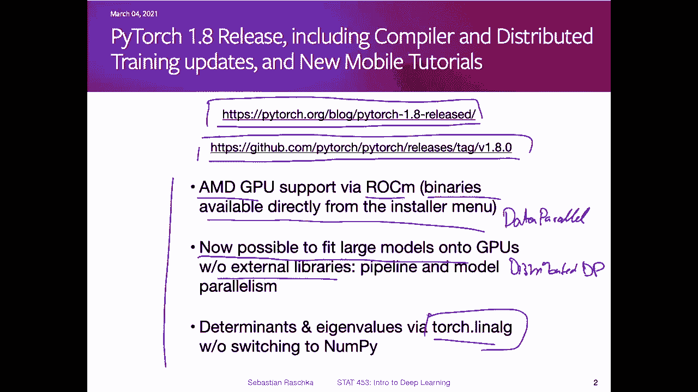

1.  **对AMD GPU的原生支持**：通过名为ROCm的库（类似于NVIDIA的CUDA），现在可以更方便地使用AMD显卡进行深度学习计算。虽然之前也有支持，但需要自行编译PyTorch，过程繁琐。现在，安装程序菜单中直接提供了预编译的二进制文件，使得在Linux系统上的安装更加便捷（目前仅支持Linux，但预计macOS和Windows的支持也会很快跟进）。
2.  **无需外部库的模型并行训练**：上周我们讨论了FairScale和Microsoft DeepSpeed等用于跨多个GPU分布模型的库。PyTorch本身已有`DataParallel`和`DistributedDataParallel`用于数据并行（即分割批次）。新版本引入了更便捷的功能，可以将单个过大的模型拆分到多个GPU上运行，而无需依赖外部库。
3.  **`torch.linalg`线性代数模块的扩展**：新增了许多通常只在NumPy中才有的线性代数函数，例如计算行列式或特征值。这减少了我们在训练神经网络时在NumPy和PyTorch之间切换的频率，使工作流程更加顺畅。

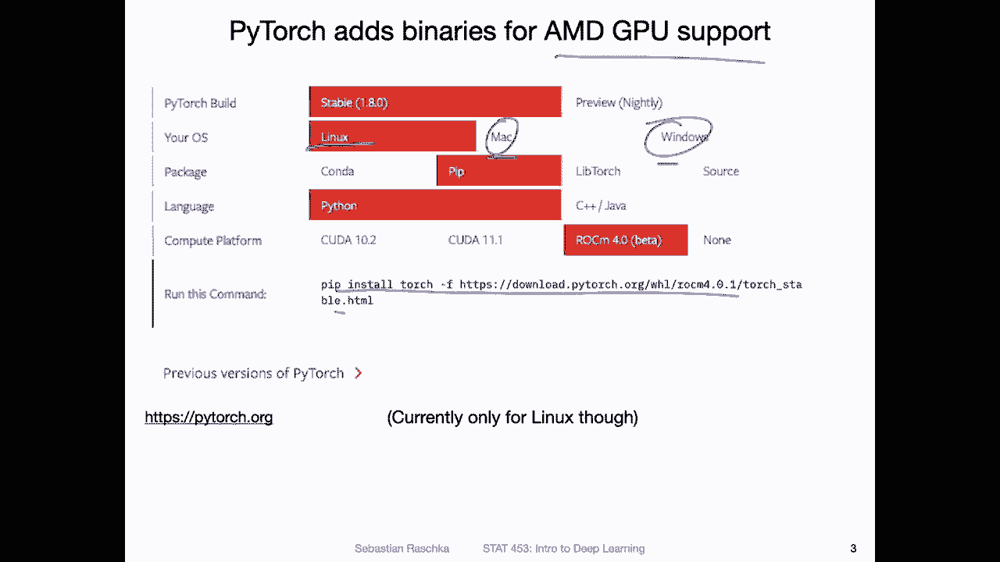

> 注：安装CUDA版本的PyTorch时，它会捆绑自己的CUDA工具包，这简化了安装过程，但也是安装包体积（现在约2.48 GB）较大的原因之一。

## 深入理解模型并行与流水线执行 🔄

上一节我们提到了PyTorch 1.8对模型并行的支持，本节中我们来深入了解一下其原理，特别是流水线执行技术。

传统的模型并行是将模型的不同层放在不同的GPU上。例如，一个四层网络，每层放在一个独立的GPU上（GPU 0, 1, 2, 3）。前向传播（F）时，数据依次通过各GPU；反向传播（B）时，梯度反向传递。

这种方法的主要缺点是GPU利用率低。如下图所示，在任一时刻，只有一个GPU在工作，其他GPU处于空闲状态（图中曲线下的区域），造成了资源浪费。

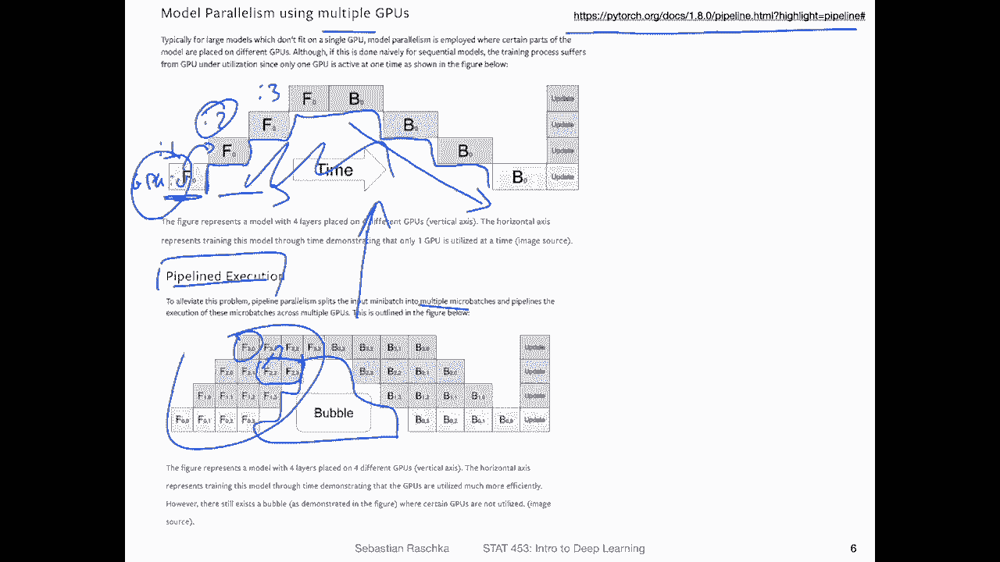

改进的方法是使用**微批次（Micro-batches）**的流水线执行。如下图所示，系统将一个小批次拆分成多个微批次。当第一个微批次在GPU 1上计算时，第二个微批次可以开始在GPU 0上计算，依此类推。这样实现了部分操作的并行，提高了GPU利用率。尽管图中仍有所谓的“气泡（Bubble）”代表空闲时间，但这比传统模型并行效率更高。


> 更多关于流水线并行的细节，可以参考[这篇论文](https://arxiv.org/abs/1811.06965)的介绍。

## 实战：在PyTorch中实现流水线并行 💻

理论介绍完毕，本节我们通过一个代码示例，看看如何在PyTorch 1.8中实际应用流水线并行。我以VGG16网络为例进行演示（虽然它本可以放入单个GPU，但用于演示目的很合适）。

以下是实现的核心步骤：

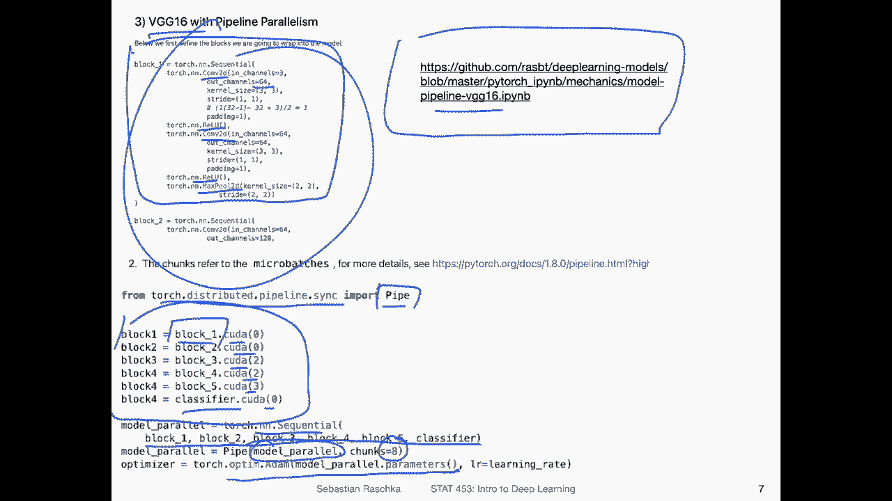

1.  **定义模型块**：将VGG16网络划分为多个块（Block），每个块包含卷积层、ReLU激活函数和池化层。
    ```python
    # 示例：定义一个块
    block1 = nn.Sequential(
        nn.Conv2d(...),
        nn.ReLU(),
        nn.Conv2d(...),
        nn.ReLU(),
        nn.MaxPool2d(...)
    )
    ```
2.  **分配块到GPU**：将不同的块放置到不同的GPU设备上。注意，输入数据所在的GPU（通常是GPU 0）应放置第一个块，最终输出也应放回GPU 0以便计算损失。
    ```python
    device0 = torch.device('cuda:0')
    device2 = torch.device('cuda:2')
    device3 = torch.device('cuda:3')
    block1.to(device0)
    block2.to(device2)
    block3.to(device3)
    # ... 分类器层放回 device0
    ```
3.  **组合模型并创建流水线**：使用`torch.nn.Sequential`组合所有块，然后将其包装进`torch.distributed.pipeline.sync.Pipe`中。
    ```python
    model = nn.Sequential(block1, block2, block3, ...)
    model = Pipe(model, chunks=8) # chunks 指定微批次数量
    ```
4.  **训练循环中的小修改**：使用`Pipe`后，模型返回的是一个包含输出的RRef对象，需要获取其本地值。
    ```python
    # 在训练循环中
    output = model(batch_data)
    loss = criterion(output.local_value(), labels)
    ```

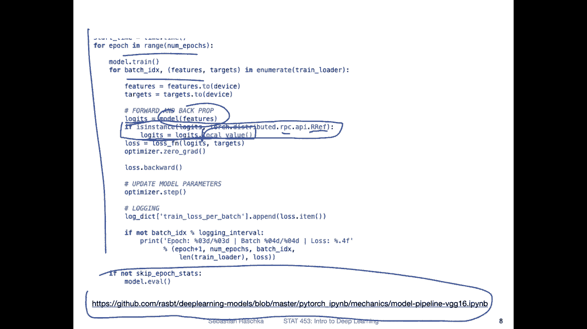

完整的可运行代码示例已分享在[GitHub](https://github.com/rasbt/pytorch-pipeline-example)上。在实际测试中，这种方法的训练速度比单GPU训练慢约一倍，但其核心目的**不是加速**，而是**使得训练超出单GPU内存容量的大型模型成为可能**，这对于大型模型研究非常有用。

## 其他新闻：Virus-MNIST 数据集 🦠

除了PyTorch更新，本周在arXiv上还看到了一个有趣的数据集——**Virus-MNIST**。它旨在为深度学习模型提供一个新颖的基准测试数据。

这个数据集模仿了经典MNIST的格式（10个类别，约数万张训练图像），但内容是关于病毒/恶意软件的。研究人员将恶意软件文件（如.exe）的二进制信息转换为灰度图像（例如，通过中间表示或校验和生成JPEG图像），然后使用卷积网络进行分类。其中一类是“良性软件”（如PuTTY终端程序），其余九类是不同类型的恶意软件。

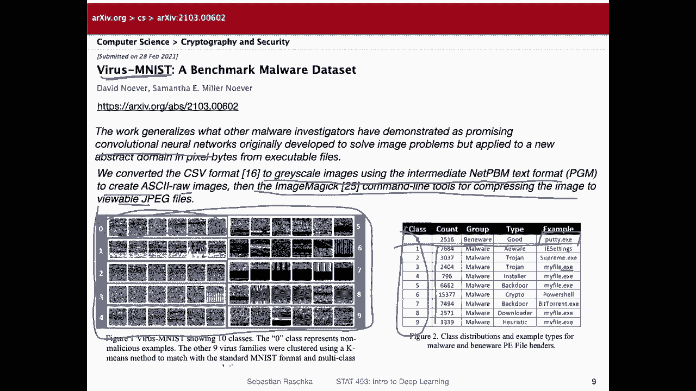


这种将非图像数据（如代码、文本）转换为图像格式以供卷积网络处理的想法很有创意。虽然不确定这是否是最优表示方法，但论文报告了不错的分类性能，为模型测试提供了一个新的有趣方向。

## 神经网络训练实用技巧 📝

现在，我们进入本节课的另一个核心部分：一篇题为《给构建复杂神经网络的简单人们的简单考量》的文章。它总结了在构建和调试模型时应考虑的一系列实用技巧，对大家正在进行的课程项目尤其有帮助。

以下是文章要点的梳理和解读：

### 第一步：深入理解你的数据

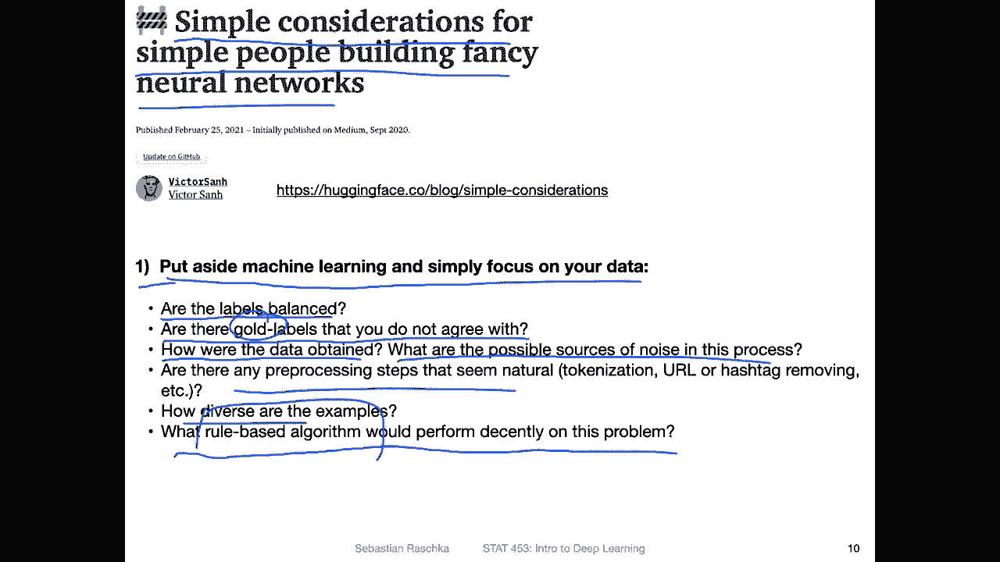

在应用任何模型之前，请先彻底审视你的数据。

*   **检查标签平衡性**：查看各个类别的样本数量是否均衡。
*   **审视标注质量**：“黄金标签”（即标注的真实值）是否准确？是否存在你不同意的错误标注？
*   **了解数据来源**：数据是如何收集和标注的？例如，著名的IBM人脸数据集“Diversity in Faces”的许多属性标签是由另一个模型预测生成的，而非人工标注，这可能会限制基于它开发的模型的上限。
*   **评估数据多样性**：样本是否足够多样，能代表真实场景？
*   **构思规则基线**：能否想出一个简单的、基于规则的算法（例如，判断垃圾邮件：“如果邮件标题全是大写字母，则标记为垃圾邮件”）？实现这样的基线非常重要，因为你的模型性能必须超越它才有意义。

### 第二步：评估任务难度

理解数据后，需要评估学习任务本身的难度。

*   **建立标准基线**：对于分类任务，**逻辑回归**是一个必须尝试的简单强基线。例如，在MNIST上，一个精心调优的卷积网络可能达到99%的准确率，但逻辑回归也能轻松达到92%以上。如果没有这个基线，92%的准确率可能看起来很高，但有了对比，你才能客观评价神经网络带来的提升。
*   **思考随机预测器的表现**：
    *   对于平衡的C分类问题，一个纯随机猜测的准确率是 **1/C**。
    *   对于不平衡数据，要考虑**多数类预测器**的表现。例如，一个数据集中80%是垃圾邮件，20%不是。如果一个模型总是预测“垃圾邮件”，它的准确率就能达到80%。如果你的模型只达到82%，那么其提升就非常有限。
*   **计算随机预测的损失值**：了解一个随机模型的理论损失值有助于调试。例如，对于C分类的交叉熵损失，随机预测（每个类概率为1/C）的理论损失是 **-log(1/C)**。如果训练时损失值停滞在这个数值附近，说明模型可能没有学到任何东西。
*   **选择合适的评估指标**：根据任务选择准确率、精确率、召回率、F1分数等。
*   **匹配模型架构与数据特性（归纳偏置）**：根据数据的内在结构选择模型。例如，时间序列数据适合用循环神经网络（RNN），图像数据适合用卷积神经网络（CNN）。

### 第三步：模型调试技巧

如果你理解了数据和任务，但模型性能仍然不佳（例如，损失值停留在随机预测水平），就需要进行调试。

一个非常有效的技巧是：**尝试让模型过拟合一个极小批次的数据**。具体做法是，在训练循环中，只使用第一个小批次的数据进行多轮训练，并在此处跳出循环。
```python
for epoch in range(num_epochs):
    for batch_idx, (data, target) in enumerate(train_loader):
        # 仅用第一个小批次反复训练
        optimizer.zero_grad()
        output = model(data)
        loss = criterion(output, target)
        loss.backward()
        optimizer.step()
        break  # 关键：只训练一个小批次
```
理论上，模型应该能迅速将这个极小批次的损失降到接近0。如果做不到，很可能代码存在以下问题：

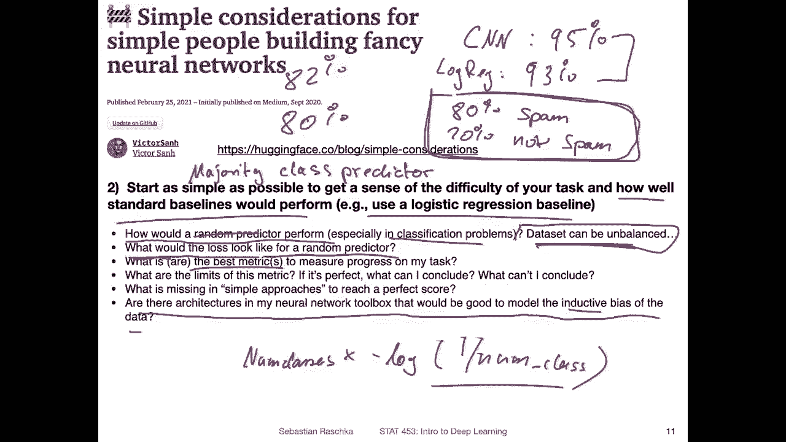

以下是常见的调试检查点：

*   **模式设置错误**：在训练/评估时忘记切换 `model.train()` 和 `model.eval()` 模式（本周讲到Dropout时会详细说明）。
*   **梯度未清零**：忘记调用 `optimizer.zero_grad()`，导致梯度累积。
*   **输入预处理问题**：例如，忘记对输入数据进行标准化。
*   **损失函数输入错误**：PyTorch的 `nn.CrossEntropyLoss` 接收的是**logits**（未归一化的分数），而不是经过softmax的**概率**。
*   **权重初始化问题**：将所有权重初始化为相同的值（如全0）会破坏对称性，阻碍学习。必须使用随机的小数进行初始化。关于这一点，课程Piazza上有同学做了精彩的解答，推荐阅读。
*   **参数未参与前向传播**：如果某些模型参数在前向计算中从未被使用，它们就不会被更新。
*   **优化器参数错误**：在脚本中有多个模型时，容易错误地将优化器指向了另一个模型的参数。
*   **学习率异常**：学习率被意外设置为0，或者学习率调度器工作不正常。

## 总结 🎯

本节课中我们一起学习了2021年3月初的深度学习重要进展。

首先，我们探讨了**PyTorch 1.8**的主要更新：对AMD GPU更便捷的支持、内置的模型并行与流水线执行功能以训练超大模型，以及扩展的线性代数模块。

接着，我们介绍了一个新颖的**Virus-MNIST**数据集，它通过将恶意软件转换为图像，为模型基准测试提供了新思路。

最后，也是最具实践指导意义的部分，我们系统性地学习了一篇关于**神经网络训练与调试技巧**的文章。其核心思想可以归纳为三个步骤：1) **深入理解数据**，检查质量、平衡性和来源；2) **科学评估任务难度**，通过建立随机预测器、多数类预测器和简单模型（如逻辑回归）基线来设定合理的性能期望；3) **有效进行模型调试**，特别是通过“过拟合一个小批次”的技巧来快速定位代码中的问题，并逐一排查学习率、梯度、损失函数输入等常见陷阱。

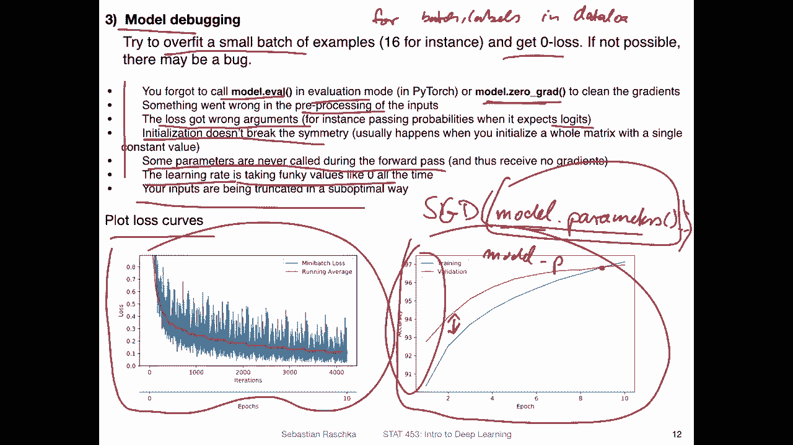

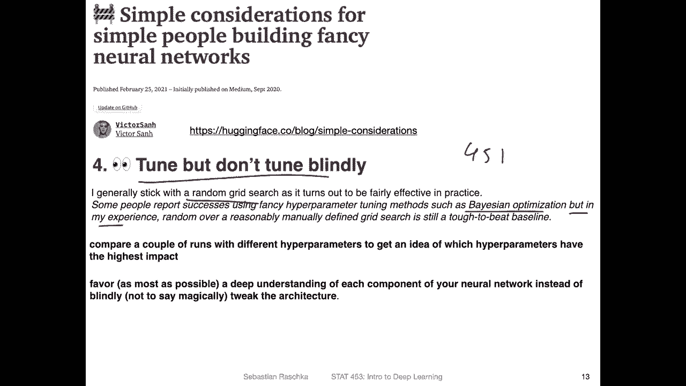

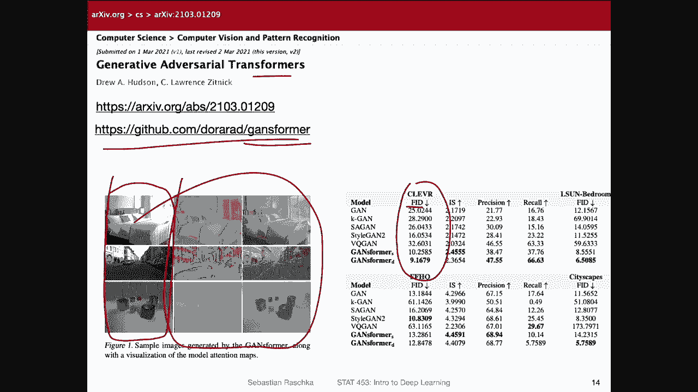

希望这些最新的工具信息和实用的方法论能帮助大家更高效地开展深度学习项目。