# P74：L10.2 - PyTorch 中的数据增强 📊

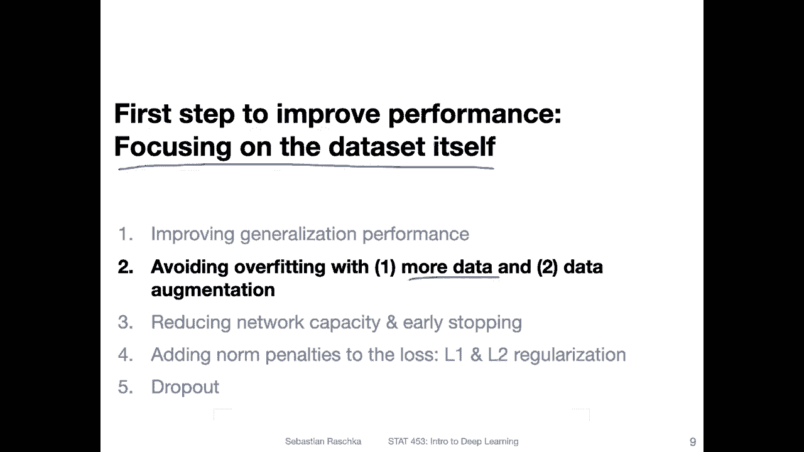

在本节课中，我们将学习两种通过优化数据集来提升模型性能的方法：绘制学习曲线以判断是否需要更多数据，以及使用数据增强技术来扩充现有数据。

## 📈 学习曲线：判断是否需要更多数据

在实践中，提升模型性能的最佳方法之一是在尝试更复杂的模型之前，先专注于数据集本身。一种判断收集更多数据是否有益的技术是绘制学习曲线。

上一节我们介绍了优化数据集的重要性，本节中我们来看看如何通过绘制学习曲线来诊断模型性能。

以下是绘制学习曲线的步骤：
1.  使用不同大小的训练子集（例如，从100个样本到3500个样本）训练同一个模型。
2.  保持测试集大小不变，评估每个模型在测试集上的准确率。
3.  将训练集大小作为横坐标，将训练集和测试集的准确率作为纵坐标，绘制曲线。

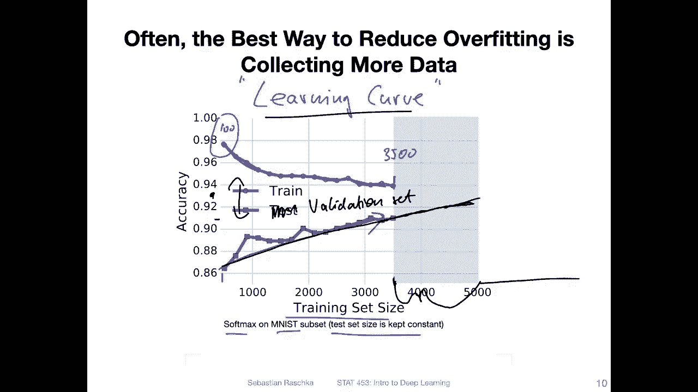

通过观察测试集准确率曲线的斜率，可以判断增加数据是否可能带来性能提升。如果测试集准确率随着训练数据增加而持续上升，并且训练集与测试集性能的差距在缩小，那么收集更多数据很可能是有益的。需要注意的是，为了不污染最终评估，建议使用验证集而非测试集来绘制学习曲线。

## 🔄 数据增强：扩充现有数据

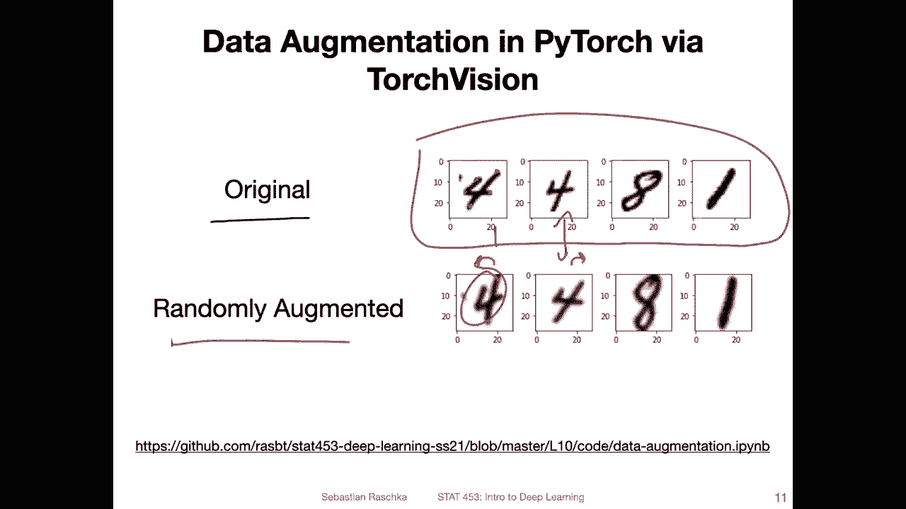

如果收集更多数据成本高昂或不可行，数据增强是一种廉价且有效的替代方案。它通过对现有训练数据进行一系列随机变换（如旋转、缩放、裁剪），生成新的、多样化的训练样本，从而帮助模型学习更鲁棒的特征，而不是记忆具体的像素位置。

上一节我们介绍了如何判断是否需要更多数据，本节中我们来看看如何利用现有数据进行增强。

在PyTorch中，数据增强可以通过 `torchvision.transforms` 模块方便地实现。以下是一个为MNIST数据集定义训练时数据增强流程的示例：

```python
import torchvision.transforms as transforms

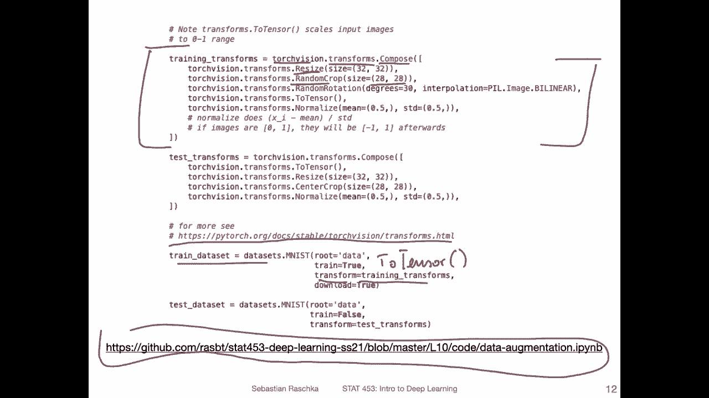

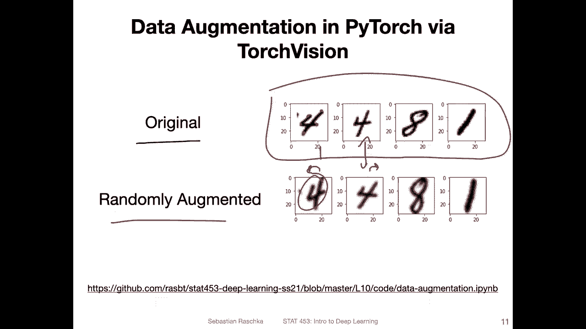

training_transforms = transforms.Compose([
    transforms.Resize((32, 32)),          # 1. 调整大小
    transforms.RandomCrop((28, 28)),      # 2. 随机裁剪
    transforms.RandomRotation(degrees=30, interpolation=transforms.InterpolationMode.BILINEAR), # 3. 随机旋转
    transforms.ToTensor(),                # 4. 转换为张量
    transforms.Normalize(mean=(0.5,), std=(0.5,)) # 5. 标准化
])
```

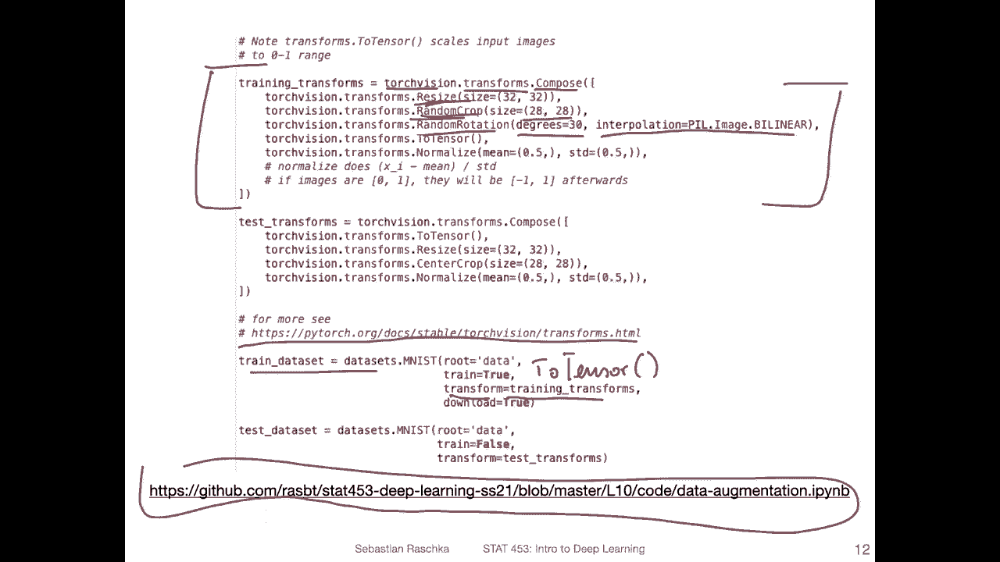

以下是上述代码中每个变换步骤的详细说明：
1.  **调整大小 (`Resize`)**：将图像从原始尺寸（如28x28）调整为稍大的尺寸（如32x32），为后续裁剪做准备。
2.  **随机裁剪 (`RandomCrop`)**：从调整后的图像中随机裁剪出目标尺寸（28x28）的区域。这模拟了图像的平移和局部放大效果。
3.  **随机旋转 (`RandomRotation`)**：将图像在指定角度范围内（如±30度）进行随机旋转，增加模型对物体方向变化的鲁棒性。
4.  **转换为张量 (`ToTensor`)**：将PIL图像或NumPy数组转换为PyTorch张量，并将像素值从[0, 255]范围缩放到[0.0, 1.0]。
5.  **标准化 (`Normalize`)**：对张量进行标准化，使其具有零均值和单位方差。对于单通道MNIST图像，使用 `mean=0.5`, `std=0.5` 可将像素值范围从[0,1]变换到[-1,1]。标准化公式为：
    `normalized_pixel = (pixel - mean) / std`

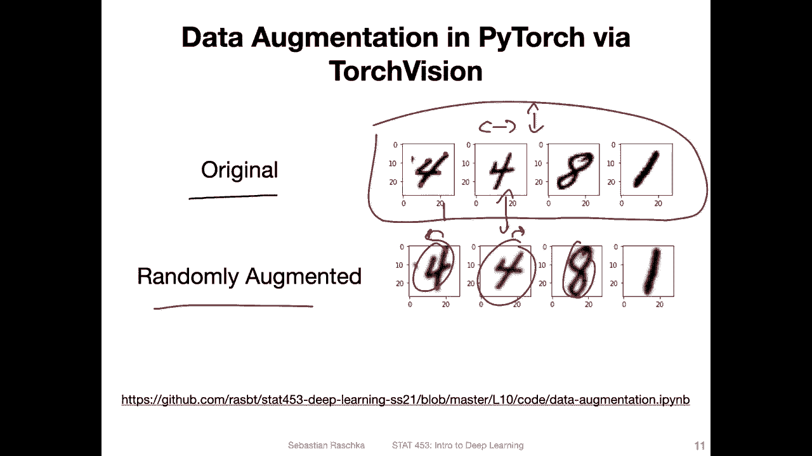

对于测试集，我们需要移除所有随机性以保证评估的一致性，但通常仍需进行中心裁剪和相同的标准化处理。

```python
test_transforms = transforms.Compose([
    transforms.Resize((32, 32)),
    transforms.CenterCrop((28, 28)), # 使用中心裁剪而非随机裁剪
    transforms.ToTensor(),
    transforms.Normalize(mean=(0.5,), std=(0.5,))
])
```

最后，在创建数据集时应用对应的变换：

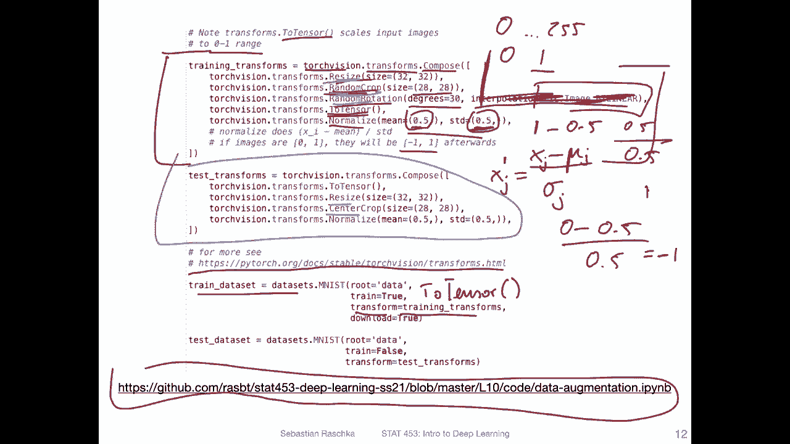

```python
from torchvision import datasets
train_dataset = datasets.MNIST(root='./data', train=True, download=True, transform=training_transforms)
test_dataset = datasets.MNIST(root='./data', train=False, download=True, transform=test_transforms)
```

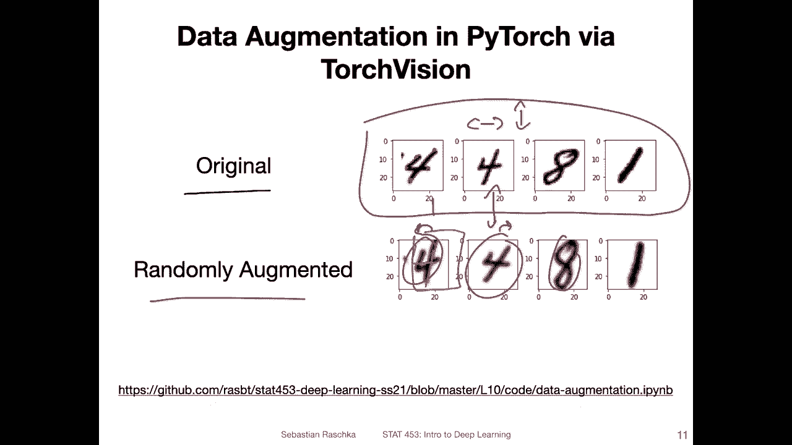

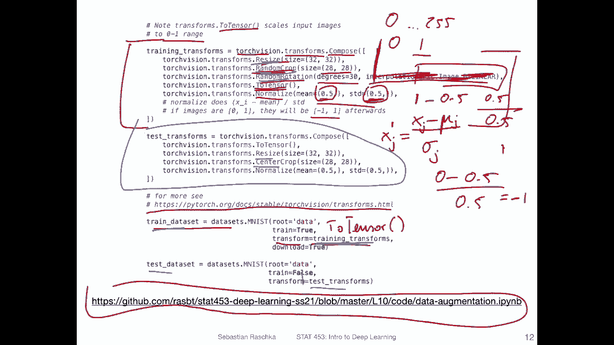

对于RGB图像（三通道），标准化时需要对每个通道指定均值和标准差，例如 `mean=[0.485, 0.456, 0.406]`, `std=[0.229, 0.224, 0.225]`（ImageNet数据集统计值）。

## 🎯 总结

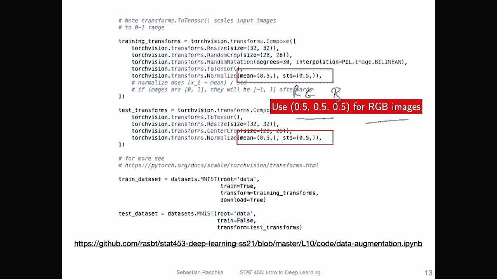

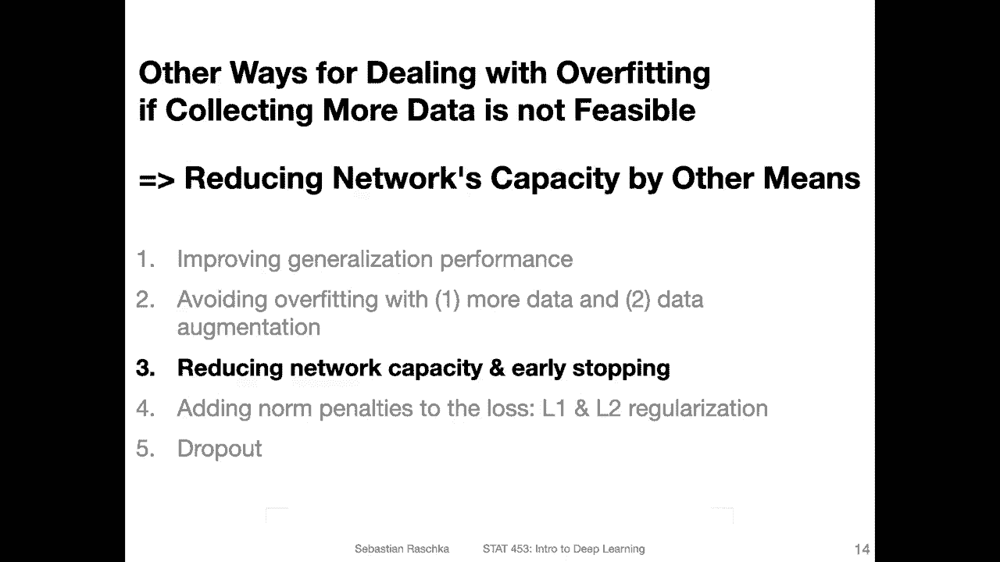

本节课中我们一起学习了两种通过优化数据来提升模型性能的核心方法。首先，我们了解了如何绘制学习曲线来诊断模型是否受益于更多训练数据。其次，我们详细探讨了在PyTorch中实现数据增强的技术，包括如何使用 `torchvision.transforms` 定义包含随机裁剪、旋转和标准化的增强流程，并区分了训练集和测试集所需的不同变换策略。这些方法是提升模型泛化能力、防止过拟合的有效工具。