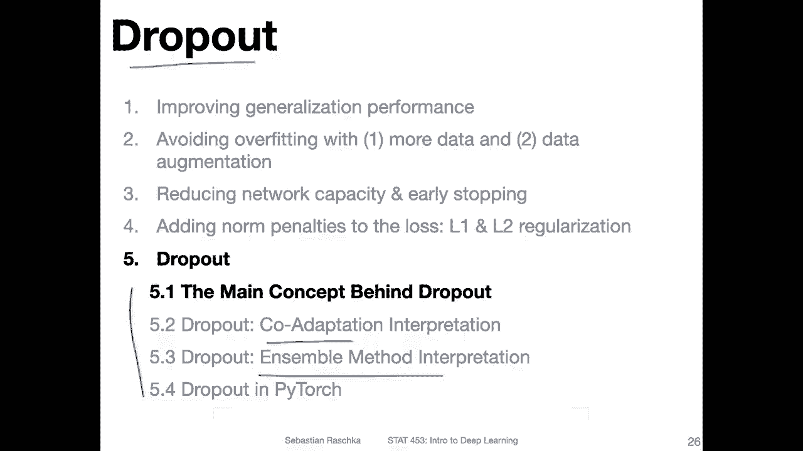
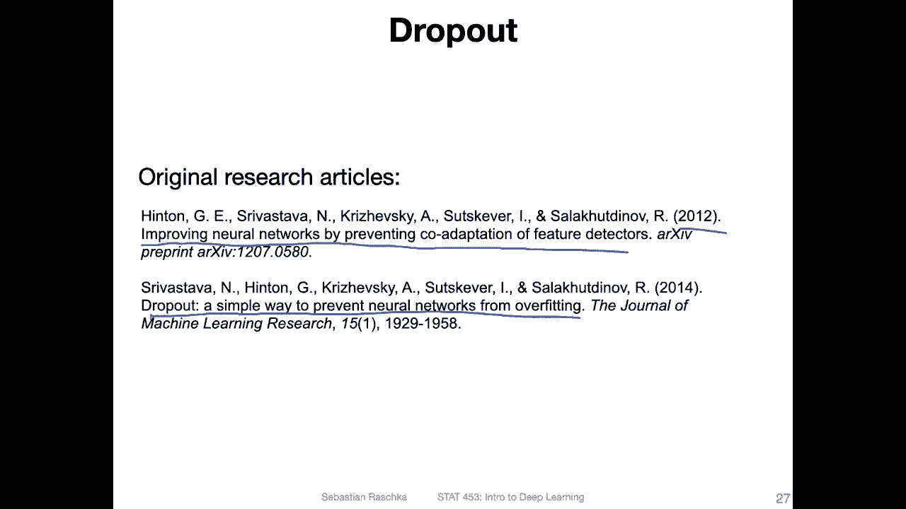
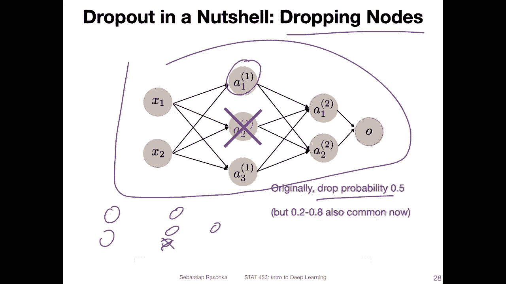
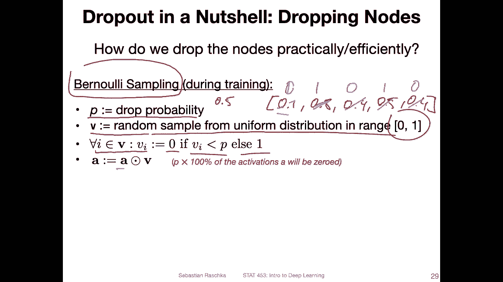
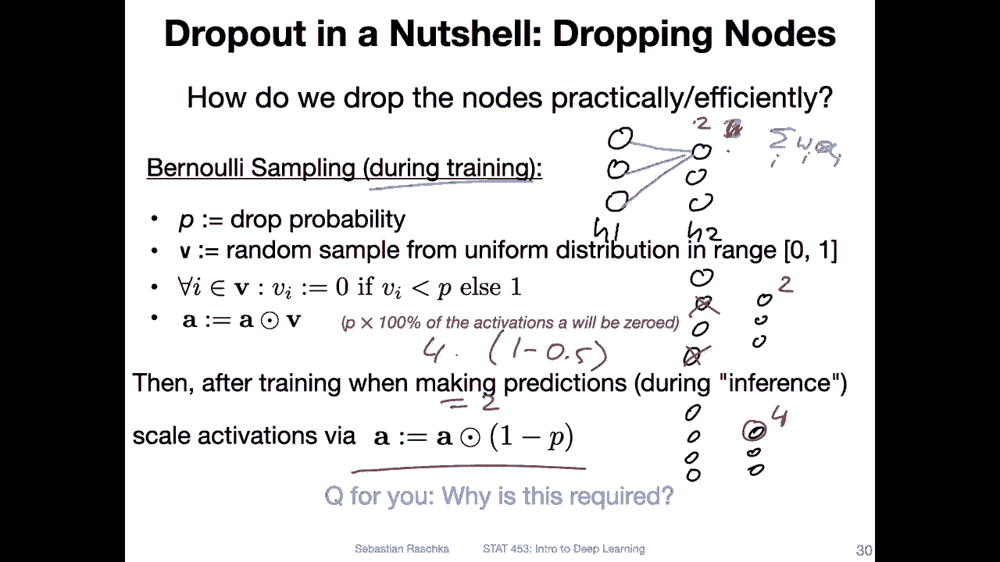
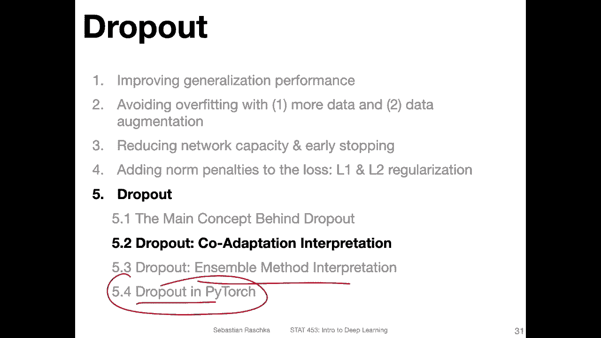

# 课程 P77：L10.5.1 - Dropout 背后的主要概念 🧠

在本节课中，我们将要学习 Dropout 这一神经网络中用于防止过拟合的重要技术。我们将从核心概念开始，逐步理解其工作原理、实现方式以及背后的理论解释。



---

## 概述



Dropout 是一种专门为神经网络设计的正则化方法。它的核心思想是在训练过程中随机“丢弃”网络中的一部分神经元。本节将首先介绍 Dropout 的基本概念和直观操作。

## Dropout 的核心概念

上一节我们介绍了神经网络训练中的过拟合问题，本节中我们来看看 Dropout 如何提供一种独特的解决方案。



Dropout 的主要概念是在训练阶段，以前向传播的每次迭代为单位，随机地将网络隐藏层中的一部分神经元临时“关闭”或“丢弃”。

假设我们有一个多层感知机。Dropout 在训练时，会以设定的概率 `p`（例如 0.5，即 50%）随机选择每个神经元，并将其在此次前向传播和反向传播中暂时移除。

这意味着每次训练迭代时，网络结构都会略有不同，因为被丢弃的神经元组合是随机的。一次迭代可能丢弃神经元 A，下一次则可能丢弃神经元 B 和 C。

## 如何高效实现 Dropout

理解了基本概念后，我们自然会问：如何在代码中高效实现它，而不必真正修改网络架构？

一种高效的方式是使用伯努利采样。我们可以通过一个与隐藏层大小相同的随机掩码向量来实现。



以下是实现步骤的简要描述：

1.  定义一个丢弃概率 `p`。
2.  生成一个与隐藏层大小相同的随机向量，其元素值在 [0, 1) 区间均匀分布。
3.  将该随机向量转换为二进制掩码：将小于 `p` 的值设为 0（丢弃），大于等于 `p` 的值设为 1（保留）。
4.  将隐藏层的激活值与该二进制掩码逐元素相乘，即可实现随机丢弃的效果。

用伪代码表示如下：
```python
# p: 丢弃概率
# a: 隐藏层激活值向量
mask = (np.random.rand(*a.shape) > p).astype(float) # 生成二进制掩码
a_dropped = a * mask # 应用Dropout
```

## 推理阶段的调整

Dropout 仅用于训练阶段。在推理（测试）时，我们使用完整的网络，不进行任何随机丢弃。但这会带来一个问题：训练时由于部分神经元被丢弃，激活值的总强度被削弱；而测试时所有神经元都参与，激活值会更强。

为了保证训练和测试时激活值的尺度一致，需要在测试时对激活值进行缩放。一个简单的做法是将测试时的激活值乘以 `(1 - p)`，即保留概率。

例如，训练时某个神经元有 4 个输入，丢弃概率 `p=0.5`，平均只有 2 个输入是活跃的。测试时，4 个输入全部活跃，其净输入是训练时的 2 倍。因此，在测试时将该神经元的激活值乘以 `(1 - 0.5) = 0.5`，即可与训练时的尺度匹配。

## 后续内容预告

以上我们介绍了 Dropout 的基本操作和实现。在接下来的视频中，我们将深入探讨 Dropout 为何有效的两种理论解释：
1.  **防止特征检测器共适应**：Dropout 可以打破神经元之间的复杂依赖，迫使每个神经元都能独立产生有用的特征。
2.  **集成学习解释**：每次前向传播都相当于训练了一个不同的“子网络”，而 Dropout 训练过程可以看作是在同时训练大量子网络的集成，测试时则近似于对这些子网络预测结果进行平均。

最后，我们还将学习如何在 PyTorch 中实现 Dropout，并了解一种称为“反向 Dropout”的实用变体，它通过调整训练时的计算来简化推理过程。

---



## 总结



本节课中我们一起学习了 Dropout 正则化技术。我们了解到，Dropout 通过在训练时随机丢弃神经元来防止过拟合，其实现依赖于伯努利采样生成的二进制掩码。同时，为了确保训练和测试阶段行为的一致性，需要在测试时对神经元的激活值进行缩放。Dropout 是一种强大而直观的技术，为提升神经网络泛化能力提供了有效工具。