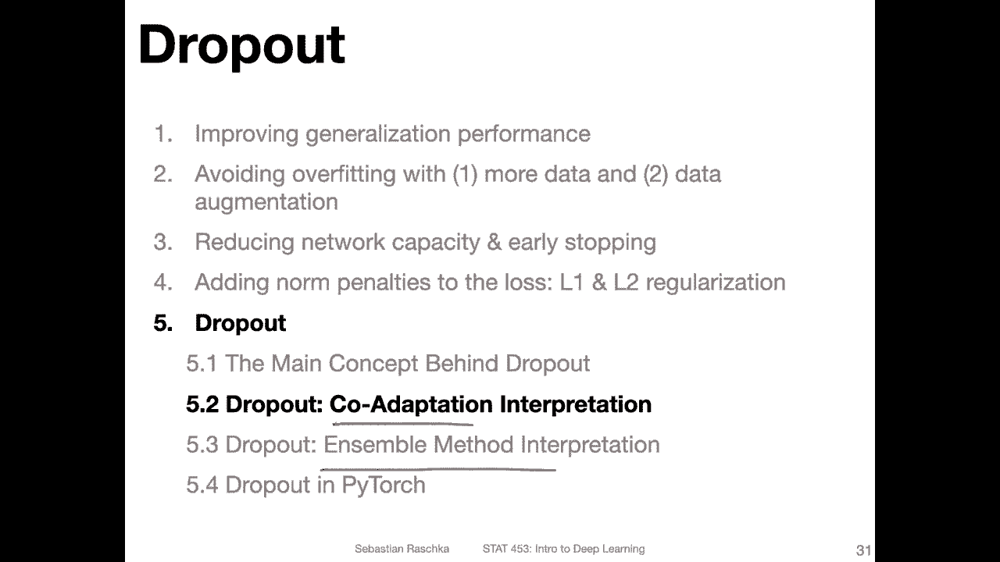
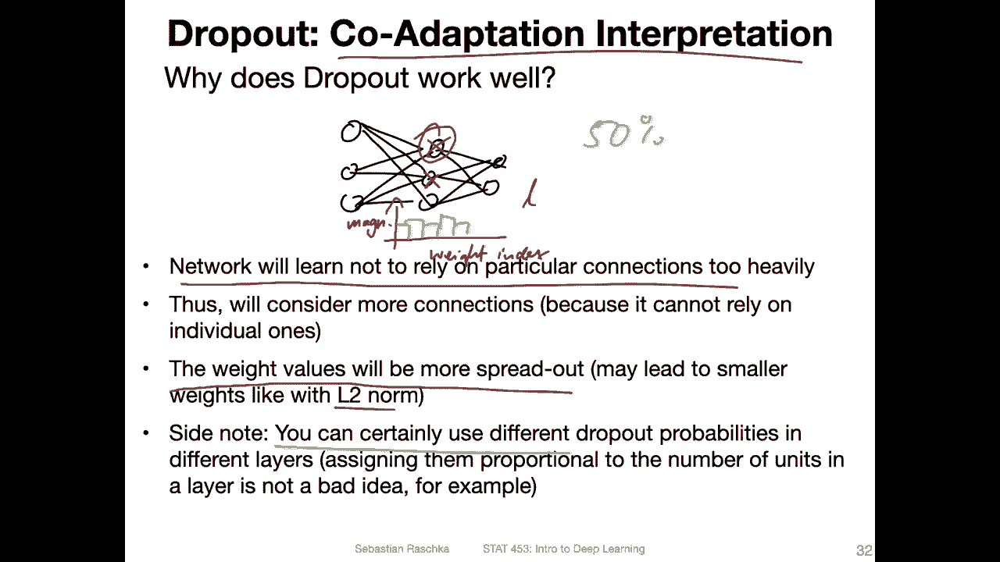
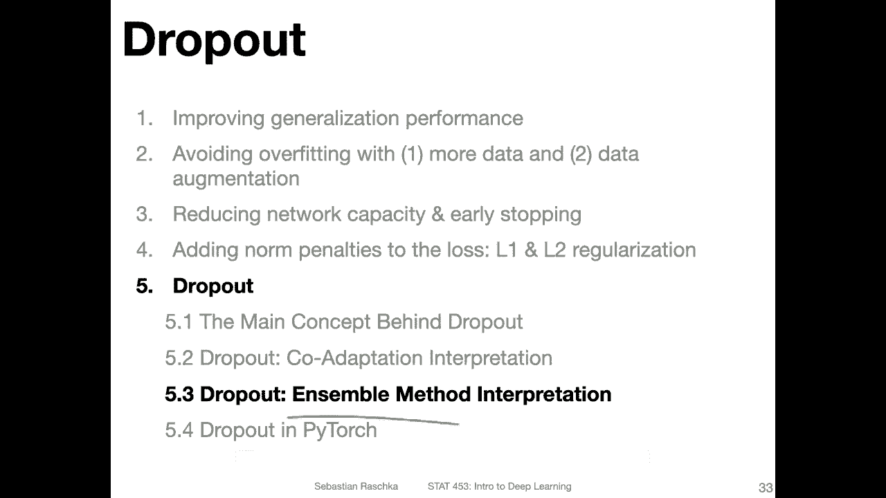

# 深度学习课程 P78：L10.5.2 - Dropout 共适应解释 🧠

在本节课中，我们将要学习 Dropout 正则化技术的一种重要理论解释——共适应理论。我们将探讨 Dropout 如何通过防止神经元之间的过度依赖来提升神经网络的泛化能力。



---

上一节我们介绍了 Dropout 的基本概念，本节中我们来看看 Dropout 在实践中为何有效，即它如何帮助模型更好地泛化到新数据（例如测试集数据）。一种解释是共适应理论，我们将在本节简要讨论它。

共适应解释的核心观点是：Dropout 会促使网络学习不过度依赖特定的连接。

这意味着，在一个全连接的多层感知机中，所有神经元通常都彼此相连。在训练过程中，Dropout 会随机地“丢弃”一些神经元。例如，如果某个神经元在训练时被随机屏蔽，网络就必须更多地依赖其他神经元来完成计算。反之亦然。

由于在训练过程中，被屏蔽的神经元组合总是在变化（可能是一个、多个，甚至没有神经元被屏蔽），网络无法过度依赖任何一个特定的神经元。这种方式会促使网络更均衡地考虑所有神经元。

这可能导致权重分布更加分散。网络会尝试将权重分配到所有神经元上，而不是让某个神经元的权重过大而其他神经元的权重过小。因为网络永远无法确保那个特定神经元一定会存在。

因此，从效果上看，Dropout 可能与 **L2 正则化** 有相似之处，都能使权重分布更均匀，而不是高度集中于少数神经元。权重分布可以表示为对权重向量的约束：

**公式：** `L2 正则化项 = λ * ||w||²`

一个有趣但尚未被广泛验证的想法是：可以绘制每层权重的分布图来观察这种效果。例如，在 Y 轴表示权重大小，X 轴表示权重索引。在应用 Dropout 之前，权重分布可能不均匀；而在应用 Dropout 之后，权重分布可能会变得更加均匀。这值得进一步探究。

此外，需要补充的是，你可以为不同的网络层设置不同的 Dropout 概率。以下是设置不同丢弃率的代码示例：

**代码：**
```python
# 示例：为不同层设置不同的 Dropout 率
model.add(Dense(128, activation='relu'))
model.add(Dropout(rate=0.5))  # 隐藏层1使用50%丢弃率
model.add(Dense(64, activation='relu'))
model.add(Dropout(rate=0.2))  # 隐藏层2使用20%丢弃率
```

你不必对每个隐藏层都使用 50% 的丢弃率。你可以使用 20%、80% 等不同的值。这也是一个需要选择的超参数。如何选择取决于具体的实验。50% 是原始论文中使用的值，但现在人们也常使用 20% 或 80%，这需要通过实验来确定。

---

总之，Dropout 之所以表现良好，一种解释是它防止了网络对特定节点的过度强调，从而可能使网络对输入波动更加鲁棒。





本节课中我们一起学习了 Dropout 的共适应理论解释。我们了解到，Dropout 通过随机屏蔽神经元，迫使网络学习更均衡、更分散的特征表示，这有助于提升模型的泛化能力。在下一节视频中，我们将简要讨论关于 Dropout 的另一种解释——集成方法解释。