# 课程 P80：L10.5.4 - PyTorch 中的 Dropout 🧠

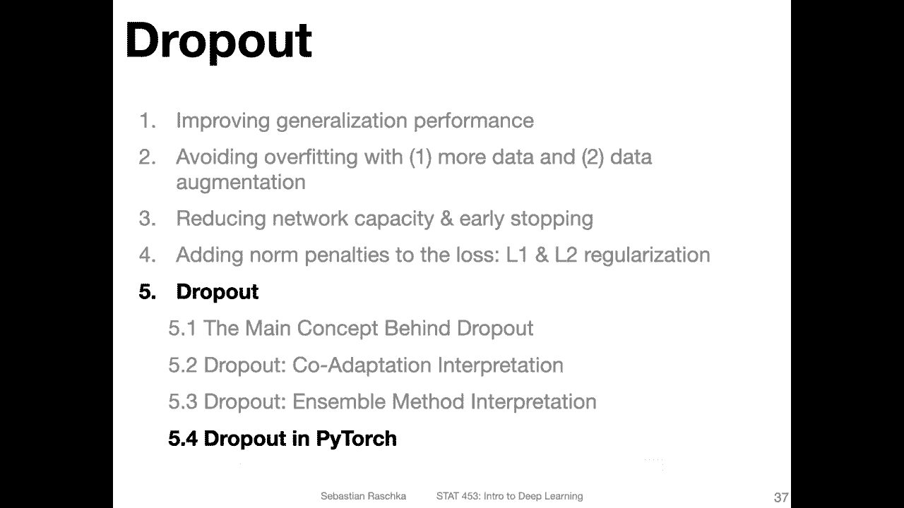

在本节课中，我们将学习如何在 PyTorch 中实际实现和应用 Dropout 技术。我们将从理解“反转 Dropout”的概念开始，然后通过代码示例展示如何在神经网络中添加 Dropout 层，并讨论相关的实践技巧。

---

## 反转 Dropout 的概念

上一节我们介绍了 Dropout 的基本原理，本节中我们来看看它在现代框架中的具体实现方式，即“反转 Dropout”。

在早期的常规 Dropout 中，我们在训练时随机丢弃神经元，而在测试时，为了补偿训练时因丢弃神经元而导致的激活值期望降低，我们需要将激活值按 `1 - p` 的比例进行缩放，其中 `p` 是丢弃概率。

**公式：** 测试时缩放因子 = `1 - p`

然而，在反转 Dropout 中，我们改变了这一操作的时间点。我们**在训练时**就对保留的激活值进行缩放（同样乘以 `1 - p`），而在测试时则无需进行任何缩放操作。PyTorch 等现代框架采用的都是反转 Dropout。

这样做的主要优势在于，它节省了测试或推理阶段的计算资源。对于需要处理海量预测请求的服务（如搜索引擎），避免在每次预测时都进行缩放操作可以显著减少计算开销。无论是常规 Dropout 还是反转 Dropout，最终效果是等价的，区别仅在于缩放操作是在训练阶段还是测试阶段执行。

---

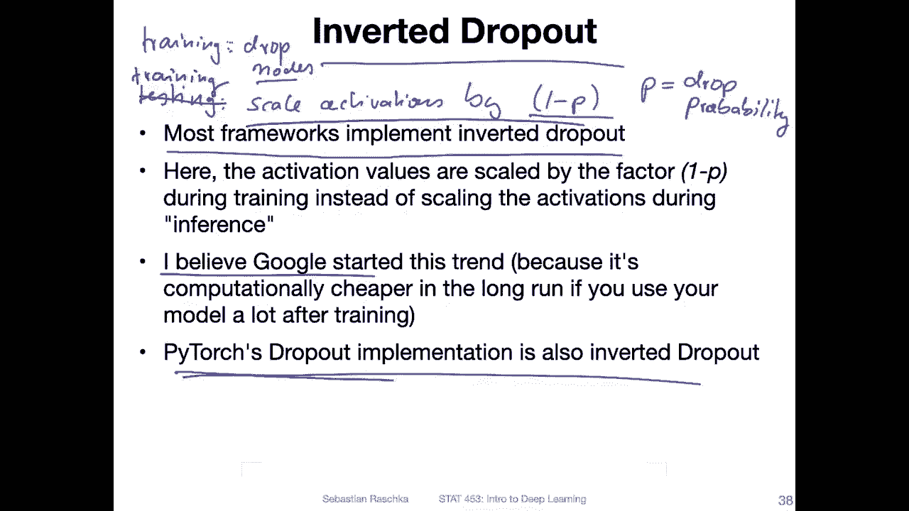

## 在 PyTorch 中使用 Dropout

理解了反转 Dropout 后，我们现在来看看如何在 PyTorch 模型中具体添加 Dropout 层。

以下是一个包含两个隐藏层的多层感知机示例代码片段，展示了如何在激活函数后添加 Dropout 层：

```python
import torch.nn as nn

class MLPWithDropout(nn.Module):
    def __init__(self, input_size, hidden_size1, hidden_size2, output_size, drop_prob):
        super(MLPWithDropout, self).__init__()
        self.model = nn.Sequential(
            nn.Linear(input_size, hidden_size1),
            nn.ReLU(),
            nn.Dropout(drop_prob),          # 在第一个隐藏层后添加 Dropout
            nn.Linear(hidden_size1, hidden_size2),
            nn.ReLU(),
            nn.Dropout(drop_prob),          # 在第二个隐藏层后添加 Dropout
            nn.Linear(hidden_size2, output_size)
        )
```

以下是关于代码的一些关键说明：

*   **放置位置**：通常将 `nn.Dropout` 放在激活函数（如 `nn.ReLU`）之后。对于 ReLU，放在之前或之后效果相同，因为输入为 0 时输出也为 0。但对于像 Sigmoid 这样的激活函数，输入为 0 时输出为 0.5，因此将 Dropout 放在激活之后是更一致和稳妥的做法。
*   **输出层**：我们通常不对输出层使用 Dropout，因为丢弃代表类别标签的神经元没有意义。
*   **丢弃概率**：`drop_prob` 是一个可以调节的超参数。不同层可以使用不同的丢弃概率。

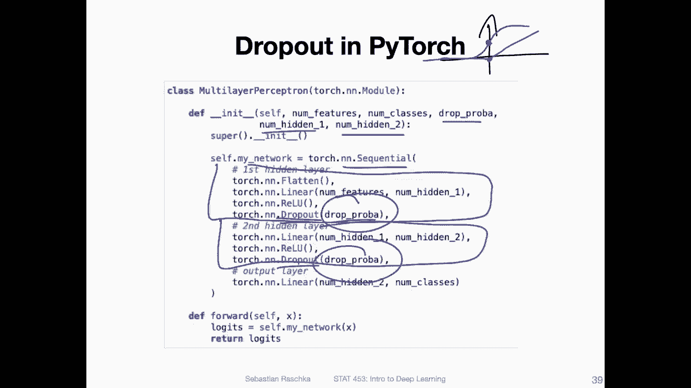

---

## 训练与评估模式的切换

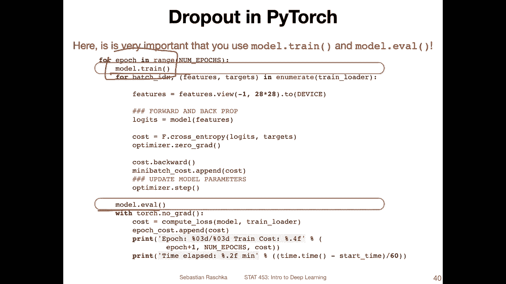

在 PyTorch 中使用 Dropout 时，一个至关重要的步骤是正确切换模型的模式。

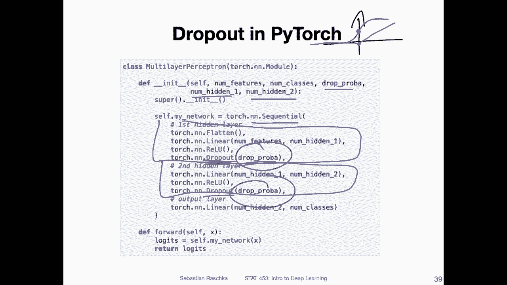

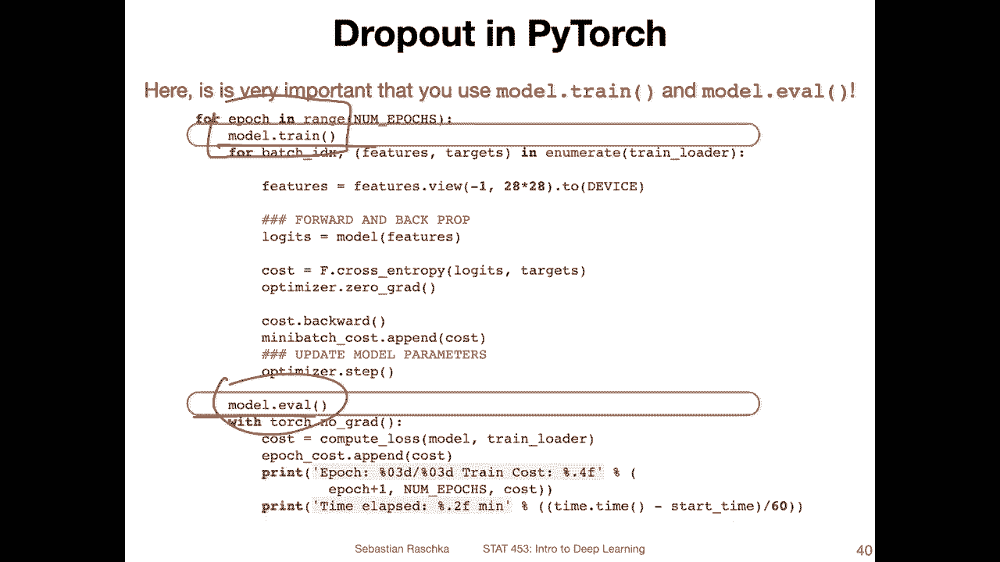

我们必须使用 `model.train()` 和 `model.eval()` 来明确告知模型当前是处于训练模式还是评估（测试）模式。这是因为 `nn.Dropout` 层的行为会随模式不同而改变：
*   在训练模式 (`model.train()`) 下，Dropout 层会按照设定的概率随机丢弃神经元。
*   在评估模式 (`model.eval()`) 下，Dropout 层会失效（相当于丢弃概率为 0），所有神经元都会参与前向传播。

这是一个良好的编程实践，即使不使用 Dropout，也建议在训练和评估时进行模式切换，以避免其他具有不同训练/评估行为的层（如 BatchNorm）出现意外结果。

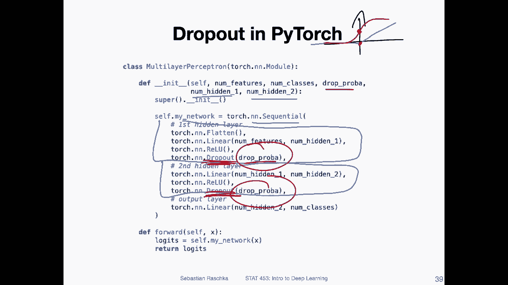

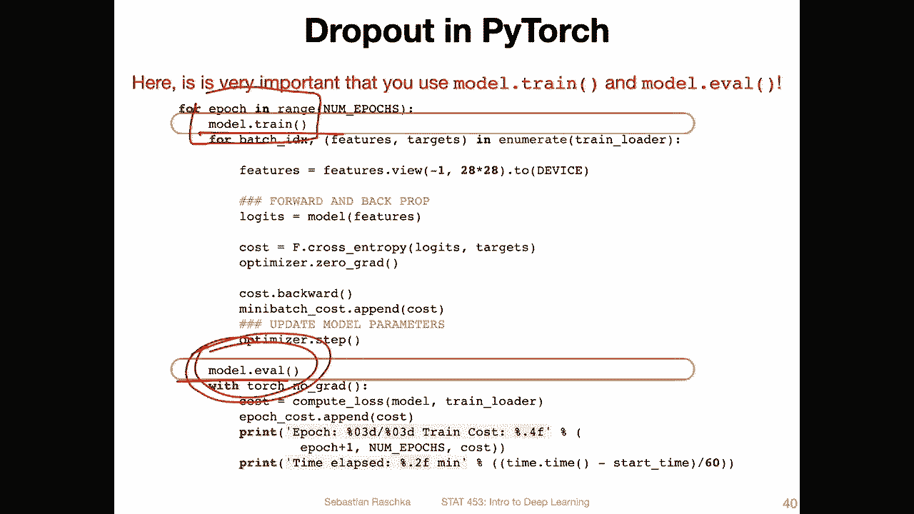

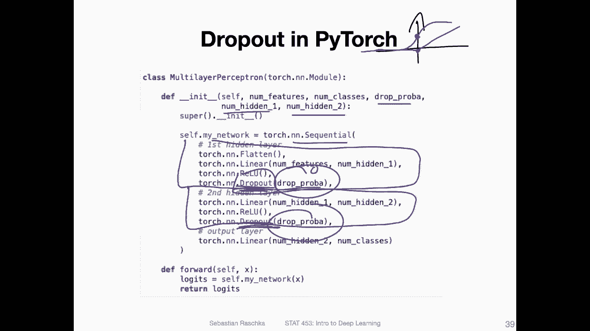

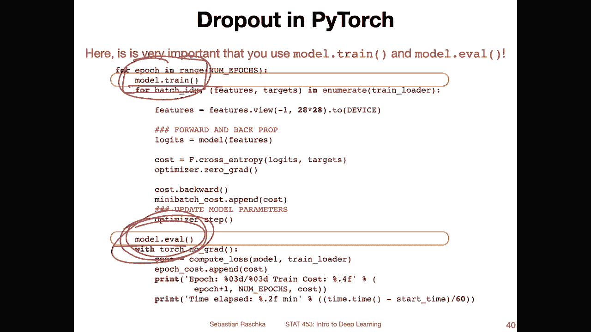

---

## 实践效果与技巧

我们通过一个在 MNIST 数据集上的实验来观察 Dropout 的效果。一个没有使用 Dropout 的模型在训练后期出现了明显的过拟合现象（训练准确率持续上升，但验证准确率停滞不前）。而添加了 50% Dropout 的模型有效地减少了过拟合，训练曲线和验证曲线更加接近。

基于此，我们可以总结出一些实践技巧：

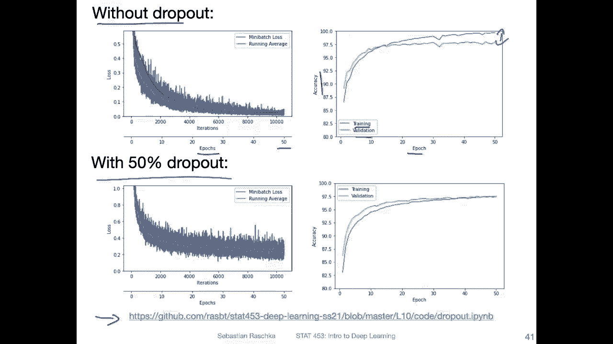

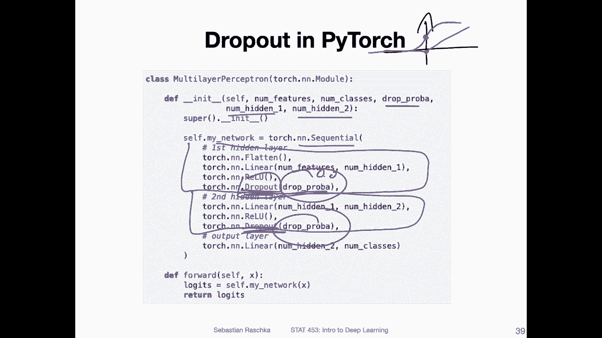

*   **何时使用**：如果模型没有出现过拟合，则没有必要使用 Dropout。建议先训练一个基线模型观察其表现。
*   **模型容量**：Dropout 的提出者建议，如果模型未过拟合，可以尝试增加模型容量（更多参数），使其先有过拟合的倾向，然后再加入 Dropout 来进行正则化。这通常比直接使用一个不会过拟合的小模型性能更好。
*   **超参数调整**：示例中 50% 的丢弃概率可能过高，虽然抑制了过拟合，但也可能导致最终性能略有下降。需要根据任务调整合适的丢弃概率。

---

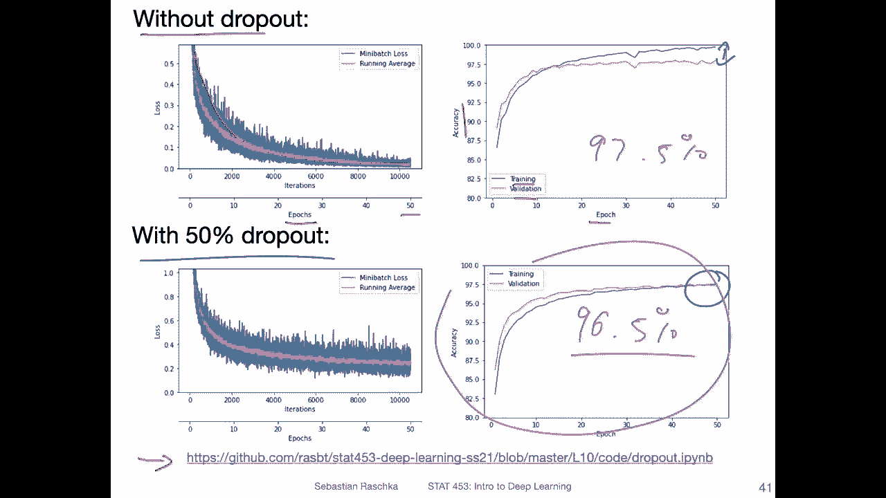

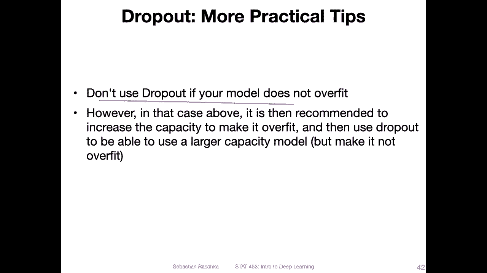

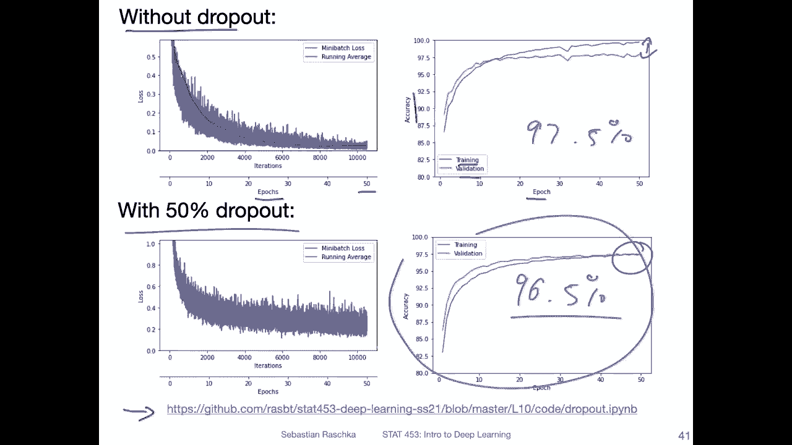

## 相关概念：DropConnect

在听课时你可能已经想到一个相关的思路：既然可以随机丢弃激活值，那么是否可以随机丢弃权重呢？

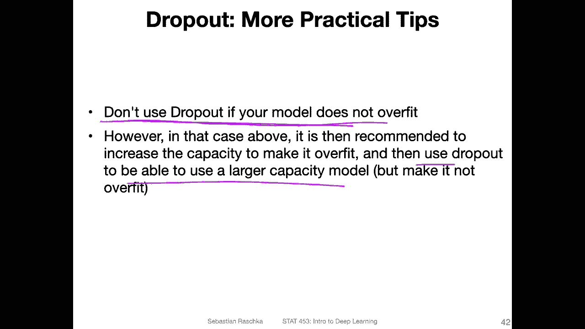

这个想法已经被研究并称为 **DropConnect**。它可以看作是 Dropout 的一种泛化。在 DropConnect 中，随机被设置为零的是层之间的权重，而不是神经元的输出。如果将一个神经元的所有输入权重都丢弃，其效果就等同于丢弃该神经元（即 Dropout）。

尽管这是一个有趣的想法，但在实践中，DropConnect 并不像 Dropout 那样常用和有效，大多数情况下 Dropout 仍然是首选的 regularization 技术。

---

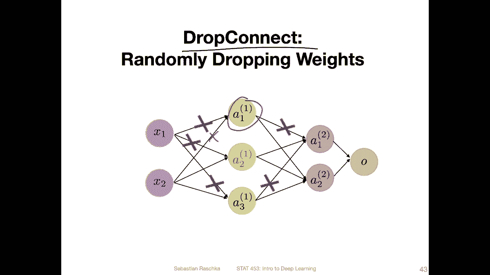

## 总结与延伸阅读

本节课中我们一起学习了如何在 PyTorch 中实现和使用 Dropout。

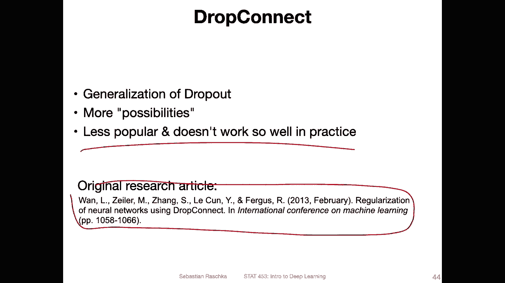

1.  我们了解了**反转 Dropout** 的概念及其优势。
2.  我们掌握了使用 `nn.Dropout` 模块在神经网络中添加 Dropout 层的**代码实现**，并注意了其放置位置和模式切换。
3.  我们讨论了 Dropout 的**实践效果**，包括其抑制过拟合的能力，以及何时使用、如何与模型容量配合等**实用技巧**。
4.  我们简要了解了与 Dropout 相关的 **DropConnect** 概念。

如果你想深入了解，推荐阅读原始的 Dropout 研究论文。它行文直观，易于理解，非常适合作为阅读科研论文的入门材料。

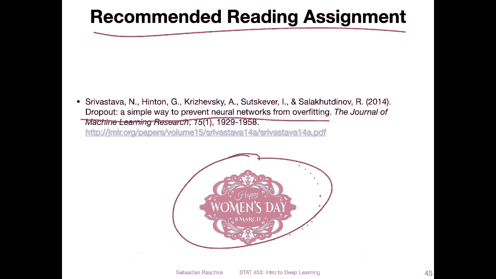

在接下来的课程中，我们将探讨权重初始化技术、学习率设置以及不同的优化器，这些都是提升神经网络训练效果的重要方法。