# 课程 P83：L11.2 - BatchNorm 的工作原理 📚

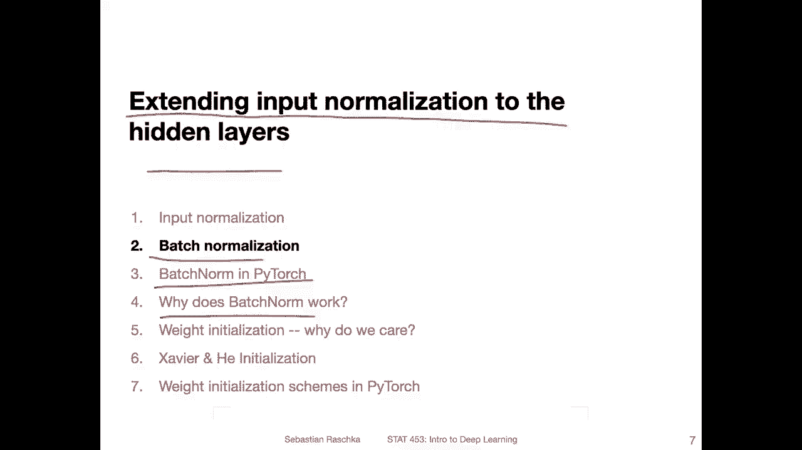

在本节课中，我们将学习一种名为 **批量归一化** 的技术。我们将了解它如何将输入归一化的思想扩展到神经网络的隐藏层，其工作原理，以及它为何能帮助提升训练过程的稳定性和速度。

---

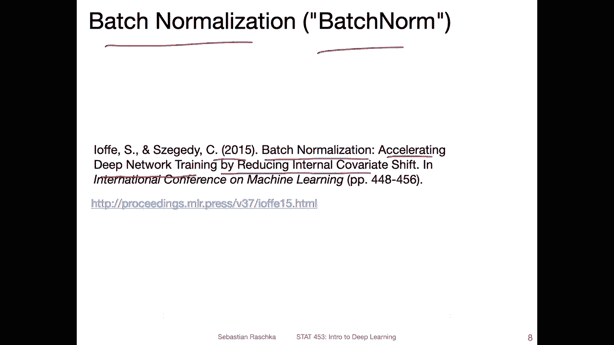

## 🧠 什么是批量归一化？

上一节我们讨论了输入数据的标准化。本节中，我们来看看如何将类似的思想应用到网络的内部。

批量归一化技术源于2015年的一篇论文，其核心思想是减少训练过程中网络内部特征的分布变化。这种内部特征分布的变化，有时被称为“内部协变量偏移”，可能导致梯度爆炸或消失等问题。

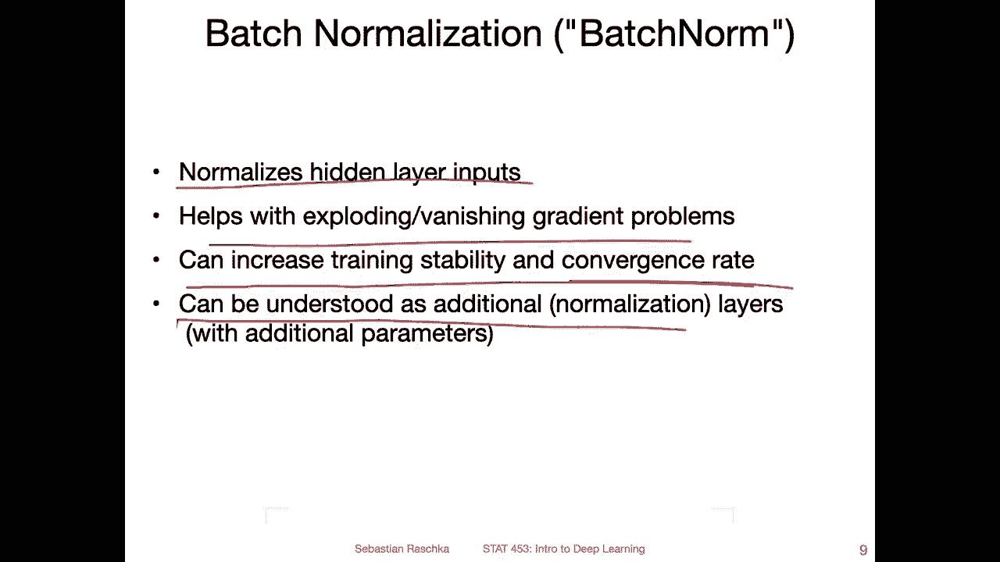

批量归一化通过在网络的每个隐藏层前增加一个归一化层来解决这个问题。它有助于稳定梯度，使训练过程更平滑，并通常能加快网络的收敛速度。你可以将其视为一个额外的、带有可学习参数的归一化层。

---

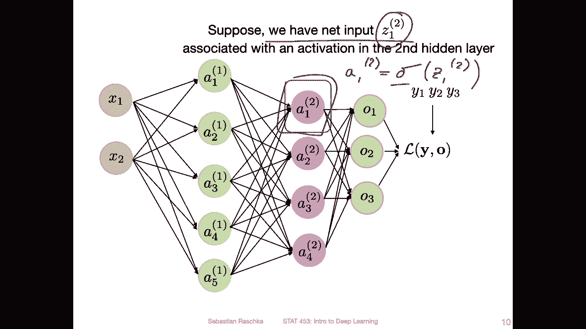

## 🔍 批量归一化的工作原理

接下来，我们将逐步拆解批量归一化的具体操作流程。为了便于理解，我们假设有一个多层感知机，并聚焦于第二个隐藏层中某个神经元的净输入。

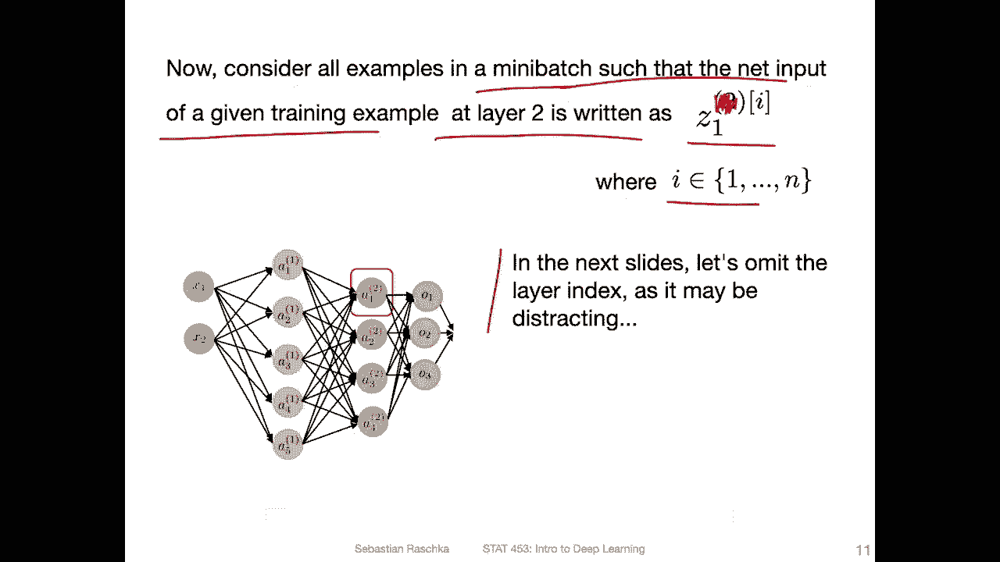

假设我们有一个小批量数据，对于该层中第 `i` 个训练样本的净输入，我们记为 `z_i`。为了简化表示，我们在接下来的讨论中暂时省略层索引。

### 第一步：归一化净输入

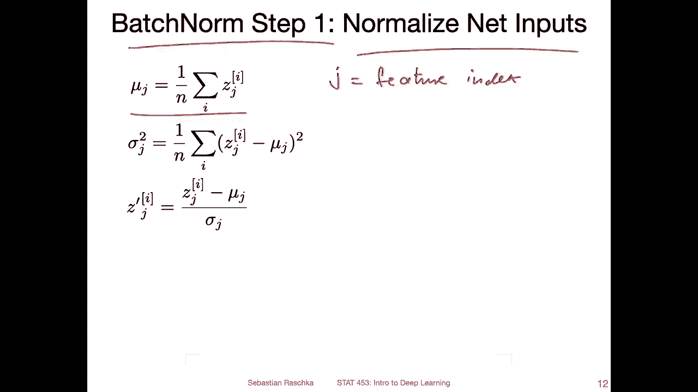

批量归一化的第一步是对净输入进行标准化处理，这与之前讨论的输入标准化原理相似，但对象是隐藏层的输入。

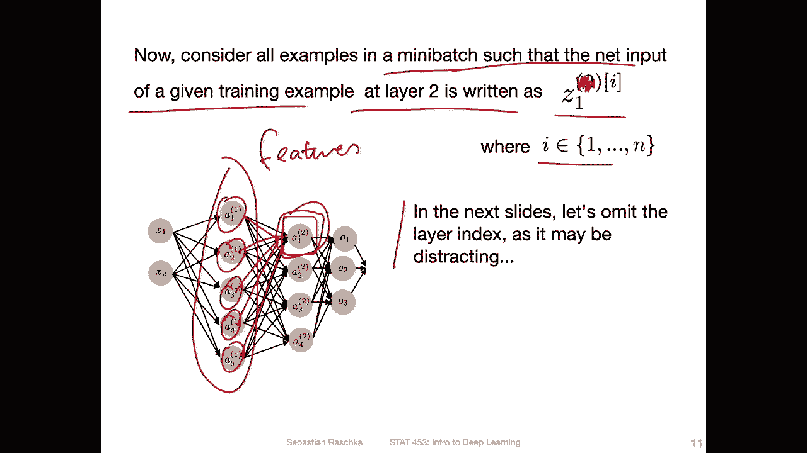

以下是计算步骤：

1.  **计算均值**：针对当前小批量数据，计算该层每个特征（即来自前一层的所有激活值）的均值。
    `μ_j = (1/m) * Σ_{i=1}^{m} z_{i,j}`

2.  **计算方差**：计算每个特征的方差。
    `σ_j^2 = (1/m) * Σ_{i=1}^{m} (z_{i,j} - μ_j)^2`

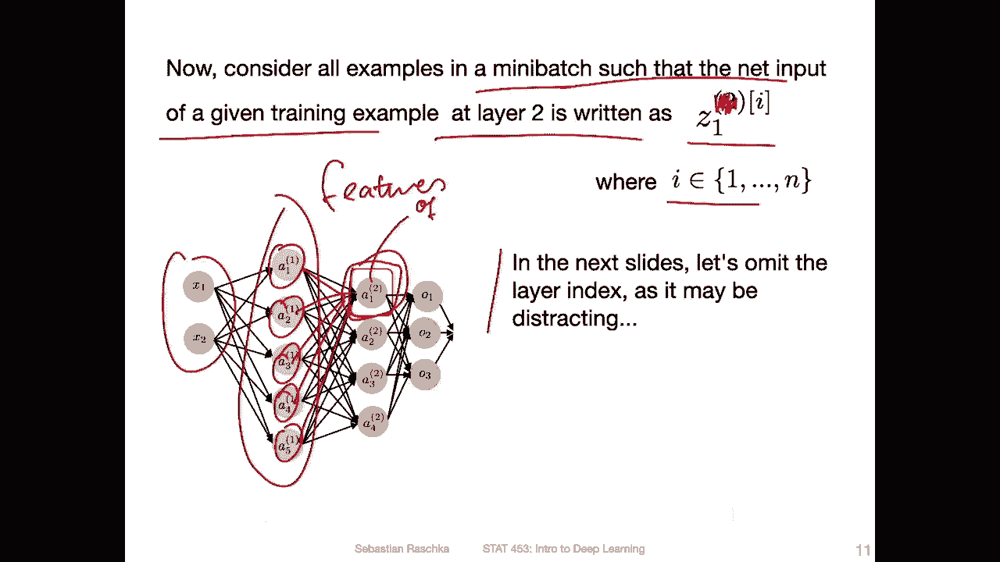

3.  **标准化**：使用计算出的均值和方差对每个特征进行标准化。
    `ẑ_{i,j} = (z_{i,j} - μ_j) / √(σ_j^2 + ε)`

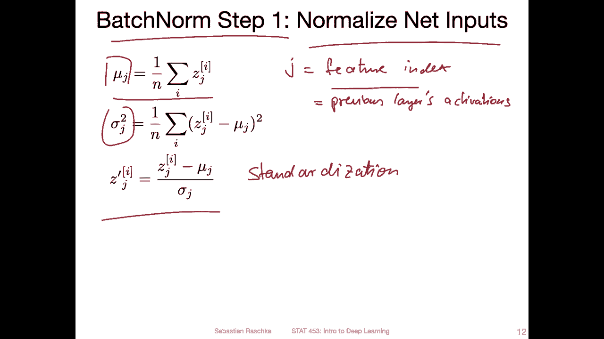

请注意，在方差项中我们添加了一个很小的常数 `ε`（例如 `1e-5`）。这是一个用于数值稳定性的技巧，目的是防止方差为零时出现除以零的错误。

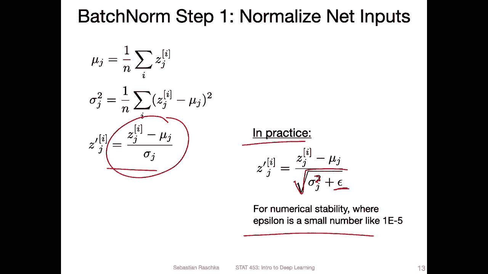

### 第二步：缩放与偏移

第一步的标准化可能会限制网络的表达能力。因此，批量归一化引入了第二步：可学习的缩放与偏移。

以下是第二步的操作：

`z̃_{i,j} = γ_j * ẑ_{i,j} + β_j`

在这里：
*   `γ_j`（伽马）是**缩放参数**，用于控制该特征分布的尺度（方差）。
*   `β_j`（贝塔）是**偏移参数**，用于控制该特征分布的中心（均值）。

这两个参数 `γ` 和 `β` 是**可学习的**，它们会像网络中的权重一样，通过反向传播算法进行更新。

这个设计的巧妙之处在于，网络可以**学习**是否需要以及如何调整第一步标准化后的结果。理论上，如果网络认为原始的、未标准化的分布更优，它可以通过学习令 `γ` 等于标准差、`β` 等于均值，从而“撤销”第一步的标准化操作。这使得批量归一化比单纯的标准化更加灵活和强大。

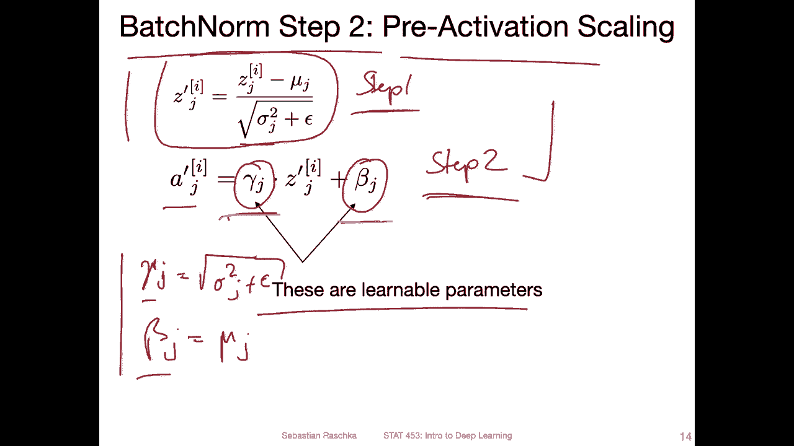

---

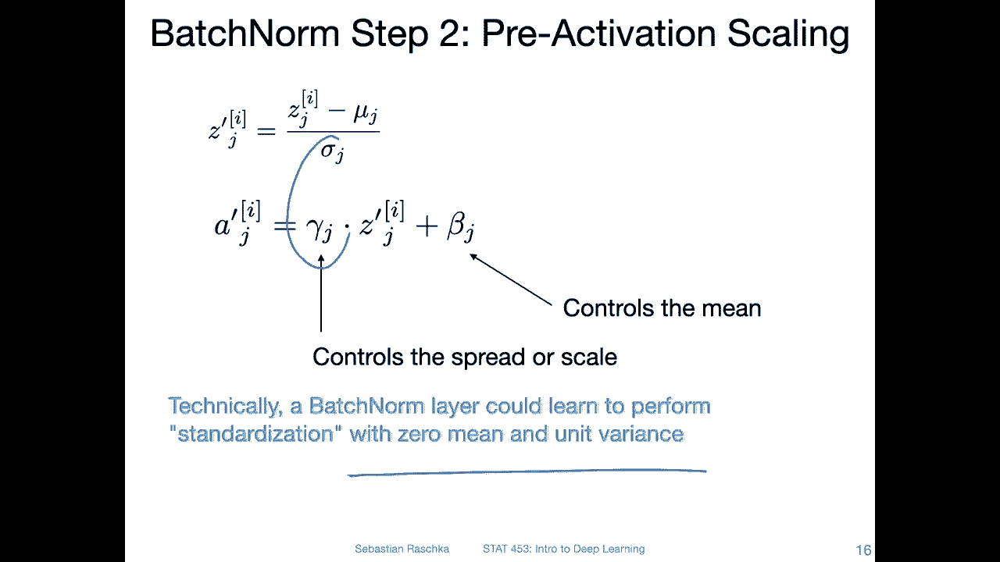

## 🧩 整合到网络前向传播中

现在，让我们把这两个步骤整合到网络的前向传播流程中来看。假设我们有一个简单的三层网络。

以下是包含批量归一化的前向传播过程：

1.  对于第一层，计算净输入：`z1 = W1 * x + b1`
2.  对 `z1` 应用**批量归一化**（第一步+第二步），得到 `z̃1`。
3.  计算第一层的激活值：`a1 = σ(z̃1)`，其中 `σ` 是激活函数。
4.  对于第二层，计算净输入：`z2 = W2 * a1 + b2`
5.  对 `z2` 应用**批量归一化**，得到 `z̃2`。
6.  计算第二层的激活值：`a2 = σ(z̃2)`。

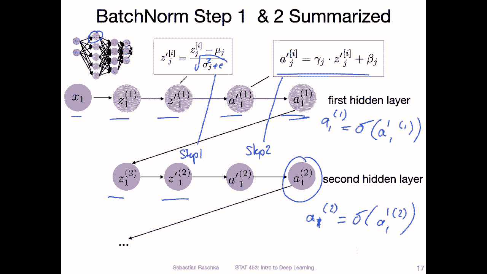

通过这种方式，批量归一化被无缝地集成到了每一层的计算中。

---

## 💡 重要细节与影响

在实施批量归一化时，有几个关键点需要注意：

*   **偏置项变得冗余**：由于批量归一化中的 `β` 参数已经起到了偏移作用，原始层中的偏置项 `b` 就变得不再必要。在实践中，我们通常在使用了批量归一化的层中省略偏置项，以使模型更简洁。
*   **增加了可学习参数**：批量归一化为每个特征引入了两个可学习参数（`γ` 和 `β`）。虽然这略微增加了模型的复杂度，但带来的训练稳定性和速度提升通常是值得的。
*   **反向传播**：批量归一化层的梯度计算比普通层更复杂，因为它依赖于整个小批量的统计信息。不过，在现代深度学习框架（如PyTorch、TensorFlow）中，这些计算都由自动微分系统自动处理，我们无需手动实现。

---

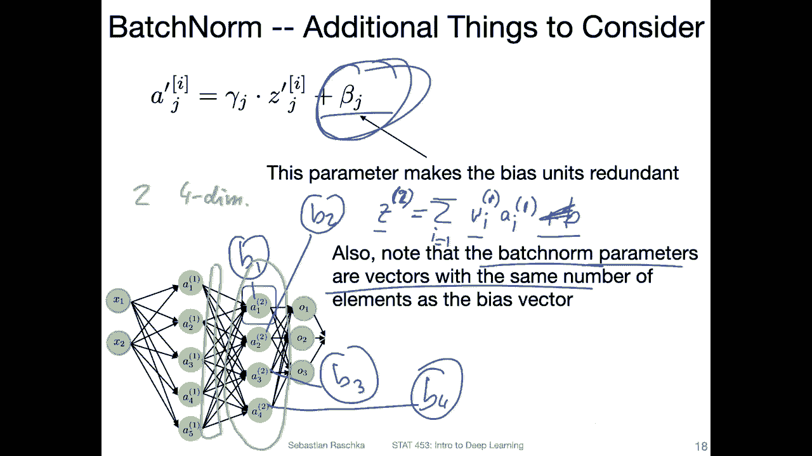

## 📝 总结

本节课中我们一起学习了批量归一化的工作原理。我们了解到：

1.  批量归一化通过标准化每一隐藏层的输入，来缓解训练中的内部协变量偏移问题。
2.  其操作分为两步：**标准化净输入**（减去均值、除以标准差）和**可学习的缩放与偏移**（通过 `γ` 和 `β` 参数）。
3.  这使得训练过程更稳定，收敛更快，并减少了对参数初始化的依赖。
4.  在实践中，使用批量归一化的层通常可以省略偏置项。

在下一节课中，我们将在代码中实际应用批量归一化，并进一步探讨其有效性的理论解释。