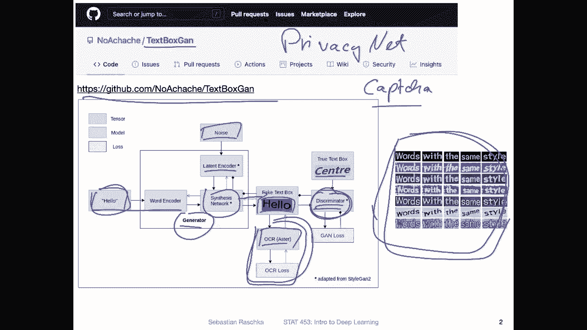
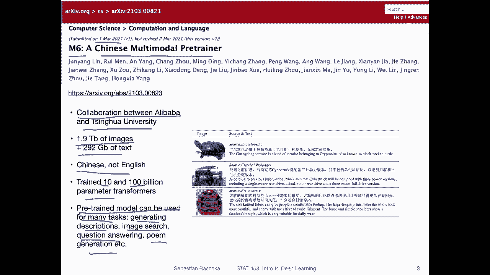
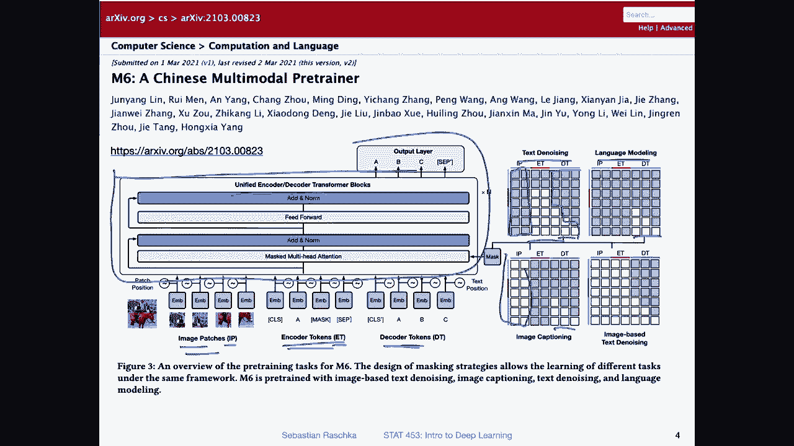
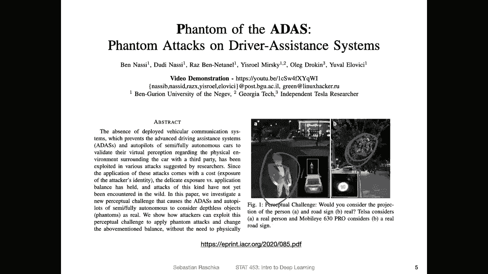
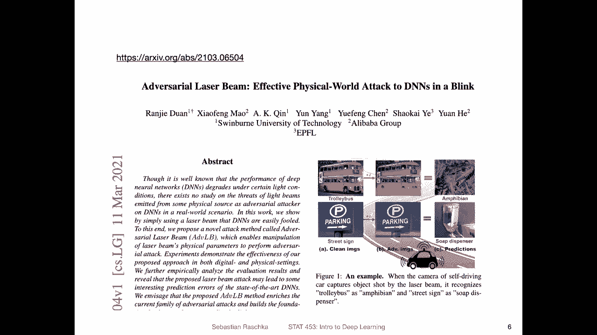
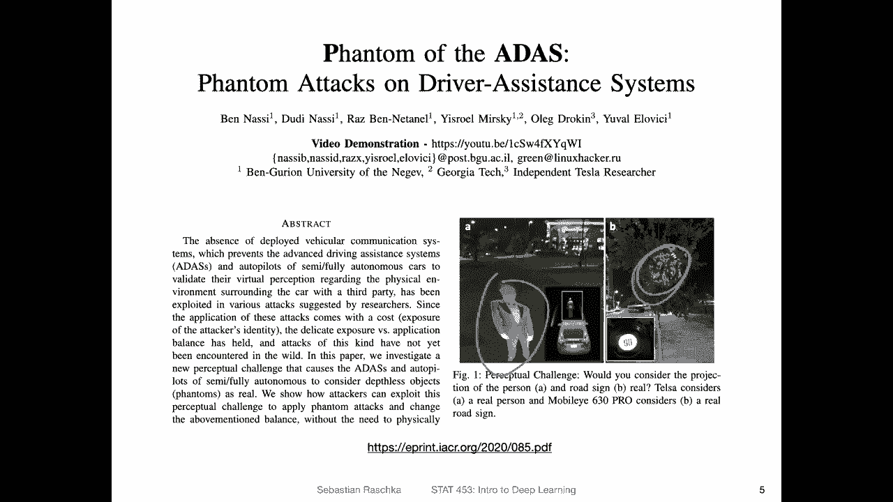
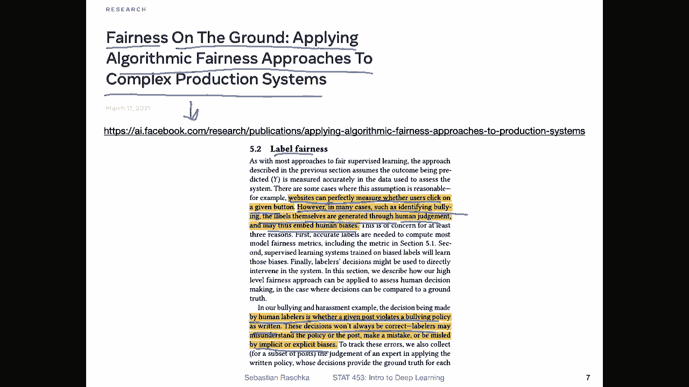
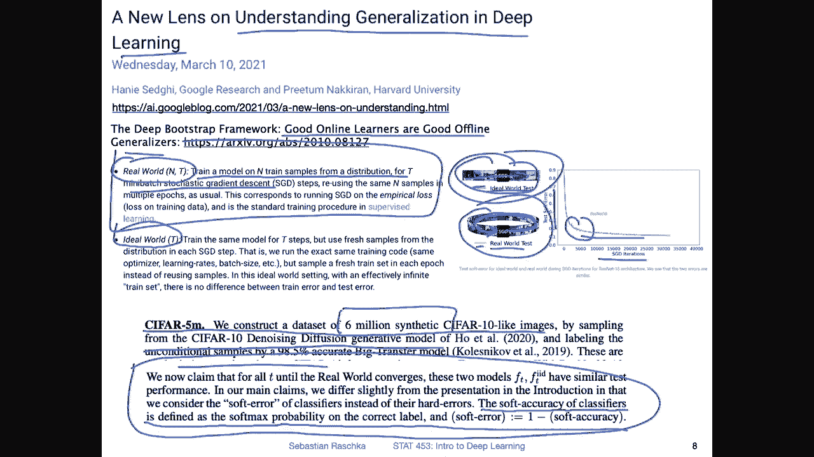
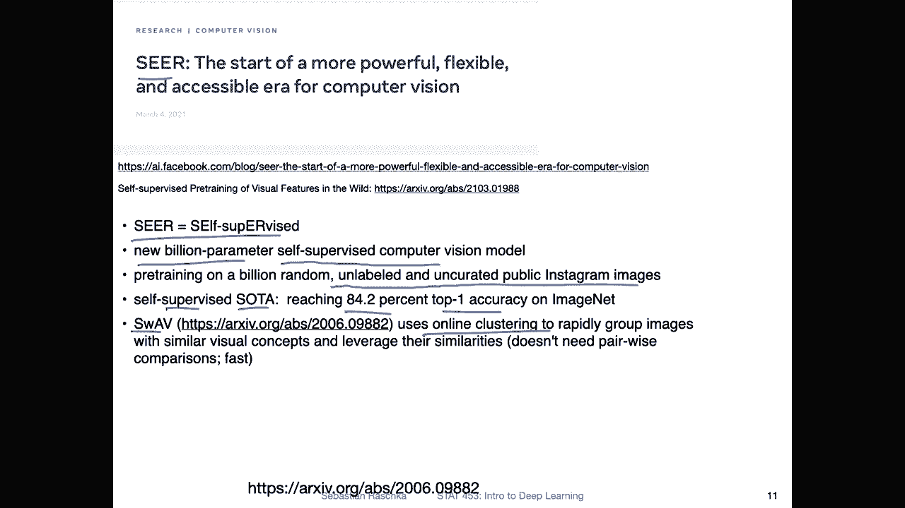
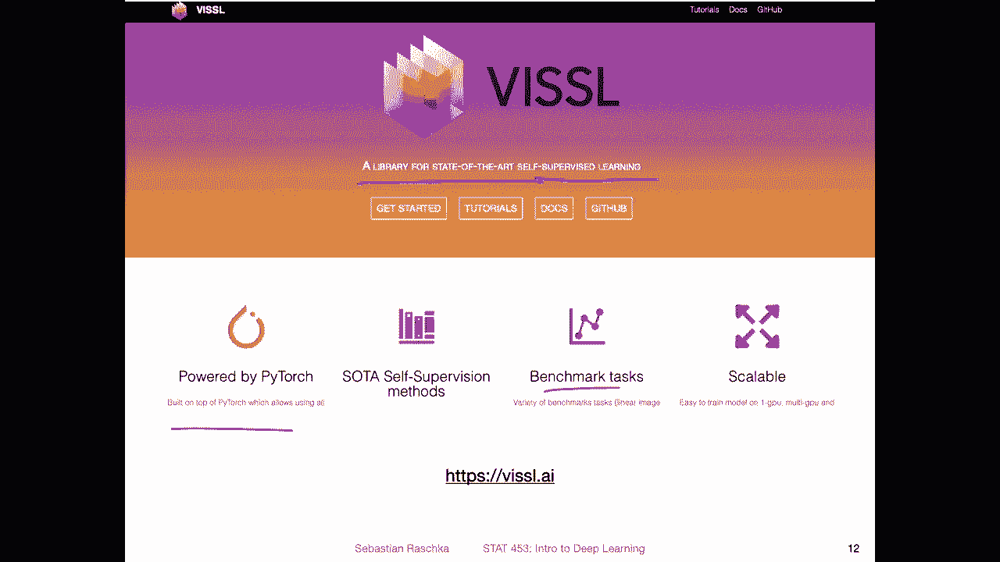

# 深度学习新闻 #7 2021年3月13日 📰

在本节课中，我们将回顾2021年3月13日发布的一期深度学习新闻。内容涵盖从生成对抗网络的有趣应用到大型多模态模型，再到深度学习系统的安全性与公平性等广泛主题。我们将以简单直白的方式介绍这些概念，并确保初学者能够理解。

---

## 🤖 项目一：文本盒生成器

首先介绍的项目是一个文本盒生成器。这是一个生成对抗网络的应用实例，用于生成包含特定文本的新图像。

生成对抗网络通常由两部分组成：**生成器**和**判别器**。生成器的目标是生成模仿训练集数据的新数据，而判别器的任务是区分生成器产生的“假”数据和真实的训练集数据。生成器通过学习来“欺骗”判别器，使其无法区分生成图像和真实图像。

在这个项目中，生成器不仅接收噪声向量作为输入，还接收一个文本编码器输入的单词。为了确保生成的图像中包含指定的文本，项目还引入了一个OCR模块来验证输出图像中的文本是否与输入单词匹配。

**核心流程公式化描述如下：**
1.  噪声向量 `z` 和单词编码 `w` 作为输入。
2.  生成器 `G(z, w)` 输出合成图像。
3.  判别器 `D(x)` 判断图像 `x` 是真实的还是生成的。
4.  OCR模块 `O(x)` 提取并验证图像中的文本。

以下是该项目的一些关键点：
*   这是一个将GAN应用于特定领域（文本嵌入图像）的简洁示例。
*   作者在GitHub仓库中提供了清晰的工作原理描述。
*   这种方法通过附加约束（如指定文本）来控制生成内容。

---

## 🐉 项目二：M6 - 中文多模态预训练模型

上一节我们介绍了一个小型的GAN应用，本节中我们来看看一个大型项目：M6。这是一个由阿里巴巴和清华大学合作开发的中文多模态预训练模型。

M6模型在1.9万亿张图像和292GB文本数据上进行了训练。其新颖之处在于它是针对中文，而非英文开发的。中文的字符系统比英文的26个字母更为复杂，因此这是一个有趣的研究案例。

他们训练了两个版本的Transformer模型，参数量分别为100亿和1000亿。该模型采用自监督预训练，预训练后的模型可以用于多种下游任务，如图像描述生成、图像搜索、问答和诗歌生成等。

那么，他们是如何让一个模型适应这么多不同任务的呢？关键在于**掩码策略**。模型被称为“统一编码器-解码器”。根据不同的任务，他们对输入进行不同类型的掩码。

以下是不同任务对应的输入掩码示例：
*   **文本去噪**：使用编码器令牌和解码器令牌，掩码掉部分图像块。
*   **语言建模**：仅使用解码器令牌。
*   **图像描述生成**：使用图像块和解码器令牌。

通过这种灵活的掩码方式，他们得以用单一模型处理多种任务。

---

## 🚗 项目三 & 四：自动驾驶系统的脆弱性

接下来，我们转向深度学习在现实世界应用中的安全性问题。有两个项目揭示了自动驾驶系统可能面临的攻击。

第一个项目展示了如何通过将街道标志投影到树木等物体上来欺骗特斯拉的自动驾驶系统。攻击者甚至可以将 Elon Musk 的轮廓投影到路上，导致车辆误认为有行人而紧急刹车。

第二个更新的项目则使用激光束进行攻击。研究者将激光束投射到摄像头的视野中，同样能误导自动驾驶汽车。这种攻击方式可能更令人担忧，因为激光设备更易于携带和隐藏。

这些研究突出表明，要确保自动驾驶汽车的安全，我们仍有很长的路要走。

---

## ⚖️ 项目五：机器学习中的公平性

与安全性相关的一个重要议题是公平性。Facebook本周发布了一篇关于算法公平性的博客文章，并链接了一篇研究论文。

实现公平的机器学习系统是一个复杂的挑战。其中一个关键点是**标签公平性**。在实践中，我们通常假设数据集中的标签是正确且客观的“地面真相”。但在现实世界中，情况并非总是如此。

例如，测量用户是否点击了网页按钮是明确且可客观度量的。然而，对于识别网络欺凌这类任务，标签通常由人工标注者根据既定政策来判断。不同的人可能对政策有不同的理解和应用，从而引入显性或隐性的偏见。因此，这些标签可能并不总是绝对正确的“真相”，这给机器学习应用带来了额外的复杂性。

对于课程项目，一个有益的做法是：从你的数据集中抽取一个样本（例如100张图像），在不看标签的情况下尝试自己进行分类，然后计算你的准确率。这能帮助你直观感受任务的难度，并反思数据标签的可靠性。

---

## 📊 项目六：从在线与离线学习视角理解泛化

本周课程讨论了提升模型泛化性能的方法，与此相关的一篇有趣论文探讨了从在线学习和离线学习角度理解泛化。

论文标题为《好的在线学习者也是好的离线泛化者》。研究者比较了两种场景：
1.  **现实世界**：我们拥有固定的训练集，使用小批量随机梯度下降进行多轮训练。
2.  **理想世界**：拥有无限数据流，每次从小批量都从数据分布中全新采样，没有重复的“轮次”。

研究发现，在这两种场景下，模型在测试集上最终达到的泛化性能**没有显著差异**。这意味着，在固定数据集上重复训练（离线学习）与持续接收新数据训练（在线学习），最终得到的模型能力是相近的。

**研究的一个注意事项**：他们的“理想世界”数据是通过一个生成模型合成的CIFAR-10类图像，并使用另一个高精度模型为其打上标签。此外，他们报告的是“测试软错误”（基于softmax概率的准确率），而非传统的测试准确率。

为了确保结论的普适性，他们在不同模型架构上也观察到了相同的效应。

---

## 🔄 项目七：预训练与自监督学习的作用

上一节的研究还涉及了预训练的影响。论文发现，使用在ImageNet上预训练的模型权重进行初始化，相比随机初始化，能**更快地达到更高的性能**，并且最终性能也显著更优。

**预训练**，特别是**自监督学习**，是提升模型性能的强大工具。自监督学习是一种利用无标签数据自身结构来生成监督信号进行预训练的方法。

本周另一个相关项目是SEER。研究者利用从Instagram获取的10亿张无标签图像，通过自监督学习（使用高效的在线聚类算法SwAV）训练了一个十亿参数的模型。该模型在ImageNet上达到了84.2%的top-1准确率，创造了自监督学习的新纪录。

为了方便研究者进行自监督学习的研究和比较，社区还推出了一个**基准测试库**。该库提供了预训练的自监督模型和标准评测流程，支持PyTorch框架，是探索自监督学习的一个实用工具。

---

## 🎯 总结

本节课中我们一起学习了2021年3月中旬深度学习领域的多项进展。我们从一个小型的文本盒生成器GAN应用开始，探讨了大型中文多模态模型M6的架构与训练策略。接着，我们审视了深度学习在自动驾驶系统中暴露出的安全性脆弱点，并讨论了构建公平机器学习系统所面临的挑战。最后，我们通过研究理解了在线与离线学习在泛化性能上的关系，并看到了预训练与自监督学习对于提升模型性能的关键作用。这些内容展示了深度学习领域的活力与多样性，以及其在迈向实际应用过程中需要持续关注的技术与伦理问题。