# 课程 P9：L1.4 - 监督学习工作流程 📊

在本节课中，我们将详细学习监督学习的工作流程，并介绍机器学习中必要的符号和术语，为后续课程打下基础。

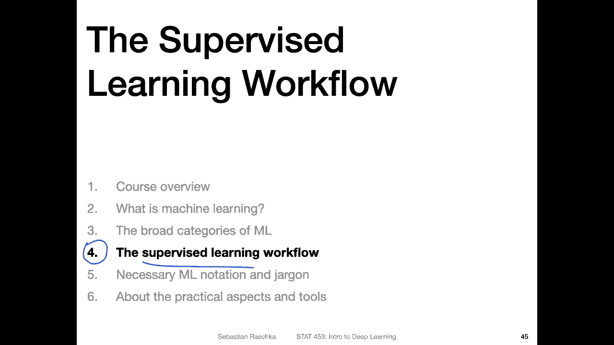

## 概述

上一节我们介绍了机器学习及其三大类别。本节中，我们将更深入地探讨监督学习的工作流程，并学习一些在本课程中会用到的核心数学符号和术语。

## 监督学习工作流程

监督学习是回归或分类的过程，主要包含两个步骤：训练步骤和推理步骤。在深入推理步骤之前，我们先看看训练步骤。

想象你有一个训练数据集，任务是进行分类。我们以一个简单的花朵分类为例。你收集了多种花朵的图像作为训练数据集，并咨询专家为这些图像提供了标签。这些标签是你想要预测的目标，而花朵图片则是你的观测数据。

在传统机器学习中，你需要从图像数据中提取特征。这通常需要领域专家的意见，以确定哪些特征是有效的。例如，潜在的特征可能包括花朵的颜色、高度或叶片的数量。提取特征后，结合标签，你就可以训练一个机器学习模型来进行预测。

训练模型后，我们的目标是使用它对新数据进行预测。例如，开发一个网站，用户可以上传花朵图片，你的模型就能预测花朵类型。对于新图像，你需要使用与训练时相同的特征提取步骤，然后将数据输入模型以预测新标签。这个过程如今常被称为“推理”。

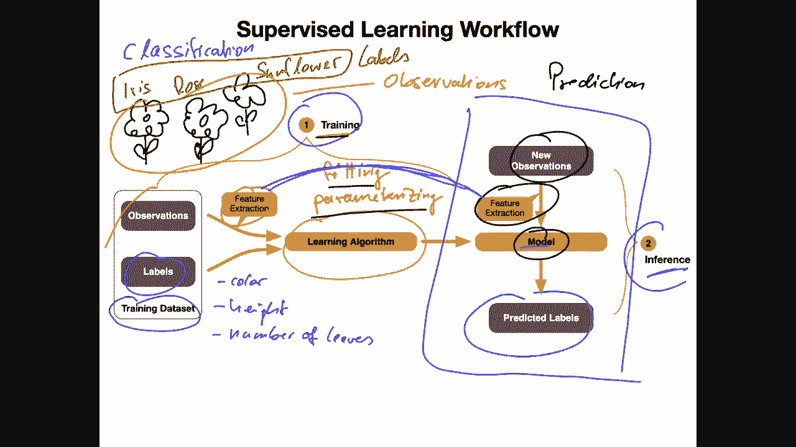

## 模型评估

在将模型部署到现实世界之前，我们需要评估其性能。评估过程与推理步骤类似，但我们使用一个独立的测试集。

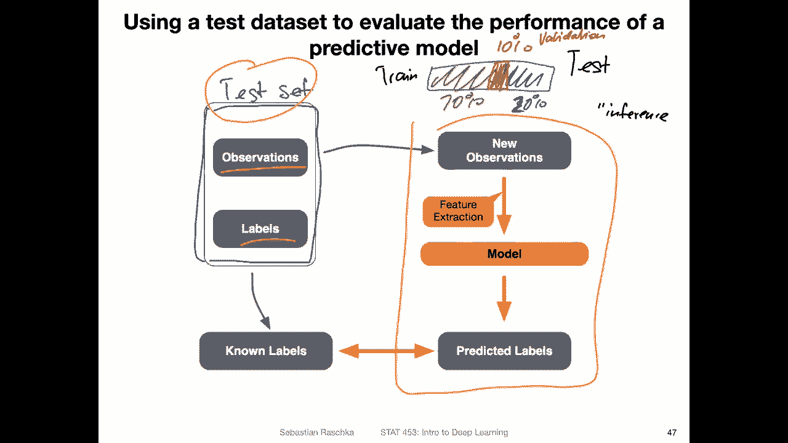

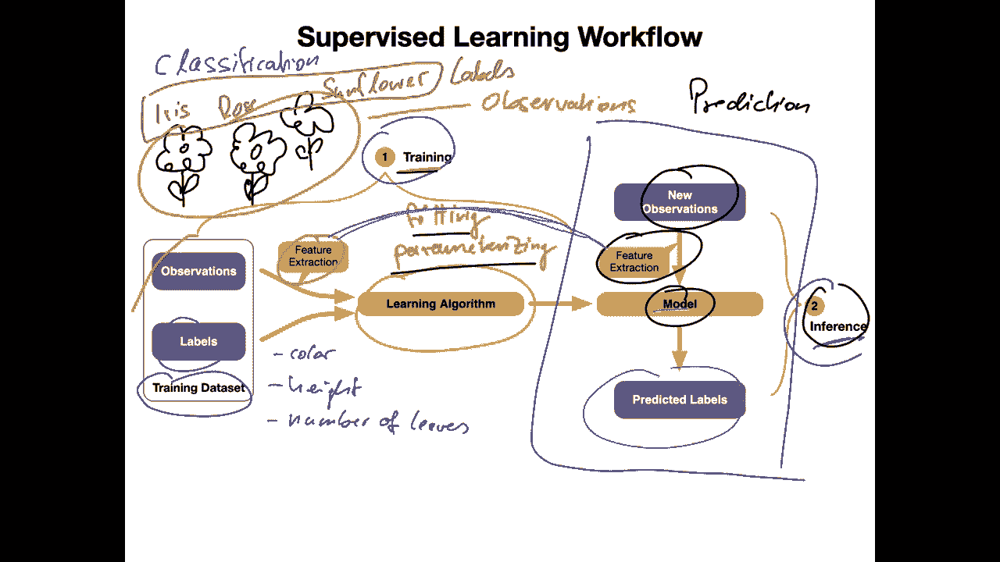

如果你有一个大型数据集，通常的做法是将其随机打乱，然后划分为训练集（例如70%）、测试集（例如20%）和验证集（例如10%）。验证集用于调整模型参数，我们将在后续看到代码示例时详细讨论。

对于测试集，我们将其观测数据输入模型进行预测，同时保留其真实标签。然后，我们将模型预测的标签与已知的真实标签进行比较。通过计算正确预测的次数占总测试数据点的比例，我们可以得到模型的准确率。相应地，错误率则是1减去准确率。

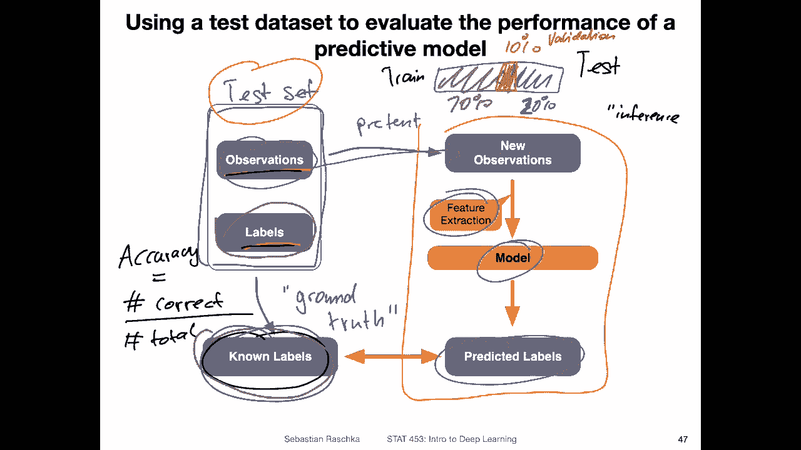

## 结构化与非结构化数据

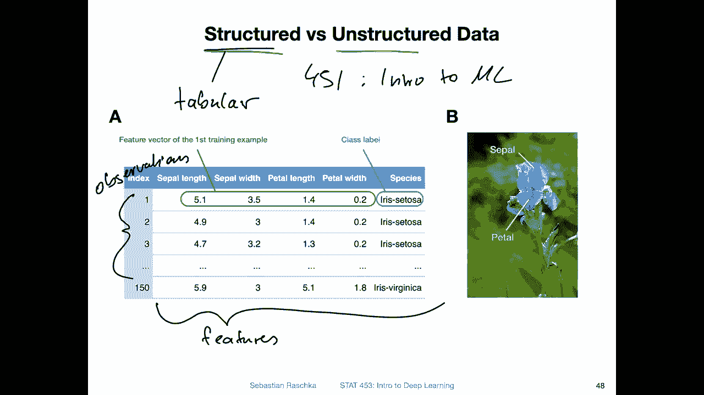

接下来，我们简要讨论结构化数据和非结构化数据的区别。

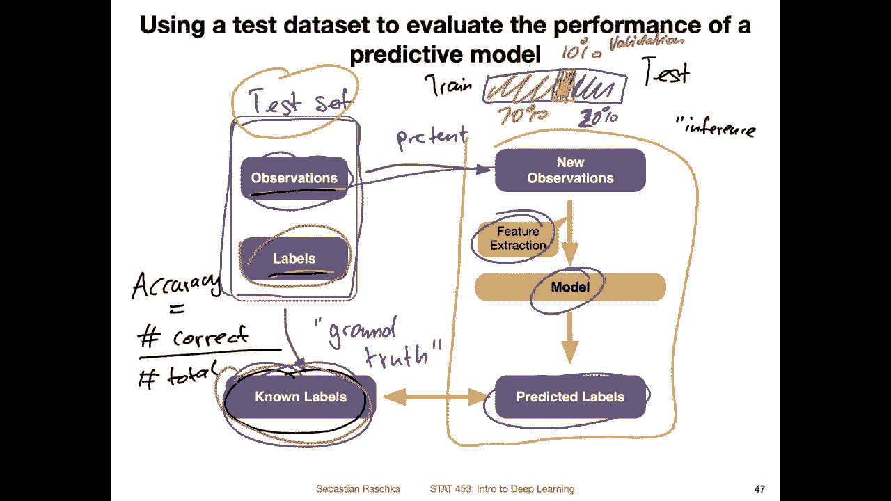

结构化数据集可以看作是一个表格。在这个表格中，列代表特征，行代表观测数据。例如，在花朵分类中，经过特征提取后，你可能会得到一个包含花萼长度、花萼宽度、花瓣长度和花瓣宽度等特征列的表格，以及一个标签列。这就是一个结构化数据集的例子。

相比之下，非结构化数据就是原始数据本身，例如原始的图像。你可以从非结构化数据中提取出结构化数据，但这并不总是简单的过程，有时需要人工协助。

结构化数据通常用于传统机器学习，而非结构化数据则适用于深度学习。因为深度学习模型内部隐含了特征提取的步骤。然而，深度学习的缺点是通常需要更多的数据。例如，一个只有150个样本的花朵数据集，使用随机森林等传统算法可能轻松达到99%的准确率；但若想用深度学习达到相近的性能，则可能需要至少上万张图像。

## 工作流程对比

下图很好地总结了传统机器学习与深度学习在工作流程上的区别。

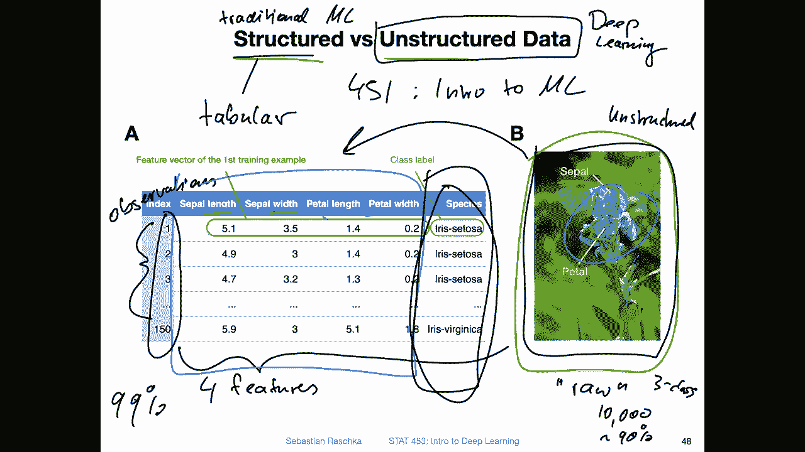

在深度学习流程中，你将原始数据直接输入网络这个“黑箱”，然后得到预测输出。而在传统机器学习流程中，需要人工从数据中提取手工设计的特征，然后将这些特征提供给机器学习系统进行预测。

结合花朵分类的例子：在深度学习情境下，你只需将原始图像输入模型，模型会自行学习如何提取有效特征。而在传统机器学习流程中，你需要先手工测量并提取特征（如花萼和花瓣的尺寸），再将它们输入模型。

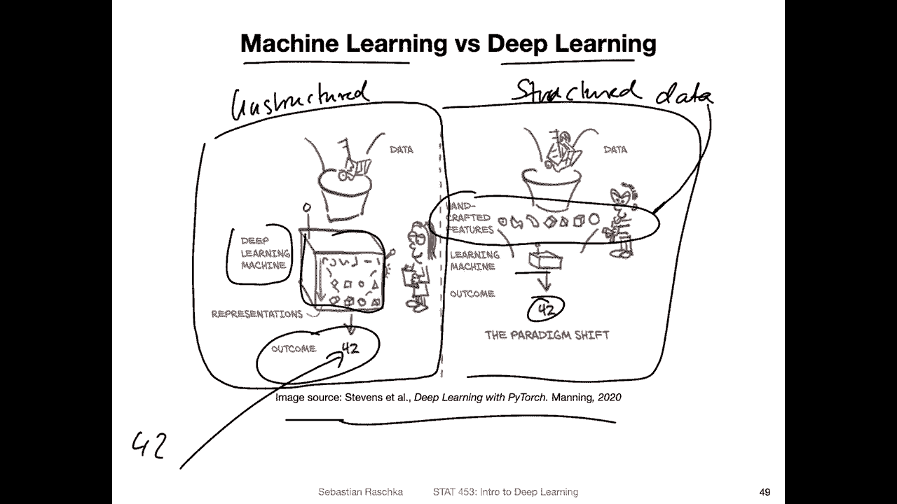

## 总结

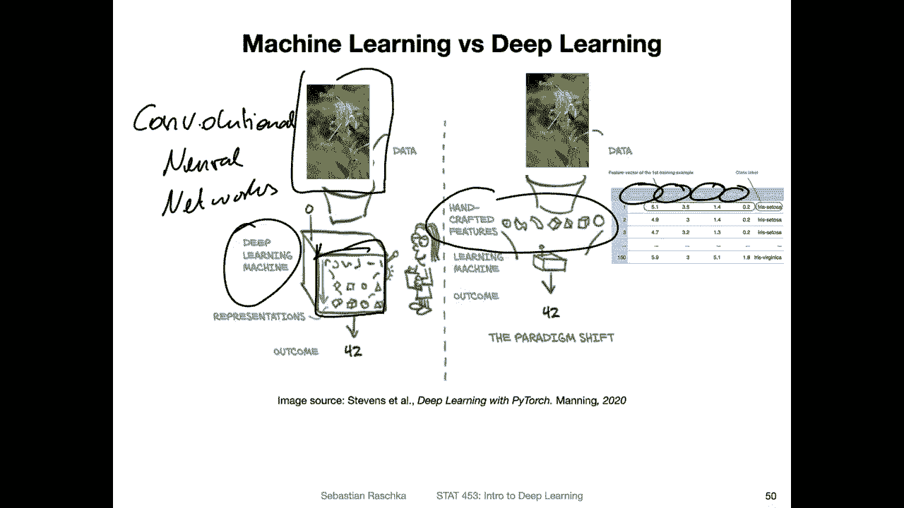

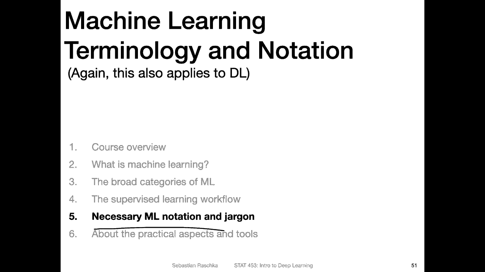

本节课我们一起学习了监督学习的完整工作流程，包括训练、推理和模型评估。我们还区分了结构化数据与非结构化数据，并对比了传统机器学习与深度学习在处理这两种数据时的不同路径。理解这些基础概念和流程，是掌握后续更复杂机器学习与深度学习主题的关键。