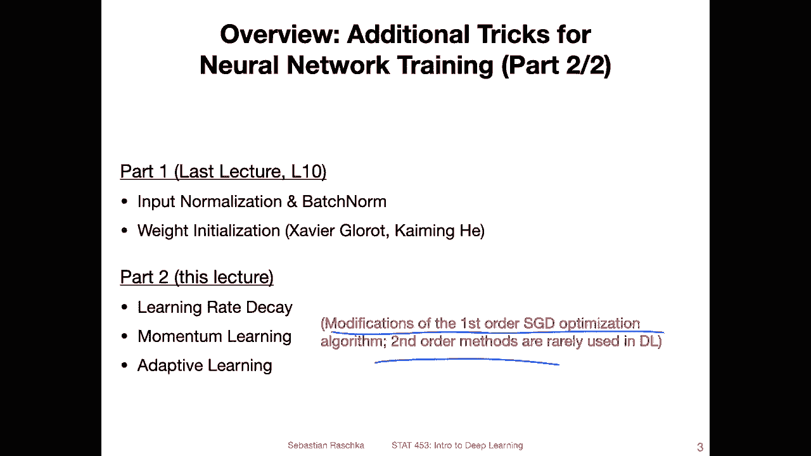
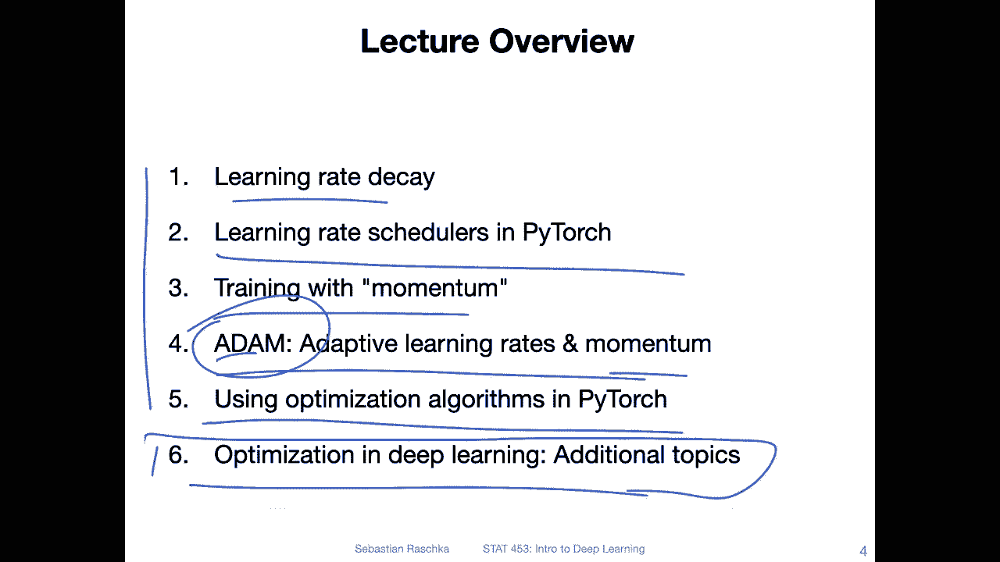
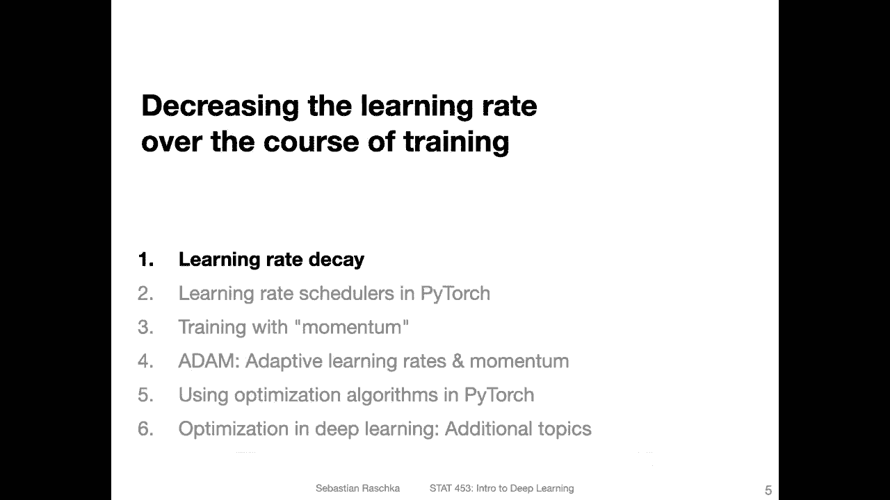

# 课程 P90：L12.0 - 改进基于梯度下降的优化 🚀

在本节课中，我们将学习如何改进神经网络训练中的优化算法。我们将重点讨论学习率衰减、动量学习以及自适应学习率等技巧，这些方法都是对随机梯度下降的改进，旨在提升模型的收敛速度和泛化性能。

---

## 学习率衰减 📉

上一节我们介绍了优化算法的重要性，本节中我们来看看学习率衰减。学习率衰减是一种在训练过程中逐步降低学习率的技术，这有助于减少随机梯度下降中的噪声，使模型在后期更稳定地收敛到最优解。

在PyTorch中，我们可以使用 `torch.optim.lr_scheduler` 模块来实现学习率衰减。以下是一个简单的示例代码：

```python
import torch.optim as optim
from torch.optim.lr_scheduler import StepLR

# 假设我们有一个模型和优化器
model = ...
optimizer = optim.SGD(model.parameters(), lr=0.1)

# 创建学习率调度器，每30个epoch将学习率乘以0.1
scheduler = StepLR(optimizer, step_size=30, gamma=0.1)

for epoch in range(100):
    # 训练代码...
    scheduler.step()  # 更新学习率
```

---

## 动量学习 ⚡

在讨论了学习率衰减后，我们接下来看看动量学习。动量项通过累积过去梯度的指数加权平均来加速梯度下降在正确方向上的收敛，并在其他方向上减缓更新，从而更有效地引导优化过程。

动量更新的公式如下：

\[
v_t = \beta v_{t-1} + (1 - \beta) \nabla J(\theta_t)
\]
\[
\theta_{t+1} = \theta_t - \alpha v_t
\]

其中，\( v_t \) 是当前动量，\( \beta \) 是动量系数，\( \alpha \) 是学习率，\( \nabla J(\theta_t) \) 是当前梯度。

---

## 自适应学习率 🔄

上一节我们介绍了动量学习，本节中我们来看看自适应学习率。自适应学习率算法（如Adam）结合了动量学习和自适应学习率的优点，能够自动调整每个参数的学习率，从而减少超参数调优的工作量，并 often 在训练中表现更好。

Adam算法的更新规则如下：

\[
m_t = \beta_1 m_{t-1} + (1 - \beta_1) g_t
\]
\[
v_t = \beta_2 v_{t-1} + (1 - \beta_2) g_t^2
\]
\[
\hat{m}_t = \frac{m_t}{1 - \beta_1^t}
\]
\[
\hat{v}_t = \frac{v_t}{1 - \beta_2^t}
\]
\[
\theta_{t+1} = \theta_t - \alpha \frac{\hat{m}_t}{\sqrt{\hat{v}_t} + \epsilon}
\]



在PyTorch中，使用Adam优化器非常简单：

```python
import torch.optim as optim

optimizer = optim.Adam(model.parameters(), lr=0.001)
```

---

## 其他高级优化主题 📚

除了Adam和动量学习，近年来还涌现了许多其他优化算法。以下是一些值得关注的高级主题：

*   **AdaGrad**：为每个参数自适应地调整学习率。
*   **RMSProp**：改进了AdaGrad，解决了学习率过早衰减的问题。
*   **AdaDelta**：进一步优化了自适应学习率，无需手动设置全局学习率。
*   **Nadam**：结合了Nesterov动量和Adam算法。
*   **Lookahead**：通过维护两组权重来稳定训练过程。

对于有兴趣深入研究的同学，可以参考相关论文和开源实现以了解更多细节。

---

## 总结 🎯





本节课中我们一起学习了改进基于梯度下降优化的几种关键技术。我们介绍了学习率衰减的原理与实现，探讨了动量学习如何加速收敛，并详细讲解了自适应学习率算法（如Adam）的优势与应用。这些技巧不仅适用于标准的神经网络，也适用于我们将要学习的卷积网络、循环网络等复杂架构。掌握这些优化方法将帮助你更高效地训练模型，并获得更好的性能。