# 课程 P91：L12.1 - 学习率衰减 📉

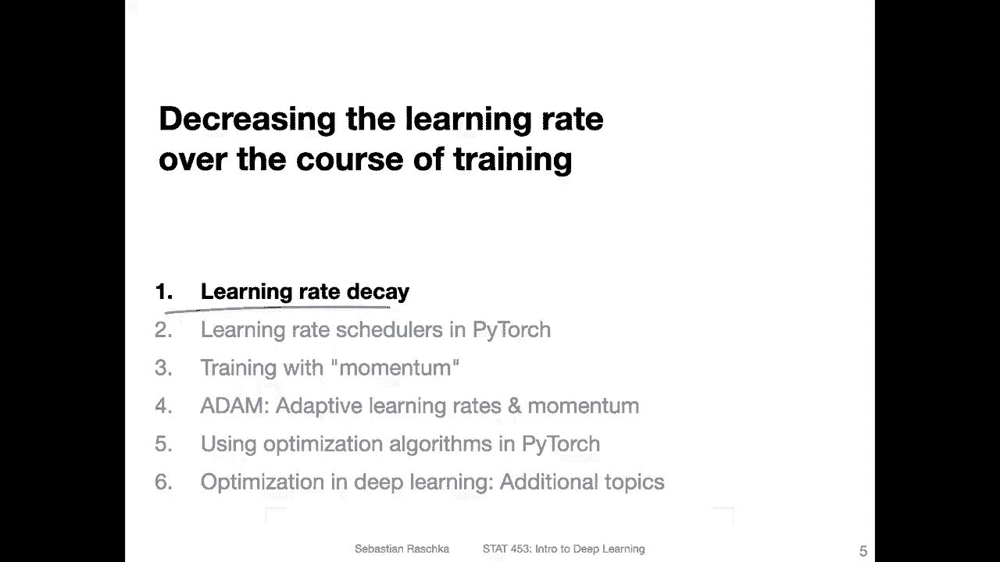

在本节课中，我们将要学习**学习率衰减**，即在训练过程中逐步降低学习率的技术。我们将探讨其原理、常见方法以及实践中的注意事项。

---

## 🔄 回顾小批量学习

上一节我们介绍了优化算法的基础，本节中我们来看看学习率衰减。首先，让我们简要回顾一下小批量学习。

小批量学习是随机梯度下降的一种形式，我们从训练集中抽取小批量数据。每个小批量可以被视为从训练集中抽取的一个样本，而训练集本身又是从总体分布中抽取的一个样本。在小批量学习中，我们对每个小批量执行前向传播和反向传播。

如果我们抽取这些小批量样本，与使用整个训练集相比，我们实际上会得到**噪声更大的梯度**。这既有优点也有缺点。

*   **优点**：噪声梯度有助于模型**逃离局部极小值**。
*   **缺点**：噪声梯度可能导致优化路径**振荡**，不如直接路径高效。

使用小批量学习的另一个优势是**收敛速度**。与每次更新只使用一个训练样本的随机梯度下降相比，小批量梯度下降更快。与使用整个训练集的梯度下降相比，小批量梯度下降也可能更快，因为它能更频繁地更新参数。

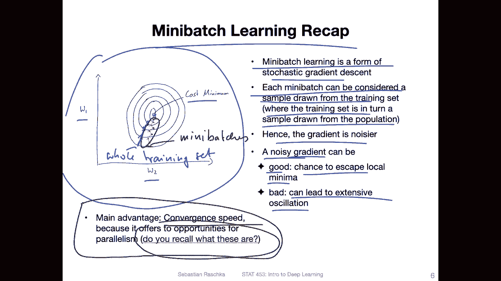

---

## ⚖️ 学习率与噪声的权衡

如果学习率设置得过大，可能会导致严重的振荡和“超调”现象，即更新步长过大，越过最优点，导致收敛低效。

反之，如果学习率设置得过小，虽然路径稳定，但收敛速度会非常慢，需要很多小步才能到达最优点。在深度学习的非凸损失函数中，过小的学习率还可能导致模型**陷入局部极小值**而无法跳出。

因此，需要在**噪声过大**和**噪声过小**之间找到一个平衡点。在训练初期，较大的噪声有助于逃离局部极小值；而在训练后期，减小噪声有助于稳定收敛。**学习率衰减**正是为了实现这一目标而设计的技术。

---

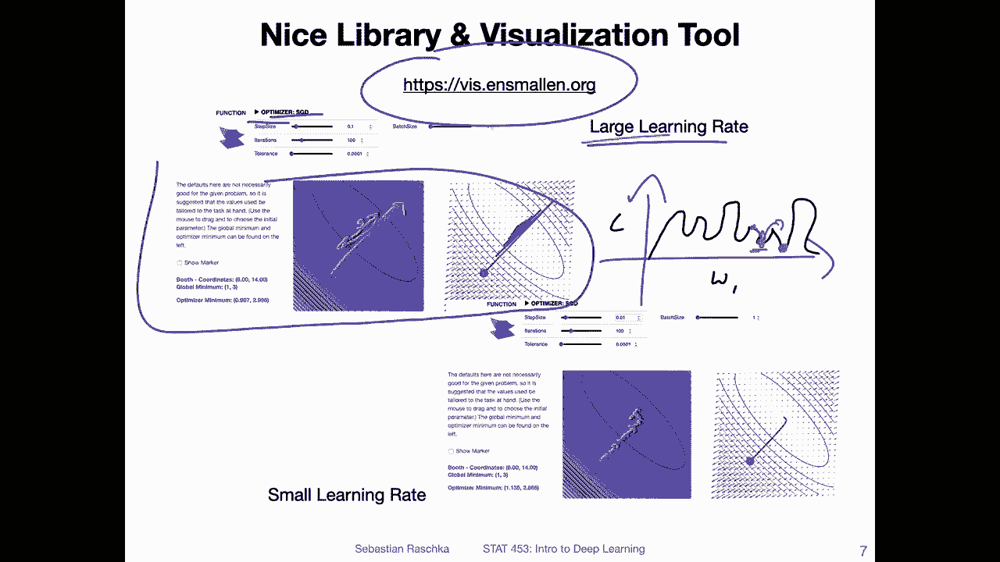

## 📊 关于批量大小的实践建议

在深入讨论学习率衰减之前，我们先介绍一个关于批量大小的实用技巧。

通常建议使用**较大的批量大小**（例如 256、512、1024）。原因如下：

1.  **更好地利用硬件**：较大的批量能更高效地利用 GPU 的并行计算能力。
2.  **梯度更稳定**：较大的样本能更好地保持数据集的原始分布，从而提供更具代表性的梯度估计，减少更新噪声。

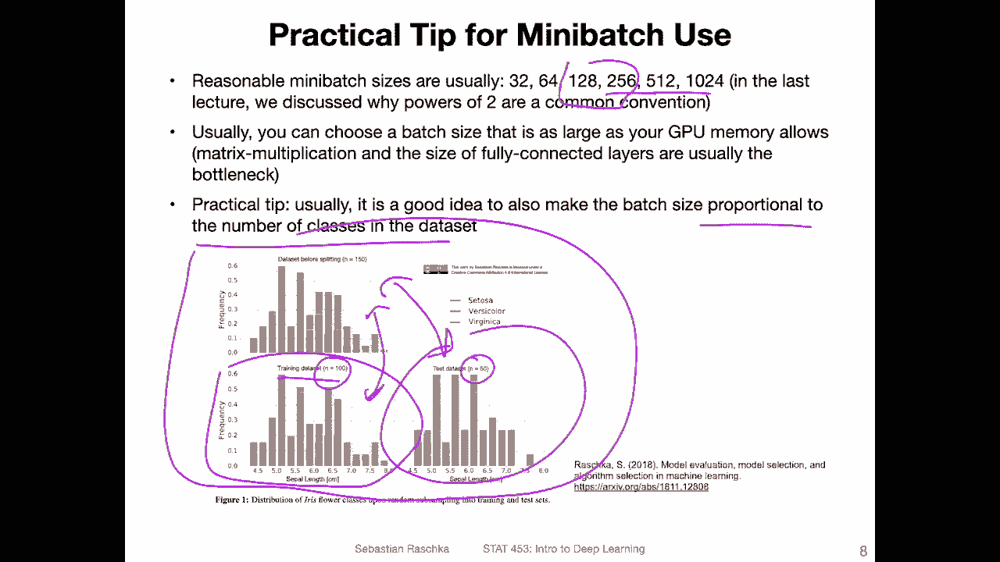

以下是一个在 MNIST 数据集上的实验对比：
*   使用较大的批量（如 1024）时，训练曲线更平滑，噪声更小。
*   使用较小的批量（如 64）时，由于更新次数更多，初期收敛可能更快，但噪声更大。

选择批量大小时，也可以考虑数据集的类别数。对于类别较多的数据集，使用更大的批量可能更有利。

---

## 📉 什么是学习率衰减？

学习率衰减的核心思想是：在训练后期，逐步降低学习率，以**抑制优化过程中的振荡**，使模型更平滑地收敛到最优点。

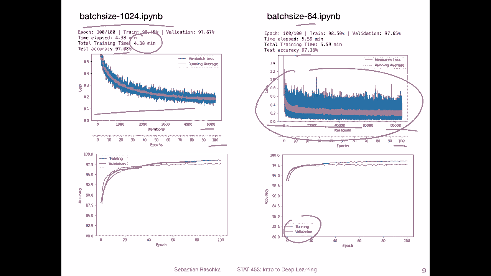

想象一下损失曲线：在训练后期，损失已经较低，但梯度更新仍在振荡。此时如果降低学习率，更新的步长就会变小，振荡幅度随之减小，有助于稳定训练。

然而，这里存在一个风险：如果**过早地衰减学习率**，可能会使模型过早停止学习，损失停滞在一个较高的平台期，无法进一步下降。因此，在实践中，通常建议先在不使用学习率衰减的情况下训练模型，建立一个性能基线，然后再尝试加入学习率衰减，观察是否能提升性能。

---

## 🛠️ 常见的学习率衰减方法

以下是几种常见的学习率衰减策略：

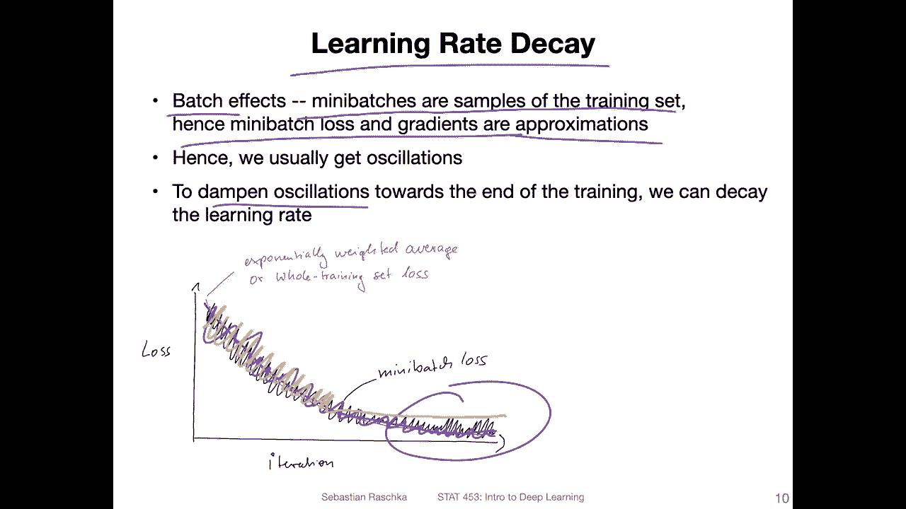

### 1. 指数衰减
学习率按指数函数衰减。
**公式**：`η_t = η_0 * e^{-k * t}`
其中，`η_0` 是初始学习率，`k` 是衰减率，`t` 是时间步（通常是周期数）。

### 2. 按步长衰减（减半）
每隔固定的训练周期（如每 10 个周期），将学习率减半。
这是一种简单且常用的策略。

### 3. 反时衰减
学习率与时间步成反比关系。
**公式**：`η_t = η_0 / (1 + k * t)`
其效果与指数衰减类似。

除了上述方法，还有一些更复杂的调度策略，例如**循环学习率**，它让学习率在一个范围内周期性循环变化，有时能帮助模型跳出尖锐的局部极小值。

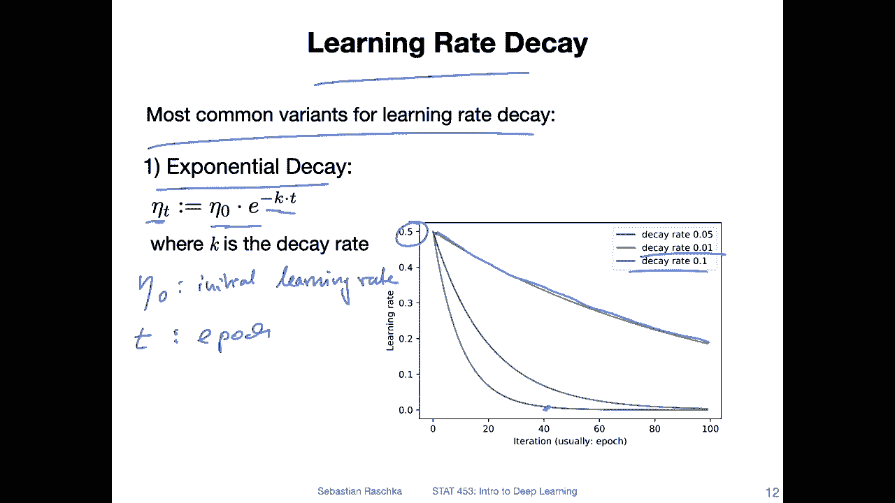

---

## 🔄 另一种思路：增加批量大小

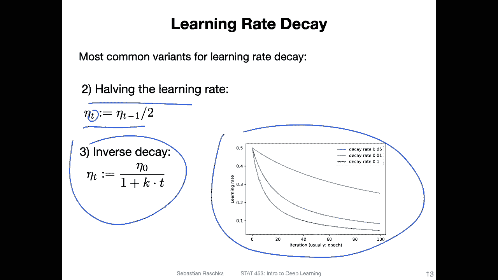

有一篇论文提出了一个有趣的观点：与其衰减学习率，不如**在训练过程中逐步增加批量大小**。这可以达到类似的效果——在训练后期减小更新步长的方差。

**优点**：
*   能达到相似的测试精度。
*   由于批量更大、更新次数减少，可能提高并行效率，缩短训练时间。

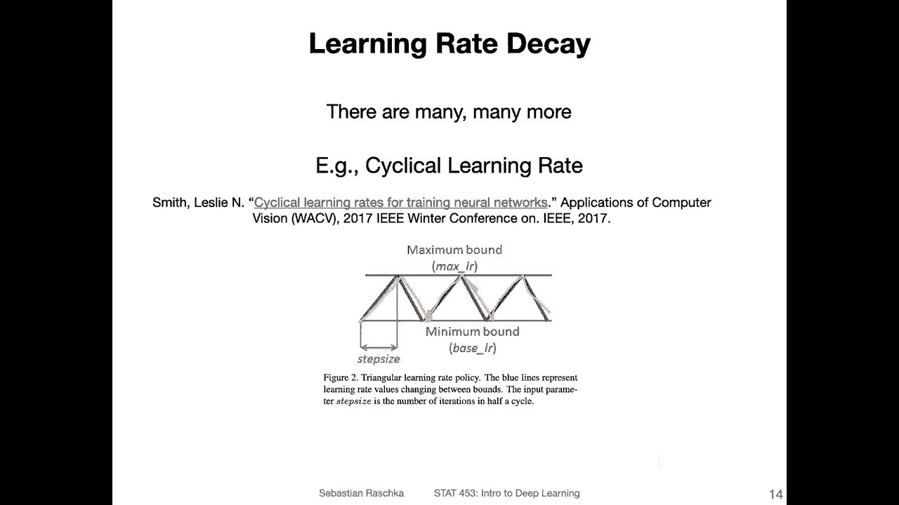

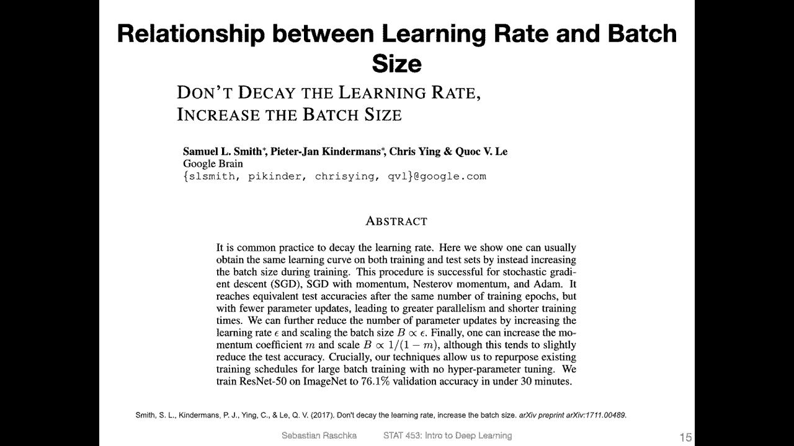

这为优化训练过程提供了另一种值得尝试的思路。

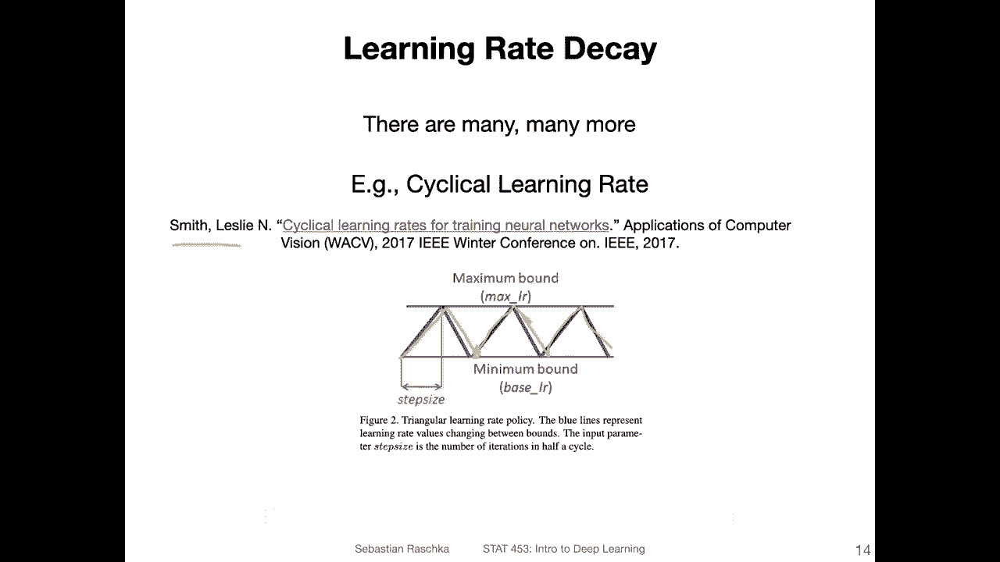

---

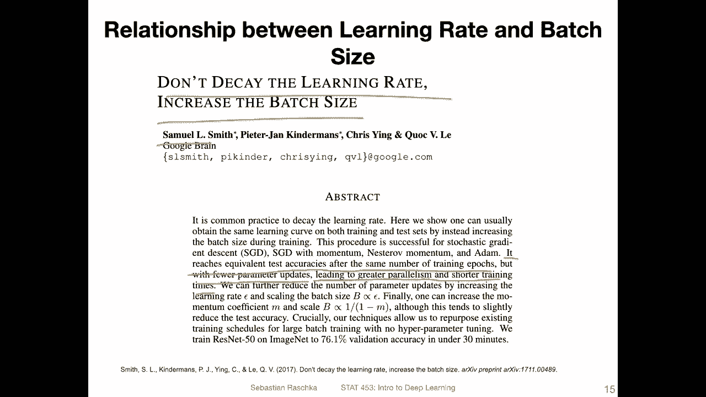

## 🎯 总结与预告

本节课中我们一起学习了**学习率衰减**。我们了解到，通过在训练后期降低学习率，可以减小优化过程中的振荡，帮助模型更稳定地收敛。我们介绍了指数衰减、按步衰减等常见方法，并讨论了过早衰减的风险。此外，我们还了解了增加批量大小作为替代方案的思路。

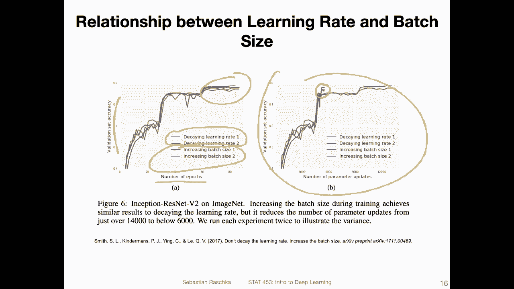

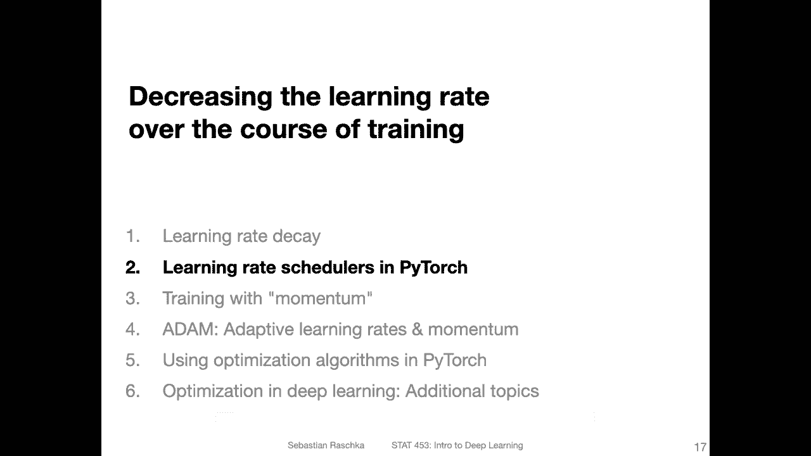

在下一节课中，我将向大家展示我个人在实践中**最喜欢的一种学习率衰减方法**（一种改进的按步衰减策略），并演示如何具体实现它。