# 课程 P92：L12.2 - PyTorch 中的学习率调度器 📚

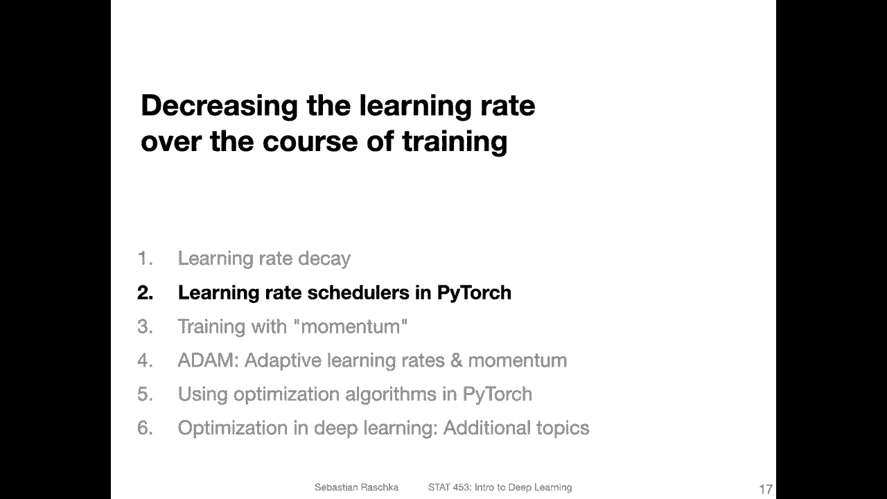

在本节课中，我们将要学习如何在 PyTorch 中实现学习率衰减。我们将从手动实现开始，然后介绍 PyTorch 内置的调度器，并探讨一种在实践中非常有效的学习率调整策略。最后，我们还会学习如何保存和加载模型，以便复用训练结果。

---

## 🔧 手动实现学习率衰减

上一节我们介绍了什么是学习率衰减及其作用。本节中我们来看看如何在 PyTorch 中手动实现它。

以下是手动实现指数衰减的示例代码：

```python
def adjust_learning_rate(optimizer, epoch, initial_lr, decay_rate):
    """每10个epoch将学习率乘以衰减率"""
    if epoch % 10 == 0:
        for param_group in optimizer.param_groups:
            param_group['lr'] = initial_lr * (decay_rate ** (epoch // 10))
```

这段代码定义了一个函数，它检查当前 epoch 数。如果 epoch 数是 10 的倍数，它会遍历优化器中的所有参数组，并将每个参数组的学习率乘以衰减率的相应次方。这种实现方式考虑了优化器可能为不同参数组设置不同学习率的情况。

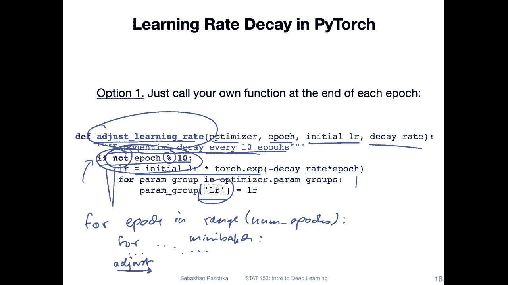

在训练循环中，你可以在每个 epoch 结束后调用此函数。

```python
# 在训练循环中
for epoch in range(num_epochs):
    # ... 在每个mini-batch上进行训练 ...
    adjust_learning_rate(optimizer, epoch, initial_lr=0.1, decay_rate=0.9)
```

然而，手动实现比较繁琐。接下来，我们将看看如何使用 PyTorch 内置的工具来简化这个过程。

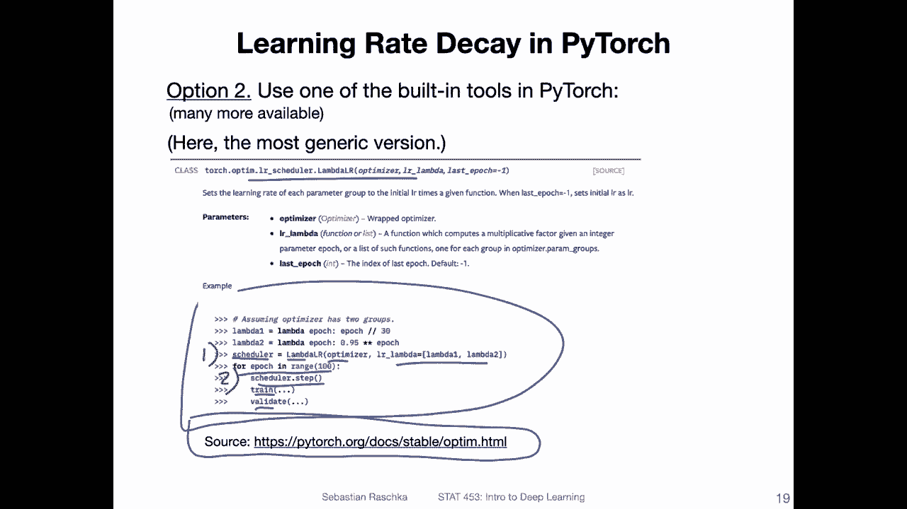

---

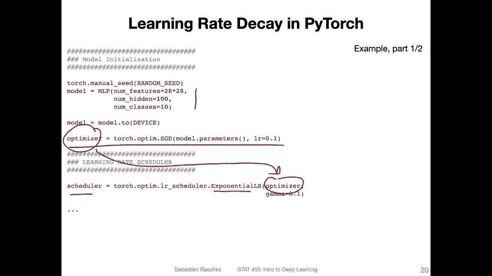

## 🧰 使用 PyTorch 内置调度器

PyTorch 在 `torch.optim.lr_scheduler` 模块中提供了多种学习率调度器。使用它们通常只需要两个步骤：初始化和在训练循环中调用 `.step()`。

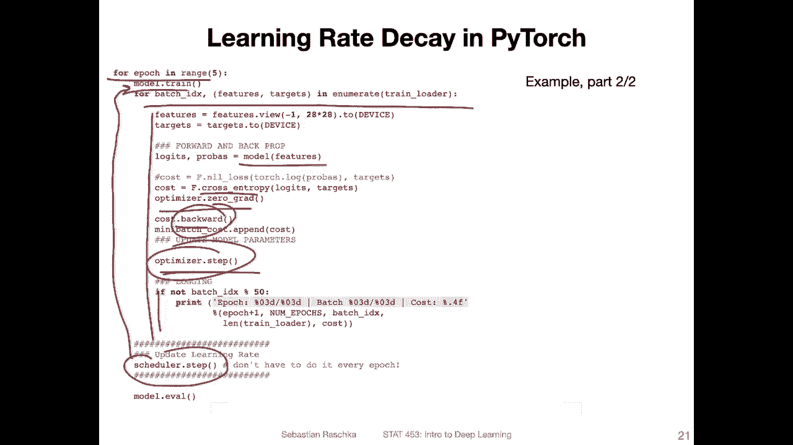

以下是使用 `ExponentialLR` 调度器的示例：

```python
import torch.optim as optim
import torch.optim.lr_scheduler as lr_scheduler

# 1. 初始化模型和优化器
model = MyModel()
optimizer = optim.SGD(model.parameters(), lr=0.1)

# 2. 初始化调度器
scheduler = lr_scheduler.ExponentialLR(optimizer, gamma=0.9)

# 训练循环
for epoch in range(num_epochs):
    model.train()
    for batch in train_loader:
        # ... 前向传播、计算损失、反向传播 ...
        optimizer.step()  # 更新权重
    # 3. 在每个epoch后更新学习率
    scheduler.step()
```

首先，我们像往常一样初始化模型和优化器。然后，我们创建一个调度器实例，并将优化器传递给它。参数 `gamma` 是每个 epoch 后学习率相乘的因子。在训练循环中，我们在每个 epoch 结束后调用 `scheduler.step()`，学习率就会自动按指数规律衰减。

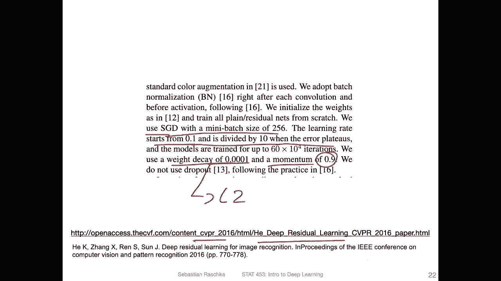

你可以在 [PyTorch 官方文档](https://pytorch.org/docs/stable/optim.html#how-to-adjust-learning-rate) 中找到所有可用的调度器。

---

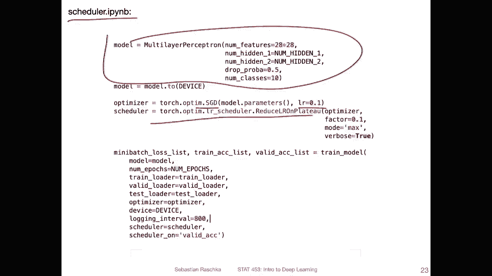

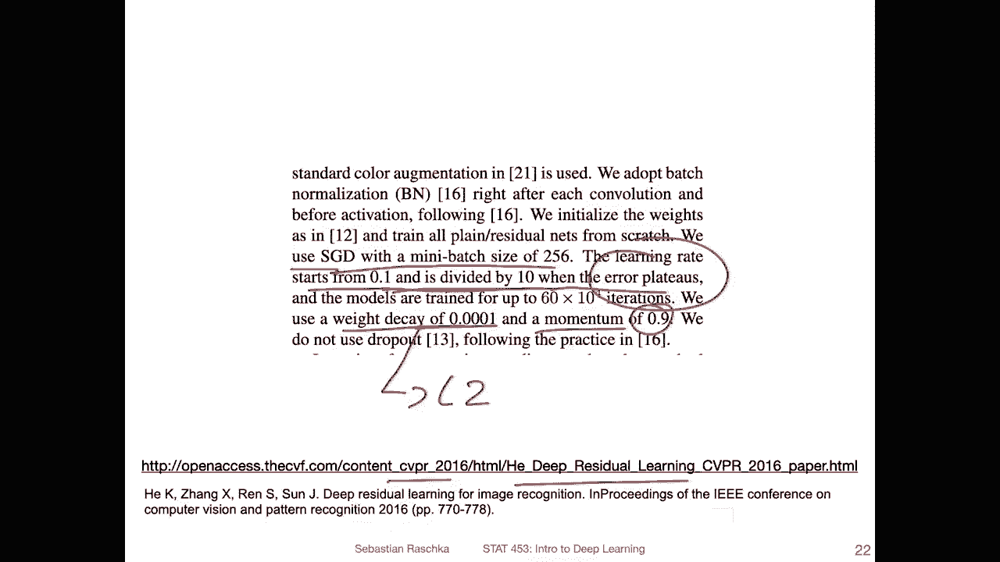

## ⭐ 一种有效的实践策略：在误差平台期降低学习率

除了标准的指数衰减，还有一种在实践中非常有效的策略。这种策略不按固定周期衰减学习率，而是在模型性能（如验证集准确率）停止提升（即达到“平台期”）时，将学习率大幅降低（例如除以10）。

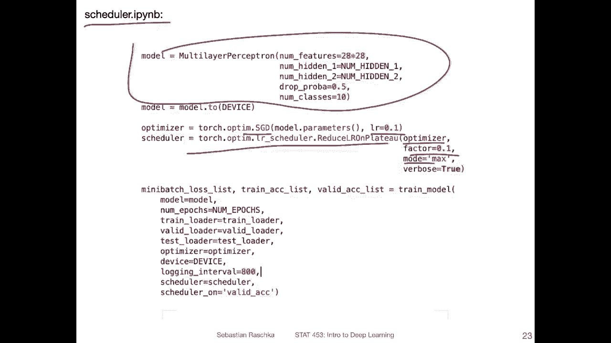

这种方法在2016年提出 ResNet 的论文中被使用。其核心思想是：使用 SGD 优化器，初始学习率设为 0.1（这对 SGD 来说较大）。当训练损失或验证误差在一段时间内不再显著下降时，就将学习率除以 10。这通常配合权重衰减（L2正则化）和动量一起使用。

在 PyTorch 中，我们可以使用 `ReduceLROnPlateau` 调度器来实现这一策略。

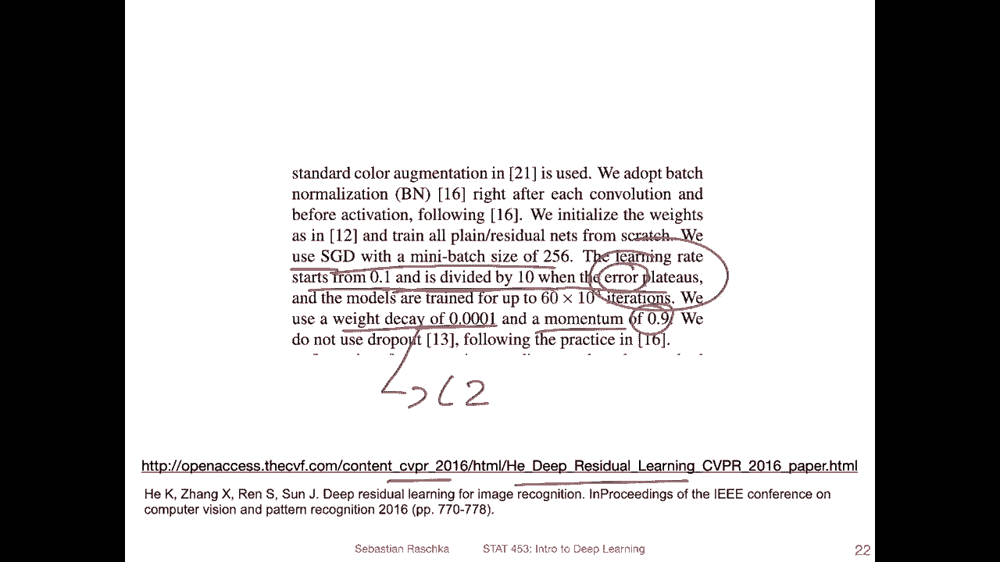

```python
from torch.optim.lr_scheduler import ReduceLROnPlateau

# 初始化优化器
optimizer = optim.SGD(model.parameters(), lr=0.1, momentum=0.9, weight_decay=1e-4)

# 初始化调度器，监控验证集准确率
scheduler = ReduceLROnPlateau(optimizer,
                              mode='max',     # 我们希望准确率‘max’imize
                              factor=0.1,     # 学习率衰减因子：乘以0.1（即除以10）
                              patience=3)     # 容忍3个epoch性能无提升

# 在训练循环中
for epoch in range(num_epochs):
    train(...)
    val_acc = validate(...)  # 计算当前epoch的验证集准确率
    # 根据监控指标更新学习率
    scheduler.step(val_acc)
```

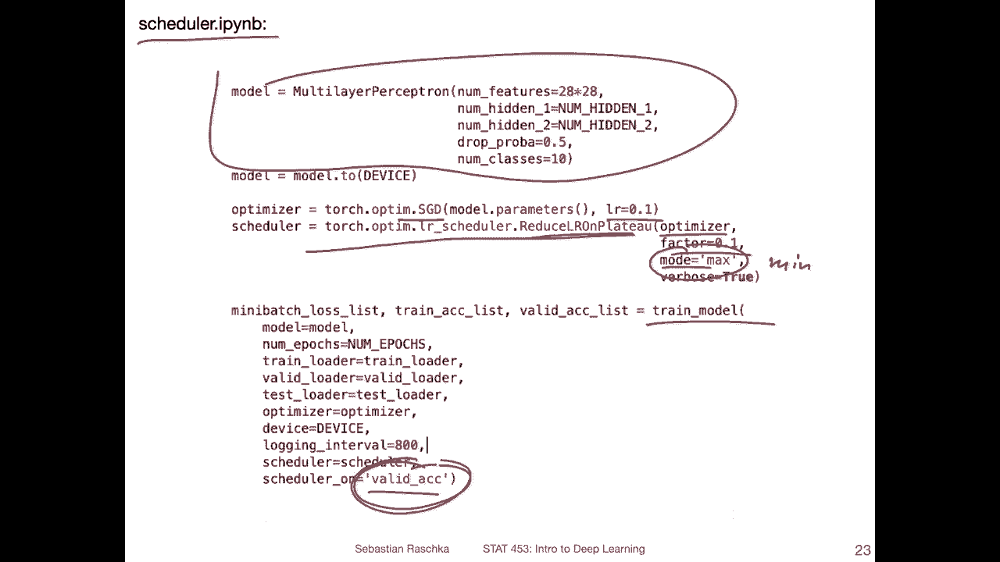

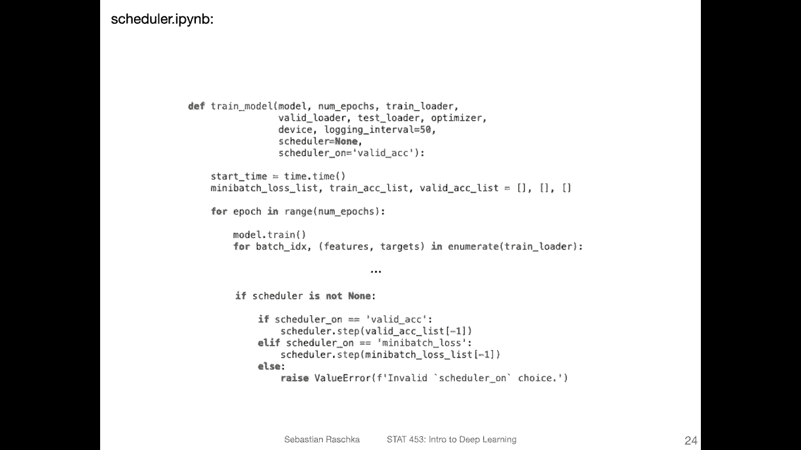

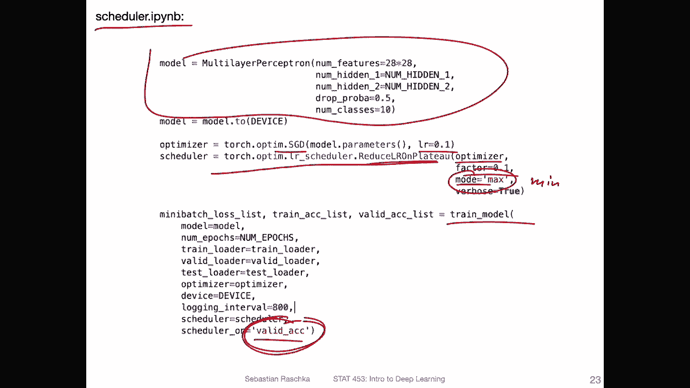

这里，`mode='max'` 表示我们监控的指标（验证准确率）是越大越好。`factor=0.1` 指定了衰减因子。`patience=3` 意味着如果准确率连续 3 个 epoch 没有提升，就触发学习率衰减。根据经验，基于验证集准确率来调整学习率通常效果很好。

---

## 💾 模型的保存与加载

在使用调度器或长时间训练模型时，保存和加载模型至关重要。这可以避免重复训练，也便于后续继续训练或部署。

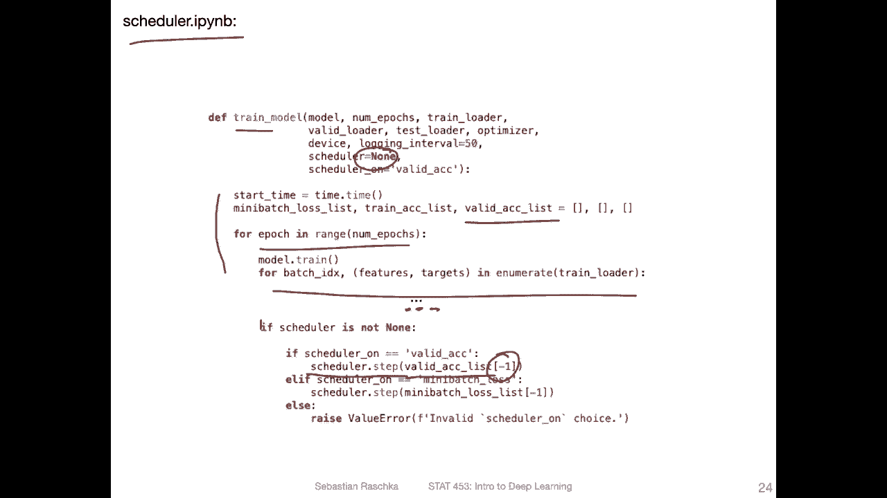

PyTorch 推荐的方式是保存模型的 `state_dict`（状态字典），它包含了模型的所有可学习参数。

以下是保存和加载模型的代码：

```python
import torch

# 保存模型
torch.save({
    'epoch': epoch,
    'model_state_dict': model.state_dict(),
    'optimizer_state_dict': optimizer.state_dict(),
    'scheduler_state_dict': scheduler.state_dict() if scheduler else None,
    'loss': loss,
}, 'model_checkpoint.pth')

# 加载模型
checkpoint = torch.load('model_checkpoint.pth')
model.load_state_dict(checkpoint['model_state_dict'])
optimizer.load_state_dict(checkpoint['optimizer_state_dict'])
if scheduler and checkpoint['scheduler_state_dict']:
    scheduler.load_state_dict(checkpoint['scheduler_state_dict'])
start_epoch = checkpoint['epoch']
```

**保存**：我们使用 `torch.save` 将一个字典保存到文件。这个字典不仅包含模型的 `state_dict`，还可以包含优化器的 `state_dict`、调度器的 `state_dict`、当前的 epoch 和损失值等。这样，所有与训练状态相关的信息都被保存下来。

**加载**：加载时，首先需要重新初始化模型、优化器和调度器（结构必须与保存时相同）。然后使用 `torch.load` 读取文件，并分别调用各自的 `.load_state_dict()` 方法将参数载入。这样，你就可以从保存的点继续训练，而学习率等状态也会被正确恢复。

---

## 📝 总结

本节课中我们一起学习了 PyTorch 中学习率调度器的使用。

1.  我们首先介绍了如何**手动实现**一个简单的学习率衰减函数。
2.  然后，我们学习了如何使用 PyTorch **内置的调度器**（如 `ExponentialLR`）来自动化这个过程，这大大简化了代码。
3.  接着，我们探讨了一种**基于性能平台期的动态调整策略**，并使用 `ReduceLROnPlateau` 调度器来实现它。这种方法通常在模型训练后期非常有效。
4.  最后，我们学习了如何**保存和加载模型**及其完整的训练状态（包括优化器和调度器），这对于实际项目中的模型持久化和继续训练至关重要。

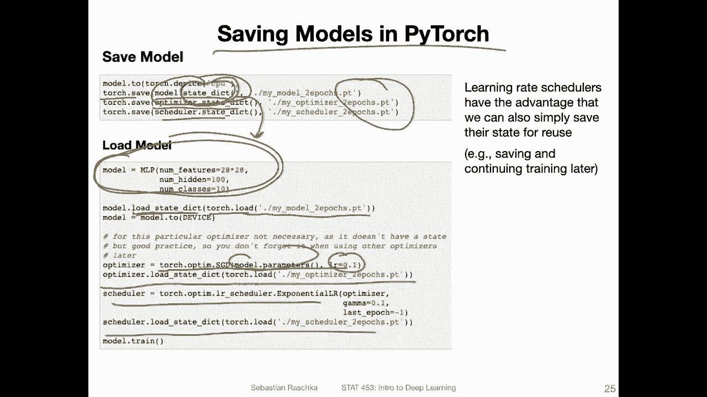

掌握这些工具和技巧，能帮助你更高效地训练神经网络模型，并管理整个训练生命周期。