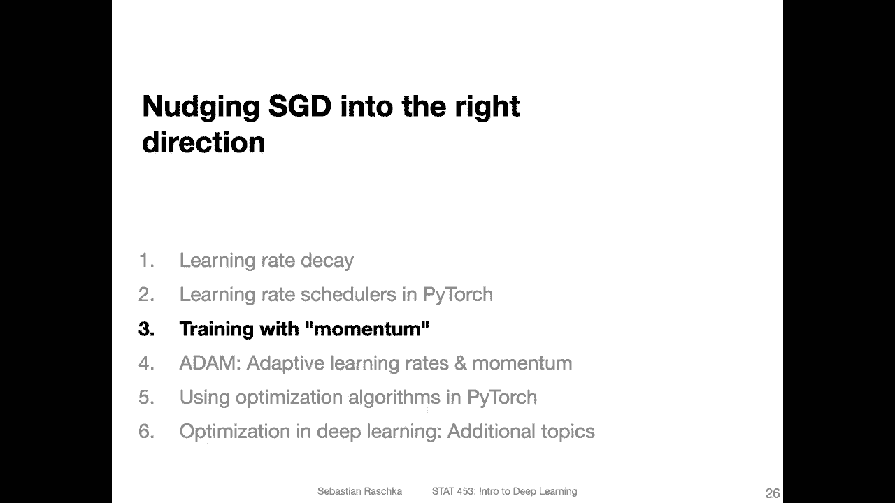
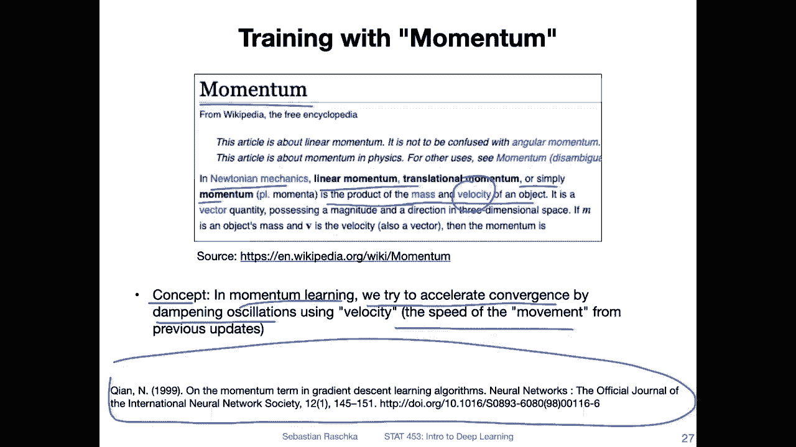
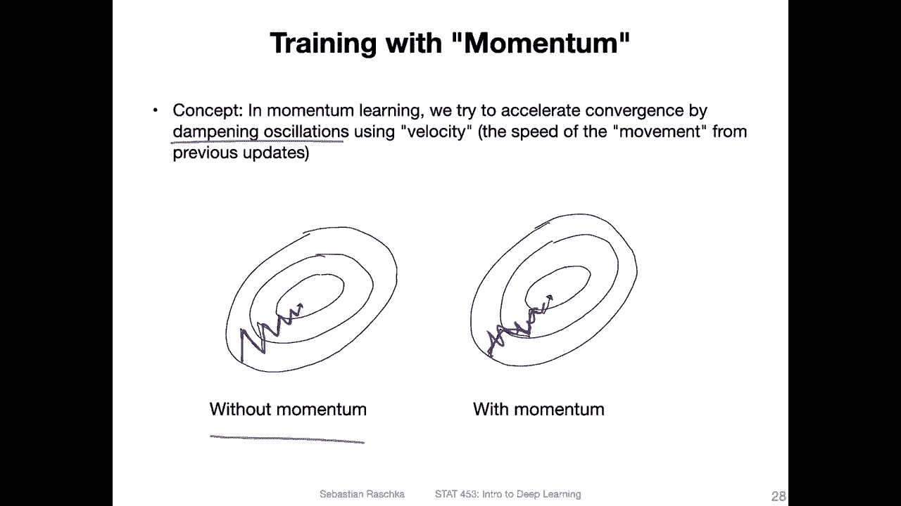
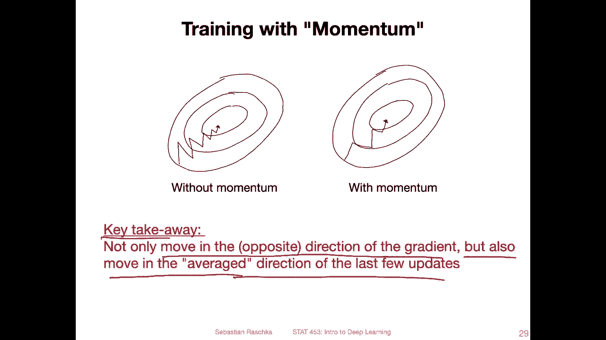
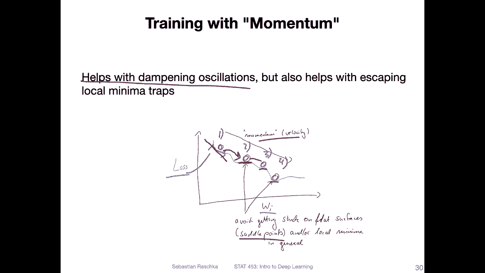
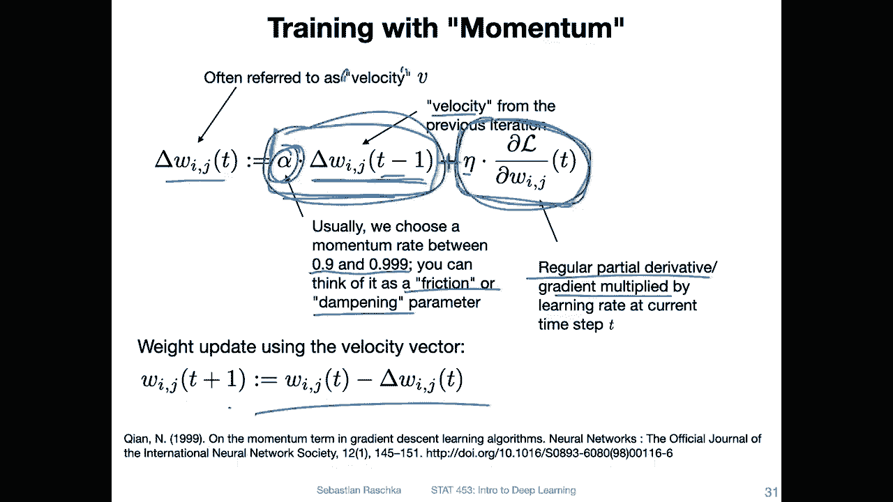
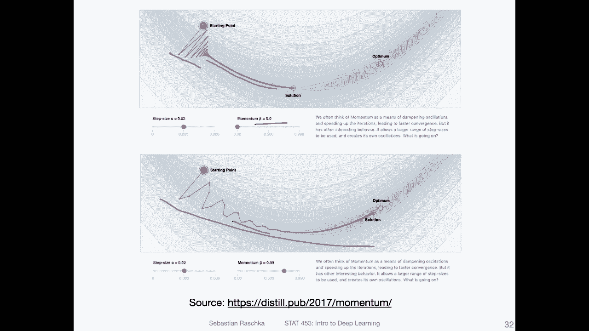
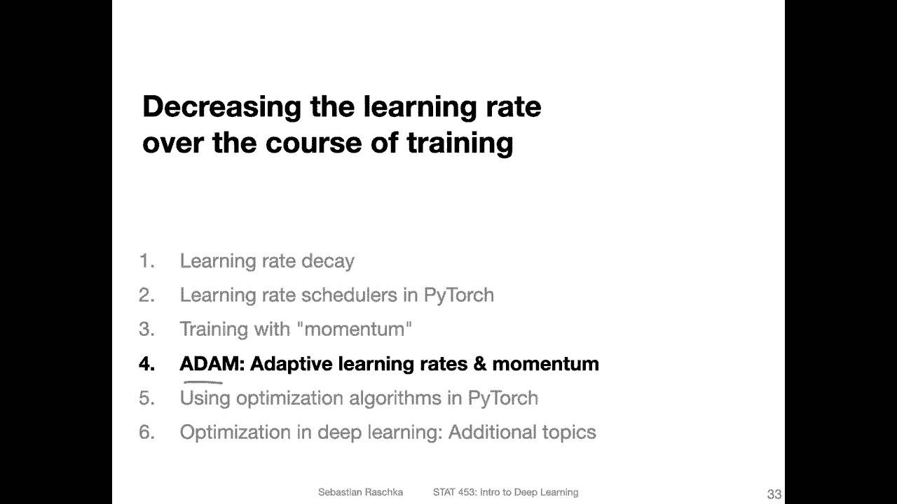

# 课程 P93：L12.3 - 具有动量的新元 🚀

在本节课中，我们将要学习一种名为“动量”的优化技术。动量是随机梯度下降（SGD）的一种改进方法，它通过考虑之前的更新历史来稳定梯度下降过程，减少噪声，从而加速收敛。

---

## 什么是动量？📈

上一节我们介绍了基础的随机梯度下降。本节中我们来看看如何通过动量来改进它。

动量是一个可以添加到SGD中的项，它考虑了之前的更新，从而稳定了随机梯度下降过程，使其噪声更小。这个概念源自物理学中的动量定义：在牛顿力学中，线性动量是物体的质量与速度的乘积。在神经网络权重更新的语境中，我们没有“质量”，但可以考虑更新的“速度”，即之前更新的移动速率。

在动量学习中，我们试图通过利用这个“速度”来抑制振荡，从而加速收敛。速度代表了之前更新过程中的移动速率。通过考虑更新在时间进程中的进展，我们可以用它来抑制这些振荡。这项技术可以追溯到1999年的一篇论文，至今仍是深度学习中非常流行的技术，尤其是与学习率衰减结合使用时。

---

## 动量如何工作？🔧

以下是动量如何抑制振荡的示意图。

左侧是使用SGD进行小批量学习的草图，由于噪声，路径呈锯齿状。但平均来看，存在一个向某个方向的作用力。我们可以利用这个“速度”将其添加到更新中，以抑制振荡，使得振荡减弱，不像之前那样嘈杂。

关键要点是：在常规梯度下降中，我们通常沿梯度的相反方向移动。这是常规的更新方式。但现在有了动量，我们还会沿最近几次更新的平均方向移动。我们关注的是之前更新的平均方向，这就是我们的“速度”。

---

## 为什么动量有帮助？💡

动量不仅有助于抑制振荡，还能帮助我们跳出局部最小值。想象一下，如果你的更新有噪声，但某个时刻你落在了平坦的表面上，此时梯度将为零。你如何从这个平坦表面出来呢？额外的速度项实际上可以帮助推动你离开这个平坦表面。

下图试图说明这一点。

这里的红线是某个权重 `W_i` 的损失曲线（一个简化的损失曲线）。这些圆圈代表不同时间步的当前位置（例如时间步1、2、3、4）。你可能沿着斜坡下降，这很好。但下一个更新可能到达一个平坦表面，那里本质上没有梯度（斜率为零）。常规梯度下降会在此停止。然而，由于动量考虑了之前更新的平均方向，它可能会提供必要的推力，使你继续下降。因此，使用速度项可以帮助我们逃离局部最小值或梯度平坦的鞍点。

---

## 基于速度的更新具体是怎样的？📝

以下是具体的更新公式示意图，让我们逐步分析。

从底部开始，如果不看幻灯片上的文字，这本质上就是我们在SGD中执行的常规梯度下降更新。

假设我们要更新网络中的权重 `W_ij`。`t` 是时间步，`t+1` 是下一个时间步。用于下一次迭代的权重是当前时间步的权重减去变化量 `ΔW_ij(t)`，其中 `ΔW_ij(t)` 是损失函数对该权重的偏导数乘以学习率 `η`。这整个部分就是我们改变权重的量。

现在，我们不直接使用损失函数对权重的偏导数乘以学习率 `η`，而是修改它。我们在常规更新中添加了一个额外的项（如上图左侧所示）。我们称这整个部分为“速度”。因此，我们不再只使用之前的部分，而是现在有了左侧的这个部分。

这个部分具体是什么？它是前一个时间步 `t-1` 的 `ΔW` 项（即前一个时间步的速度）乘以 `α`。这里的 `α` 是动量率，在实践中通常设置在0.9到0.999之间。你可以将其视为摩擦或阻尼参数。`α` 越大，前一个速度项的影响就越大。因此，`α` 越大，常规更新受之前更新的影响就越大。这本质上就像一个移动平均。我们本质上只是将之前的更新乘以一个特定数字后加进来，你可以将其视为一个移动平均，也就是速度项或动量项。然后我们称其为速度，并用它来更新权重。这就是动量的工作原理。

---

## 动量在实践中看起来如何？🎯

以下是一个动量的实际模拟，展示了它与常规梯度下降的区别。

这里展示了两个动量值的情况。零动量就是常规梯度下降（在一个理想的损失曲面上，实际深度学习场景会更复杂）。你可以看到它非常嘈杂，振荡剧烈。而使用动量后，振荡减少了，更加稳定，因为考虑了平均方向。你还可以看到更新点可能更少（这些点彼此更接近，而常规更新的点间距更大）。这就是动量工作的方式和外观。

---

## 核心公式总结 📚

以下是带有动量的随机梯度下降（SGD）的核心更新公式：

**速度计算：**
`v(t) = α * v(t-1) - η * ∇J(θ(t))`

**权重更新：**
`θ(t+1) = θ(t) + v(t)`

其中：
*   `v(t)` 是当前时间步的速度。
*   `α` 是动量系数（通常为0.9）。
*   `η` 是学习率。
*   `∇J(θ(t))` 是当前参数 `θ(t)` 处的损失梯度。

---

## 下一步是什么？➡️

在下一个视频中，我将讨论自适应学习率。首先会介绍一种称为RMSProp的算法，然后我们将这些自适应学习率的概念与动量结合起来，这将产生Adam优化器，它可能是目前应用最广泛的基于SGD的优化器。

---

## 总结 ✨

本节课中我们一起学习了动量优化技术。我们了解到，动量通过引入一个“速度”项，将之前更新的方向以移动平均的方式纳入当前更新。这样做的主要好处是：
1.  **抑制振荡**：使梯度下降路径更平滑、更稳定。
2.  **加速收敛**：有助于在正确的方向上积累速度。
3.  **逃离平坦区域**：在梯度接近零的局部最小值或鞍点附近，积累的速度可以提供推力，帮助模型继续优化。

动量是优化神经网络训练过程的一个简单而强大的工具，常作为后续更高级优化器（如Adam）的基础组件。