# 深度学习优化算法课程 P94：L12.4 - Adam：结合自适应学习率与动量 🚀

在本节课中，我们将学习一种名为 **Adam** 的强大优化算法。它是**动量**与**自适应学习率**两种技术的结合，旨在更高效、更稳定地训练神经网络。

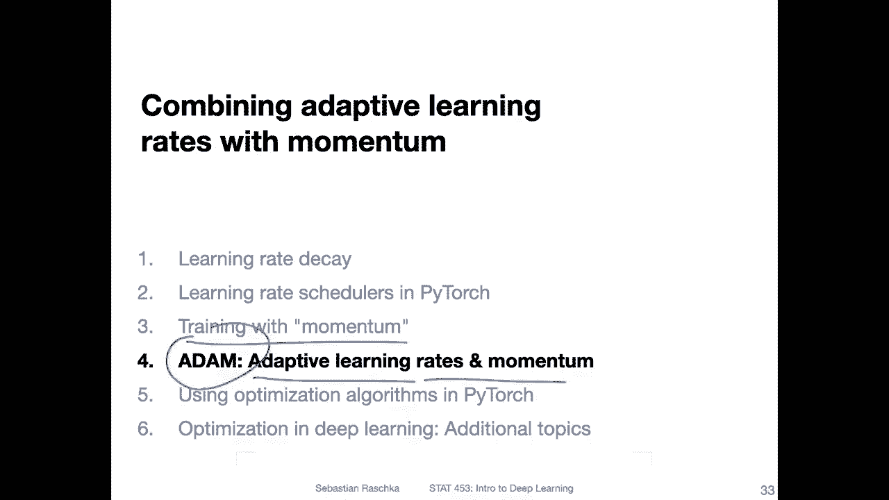

---

## 回顾：动量法

上一节我们介绍了动量法，它通过引入一个“速度”项来帮助抑制随机梯度下降中的振荡，并有助于克服损失曲面上的平坦区域，例如鞍点或局部最小值。

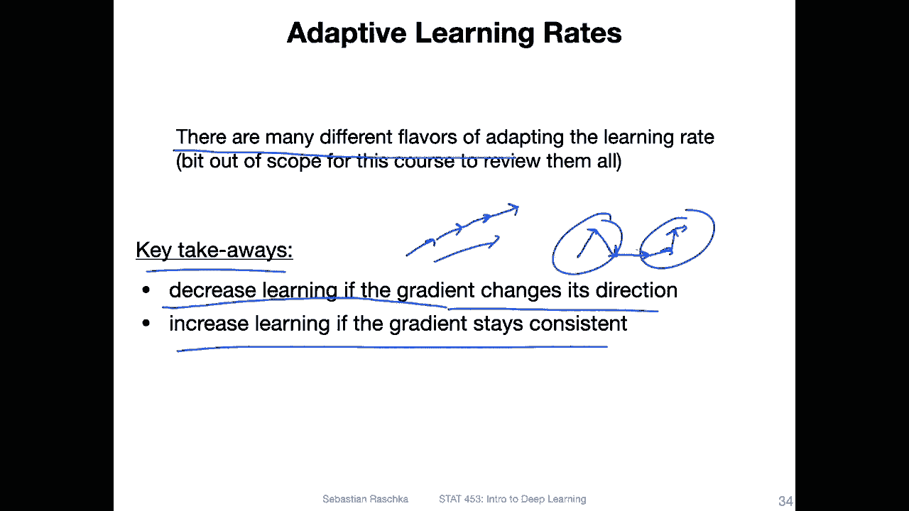

除了动量项，我们现在将学习一个略有不同但相关的概念：**自适应学习率**。

---

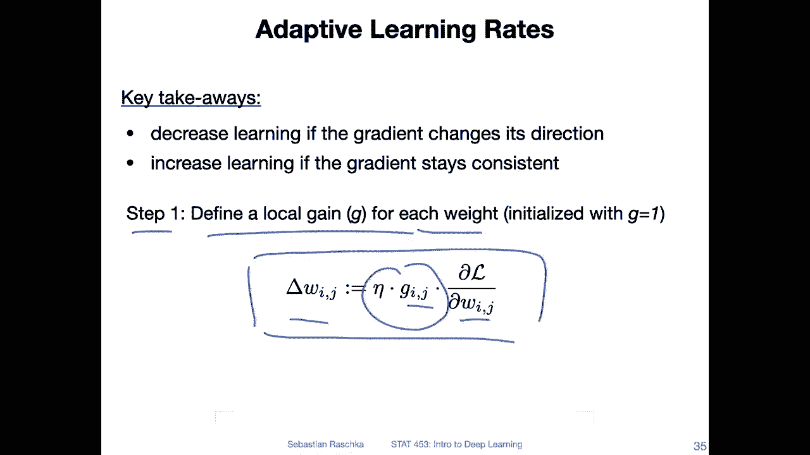

## 自适应学习率概念

自适应学习率的核心思想是在正确的时刻**加速**或**减速**学习过程。当我们朝着正确的方向前进时，就加快学习速度；当我们改变方向时，就减慢学习速度。

以下是其工作原理的一个简单示例：
*   **方向一致时加速**：如果连续几次更新都朝着大致相同的方向，我们便加速，因为这很可能是正确的方向，从而能更快收敛。
*   **方向改变时减速**：如果更新方向频繁改变，我们便减速。这可以防止因噪声或错误方向而偏离太远。

---

## 自适应学习率的实现步骤

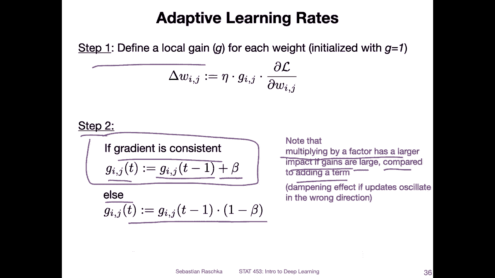

实现自适应学习率主要分为两步：

**第一步：初始化局部增益**
为网络中的**每一个权重** `w_ij` 初始化一个局部增益 `g_ij`。权重更新公式变为：
`Δw_ij = -η * g_ij * (∂L/∂w_ij)`
这里的 `g_ij` 可以看作是该权重独有的学习率。

**第二步：在训练中动态调整增益**
在训练过程中，我们根据梯度方向的一致性来修改每个增益 `g_ij`：
*   **方向一致**：小幅增加增益（例如加上一个常数 `β`），实现平缓加速。
*   **方向改变**：大幅减小增益（例如乘以一个小于1的因子 `β`），实现快速减速。

这种设计的直觉类似于驾驶：路况好时平稳加速，需要急转弯或避障时则大力刹车。

---

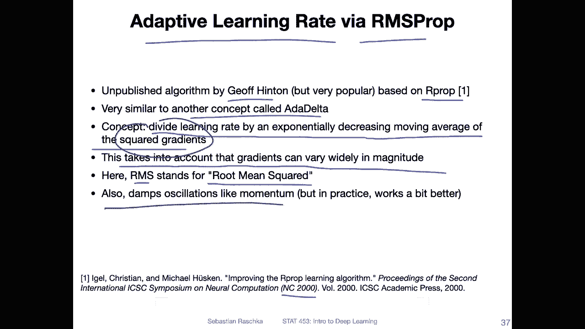

## RMSprop：一种流行的自适应学习率算法

在深入Adam之前，我们先了解一个重要的自适应学习率变体：**RMSprop**。它没有正式发表的论文，但在Geoffrey Hinton的课程中被提出并广泛使用。

RMSprop的核心思想是：将学习率除以一个**平方梯度的指数移动平均值**。这比之前介绍的基础版本更复杂，因为它考虑了梯度幅值的大范围变化。

其更新规则如下：
1.  计算平方梯度的移动平均（第二动量）：
    `MS_t = β * MS_{t-1} + (1 - β) * (∂L/∂w_t)^2`
2.  使用该平均值缩放梯度更新权重：
    `w_{t+1} = w_t - η / (√MS_t + ε) * (∂L/∂w_t)`

这里的 `ε` 是一个极小值，用于防止除以零的错误。RMSprop不仅实现了自适应学习率，对振荡也有阻尼作用。

---

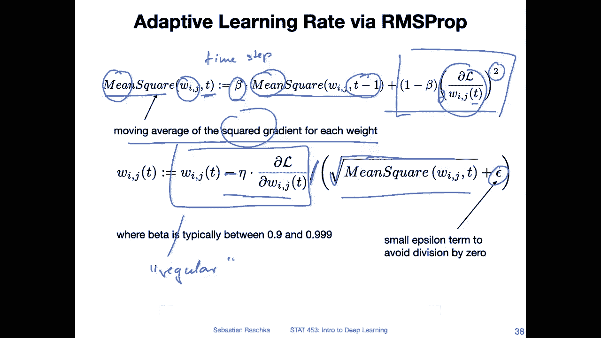

## Adam：自适应矩估计

现在，我们来学习本节课的核心——**Adam** 算法。它结合了**动量法**（一阶矩估计）和**RMSprop**（二阶矩估计）的思想，是目前深度学习中最常用的优化器之一，因其通常能取得优异性能且需要更少的手动调参。

以下是Adam算法的计算步骤：

**1. 计算动量（一阶矩）**
`m_t = α * m_{t-1} + (1 - α) * (∂L/∂w_t)`
这类似于带偏差修正的动量项。

**2. 计算RMSprop项（二阶矩）**
`v_t = β * v_{t-1} + (1 - β) * (∂L/∂w_t)^2`
这是平方梯度的指数移动平均。

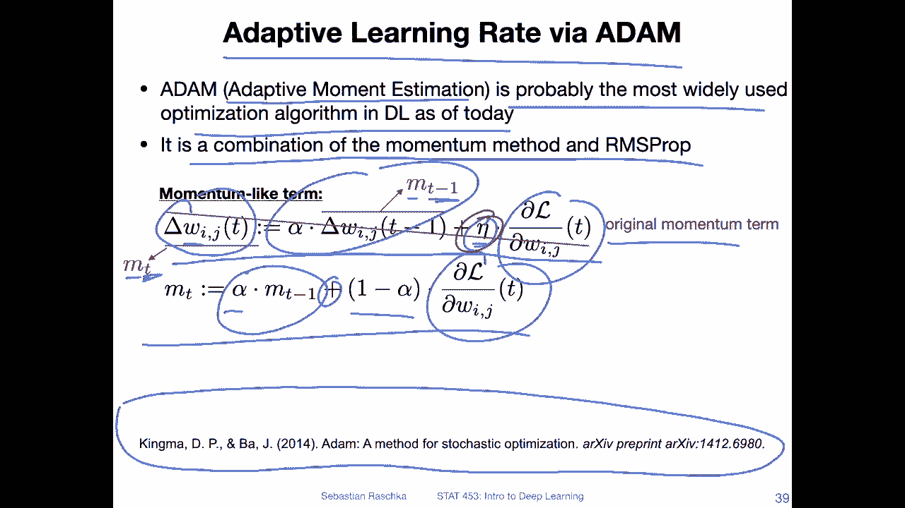

**3. 偏差修正（可选但推荐）**
由于 `m_t` 和 `v_t` 在初始阶段偏向于0，可以进行修正：
`m̂_t = m_t / (1 - α^t)`
`v̂_t = v_t / (1 - β^t)`

**4. 更新参数**
`w_{t+1} = w_t - η / (√v̂_t + ε) * m̂_t`
最终更新是**用经过自适应学习率（`√v̂_t`）缩放后的动量（`m̂_t`）** 来调整权重。

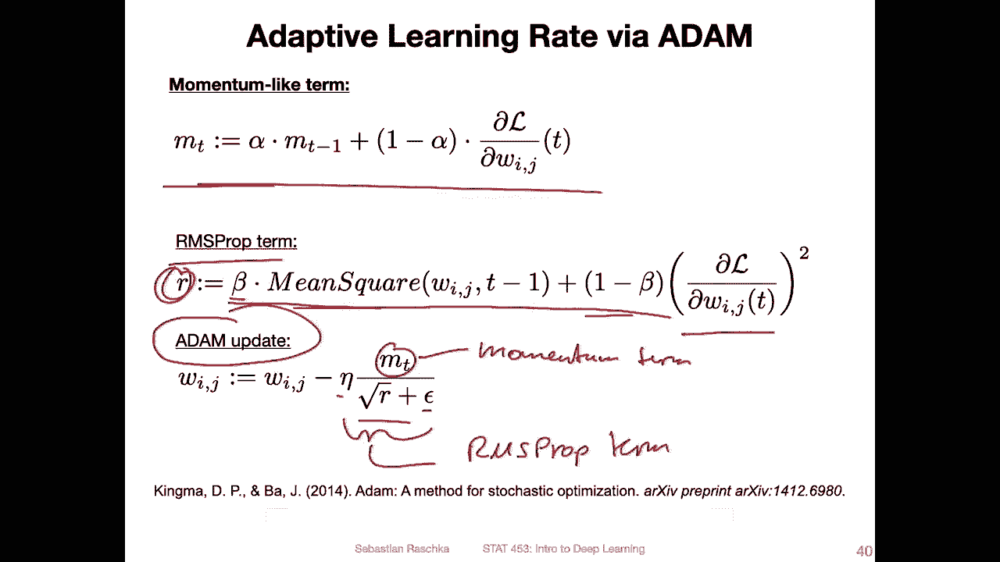

---

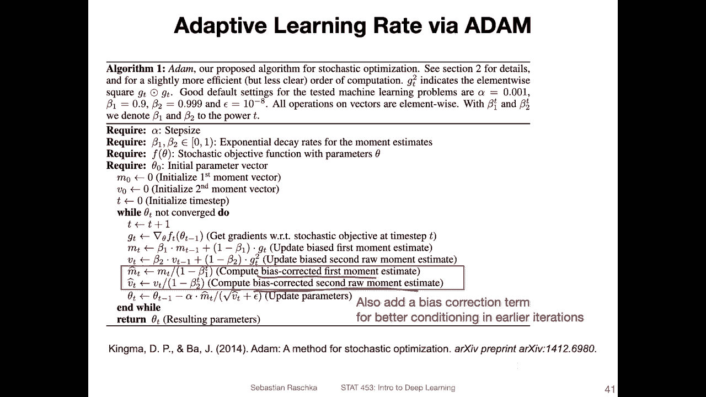

## 总结

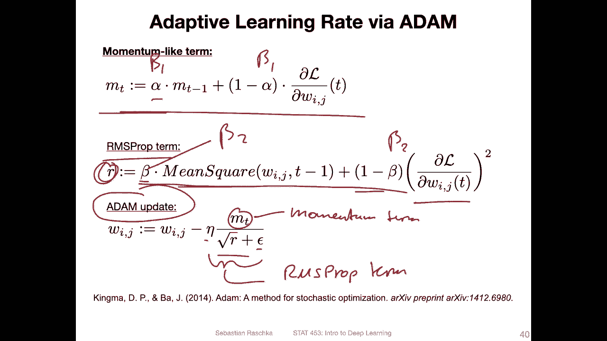

本节课我们一起学习了：
1.  **自适应学习率**的概念：根据梯度方向的一致性动态调整每个参数的学习速度。
2.  **RMSprop**算法：通过除以平方梯度的移动平均来实现自适应学习率。
3.  **Adam**算法：将动量法（捕捉梯度方向）与RMSprop（自适应调整步长）相结合，形成了强大且鲁棒的优化器，在实践中通常能取得优异效果并减少调参负担。

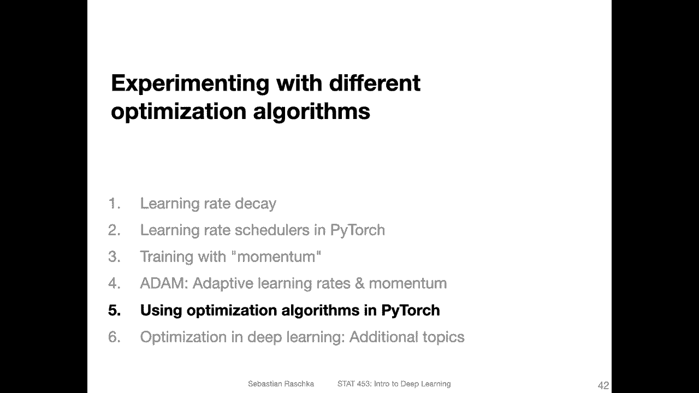

在下一节中，我们将学习如何在PyTorch中实际使用这些优化算法。