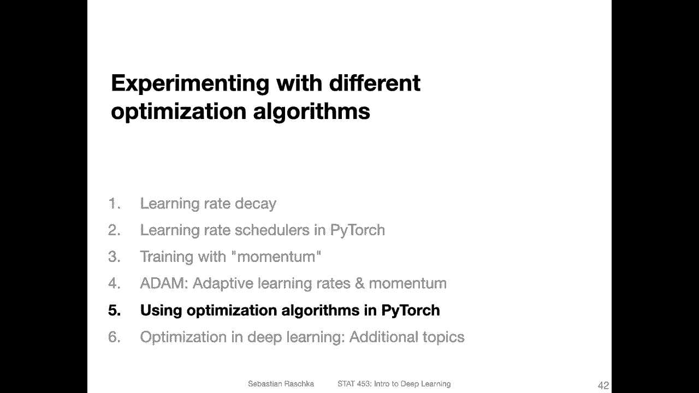
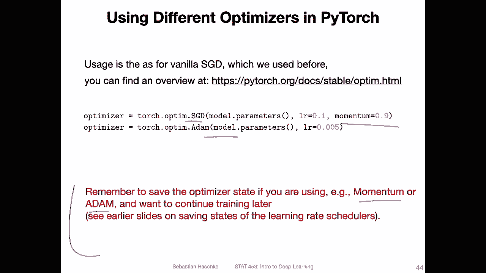
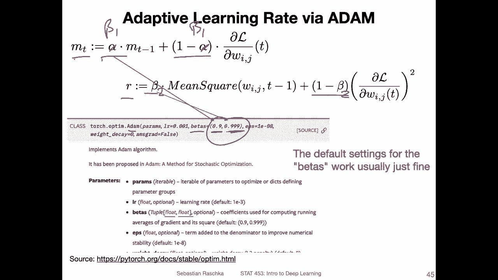
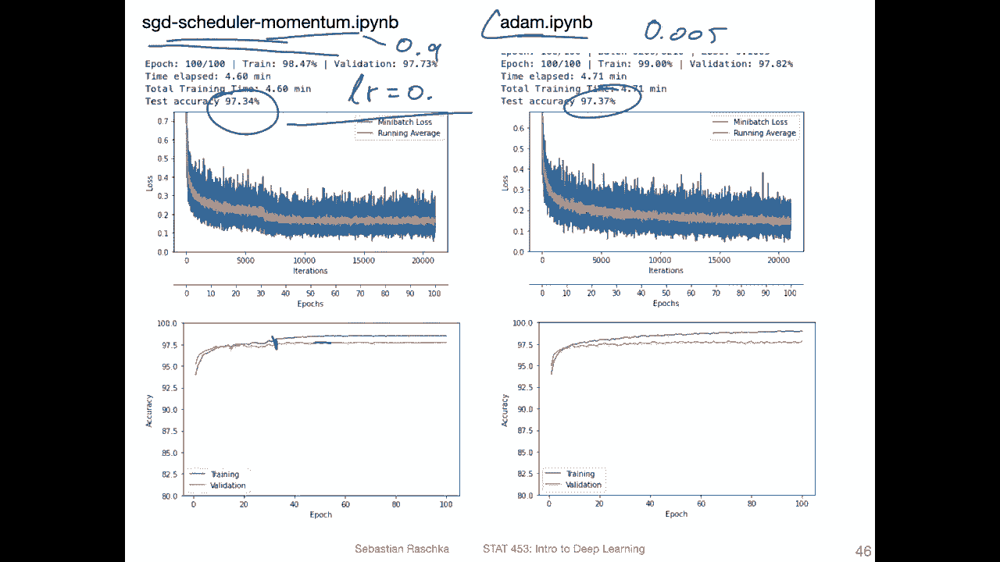
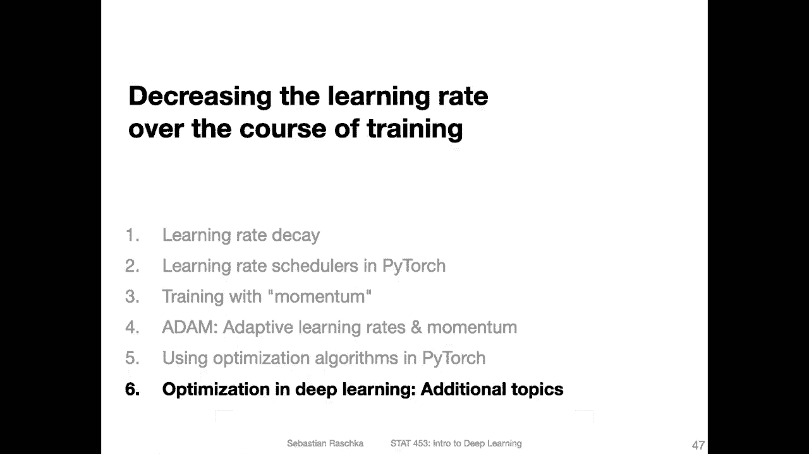

# 课程 P95：L12.5 - 在 PyTorch 中选择不同的优化器 🚀

在本节课中，我们将学习如何在 PyTorch 中使用不同的优化算法。PyTorch 使得应用这些算法变得非常简单。

## 概述

最常见的优化算法仍然是 SGD（随机梯度下降）及其带动量的版本，以及 Adam。当然也存在其他优化算法，我们将在下一个视频中提及。但在实践中，SGD 和 Adam 是大多数人最常用的两种。

如果你对其他类型的优化器感兴趣并想探索它们，可以参考相关网站，那里有关于可用参数的更详细描述。

## 在 PyTorch 中使用优化器

之前我们在代码示例和作业中已经使用过 `torch.optim.SGD`。现在的主要区别是，这里我们为其添加了动量项。

通常，我发现使用 0.01 或 0.001 的学习率效果不错，但你当然需要根据实际情况进行实验。找到合适的学习率很大程度上取决于数据集、权重初始化、数据归一化、批归一化等诸多因素。这是你必须在实践中尝试的事情。

当我使用 SGD 时，我通常也会使用学习率调度器。稍后我将在幻灯片中提供参考代码。如果使用学习率调度器，我通常将初始学习率设为 0.1。

对于 Adam，我通常不做太多调整。我通常使用 0.001 或 0.005 的学习率，这些值对我来说效果很好。但同样，这取决于具体问题。我建议也尝试一些不同的学习率，但大多数情况下，像 0.005 这样的值对我来说效果不错。有时，与 SGD 相比，Adam 更容易找到一个好的学习率。使用 SGD 时，通常需要尝试更多设置才能使其正常工作，而使用 Adam 时，实践中多个学习率都可能表现良好。

## 保存和加载优化器状态

如果你使用任何带动量的版本（如带动量的 SGD 或 Adam），并且希望保存模型以便后续继续训练，你也必须保存和加载优化器。这是因为优化器现在具有状态，包括动量状态和自适应学习率组件（RMS 组件）的状态。我在大约两三个视频前的早期视频中讨论过保存和加载优化器。因此，如果你使用带动量的版本或 Adam，并希望在之后的时间点继续训练，请确保你知道如何保存和加载优化器状态。

## 关于 Adam 参数的说明

在之前的视频中，我提到 Adam 有两个参数：用于动量项的 alpha 参数和用于 RMSprop 项的 beta 参数。在 Adam 优化器中，这些参数也可以修改。在 PyTorch 的实现中，它们都被称为 `betas`，正如论文中一样。第一个值是动量项的 beta（beta1），第二个值是 RMSprop 项的 beta（beta2）。

就我个人而言，我从不更改这些参数。保持其默认值通常对我来说效果很好。在许多深度学习论文中，几乎没有人更改这些参数，他们总是说使用默认参数，因为它们在实践中通常表现相当不错。

## 实践示例

以下是使用不同优化算法的两个示例。

在第一个示例中，我使用了带有学习率调度器的 SGD，当验证准确率停滞时降低学习率，同时动量项设为 0.9。初始学习率为 0.1。每当验证准确率不再提升（即波动）时，我就降低学习率以稳定训练，使其更接近微调阶段。你可以看到，在开始时训练曲线相当嘈杂，可能在这次降低学习率后变得更加稳定，因为不再有改进，因此我们可以减半学习率以消除振荡。通过此设置，我在测试集上达到了 97.34% 的准确率。

在右侧的第二个示例中，我仅使用了具有默认参数的 Adam。我想我在这里使用了 0.005 的学习率。我也获得了基本相同的性能。但你可以看到，由于我们没有使用学习率调度器，可能在该区域附近看到曲线稍微嘈杂一些。但说实话，两者在实践中都完全可行。我通常发现 Adam 对我来说效果稍好一些，但我也是一个非常没有耐心的人。我想如果我更多地调整 SGD，我可能也能获得类似甚至更好的性能。但 Adam 是，如果你像我一样“懒”，它通常总是表现得很好，我因此而喜欢它。

## 总结

本节课中，我们一起学习了如何在 PyTorch 中应用 SGD（含动量）和 Adam 优化器。我们了解了如何设置其参数，特别是学习率的选择策略，以及在使用带动量的优化器时保存和加载状态的重要性。我们还通过示例对比了使用学习率调度器的 SGD 与默认 Adam 的表现。对于初学者，Adam 因其对超参数相对不敏感的特性，通常是更简单直接的选择。