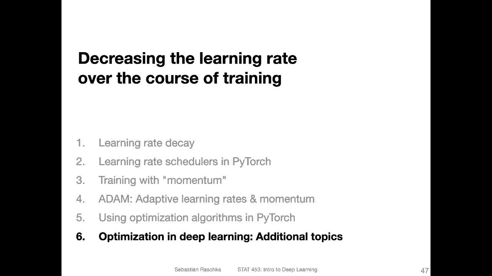
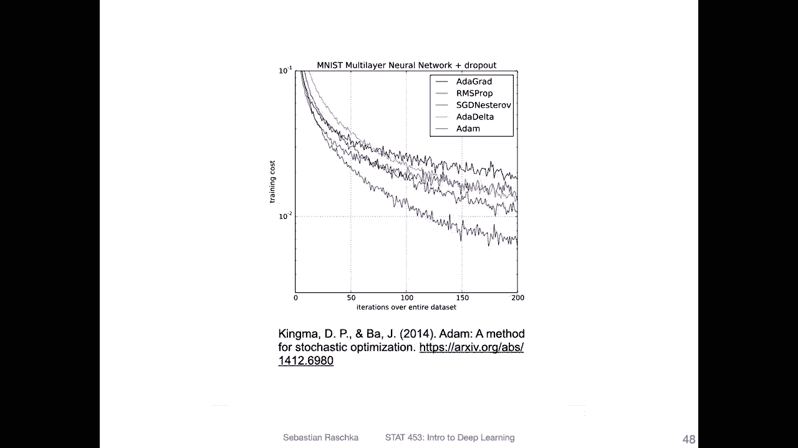
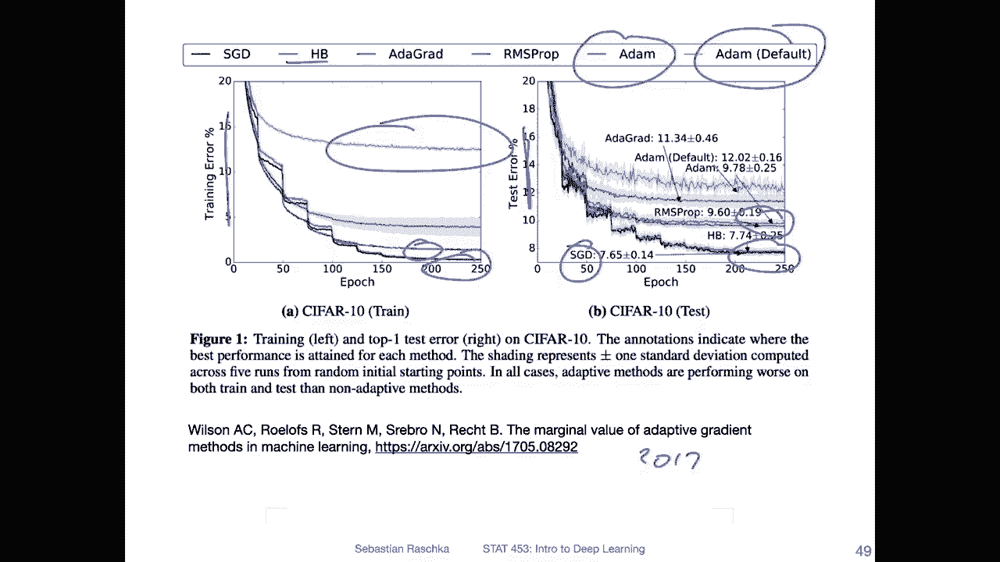
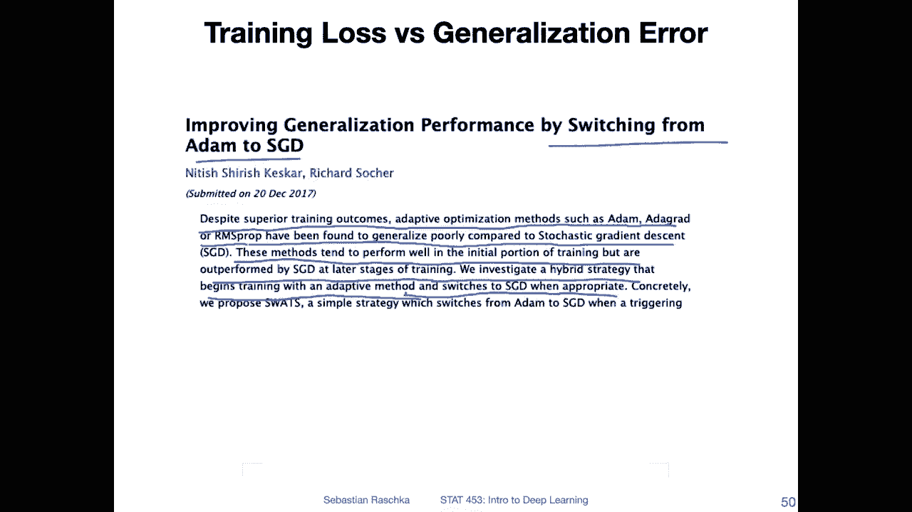
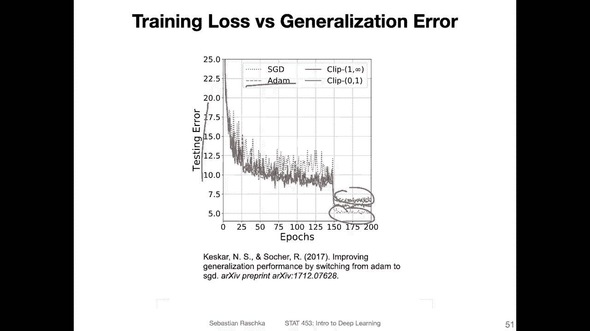
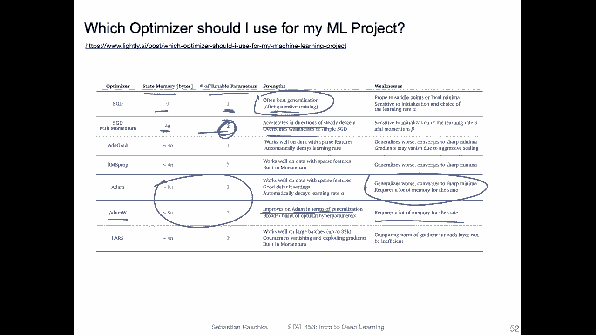
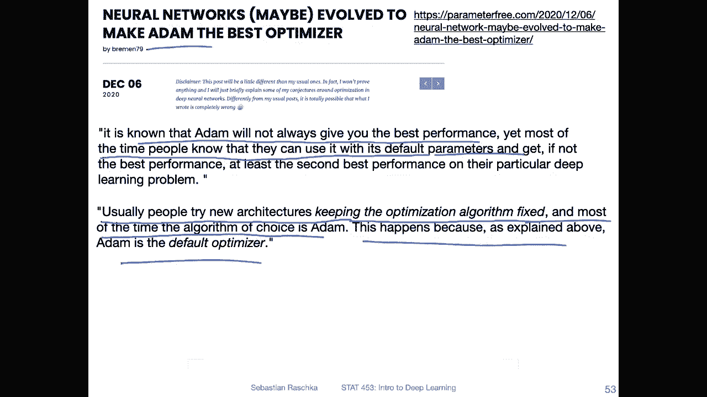
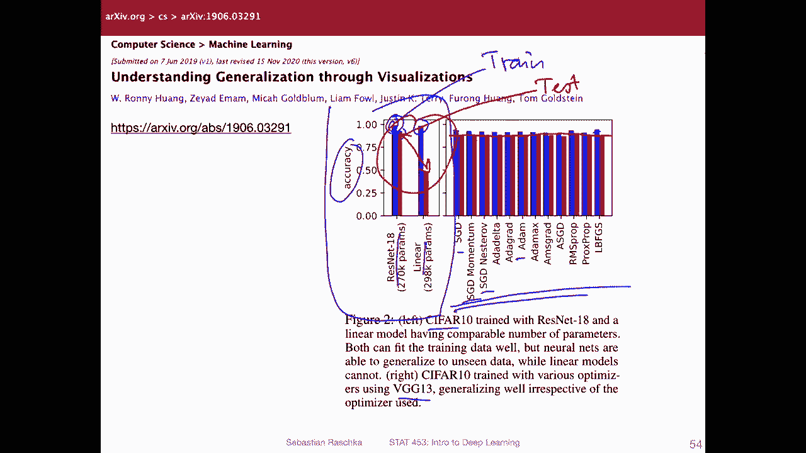
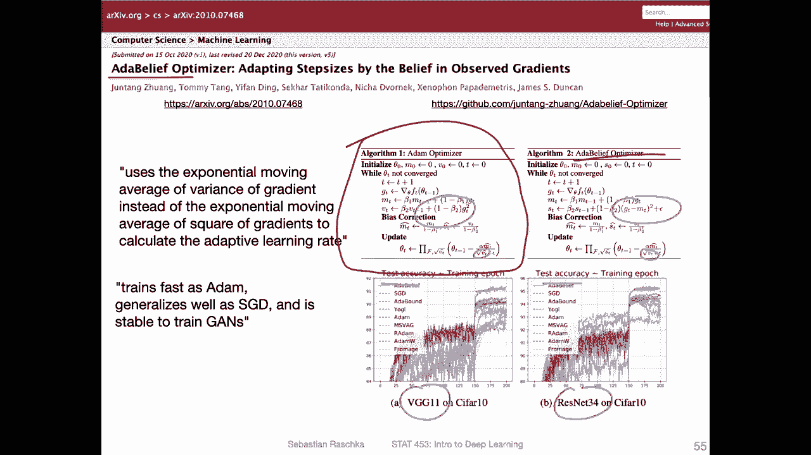

# 优化算法附加主题与研究 📚

在本节课中，我们将探讨优化算法的一些附加主题和研究。我们将回顾不同优化算法的性能比较，讨论它们在训练和泛化方面的表现，并了解一些最新的研究进展。

---

## Adam 算法回顾 🔄

上一节我们介绍了多种优化算法，本节中我们来看看 Adam 算法的原始论文及其背景。

在 2014 年的 Adam 原始论文中，作者比较了多种优化方法。如今，人们提出的优化方法数量可能比当时多出至少五倍。

我们之前没有讨论的一个方法是 SGD with Nesterov Momentum，它是带动量的 SGD 的一个改进版本。理论上，它可能比常规动量方法效果更好。虽然我为此准备了幻灯片，但考虑到课程时长，最终决定不包含它。在实践中，大多数人仍然使用常规的动量方法。

带动量的常规 SGD 即使是最简单的算法之一，也属于最佳算法之列。我将在后续幻灯片中解释原因。

Adam 算法的一个优点是它不需要过多的调参。但 SGD 在泛化性能方面也表现得非常出色。

---

## 训练损失与泛化性能 📉

为了说明这一点，我们来看一个关于训练成本的图表。在这篇论文中，作者发现 Adam 在降低训练成本或损失方面表现最佳。

然而，低的训练成本并不意味着最终模型对新数据的泛化能力好。模型可能只是过拟合了。我们当然希望获得低的训练成本，但这还不够。我们可能得到一个低训练成本的模型，但如果过拟合程度很高，那么最终的模型仍然不够好。

相比之下，一个训练损失较高但过拟合程度较低的模型，可能具有更好的泛化性能。

为了更详细地解释，这里有一篇论文的可视化结果（具体年份不详，可能是 2017 年）。

在这篇论文中，作者也研究了不同的优化算法。他们观察了训练误差和测试误差。

有趣的是，他们发现对于 Adam 算法，经过超参数调优的版本和默认版本表现不同。大多数人使用默认版本，但在这个案例中，默认版本表现很差，而调优后的版本表现更好。

与之前幻灯片展示的结果不同，他们发现在训练集上，SGD 的表现优于 Adam。HB（Heavy Ball）是另一种方法。这与之前幻灯片展示的结果略有不同。

尽管如此，这里的关键收获在于测试集上的表现。在测试集上，他们同样发现常规 SGD 的表现优于 Adam。这并非个例，其他研究者也观察到了类似现象：如果调优得当，SGD 通常具有最佳的泛化性能。

一个可能的解释是 SGD 的噪声更大。由于这种噪声，它可能更容易避开某些尖锐的最小值，或者更容易跳出局部最小值。同时，找到一个非常低的损失值可能导致过拟合，因此有时拥有较高的训练损失未必是坏事。

---

## 算法比较与混合策略 ⚖️

以下是不同优化算法的一些比较要点。

还有一篇有趣的论文提出，在训练过程中从 Adam 切换到 SGD。论文指出，尽管自适应优化方法（如 Adam、Adagrad 或 RMSprop）在训练结果上表现优异，但它们的泛化能力通常不如 SGD。

这些方法在训练初期表现良好，但在训练后期阶段，SGD 的表现会超越它们。作者研究了一种混合策略：开始时使用自适应方法（如 Adam），然后在适当时机切换到 SGD。

以下是相关比较图表。

图表显示，使用 SGD 可以获得更低的测试误差，即更好的泛化性能。

这里有一篇博客文章，客观地列出了不同算法的优缺点。通常，提出新方法的论文会宣称新方法优于旧方法，但这篇文章只是总结了现有方法并给出了一些结论。

以下是关于内存占用和需调优超参数的比较：
*   **SGD**：状态内存需求最低，但需要调优学习率（可能还有动量项）。它泛化性能最佳，但需要大量的训练和调优。
*   **SGD with Momentum**：加速训练并克服了 SGD 的一些弱点。
*   **Adam**：泛化能力通常不如 SGD。
*   **AdamW**：在泛化方面改进了 Adam，但需要与 Adam 相同的状态内存。它并不比常规 Adam 差太多，并且最近也有人使用。

如果你感兴趣，可以阅读这篇文章以获取不同方法的更详细比较。

---

## 架构与优化算法的影响 🏗️

这里有一个关于 Adam 的有趣观点。人们经常使用 Adam 并认为它在许多不同架构上都能表现良好。这篇文章的作者认为，这可能是因为架构的演变使得 Adam 成为了最佳优化器。

作者指出，众所周知 Adam 并不总能提供最佳性能，但大多数时候人们知道可以使用其默认参数，通常就能在问题上获得良好的开箱即用性能。这也是我在实践中观察到的现象。

但这里的论点是，也许不是因为 Adam 本身效果如此之好，而是因为 Adam 在过去效果很好，现在随着新架构的出现，人们继续使用 Adam，而这些新架构的演变预期人们会使用 Adam。因此，Adam 本质上非常适合这些架构，因为这些架构是在考虑使用 Adam 的情况下演变而来的。这里存在一种演化偏差。

作者还说，通常人们在尝试新架构时，会保持优化算法不变。大多数时候，选择的算法是 Adam。这是因为 Adam 是默认优化器。这在某种程度上是一个鸡生蛋还是蛋生鸡的问题。

最近，在一次演讲中看到了这个图表。这是对不同优化算法的一些额外独立评估。这里的论点实际上是，使用什么类型的优化算法并不那么重要。

在左侧，这是一个 ResNet-18（残差网络，我们将在下周讨论），它是一种卷积网络。右侧是一个多层感知机。它们在 CIFAR-10 数据集上进行训练。

蓝色表示训练集准确率，红色表示测试集准确率。你可以看到，对于卷积网络和全连接网络（多层感知机），训练集准确率基本相同。然而，测试集准确率却存在巨大差异。

**架构选择对泛化性能的影响非常巨大**，即使训练准确率保持不变。因此，架构选择非常重要。

相比之下，对于优化算法的选择，他们使用 VGG-13（另一种卷积网络）进行训练，并采用了不同的优化算法，例如 SGD、带动量的 SGD、带动量的 Nesterov SGD 或 Adam。你可以看到，虽然训练性能略有不同，但测试性能几乎相同。测试性能几乎没有差异，可能只有一两个百分点。

这里我们真正看到的是，**我们所使用的优化算法类型并不像我们想象的那么重要**。如果你想要获得更好的性能，关注不同的架构可能比关注不同的优化算法更有效。

---

## 新兴优化器：Adabelief 🚀

话虽如此，最近也有一个新的优化器变得非常流行。我在几个讨论论坛上都看到了它，那就是 Adabelief 优化器，它本质上是 Adam 的一个修改版本。

左侧是常规的 Adam 优化器，右侧是这个 Adabelief 优化器。在蓝色字体中，你可以看到一些微小的改动。我不想在此讨论太多细节，因为我想结束这节已经足够长的课程。

当然，你可以看到它比其他优化器表现更好。蓝色线代表 Adabelief 优化器，它超越了其他优化器。测试使用了 VGG-11 和 ResNet-34，这两种都是我们将会讨论的卷积网络，并且我们也将开始使用 CIFAR-10 数据集。

---

## 总结 📝

本节课中我们一起学习了优化算法的一些附加主题和研究。我们回顾了 Adam 算法及其与其他算法的比较，深入探讨了训练损失与泛化性能的关系，并了解了混合训练策略。我们还讨论了模型架构选择相对于优化算法选择的重要性，并简要介绍了一个新兴的优化器 Adabelief。希望这些内容能帮助你更全面地理解优化算法在深度学习中的应用和最新进展。