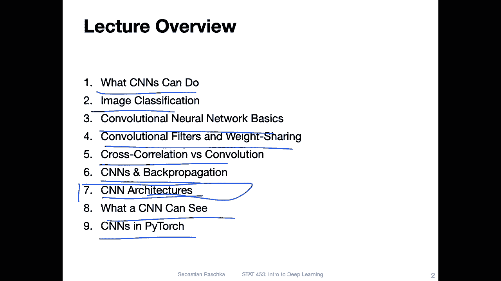
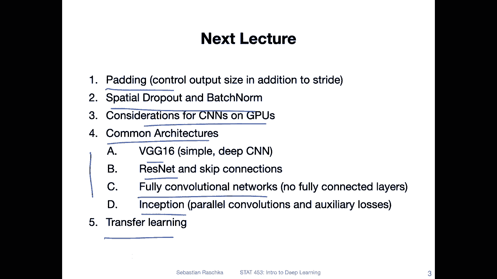
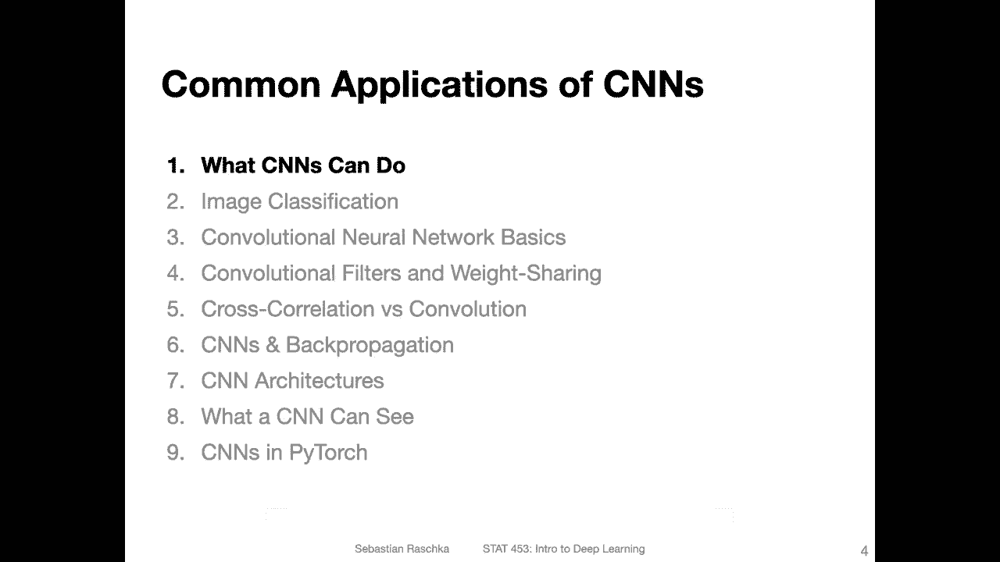

# 课程 P97：L13.0 - 卷积网络简介 🧠

在本节课中，我们将学习卷积神经网络的基本概念、工作原理及其主要应用。卷积神经网络特别擅长处理图像数据，是深度学习领域的重要架构。

---

## 应用领域 🌍

卷积神经网络的应用非常广泛。以下是其主要应用方向：

*   **图像分类**：识别图像中的主要物体。
*   **目标检测**：定位并识别图像中的多个物体。
*   **图像分割**：为图像的每个像素分配类别标签。
*   **风格迁移**：将一种图像的风格应用到另一张图像上。
*   **图像生成**：创建新的、逼真的图像。

## 聚焦图像分类 🖼️

为了更清晰地理解卷积网络，我们首先聚焦于图像分类任务。图像分类是卷积网络最基础且流行的应用之一，它有助于我们循序渐进地学习核心概念。

## 卷积网络基础 ⚙️

上一节我们了解了卷积网络的应用，本节中我们来看看它的核心思想。卷积网络的设计灵感来源于生物视觉皮层，它通过以下关键机制高效处理图像：

*   **局部连接**：神经元只与输入图像的局部区域连接，而非全连接。
*   **权重共享**：同一组滤波器（或权重）在输入的不同位置上滑动并重复使用。
*   **空间下采样**：通过池化等操作逐步降低特征图的空间尺寸。

## 卷积滤波器与权重共享 🔍

卷积操作的核心是滤波器（或卷积核）。以下是其工作方式：

1.  一个小的滤波器（例如 3x3 的矩阵）在输入图像上滑动。
2.  在每一个位置，计算滤波器与对应图像区域的**点积**，生成输出特征图的一个值。
3.  这个过程可以形式化表示为：
    `output[i, j] = sum( input[i+m, j+n] * filter[m, n] )`
    其中 `(i, j)` 是输出位置，`(m, n)` 是滤波器内的索引。

由于同一个滤波器遍历整个图像，参数被共享，这极大地减少了模型的参数量。

## 互相关与卷积的细微区别 📝

在深度学习的语境中，我们通常所说的“卷积”在技术上是指“互相关”。两者唯一的区别在于卷积操作在计算前会将滤波器旋转180度。然而，由于网络会在训练中学习滤波器权重，因此这个区别在实践中并不重要，可以忽略。

## 卷积网络中的反向传播 ⬅️

了解了前向传播后，我们自然关心梯度如何反向传播。卷积层反向传播的原理与全连接层类似，但涉及对卷积操作的梯度计算。具体推导较为复杂，但幸运的是，现代深度学习框架（如PyTorch）的自动微分功能可以自动处理这一切，因此我们无需手动实现。



## 主流卷积网络架构概览 🏗️

卷积网络发展出了多种强大的架构。本节我们简要列举，下一讲将深入探讨：

*   **VGGNet**：通过堆叠简单的3x3卷积层构建深度网络。
*   **ResNet**：引入残差连接，解决了极深网络中的梯度消失问题。
*   **Inception**：在单层内使用不同尺寸的滤波器并行提取特征。
*   **全卷积网络**：用于图像分割等稠密预测任务。

## 卷积网络看到了什么？ 👀

我们可以通过可视化技术来理解卷积网络内部的工作。例如，可视化第一层的滤波器，通常可以看到它们学习到了边缘、颜色和纹理等基础特征。更深层的神经元则可能对更复杂的图案或物体部件产生响应。

## 在PyTorch中使用卷积网络 💻

在PyTorch中实现卷积网络非常简单。主要使用 `torch.nn.Conv2d` 模块。以下是一个简单的示例代码框架：

```python
import torch
import torch.nn as nn

class SimpleCNN(nn.Module):
    def __init__(self):
        super(SimpleCNN, self).__init__()
        self.conv1 = nn.Conv2d(in_channels=3, out_channels=16, kernel_size=3, padding=1)
        self.pool = nn.MaxPool2d(kernel_size=2, stride=2)
        self.fc = nn.Linear(16 * 16 * 16, 10) # 假设输入图像为32x32

    def forward(self, x):
        x = self.pool(torch.relu(self.conv1(x)))
        x = x.view(-1, 16 * 16 * 16)
        x = self.fc(x)
        return x
```

---

## 总结 📚





本节课我们一起学习了卷积神经网络的基础知识。我们了解了其广泛的应用场景，深入探讨了其核心机制——局部连接和权重共享，并简要介绍了互相关与卷积的区别、反向传播原理以及主流网络架构。最后，我们还看到了如何在PyTorch中快速搭建一个简单的卷积网络。在下一讲中，我们将深入更高级的主题，如残差网络、Inception模块以及迁移学习。