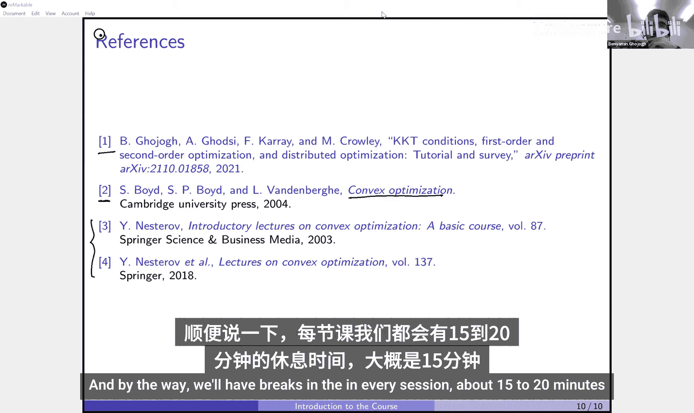
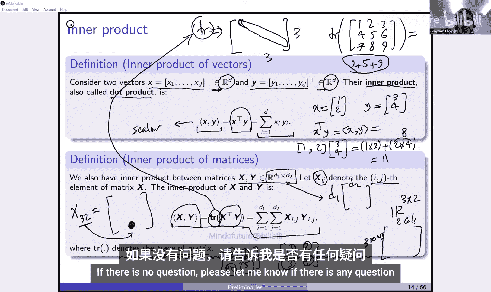
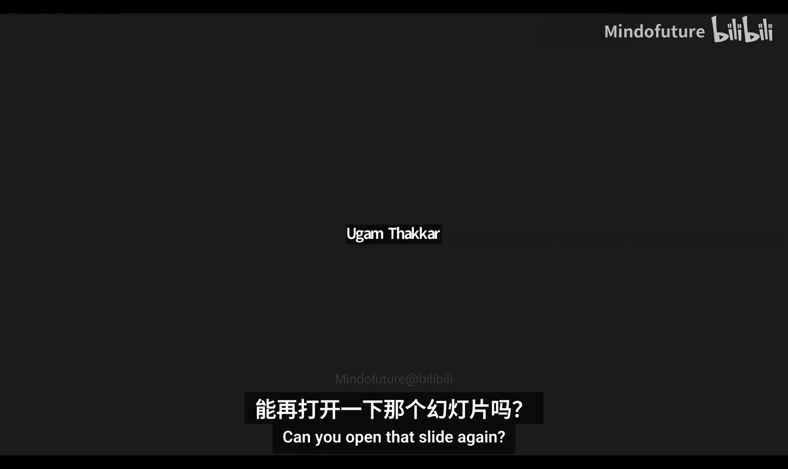
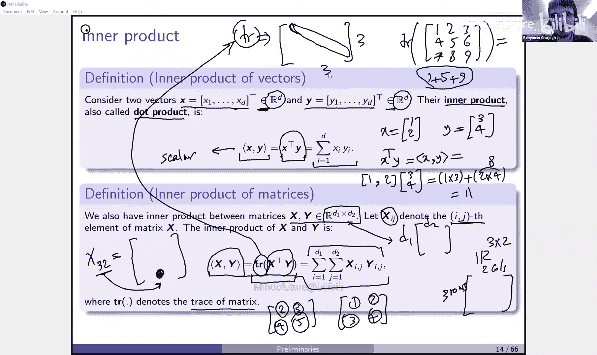

# 001：课程介绍与预备知识


## 概述
在本节课中，我们将学习优化技术课程的整体介绍以及一些必要的数学预备知识。课程将涵盖从基础概念到高级算法的广泛内容，旨在帮助初学者理解优化的核心思想及其在理论与实践中的应用。

---

## 课程介绍

本课程将介绍优化的主要方法。我们不仅会学习理论，还会探讨实践应用。课程内容涵盖核心优化算法，这些算法在工业界和学术研究中都非常有用。

我们将从预备知识和背景开始，包括集合、范数、函数、局部与全局最小化器、导数等概念。如果对这些概念不熟悉，请不要担心，课程会逐一讲解。

我们将学习梯度、雅可比矩阵、海森矩阵、集合的凸性以及函数的凸性。这些概念和方法既有趣又实用。

课程将介绍标准问题，如凸问题、线性规划、二次规划和半定规划。我们将详细讲解线性规划中的单纯形算法，特别是其实现方法之一——表格法。

我们还将学习整数线性规划，并使用分支定界法来求解。该方法通过树状结构简化整数线性规划问题，使其能利用线性规划的方法求解。

课程将介绍KKT条件（Karush-Kuhn-Tucker条件），这是优化中非常著名的条件。它们看似复杂，但实际上非常简单易懂，并且非常有用。

我们将学习拉格朗日函数和拉格朗日乘数法。之后，课程将涵盖无约束和一阶约束优化。我们将解释无约束和约束的含义，并学习基于梯度的一阶优化方法，如梯度下降法。我们也会涉及二阶优化方法，如牛顿法，以及在约束情况下的内点法或障碍法。

课程还将介绍重要的元启发式方法。当目标函数非常复杂或约束过多时，例如优化飞机的空气动力学结构，经典方法可能难以应用，此时可以使用元启发式优化方法。

元启发式优化是软计算的一个领域，包括模糊逻辑、神经网络和进化算法等。我们将学习一些重要的元启发式算法，如遗传算法、粒子群优化和模拟退火算法。

如果时间允许，我们还将介绍分布式优化，其中最著名的算法是交替方向乘子法（ADMM）。分布式优化的思想与联邦学习类似，适用于大数据和隐私保护场景。

此外，我们可能涵盖其他主题，如L1范数优化、次梯度和非光滑优化等。

---

## 课程大纲与时间安排

课程大纲是暂定的，我们将根据进度灵活调整。主要内容安排如下：
*   初步知识与背景
*   线性规划与单纯形法（表格法）
*   整数线性规划
*   KKT条件
*   期中考试（大约在第6周）
*   无约束与约束一阶方法
*   无约束与约束二阶方法
*   元启发式优化
*   分布式优化

---



## 课程材料与评估

课程材料包括讲义和笔记。我们还将提供一份教程论文作为可选阅读材料，其中涵盖了除线性规划外的许多主题。

课程评估包括：
*   **作业（20%）**：预计有三次作业，可能包含编程部分（建议使用Python）。
*   **期中考试（30%）**：内容将基于课堂讲授和作业，旨在检验理解程度。
*   **课程项目（40%）**：学生将分组进行，包括报告和口头展示。
*   **课堂参与（10%）**：积极参与课堂讨论、提问和回答问题将获得加分。

课程的主要目标是理解优化方法，而非追求高分。我们希望学习过程充满乐趣。


---

## 什么是优化？ 🔍

优化问题是寻找一个函数的最小值或最大值。

**函数** 是一种映射关系，对于每一个输入，都有唯一的输出。输入可以是标量（单个数字）、向量或多维数据。输出通常是标量。

我们想要最小化或最大化的函数称为**目标函数**或**成本函数**。最小化通常与减少成本或误差相关；最大化通常与增加利润或收益相关。

从哲学角度看，整个生命就是一场优化。同样，所有机器学习（如回归、分类、聚类、强化学习）本质上都是优化问题。

优化问题的输入变量称为**决策变量**、**优化变量**或**目标变量**。

---

## 优化问题的类型

优化问题可以是**单变量**的（只有一个标量输入），也可以是**多变量**的（有多个输入，可表示为向量或矩阵）。

例如，函数 `f(x) = xᵀx = x₁² + x₂² + ... + xₙ²` 是一个二次函数。在二维情况下，其图像像一个碗，最小值在原点 (0,0)。

优化问题可以是**无约束的**，即对变量没有限制。例如，最小化 `f(x) = x²`。

优化问题也可以是**有约束的**，即对变量的取值有限制。例如：
```
最小化 f(x) = x₁² + x₂²
约束条件：
    x₁ + x₂ ≤ 8
    2x₁ + x₂² ≤ 16
```
约束条件定义了变量的可行域。优化就是在可行域内寻找使目标函数值最优的点。需要注意的是，约束条件不能相互矛盾，否则可行域为空，问题无解。

---

## 优化与搜索

对于简单问题，可以使用经典的优化方法（基于微积分等）。对于非常复杂的问题（如存在许多局部最优解），则可以使用搜索方法。

**网格搜索**（或称暴力搜索）将定义域划分为网格，并计算每个网格点的函数值。这是一种简单但计算量可能很大的方法。

**元启发式搜索**（如粒子群优化）则更智能。它模拟群体协作，个体根据自身经验和群体经验在搜索空间中移动，逐步逼近最优解。目标函数的图像通常被称为**搜索地形**或**景观**。

---

## 集合与范数 📐

理解优化需要一些关于集合的基本概念。

**内点、闭包与边界**：
*   给定一个集合 D，其**内点**是那些可以被一个完全位于 D 内的小邻域包围的点。
*   集合的**闭包**是集合与其边界点的并集。
*   **边界**是闭包与内点的差集。

**凸集与凸包**：
*   一个集合是**凸集**，如果连接该集合中任意两点的线段上的所有点都仍然在该集合内。直观地说，凸集没有“凹陷”的部分。
*   **凸包**是包含给定集合的最小凸集。它相当于把非凸集的“凹陷”处“填平”。

**最小值、最大值、下确界、上确界**：
*   **最小值**是函数能达到的最小的函数值。
*   **最大值**是函数能达到的最大的函数值。
*   **下确界**是函数值最大的下界（可能达不到）。
*   **上确界**是函数值最小的上界（可能达不到）。
最小值和最大值分别是下确界和上确界的特殊情况。

---

## 内积

**向量的内积**（点积）：
对于两个向量 **x** 和 **y**，其内积定义为：
`<**x**, **y**> = **x**ᵀ**y** = Σᵢ xᵢ yᵢ`
结果是一个标量。几何上，它表示一个向量在另一个向量方向上的投影长度。

**矩阵的内积**：
对于两个矩阵 **X** 和 **Y**，其内积通常通过迹运算符定义：
`<**X**, **Y**> = tr(**X**ᵀ**Y**) = Σᵢ Σⱼ Xᵢⱼ Yᵢⱼ`
结果也是一个标量。迹运算符 `tr()` 计算的是矩阵主对角线元素之和。






---



## 总结
本节课我们一起学习了优化技术课程的总体框架、基本概念以及必要的数学预备知识。我们了解了什么是优化问题，以及无约束与约束优化的区别。我们还介绍了集合的基本概念（如内点、边界、凸集）和向量/矩阵的内积运算。这些概念是理解后续更复杂优化算法的基础。下节课我们将继续学习其他预备知识，并开始进入线性规划的具体内容。