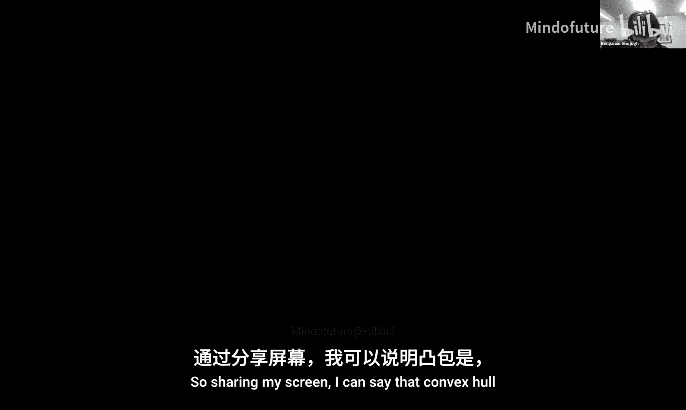
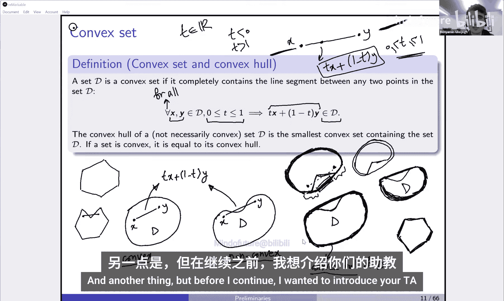
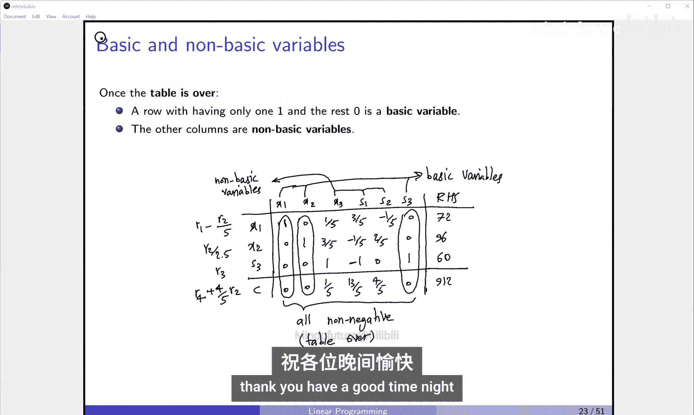

# 002：预备知识

在本节课中，我们将要学习优化技术所需的一些核心数学预备知识，包括集合、函数和优化问题的基础概念。这些知识是理解后续优化算法的基础。

## 集合的预备知识

上一节我们介绍了课程的基本信息，本节中我们来看看与集合相关的重要概念。

### 凸集

一个集合是**凸集**，如果对于集合中的任意两点，连接这两点的线段上的所有点也都在该集合内。用公式表示，对于集合 D 中的任意两点 x 和 y，以及任意 α ∈ [0, 1]，都有：
**αx + (1-α)y ∈ D**

### 凸包

对于一个集合（不一定是凸集），其**凸包**是包含该集合的最小凸集。如果集合本身已经是凸集，那么它的凸包就是它自己。

### 内点

点 x 是集合 D 的**内点**，如果存在一个正数 ε > 0，使得以 x 为中心、ε 为半径的邻域完全包含在 D 内。用公式表示：
**∃ ε > 0, {y | ||y - x||₂ ≤ ε} ⊆ D**
其中，||·||₂ 表示 L2 范数（欧几里得距离）。

## 范数与距离

以下是几种重要的范数定义。

### Lp 范数

对于一个 D 维向量 x = [x₁, x₂, ..., xₙ]ᵀ，其 Lp 范数定义为：
**||x||_p = (∑_{i=1}^{D} |x_i|^p)^{1/p}**
其中 p ≥ 1。

### 常用范数

*   **L1 范数（曼哈顿范数）**：`||x||₁ = ∑ |x_i|`
*   **L2 范数（欧几里得范数）**：`||x||₂ = √(∑ x_i²)`
*   **L∞ 范数（切比雪夫范数）**：`||x||_∞ = max(|x_i|)`

### 弗罗贝尼乌斯范数

对于矩阵 X ∈ ℝ^{D₁×D₂}，其弗罗贝尼乌斯范数类似于向量的 L2 范数：
**||X||_F = √(∑_{i=1}^{D₁} ∑_{j=1}^{D₂} X_{ij}²)**

### 范数的性质

范数满足以下四个条件：
1.  **非负性**：`||x|| ≥ 0`
2.  **齐次性**：`||αx|| = |α| · ||x||`
3.  **零向量的范数为零**：`||x|| = 0 ⇔ x = 0`
4.  **三角不等式**：`||x + y|| ≤ ||x|| + ||y||`

三角不等式可以直观理解为：两点之间的直线距离最短。

### 对偶范数

范数 ||·|| 的**对偶范数** ||·||_* 定义为：
**||z||_* = sup{ zᵀx | ||x|| ≤ 1 }**
其中，L2 范数的对偶是自身，L1 范数的对偶是 L∞ 范数，反之亦然。

### 霍尔德不等式

对于向量 x 和 y，以及满足 1/p + 1/q = 1 的 p, q ≥ 1，有：
**|xᵀy| ≤ ||x||_p · ||y||_q**
当 p = q = 2 时，即为著名的**柯西-施瓦茨不等式**。

## 锥与广义不等式

### 锥

一个集合 K 是**锥**，如果它满足：
1.  包含原点。
2.  是凸集。
3.  对于任意 x ∈ K 和标量 λ ≥ 0，都有 λx ∈ K。直观上，锥是从原点向外无限延伸的区域。

### 广义不等式

利用锥可以定义向量或矩阵之间的**广义不等式**。对于锥 K，我们定义：
**x ≼_K y ⇔ y - x ∈ K**
当 K 是非负象限（即所有分量非负）时，`x ≼ y` 意味着 x 的每个分量都小于等于 y 的对应分量。对于矩阵，通常使用半正定锥。

## 函数的预备知识

上一节我们介绍了集合和范数，本节中我们来看看函数，特别是凸函数的相关性质。

### 凸函数

一个函数 f: D → ℝ 是**凸函数**，如果其定义域 D 是凸集，且对于任意 x, y ∈ D 和 α ∈ [0, 1]，满足：
**f(αx + (1-α)y) ≤ αf(x) + (1-α)f(y)**
几何意义是：函数图像上任意两点之间的线段位于函数图像的上方（或重合）。如果不等式反向，则函数是**凹函数**。

### 凸函数的一阶条件

如果凸函数 f 可微，那么对于定义域内所有 x, y，有：
**f(y) ≥ f(x) + ∇f(x)ᵀ (y - x)**
这意味着函数图像始终在其任意一点的切线的上方。

### 凸函数的二阶条件

如果凸函数 f 二阶可微，那么其海森矩阵（二阶导数矩阵）处处是半正定的：
**∇²f(x) ≽ 0, ∀ x ∈ D**
对于标量函数，这意味着二阶导数非负，函数图像“开口向上”。

### 强凸函数

一个可微函数 f 是 **μ-强凸** 的（μ > 0），如果对于所有 x, y ∈ D，满足：
**f(y) ≥ f(x) + ∇f(x)ᵀ (y - x) + (μ/2) ||y - x||₂²**
强凸函数有且仅有一个全局最小值点，而普通凸函数的最小值点可能是一个区域。

### L-光滑（利普希茨连续）

一个函数 f 是 **L-光滑** 的，如果存在常数 L，使得对于所有 x, y ∈ D，满足：
**|f(x) - f(y)| ≤ L ||x - y||₂**
这意味着函数的变化率（斜率）有一个上界 L，不会出现过于陡峭的变化。

## 优化问题基础

### 极小值与极大值

*   **局部极小点 x***：存在一个邻域，在该邻域内 f(x*) 是最小值。
*   **全局极小点 x***：在整个定义域内，f(x*) 是最小值。
*   **凸函数的性质**：凸函数的任何局部极小点都是全局极小点。强凸函数有唯一的全局极小点。

### 驻点、鞍点与极值点

对于可微函数 f：
*   **驻点**：梯度为零的点，即 ∇f(x) = 0。
*   **极值点**：局部极小点或局部极大点。在极值点处，梯度为零。
*   **鞍点**：梯度为零，但既不是局部极小点也不是局部极大点。在鞍点处，函数在不同方向上的曲率符号相反（海森矩阵有正有负的特征值）。

需要注意的是，对于凸函数，“梯度为零”是“成为极小点”的充要条件。但对于非凸函数，梯度为零的点可能是极小点、极大点或鞍点。

### 优化问题的解

对于一个最小化问题 min f(x)：
*   **最优值**：函数能达到的最小值，记为 min f(x)。
*   **最优点（解）**：使得函数取得最优值的变量值，记为 argmin f(x)。

### 最小化与最大化的转换

可以利用以下关系在最小化和最大化问题之间转换：
*   `max f(x) = -min [-f(x)]`
*   `argmax f(x) = argmin [-f(x)]`

## 导数（梯度）的维度

导数的维度由函数输入和输出的维度决定：
*   **标量对标量的导数**：标量。
*   **标量对向量的导数（梯度）**：向量，维度与输入向量相同。`∇f(x) ∈ ℝᴰ`。
*   **向量对向量的导数（雅可比矩阵）**：矩阵，行数等于输入维度，列数等于输出维度。`J ∈ ℝ^{D₁×D₂}`。
*   **标量对矩阵的导数**：矩阵，维度与原矩阵相同。
*   **梯度向量的导数（海森矩阵）**：二阶导数矩阵，是方阵。对于凸函数，海森矩阵是半正定的。

### 链式法则

对于复合函数 h(x) = f(g(x))，其导数遵循链式法则：
**∇h(x) = ∇f(g(x)) · ∇g(x)**

## 总结

本节课中我们一起学习了优化技术所需的数学预备知识。我们回顾了凸集、凸包、内点等集合概念，介绍了Lp范数、弗罗贝尼乌斯范数及其性质。我们深入探讨了凸函数、强凸函数和L-光滑函数的定义与判别条件，并理解了它们在优化中的重要性。最后，我们学习了优化问题的基础，包括极值点、驻点、鞍点的区别，以及导数在不同情况下的维度。这些概念是理解和分析后续优化算法（如线性规划、梯度下降法等）的基石。下一讲，我们将开始学习具体的优化算法——线性规划。