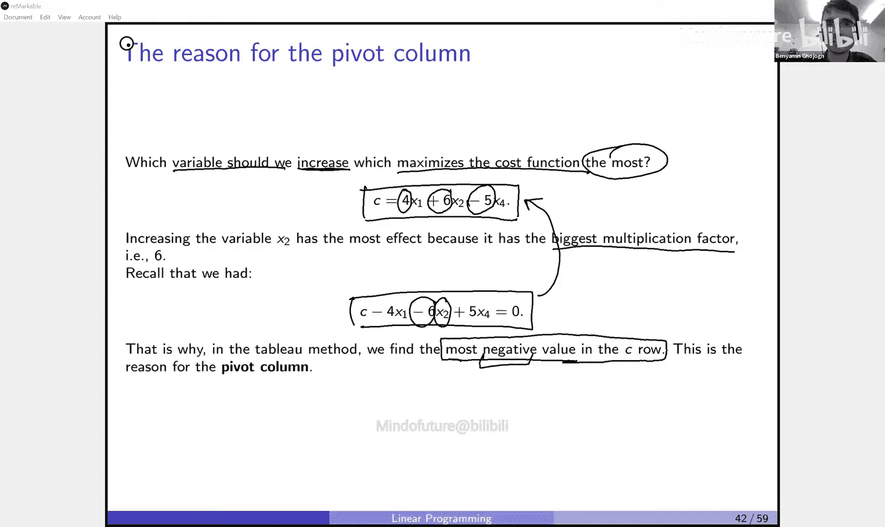

# 003：线性规划 📊


在本节课中，我们将要学习线性规划。线性规划是凸优化问题的一种特殊形式，其目标函数和所有约束条件都是线性的（或仿射的）。我们将从基本概念入手，学习如何将实际问题建模为线性规划问题，并通过可视化和单纯形法来求解。

---

## 概述

线性规划是优化问题中最基础且应用最广泛的一类。其特点是目标函数和约束条件都是线性的。由于问题的结构特性，其最优解总是出现在可行域的顶点（也称为极值点）上。本节课我们将学习线性规划的标准形式、建模方法、图解法以及求解线性规划的经典算法——单纯形法及其表格实现。

---

## 范数与利普希茨常数回顾

在深入线性规划之前，我们先简要回顾上节课的两个核心概念。

上一节我们介绍了各种范数及其单位球。随着参数 `p` 的增加，`L_p` 范数的单位球形状会从菱形（`p=1`）逐渐向正方形（`p=∞`）变化。当 `p` 小于1时，单位球会向内收缩。

关于利普希茨常数 `L` 的计算，我们有一个重要的结论。利普希茨条件不等式：
`|f(x) - f(y)| ≤ L ||x - y||`
可以重新整理，得到斜率的上界：
`|(f(x) - f(y)) / ||x - y||| ≤ L`
当 `x` 趋近于 `y` 时，这个比值趋近于函数在 `y` 点导数的范数 `||∇f(y)||`。因此，利普希茨常数 `L` 是函数在其定义域内导数范数的一个上界。为了获得最小的 `L`（这对优化有利），我们通常将其取为导数的最大范数：
`L = max_{x ∈ D} ||∇f(x)||`

---

## 优化问题的一般形式

现在，我们正式进入优化问题的讨论。一个一般的约束优化问题可以写成如下形式：
```
最小化 f(x)
满足于 g_i(x) ≤ 0, i = 1, ..., m1
        h_j(x) = 0, j = 1, ..., m2
```
其中 `x ∈ D`，`D` 是函数 `f` 的定义域。

*   **约束转换**：任何 `≥` 约束可以通过乘以 `-1` 转换为 `≤` 约束。等式或不等式右侧的常数项可以移到左侧，构成新的函数。
*   **可行点与可行集**：一个点 `x` 是可行的，当且仅当它同时属于函数定义域 `D` 并满足所有约束条件。所有可行点的集合称为可行集 `S`，优化问题也可以简洁地写为 `min_{x ∈ S} f(x)`。

---

## 凸优化问题

在所有优化问题中，凸优化问题是最容易求解的，因为其局部最优解就是全局最优解。

一个优化问题是凸的，当满足以下条件：
1.  目标函数 `f(x)` 是凸函数。
2.  不等式约束函数 `g_i(x)` 是凸函数。
3.  等式约束函数 `h_j(x)` 是仿射函数（即形如 `Ax + b` 的线性函数）。

凸优化有许多标准形式，以下是其中几种：

*   **线性规划**：目标函数和所有约束都是仿射函数。这是凸优化的特例。
*   **二次规划**：目标函数是二次的（例如 `(1/2)x^T P x + q^T x`，其中 `P` 正定），约束是仿射的。
*   **二次约束二次规划**：目标函数和不等式约束都是二次的，等式约束是仿射的。
*   **半定规划**：优化变量是一个半正定矩阵，目标函数和约束都是关于该矩阵的线性（仿射）函数。许多其他凸优化问题都可以转化为半定规划，因此它非常重要。内点法（或障碍法）是求解此类问题的强大工具。

---

## 线性规划详解

本节中我们重点学习线性规划，它是所有优化技术的重要基础。

### 标准形式

线性规划的标准形式通常写作：
```
最小化 c^T x
满足于 Gx ≤ h
        x ≥ 0
```
或者对于最大化问题，将“最小化”改为“最大化”。这里 `x ≥ 0` 表示向量的每个分量都非负，`Gx ≤ h` 也是按分量理解。变量非负的要求在许多实际问题（如生产数量、资源分配）中是很自然的。

### 实际应用举例

以下是两个将实际问题建模为线性规划的例子：

1.  **生产利润最大化**：
    *   **变量**：`x1`, `x2` 表示两种产品的产量。
    *   **目标**：最大化总利润 `60*x1 + 30*x2`。
    *   **约束**：资源限制，例如 `8*x1 + 3*x2 ≤ 48`（原材料限制），`4*x1 + 2*x2 ≥ 24`（最低生产要求），以及 `x1, x2 ≥ 0`。

2.  **储水系统容量最大化**：
    *   **变量**：`x1`, `x2` 表示两个连通水箱的水位高度。
    *   **目标**：最大化总储水量 `60*x1 + 30*x2`（假设宽度固定）。
    *   **约束**：进水流量限制或物理空间限制，可表示为线性不等式，如 `x1 + 2*x2 ≤ 40`，以及 `x1, x2 ≥ 0`。

---

## 图解法

当优化变量只有1个或2个时，我们可以用图解法直观地求解线性规划。

**求解步骤**：
1.  在坐标系中画出所有约束条件对应的直线（或平面），并确定满足不等式的半平面。
2.  所有约束半平面以及 `x ≥ 0` 的交集构成了可行域。它是一个多边形（或多面体），称为**多胞形**。
3.  画出目标函数的等值线（即 `c^T x = k` 的一系列平行线）。
4.  观察目标函数值 `k` 的变化方向。对于最大化问题，沿着目标函数增加的方向移动；对于最小化问题，则沿着减少的方向移动。
5.  **关键结论**：线性规划的最优解一定出现在可行域的某个**顶点**（极值点）上。只需比较目标函数在所有顶点处的值，即可找到最优解。

**示例**：对于问题 `min x1 + 2*x2, s.t. x1 + 2*x2 ≥ 40, x1 + x2 ≥ 30, x1, x2 ≥ 0`，其可行域是一个无界区域。图解法显示，在顶点 `(20, 10)` 处目标函数取得最小值 `40`。

---

## 单纯形法

对于变量更多的情况，我们需要系统性的算法。单纯形法是求解线性规划最著名的算法之一，其核心思想与图解法一致：在可行域（一个多胞形，或称单纯形）的顶点之间移动，每次移动都让目标函数值得到改善，直到找到最优顶点。

### 表格法

表格法是实现单纯形法的一种具体方法，通过一系列表格操作来模拟顶点间的移动。

**处理 `≤` 约束**：
1.  **引入松弛变量**：将每个 `≤` 不等式约束 `a^T x ≤ b` 转化为等式 `a^T x + s = b`，其中 `s ≥ 0` 称为松弛变量。原问题变量和所有松弛变量都要求非负。
2.  **构造初始表格**：将目标函数和所有等式约束写成表格形式。目标函数改写为 `c^T x - z = 0`，其中 `z` 是目标函数值。
3.  **迭代过程**：
    *   **选择主元列**：在目标函数行（`z` 行除外）中，选取最负的系数对应的变量作为**进基变量**（对于最大化问题）。这代表增加该变量对提升目标函数最有效。
    *   **比值检验**：对于主元列中每个正系数，计算其对应行的右端项与该系数的比值。忽略负系数和零系数。取最小比值对应的行作为**主元行**。该行对应的变量将成为**离基变量**。
    *   **行变换**：通过初等行变换，使主元位置变为1，且主元列其他所有位置变为0。这相当于让进基变量取代离基变量成为基变量。
    *   **更新**：将主元行的标签（变量名）替换为主元列的变量名。
4.  **终止条件**：重复步骤3，直到目标函数行的所有系数（`z` 列除外）都非负。此时表格给出了最优解：基变量取对应行的右端项值，非基变量取0，`z` 值即为最优目标函数值。

### 处理混合约束（`≥`, `=`）

对于更一般的约束，需要引入额外变量：
*   **`≥` 约束**：引入**剩余变量** `e (≥ 0)` 和**人工变量** `a (≥ 0)`，将 `a^T x ≥ b` 写为 `a^T x - e + a = b`。为了迫使人工变量 `a` 在最优解中为0，需要在目标函数中加上 `-M * a`（最大化问题），其中 `M` 是一个极大的正数。这称为**大M法**。
*   **`=` 约束**：直接引入**人工变量** `a (≥ 0)`，将等式写为 `a^T x + a = b`，同样在目标函数中加上 `-M * a` 以驱使 `a` 为0。

在表格法中，需要先通过行变换将人工变量对应的列化为单位向量形式（即成为基变量），然后再开始正常的单纯形迭代。

### 算法原理

单纯形法的每一步选择（主元列和主元行）都有直观解释：
*   **选择主元列（最负系数）**：这对应于选择那个单位增长能带来最大目标函数提升的变量进入基。
*   **比值检验（选择主元行）**：对于选定的进基变量，比值 `(右端项)/(主元列系数)` 代表了在其他变量为0的“最坏情况”下，该变量能增长的最大值。我们选择最小的比值，是为了确保移动到一个新的顶点时，所有约束仍然得到满足，即不离开可行域。

---

## 总结



本节课我们一起学习了线性规划的核心内容。我们首先回顾了范数和利普希茨常数的概念，然后介绍了优化问题的一般形式和凸优化的重要性。接着，我们深入探讨了线性规划的标准形式、建模方法以及两种求解技术：适用于低维问题的图解法和适用于任意维度的单纯形法（通过表格法实现）。我们了解到线性规划的最优解总在可行域的顶点达到，而单纯形法则通过沿着边在顶点间智能移动来寻找这个最优解。最后，我们还学习了如何处理 `≥` 和 `=` 约束的大M法。掌握线性规划是理解更复杂优化技术的重要基石。