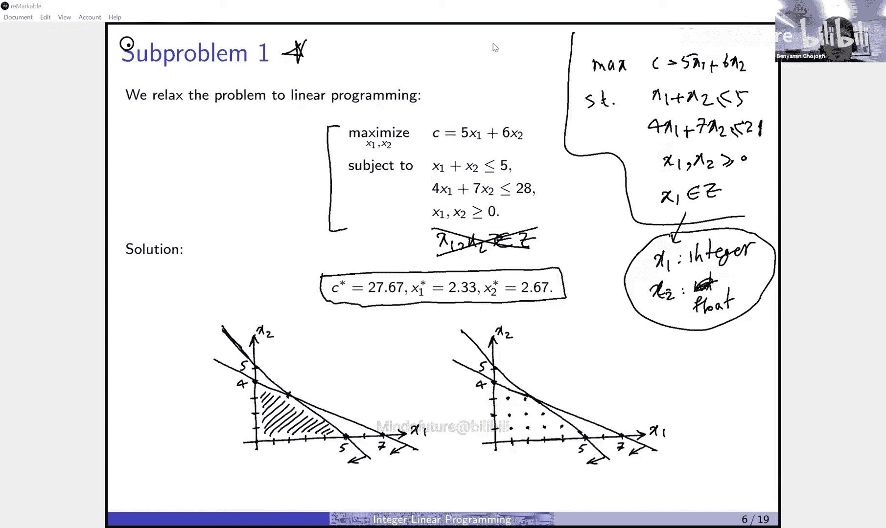
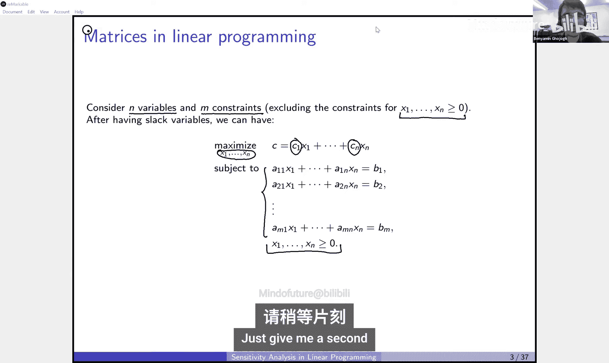
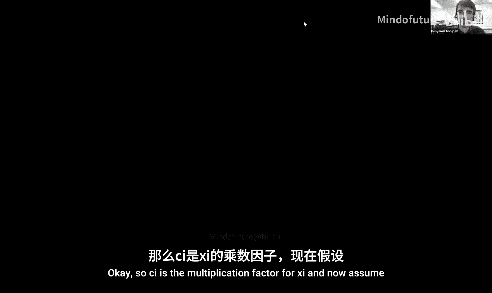
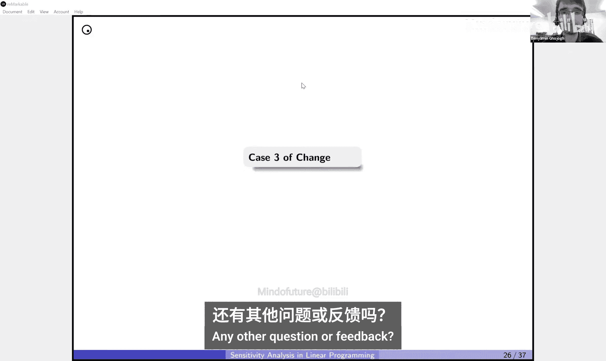

# 004：整数线性规划与灵敏度分析


在本节课中，我们将学习整数线性规划的基本概念及其求解方法——分支定界法。随后，我们将探讨线性规划中的灵敏度分析，了解当优化问题的参数发生变化时，如何分析其对最优解的影响。

---

## 线性规划回顾与对偶单纯形法

上一节我们介绍了线性规划的单纯形法。本节中，我们来看看对偶单纯形法，它特别适用于处理某些特定形式的约束。

在对偶单纯形法中，我们首先选择主元行，然后选择主元列，这与标准单纯形法的顺序相反。以下是其步骤概要：

1.  **选择主元行**：在约束的右侧值（RHS）列中，选择最负的值所在的行作为主元行。
2.  **选择主元列**：对于主元行中每一个负的系数，计算目标函数行（第0行）对应系数除以该负系数绝对值的比值。选择比值最小的列作为主元列。
3.  **执行行变换**：进行初等行变换，使主元变为1，主元列其他元素变为0。
4.  **终止条件**：重复上述步骤，直到RHS列中的所有值都变为非负。

当我们在最大化问题中遇到“大于等于”约束，或在最小化问题中遇到“小于等于”约束时，可以通过乘以-1来转换，但这可能导致RHS出现负值，此时就需要使用对偶单纯形法。

---

## 整数线性规划

整数线性规划是线性规划的一个扩展，要求部分或全部决策变量取整数值。当所有变量都必须为整数时，称为纯整数规划；当部分变量为整数，部分为连续变量时，称为混合整数规划。

### 为什么整数规划更困难？

与连续优化相比，离散（整数）优化通常更困难。因为在连续空间中，我们可以沿着任何方向平滑地移动以寻找最优解；而在整数空间中，我们只能“跳跃”到离散的格点上，这限制了搜索的灵活性。

### 整数规划与线性规划最优解的关系

对于一个最大化问题，将其整数约束松弛为连续约束后得到线性规划问题。线性规划的最优目标函数值 **总是大于或等于** 对应的整数规划的最优值。这是因为整数规划的可行域是线性规划可行域的一个子集。

### 求解方法：分支定界法

分支定界法是求解整数线性规划的经典方法。其核心思想是：先求解松弛后的线性规划问题，如果解不满足整数要求，则通过添加新的约束将原问题分解为两个子问题，并逐步缩小搜索范围。

以下是分支定界法的基本步骤：

1.  **松弛**：忽略整数约束，求解对应的线性规划问题（称为松弛问题）。
2.  **分支**：如果松弛问题的最优解中，某个应为整数的变量 `x_k` 取值为非整数 `a`，则创建两个新的子问题：
    *   子问题 A：在原问题基础上增加约束 `x_k ≤ floor(a)`。
    *   子问题 B：在原问题基础上增加约束 `x_k ≥ ceil(a)`。
3.  **定界与剪枝**：
    *   **整数解**：如果某个子问题的最优解全是整数，则记录该解及其目标值，作为当前最优整数解的一个候选。不再对该分支继续分解。
    *   **优于当前界**：如果子问题的最优值（对于最大化问题是上界）比当前记录的最佳整数解的目标值还差，则剪掉该分支（不再分解）。
    *   **无可行解**：如果子问题无可行解，则剪掉该分支。
    *   **非整数解**：如果子问题有非整数解且其上界优于当前最佳整数解，则返回步骤2，继续对该子问题进行分支。
4.  **选择最优**：遍历所有分支后，从所有记录的整数可行解中，选择目标值最优的一个作为原整数规划的最优解。

**分支变量选择**：通常选择当前解中分数部分最大的变量进行分支，这有助于更快地找到整数解。

---

## 灵敏度分析

灵敏度分析研究线性规划问题的最优解如何随问题参数的变化而变化。这对于实际应用（如生产计划、资源分配）中的决策支持至关重要。

### 分析框架




假设我们已通过单纯形法求解出标准形式的线性规划问题，并得到最终单纯形表。我们可以将表整理为以下形式，其中 `B` 和 `N` 分别代表基变量和非基变量的系数矩阵：





```
[ I | B^{-1}N ] | B^{-1}b
[ 0 | c_N^T - c_B^T B^{-1}N ] | -c_B^T B^{-1}b
```

*   `I`：单位矩阵。
*   `B^{-1}b`：基变量的最优值。
*   `c_N^T - c_B^T B^{-1}N`：判别数（第0行中非基变量的系数）。最优时，这些值应全部 ≥ 0（对于最大化问题）。
*   `-c_B^T B^{-1}b`：最优目标函数值的相反数。

灵敏度分析通过考察参数变化如何影响判别数 `c_N^T - c_B^T B^{-1}N` 和基变量值 `B^{-1}b` 来进行。

### 常见的参数变化类型及分析思路

1.  **目标函数系数 `c_j` 的变化**
    *   **非基变量系数变化**：只影响该变量对应的判别数。计算新判别数，若仍 ≥ 0，则最优解不变；否则，需继续迭代。
    *   **基变量系数变化**：影响所有非基变量的判别数。需重新计算所有判别数，检查是否全部 ≥ 0，以确定最优基是否改变。

2.  **约束条件系数 `a_{ij}` 的变化**
    *   **非基变量系数变化**：影响 `B^{-1}N` 中对应的列，从而影响相关判别数。重新计算并判断。
    *   **基变量系数变化**：改变了基矩阵 `B`，因此需要重新计算 `B^{-1}`，进而影响整个表格。分析较为复杂。

3.  **右端项 `b_i` 的变化**
    *   影响基变量的值 `B^{-1}b`。计算新的基变量值，若全部 ≥ 0，则最优基不变，但解值改变；否则，需使用对偶单纯形法恢复可行性。

4.  **增加新变量**
    *   相当于在最终表中增加一列。计算该新变量对应的判别数，若 ≥ 0，则不应引入；否则，将其作为入基变量继续迭代。

5.  **增加新约束**
    *   将新约束加入最终表。若原最优解满足新约束，则仍为最优；否则，引入松弛变量或人工变量，并使用对偶单纯形法或大M法求解。

**核心原则**：参数变化后，检查原最终单纯形表中的两个关键部分：
*   **最优性条件**：判别数是否仍全部非负（最大化问题）。
*   **可行性条件**：基变量的值是否仍全部非负。
只要这两个条件同时满足，则当前基仍是最优基，尽管目标函数值和变量值可能已变。若任一条件被破坏，则需从当前表出发继续迭代，寻找新的最优解。

---



本节课中我们一起学习了整数线性规划的分支定界法，以及线性规划灵敏度分析的基本原理。理解这些内容有助于我们处理现实世界中带有离散决策或参数不确定性的优化问题。