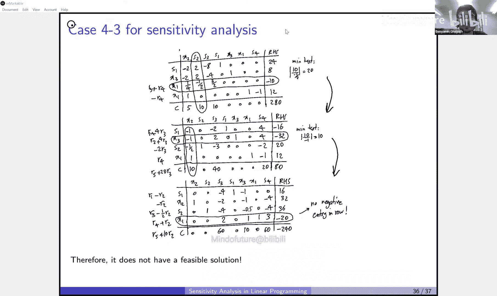
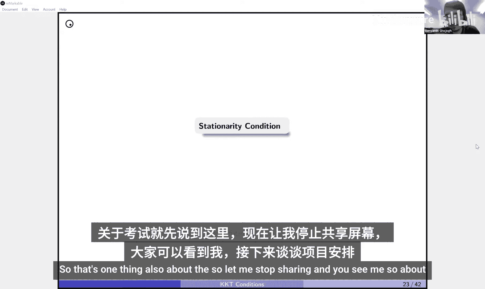

# 005：灵敏度分析与拉格朗日函数

## 概述
在本节课中，我们将学习线性规划中的灵敏度分析，并引入优化理论的核心概念——拉格朗日函数与对偶性。我们将了解如何分析优化问题对参数变化的敏感度，并学习如何将带约束的优化问题转化为无约束问题。

---

## 灵敏度分析回顾
上一节我们介绍了线性规划的基本解法。本节中，我们来看看当优化问题的参数发生变化时，如何分析其对最优解的影响，即灵敏度分析。

灵敏度分析的核心思想是：在已求得最优解的基础上，分析当目标函数系数、约束系数等参数发生改变时，最优解是否会变化，以及如何变化。管理者可能基于市场变化提出此类问题，工程师需要据此给出建议。

### 参数变化的几种情况
以下是灵敏度分析中常见的几种变化类型：

1.  **改变非基变量在目标函数中的系数**：例如，改变某个当前不生产产品的单位利润。如果变化在一定范围内，最优解可能不变；若超出范围，则需重新计算，该变量可能进入基变量，开始被生产。
2.  **改变基变量在目标函数中的系数**：这会影响单纯形表中的多个部分，需要重新计算检验数。变化超出特定区间时，最优基可能改变。
3.  **改变约束条件中的系数**：分为改变非基变量和基变量的系数。这需要重新计算单纯形表中受影响的列，并判断是否需要继续迭代。
4.  **增加新的决策变量**：例如，公司考虑引入新产品。这相当于在单纯形表中增加一列。若该列检验数为非负，则不应生产该产品；若为负，则需继续迭代，新产品可能取代原有产品进入生产计划。
5.  **增加新的约束条件**：这可能导致三种情况：
    *   当前最优解满足新约束，则最优解不变。
    *   当前最优解不满足新约束，但问题仍有可行解，此时需用对偶单纯形法继续求解。
    *   新约束与原有约束矛盾，导致可行域为空，问题变得不可行。

**核心概念**：在单纯形表中，参数变化的影响可通过公式 **`c_N^T - c_B^T B^{-1} N`** 重新计算检验数来判断。其中 `B` 是基变量系数矩阵，`N` 是非基变量系数矩阵。

---

## 整数规划的舍入问题
在讨论灵敏度分析后，我们回顾一个关于整数线性规划的重要观点。有人提出，可以先求解连续的线性规划问题，再将解舍入到最近的整数。但这是一个常见的误解。

**反例**：假设连续线性规划的最优解是 `(1.8, 4.8)`，舍入到最近整数得到 `(2, 5)`。然而，`(2, 5)` 这个点可能根本不在整数规划的可行域内。因此，简单的舍入通常无法得到可行或最优的整数解。这正是我们需要使用分支定界法等专门算法来解决整数规划的原因。

---

## 拉格朗日函数与对偶性
从线性规划过渡到更一般的非线性优化，我们引入一个核心工具——拉格朗日函数。它是处理约束优化问题的关键。

### 一般优化问题的形式
任何优化问题都可以写成以下标准形式：
**最小化** `f(x)`
**满足** `g_i(x) ≤ 0, i = 1, ..., m`
**以及** `h_j(x) = 0, j = 1, ..., p`

其中，`x` 是优化变量，`f(x)` 是目标函数，`g_i(x)` 是不等式约束，`h_j(x)` 是等式约束。最大化问题可以通过对目标函数取负号转化为最小化问题。

### 拉格朗日函数的定义
对于上述优化问题，其拉格朗日函数 `L(x, λ, ν)` 定义为：

**`L(x, λ, ν) = f(x) + Σ_{i=1}^{m} λ_i g_i(x) + Σ_{j=1}^{p} ν_j h_j(x)`**

其中：
*   `λ_i` 称为对应于不等式约束 `g_i(x) ≤ 0` 的**拉格朗日乘子**或**对偶变量**，且要求 **`λ_i ≥ 0`**。
*   `ν_j` 称为对应于等式约束 `h_j(x) = 0` 的拉格朗日乘子，符号不限。

### 拉格朗日函数的直观理解
拉格朗日函数可以理解为原约束问题的“松弛”。它将难以处理的约束条件以惩罚项的形式加入目标函数：
*   `f(x)` 是原始目标。
*   `Σ λ_i g_i(x)` 是对违反不等式约束的惩罚。由于 `g_i(x) ≤ 0` 且 `λ_i ≥ 0`，此项为非正，违反越严重（`g_i(x)` 越大），惩罚越大（使 `L` 值增大）。
*   `Σ ν_j h_j(x)` 是对违反等式约束的惩罚。

通过最小化拉格朗日函数，我们试图在最小化原始目标的同时，尽可能满足约束条件。它将一个**带约束**的问题转化为了一个关于 `x` 的**无约束**问题（但引入了新的变量 `λ` 和 `ν`）。

### 对偶函数
在拉格朗日函数的基础上，我们定义**对偶函数** `g(λ, ν)`：

**`g(λ, ν) = inf_{x} L(x, λ, ν)`**

对偶函数是拉格朗日函数关于原始变量 `x` 取极小值后得到的函数，因此它只是对偶变量 `λ` 和 `ν` 的函数。

### 弱对偶与强对偶
一个重要引理指出：对于任意满足 `λ ≥ 0` 的 `λ` 和 `ν`，对偶函数 `g(λ, ν)` 总是原问题最优值 `p*` 的一个**下界**，即 **`g(λ, ν) ≤ p*`**。

由此，我们可以构造**对偶问题**：
**最大化** `g(λ, ν)`
**满足** `λ ≥ 0`

设对偶问题的最优值为 `d*`。根据上述引理，恒有 **`d* ≤ p*`**。这个性质称为**弱对偶性**。差值 `p* - d*` 称为**对偶间隙**。

如果对偶间隙为零，即 **`d* = p*`**，则称为**强对偶性**成立。对于凸优化问题，在满足一定条件（如Slater条件：存在一个严格可行点，使得所有不等式约束都严格小于0）时，强对偶性通常成立。

### 对偶性的意义
*   **弱对偶**：给出了原问题最优值的一个下界，可用于评估求解算法的效果。
*   **强对偶**：意味着我们可以通过求解对偶问题来获得原问题的最优值。有时对偶问题更容易求解。

---

## 总结
本节课我们一起学习了两个重要部分：
1.  **灵敏度分析**：我们掌握了如何分析线性规划问题参数变化对最优解的影响，并能够针对不同变化情况（如改变系数、增加变量或约束）给出是否需重新求解的判断。
2.  **拉格朗日函数与对偶性基础**：我们引入了处理约束优化问题的核心工具——拉格朗日函数，理解了它如何通过添加惩罚项将约束问题松弛。在此基础上，我们定义了对偶函数，并学习了弱对偶与强对偶的关键概念，这为后续学习KKT条件奠定了理论基础。

在接下来的课程中，我们将基于拉格朗日函数，深入探讨最优解必须满足的KKT条件。