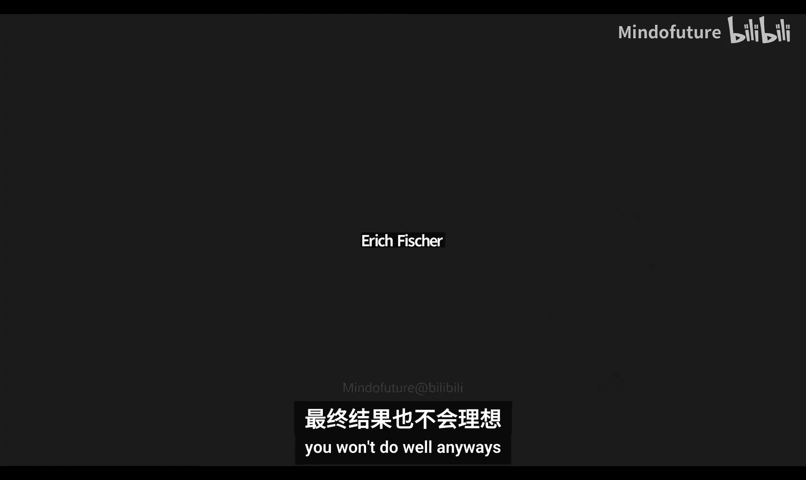
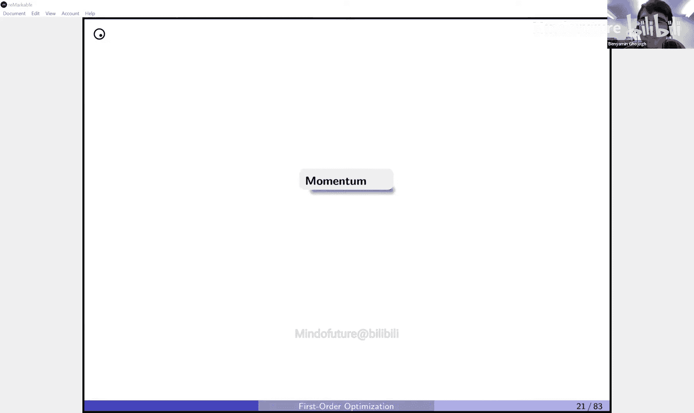
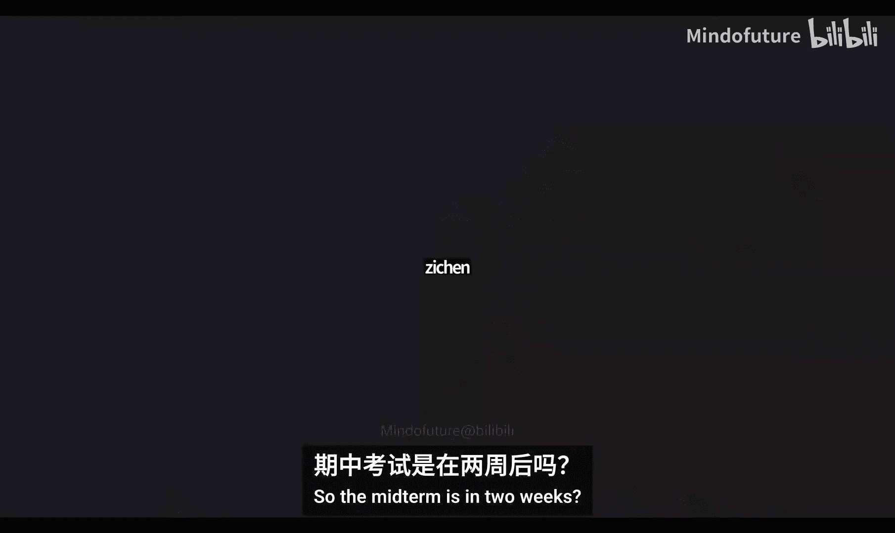

# 006：KKT条件与梯度下降


在本节课中，我们将学习优化理论中的两个核心概念：KKT条件和梯度下降法。KKT条件是判断优化问题最优解的必要条件，而梯度下降法是一种用于寻找函数最小值的迭代式一阶优化算法。我们将从理论推导到实际应用，逐步解析这些内容。

## 课程与项目安排概述



在深入技术内容之前，我们先简要说明课程项目分组和期中考试的相关安排。

*   课程项目需要组建小组，每组建议4人（允许一组为3人）。请尽快在课程链接中提交小组成员名单和简短的项目提案。
*   期中考试将于两周后的课程时间（2月28日）在线进行。考试形式为开卷，内容涵盖截至KKT条件结束的所有课程材料。请确保按时参加，并准备好必要的设备。

现在，让我们进入今天的核心学习内容。

## KKT条件详解

上一讲我们介绍了对偶问题、对偶函数以及强对偶性的Slater条件。本节中，我们将基于这些概念，推导出在优化理论中至关重要的KKT条件。

### 平稳性条件

首先回顾拉格朗日函数，对于标准形式的优化问题：
`L(x, λ, ν) = f(x) + Σ λ_i g_i(x) + Σ ν_j h_j(x)`
我们可以将其视为原始目标函数 `f(x)` 的一个正则化形式。为了最小化这个正则化问题，我们对 `x` 求导并令其为零：
`∇_x L(x, λ, ν) = 0`
这个方程称为**平稳性条件**。它意味着在最优解处，拉格朗日函数关于原始变量的梯度必须为零。这个条件对于所有对偶变量 `λ` 和 `ν` 都成立，而不仅仅是最优对偶变量。

### 互补松弛条件

在强对偶性成立的前提下，我们可以推导出另一个关键条件。假设 `x*` 是原始最优解，`λ*`, `ν*` 是对偶最优解。根据强对偶性定义和对偶函数，经过一系列推导，我们可以得到：
`λ_i* · g_i(x*) = 0`， 对于所有不等式约束 `i`
这被称为**互补松弛条件**。它意味着对于每个不等式约束，其对应的最优拉格朗日乘子 `λ_i*` 和约束函数值 `g_i(x*)` 至少有一个为零。

以下是互补松弛条件的两种具体情况：
*   若 `λ_i* > 0`，则必有 `g_i(x*) = 0`（约束是紧的或活跃的）。
*   若 `g_i(x*) < 0`，则必有 `λ_i* = 0`（约束是非活跃的，其对偶变量为零）。

### KKT条件总结

将平稳性条件、互补松弛条件与我们之前讨论的原始可行性和对偶可行性结合起来，就得到了完整的**KKT条件**（Karush-Kuhn-Tucker条件）。对于最优解 `(x*, λ*, ν*)`，它们必须满足以下四点：

1.  **平稳性**： `∇_x L(x*, λ*, ν*) = 0`
2.  **原始可行性**： `g_i(x*) ≤ 0`, `h_j(x*) = 0` （对所有约束）
3.  **对偶可行性**： `λ_i* ≥ 0` （对所有不等式约束）
4.  **互补松弛**： `λ_i* · g_i(x*) = 0` （对所有不等式约束）

KKT条件是最优解的必要条件。对于凸优化问题且满足Slater条件（即强对偶成立）时，KKT条件同时也是最优解的充分条件。

### 拉格朗日乘子法

KKT条件不仅可以用来验证解的最优性，还可以直接用于求解优化问题，这种方法称为**拉格朗日乘子法**。其步骤如下：

以下是使用拉格朗日乘子法求解优化问题的具体步骤：
1.  构造拉格朗日函数 `L(x, λ, ν)`。
2.  对 `L` 关于 `x` 求导并令为零，解出 `x` 为 `λ, ν` 的函数，即 `x = φ(λ, ν)`。
3.  将 `x = φ(λ, ν)` 代回 `L`，得到对偶函数 `g(λ, ν)`。
4.  求解对偶问题 `max_{λ≥0, ν} g(λ, ν)`，得到最优对偶变量 `λ*`, `ν*`。
5.  将 `λ*`, `ν*` 代入 `x = φ(λ, ν)`，得到最优原始变量 `x*`。
6.  计算 `f(x*)` 得到最优目标值。

我们通过一个简单的数值例子演示了该方法的应用，并验证了在满足Slater条件的问题中，强对偶性（`f(x*) = g(λ*, ν*)`）确实成立。

## 梯度下降法

在学习了处理约束问题的KKT条件后，我们转向无约束优化问题，并介绍一种基础而强大的迭代算法——梯度下降法。

### 梯度下降的推导

梯度下降的核心思想是沿着当前点梯度方向的反方向（即函数下降最快的方向）前进一小步，逐步逼近函数的最小值点。

我们从微积分基本定理的一个推论出发：对于一个梯度是L-利普希茨连续的函数，有以下不等式成立：
`f(y) ≤ f(x) + ∇f(x)^T (y - x) + (L/2) ||y - x||^2`
我们的目标是在每一步迭代中减少函数值，即希望 `f(x_{k+1}) < f(x_k)`。将 `y = x_{k+1}`, `x = x_k` 代入上式，并令 `x_{k+1} = x_k + Δx`，我们得到：
`f(x_k + Δx) - f(x_k) ≤ ∇f(x_k)^T Δx + (L/2) ||Δx||^2`
为了使左端（函数值的实际变化）尽可能为负，我们最小化其右端上界。通过求解这个关于 `Δx` 的二次函数最小值，我们得到最优的更新步长为：
`Δx = - (1/L) ∇f(x_k)`
因此，梯度下降的迭代公式为：
`x_{k+1} = x_k - (1/L) ∇f(x_k)`

### 步长与线搜索

在实际应用中，利普希茨常数 `L` 通常难以获取。因此，我们引入一个可调的**步长**（或学习率） `η`，将迭代公式写为更通用的形式：
`x_{k+1} = x_k - η ∇f(x_k)`
为了保证算法收敛（函数值下降），步长 `η` 需要满足条件 `0 < η < 2/L`。最优的理论步长是 `η = 1/L`。

由于 `L` 未知，我们需要动态确定合适的步长，这个过程称为**线搜索**。最简单的线搜索（回溯法）从 `η=1` 开始，如果新点的函数值没有充分下降（例如，不满足 `f(x_k - η∇f(x_k)) < f(x_k)`），则将 `η` 减半，重复此过程直到满足条件。更复杂的线搜索如**Armijo准则**要求更严格的下降条件，通常能带来更稳定的收敛。

### 收敛准则与算法框架

梯度下降是一个迭代过程，我们需要一个停止条件。常用的**收敛准则**包括：
*   梯度范数足够小：`||∇f(x_k)|| < ε`
*   函数值变化足够小：`|f(x_{k+1}) - f(x_k)| < ε`
*   自变量变化足够小：`||x_{k+1} - x_k|| < ε`
*   达到最大迭代次数。

结合线搜索和收敛准则，梯度下降算法的框架如下：
```
初始化 x_0
for k = 0, 1, 2, ...:
    初始化步长 η = 1
    while 不满足线搜索条件（如Armijo条件）:
        η = β * η （例如 β=0.5）
    x_{k+1} = x_k - η ∇f(x_k)
    if 满足收敛准则:
        break
返回 x_{k+1}
```
对于凸函数，梯度下降能收敛到全局最小值；对于非凸函数，它可能收敛到局部最小值或鞍点。步长的选择会影响收敛速度和稳定性，过大的步长可能导致振荡，过小的步长则收敛缓慢。

## 总结

本节课中我们一起学习了优化理论中的两大支柱。首先，我们深入探讨了KKT条件，它是一组用于判断约束优化问题最优解的必要条件，包含了平稳性、原始可行性、对偶可行性和互补松弛性。我们还介绍了利用KKT条件求解问题的拉格朗日乘子法。

随后，我们转向无约束优化，推导了梯度下降法这一基础的一阶迭代算法。我们讨论了其理论步长、实际应用中步长的选择策略（线搜索），以及判断算法何时停止的收敛准则。





从下一讲开始，我们将继续探索更高级的一阶和二阶优化方法，并将这些技术应用于带约束的问题。