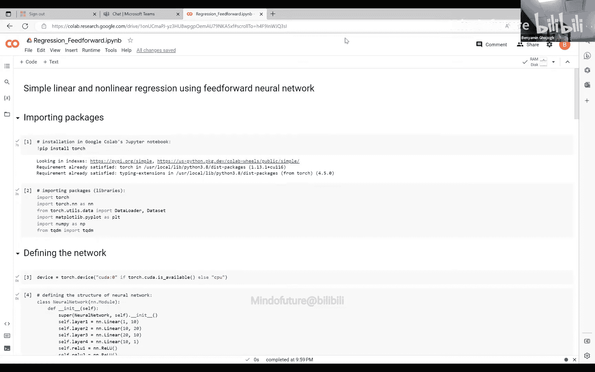

# 007：反向传播、AGM、SGD、SAG、Adam与神经网络


## 概述
在本节课中，我们将学习几种重要的优化算法，包括反向传播、加速梯度法、随机梯度下降及其变体，并了解它们如何应用于神经网络训练。课程最后将通过一个简单的代码示例，展示如何构建和训练一个神经网络。

---

## 项目与课程反馈
上一讲我们介绍了梯度下降与动量方法。在开始新内容前，先对课程项目和中途测验进行一些说明。

以下是关于课程项目的一些通用建议：
*   请首先清晰地解释你要解决的问题。
*   将问题表述为一个或多个优化问题，即最小化或最大化某个目标函数，并包含约束条件。
*   请说明你计划使用的优化算法，并简要解释其工作原理、优缺点，以及为何选择该算法。
*   在报告中展示实验结果并进行深入分析，而不仅仅是呈现数据。


关于课程成绩，请尽力完成项目、作业和测验，无需过度担忧。我会根据每个项目的完成情况独立评分。如果在项目过程中遇到任何困难，欢迎随时联系我寻求帮助。

关于中途测验，我收到了关于测验时长的反馈。在未来的课程中，我会尝试缩短测验时间。感谢大家的反馈。

根据课程进度，我们可能还会有一次作业。如果之前作业完成得不够理想，请尽力完成后续的作业和项目。

---

## 反向传播算法
现在，我们进入本节课的核心内容。首先，我们来探讨在神经网络中至关重要的**反向传播**算法。

### 神经网络基础
人工神经网络试图模仿人脑的结构。一个简单的**前馈神经网络**包含多个层，每层有多个神经元。每一层的神经元都与下一层的所有神经元相连，但同层神经元之间没有连接。网络的输入层神经元数量应与输入数据的维度匹配，输出层神经元数量应与输出维度匹配。这些连接上的**权重**是可学习的参数，我们的目标就是优化这些权重，使网络能准确地将输入映射到期望的输出。

每个神经元的计算分为两步：
1.  **加权求和**：将上一层所有神经元的输出乘以对应的权重并求和，得到 `a_i`。
    `a_i = Σ_l (x_il * z_l)`
2.  **激活函数**：将 `a_i` 输入一个非线性**激活函数**（如ReLU、Sigmoid），得到该神经元的输出 `z_i`。
    `z_i = σ_i(a_i)`

激活函数的非线性至关重要。如果所有激活函数都是线性的，那么整个多层网络将退化为一个单层线性变换，无法捕捉数据中的复杂非线性模式。

### 反向传播原理
反向传播的本质是**梯度下降**加上**链式法则**。我们的目标是最小化网络的预测误差 `E`。由于优化变量是所有权重 `x_il`，我们需要计算误差 `E` 对每个权重 `x_il` 的梯度。

根据梯度下降，权重的更新规则为：
`x_il^(新) = x_il^(旧) - η * (∂E/∂x_il)`

关键是如何计算 `∂E/∂x_il`。这里就需要链式法则。我们可以将其分解：
`∂E/∂x_il = (∂E/∂a_i) * (∂a_i/∂x_il)`

*   `∂a_i/∂x_il` 很容易计算，根据 `a_i` 的定义，其结果为 `z_l`。
*   `∂E/∂a_i` 定义为 `δ_i`。计算 `δ_i` 需要区分神经元 `i` 所在的层：
    *   如果神经元 `i` 在**输出层**，`δ_i` 可以直接根据误差函数 `E` 和激活函数 `σ_i` 计算。
    *   如果神经元 `i` 在**中间层（隐藏层）**，则需要再次使用链式法则，通过下一层神经元的 `δ_j` 来计算：
        `δ_i = σ_i‘(a_i) * Σ_j (x_ji * δ_j)`

通过这种从输出层向输入层反向递推的方式，我们可以高效地计算出所有权重的梯度，从而利用梯度下降更新权重。反向传播算法于1986年提出，极大地推动了人工智能的发展。

---

## 加速梯度法
我们之前学习的梯度下降法，在收敛速度上并非最优。为此，Nesterov在1983年提出了**加速梯度法**，也称为快速梯度法。

AGM在每次迭代中更新两个变量 `x` 和 `y`，其更新规则如下：
1.  `x_{k+1} = y_k - η_k * ∇f(y_k)`
2.  `y_{k+1} = x_{k+1} + γ_k * (x_{k+1} - x_k)`

其中，序列 `γ_k` 需要满足特定条件（例如 `γ_k = 2/k` 对于 k>=4）。

### 收敛速率比较
假设目标函数 `f` 是凸函数且其梯度是L-平滑的。设 `f*` 为最优函数值，`x*` 为最优解，`x_0` 为初始点。

*   **梯度下降**的收敛速率上界为：
    `f(x_k) - f* ≤ (2L ||x_0 - x*||^2) / (k+1)`
    其收敛阶为 `O(1/k)`。

*   **加速梯度法**的收敛速率上界为：
    `f(x_k) - f* ≤ (4L ||x_0 - x*||^2) / ((k+1)^2)`
    其收敛阶为 `O(1/k^2)`。

比较可知，AGM的收敛速度显著快于标准梯度下降法。值得注意的是，AGM是一种梯度**方法**，而非“下降”法，因为其迭代过程并不保证函数值每一步都下降。

---

## 随机梯度下降及其变体
当目标函数是大量子函数之和时（常见于机器学习），计算完整梯度非常耗时。**随机梯度下降** 应运而生。

### 随机梯度下降
考虑目标函数：`f(x) = (1/n) Σ_{i=1}^n f_i(x)`
完整梯度为：`∇f(x) = (1/n) Σ_{i=1}^n ∇f_i(x)`

SGD在每次迭代中，**随机采样**一个索引 `i_t`，然后仅使用该子函数的梯度进行更新：
`x_{k+1} = x_k - η_k * ∇f_{i_t}(x_k)`

*   **优点**：每次迭代计算快，内存需求低。
*   **缺点**：由于使用噪声梯度，收敛路径震荡，且最终可能只在最优解附近徘徊。若使用固定学习率，最终会与最优解保持一个与 `η` 相关的差距。

其收敛速率取决于学习率的选择。对于凸函数，若使用递减学习率（如 `η_k = 1/√k`），收敛阶约为 `O(log k / √k)`。

### 小批量随机梯度下降
为了在速度和稳定性之间取得平衡，**小批量SGD** 被广泛使用。它每次迭代随机采样一个小批量（Mini-batch）数据 `B`，并使用该批数据的平均梯度进行更新：
`x_{k+1} = x_k - η_k * (1/|B|) Σ_{i∈B} ∇f_i(x_k)`

小批量SGD是深度学习中最重要的优化算法之一。遍历整个数据集一次称为一个**周期**。

### 随机平均梯度
SAG算法（2012年提出）试图结合SGD的速度和GD的精度。其思想是维护一个梯度表，每次迭代随机更新一个子函数的梯度，并用更新后的梯度表均值来近似完整梯度。理论上，它具有与GD相同的 `O(1/k)` 收敛速率，但实践中需要仔细调参。

### 随机方差缩减梯度
SVRG（2013年提出）是另一种改进SGD的方法。它在每次外循环中计算一次完整梯度作为锚点，然后在接下来的内循环中，使用该锚点来修正随机梯度的方差，从而获得更稳定的收敛。

---

## 自适应学习率算法
学习率的设置对优化至关重要。以下是一些自适应调整学习率的著名算法。

### AdaGrad
AdaGrad（2011年）为每个参数维护一个累积平方梯度，并据此缩放学习率：
`G_{jj} = Σ_{t=1}^k (∇f_{i_t}(x_t)_j)^2`
`x_{k+1} = x_k - η * (G + εI)^{-1/2} * ∇f_{i_k}(x_k)`
其思想是：对于历史上更新频繁（梯度大）的参数，降低其学习率；对于更新少的参数，则给予较大的学习率。这有助于处理稀疏数据。

### RMSProp
RMSProp（2012年）改进了AdaGrad，引入衰减因子 `γ` 来计算梯度的指数移动平均，避免了学习率过早衰减至零：
`v_k = γ * v_{k-1} + (1-γ) * (∇f(x_k))^2`
`x_{k+1} = x_k - η * (∇f(x_k) / (√v_k + ε))`

### Adam
**Adam**（自适应矩估计）是当前最流行的优化器之一。它结合了RMSProp和动量的思想，同时计算梯度的一阶矩（均值）和二阶矩（未中心化的方差）的指数移动平均，并进行偏差校正：
`m_k = β1 * m_{k-1} + (1-β1) * ∇f(x_k)`
`v_k = β2 * v_{k-1} + (1-β2) * (∇f(x_k))^2`
`m̂_k = m_k / (1 - β1^k)`
`v̂_k = v_k / (1 - β2^k)`
`x_{k+1} = x_k - η * m̂_k / (√v̂_k + ε)`
Adam通常能快速收敛且对超参数选择相对鲁棒。

---

## 神经网络编程实践
理论需要实践来巩固。本节我们将通过代码，实际构建并训练一个简单的神经网络。

### 环境设置与库导入
我们将使用PyTorch库。首先安装并导入必要的包：
```python
import torch
from torch import nn
import matplotlib.pyplot as plt
import numpy as np
from tqdm import tqdm
```

### 定义神经网络结构
我们定义一个继承自 `nn.Module` 的四层全连接网络：
```python
class NeuralNetwork(nn.Module):
    def __init__(self):
        super().__init__()
        self.layer1 = nn.Linear(1, 10)
        self.layer2 = nn.Linear(10, 20)
        self.layer3 = nn.Linear(20, 10)
        self.layer4 = nn.Linear(10, 1)
        self.relu = nn.ReLU()

    def forward(self, x):
        x = self.relu(self.layer1(x))
        x = self.relu(self.layer2(x))
        x = self.relu(self.layer3(x))
        x = self.layer4(x)  # 输出层通常不使用激活函数（回归任务）
        return x
```

### 准备数据
创建一个数据集类来加载和处理数据，并使用 `DataLoader` 生成小批量数据：
```python
class MyDataset(torch.utils.data.Dataset):
    def __init__(self, x, y):
        self.x = torch.from_numpy(x).float().view(-1, 1)
        self.y = torch.from_numpy(y).float().view(-1, 1)

    def __len__(self):
        return len(self.x)

    def __getitem__(self, idx):
        return self.x[idx], self.y[idx]

def load_data(xtrain, ytrain, xtest, ytest, batch_size=16):
    train_dataset = MyDataset(xtrain, ytrain)
    test_dataset = MyDataset(xtest, ytest)
    train_loader = torch.utils.data.DataLoader(train_dataset, batch_size=batch_size, shuffle=True)
    test_loader = torch.utils.data.DataLoader(test_dataset, batch_size=batch_size, shuffle=False)
    return train_loader, test_loader
```

### 训练与评估
实例化模型、优化器（如Adam）和损失函数（如均方误差）。然后进行多轮训练：
```python
device = torch.device('cuda' if torch.cuda.is_available() else 'cpu')
net = NeuralNetwork().to(device)
optimizer = torch.optim.Adam(net.parameters(), lr=0.001)
criterion = nn.MSELoss()

num_epochs = 1000
for epoch in tqdm(range(num_epochs), desc='Epochs'):
    epoch_losses = []
    for data_batch, label_batch in train_loader:
        data_batch, label_batch = data_batch.to(device), label_batch.to(device)
        prediction = net(data_batch)
        loss = criterion(prediction, label_batch)
        optimizer.zero_grad()
        loss.backward()
        optimizer.step()
        epoch_losses.append(loss.item())
```
在测试阶段，需要设置 `torch.no_grad()` 来禁用梯度计算，以提高效率并防止误更新。

通过绘制训练损失下降曲线和测试集上的预测结果，可以直观地评估模型的学习效果。代码演示了网络如何学习线性或非线性数据的模式。

---

## 总结
本节课我们一起学习了多种核心优化技术。
1.  **反向传播**是神经网络训练的基石，本质是梯度下降与链式法则的结合。
2.  **加速梯度法**通过引入额外的变量和更新步骤，获得了比标准梯度下降更快的理论收敛速度。
3.  **随机梯度下降**及其变体（小批量SGD、SAG、SVRG）通过随机采样来近似梯度，解决了大数据集上的计算瓶颈，是机器学习的主流优化器。
4.  **自适应学习率算法**（AdaGrad, RMSProp, Adam）能够自动调整每个参数的学习步长，通常能带来更稳定、更快速的收敛，其中Adam尤为流行。
5.  最后，我们通过一个PyTorch代码示例，将理论应用于实践，完成了从构建、训练到评估一个简单神经网络的完整流程。



理解这些优化算法的原理和适用场景，对于有效训练机器学习模型至关重要。