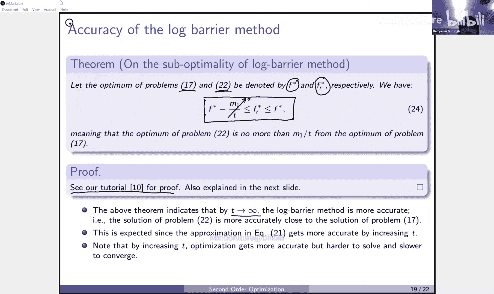

# 008：近端方法、牛顿法与内点法

在本节课中，我们将要学习第一类优化方法中的近端方法，以及第二类优化方法中的牛顿法和内点法。我们将从近端算子的定义开始，逐步深入到其在优化算法中的应用，然后过渡到利用二阶导数的牛顿法，最后探讨如何处理带约束的优化问题，特别是使用内点法。

## 近端算子与相关概念

上一节我们介绍了梯度下降等一阶方法。本节中，我们来看看另一类重要的一阶方法：近端方法。

### 近端算子的定义

对于一个凸函数 **G**，其近端算子（或近端映射）定义为：
`prox_{λG}(x) = argmin_u [ G(u) + (1/(2λ)) * ||u - x||_2^2 ]`
其中，λ > 0 是一个参数。当 λ = 1 时，我们得到标准形式。

这个定义可以理解为三个步骤的转换：
1.  原始问题：最小化 **G(x)**。
2.  变量替换：引入新变量 **u**，并添加约束 **x = u**。
3.  约束松弛：将硬约束 **x = u** 作为正则化项（软惩罚）加入目标函数，从而转化为无约束问题。

因此，近端算子在最小化函数 **G** 的同时，要求解 **u** 尽可能接近给定的点 **x**。

### 莫罗包络与莫罗分解

与近端算子紧密相关的概念是莫罗包络（Moreau Envelope）：
`M_{λG}(x) = inf_u [ G(u) + (1/(2λ)) * ||u - x||_2^2 ]`
注意，莫罗包络是函数值，而近端算子是达到该最小值的参数 **u**。函数 **G** 的最小化点也是其莫罗包络的最小化点。

另一个重要概念是莫罗分解（Moreau Decomposition）：
`x = prox_{λG}(x) + λ * prox_{G*/λ}(x/λ)`
其中 **G*** 是函数 **G** 的共轭函数（对偶空间中的对应函数）。这个分解表明，任何点 **x** 都可以分解为两个近端映射结果的和。

### 指示函数与投影

在优化中，集合 **S** 的指示函数定义为：
`I_S(x) = 0, if x ∈ S; ∞, if x ∉ S`
这与机器学习中常见的0/1指示函数不同。这里的定义使得指示函数可以作为“硬惩罚”：如果点不在集合内，则目标函数值为无穷大，迫使优化必须满足约束。

近端算子与指示函数结合，会产生一个非常重要的操作：投影。
`prox_{I_S}(x) = argmin_{u ∈ S} (1/2) * ||u - x||_2^2 = Π_S(x)`
这个等式的证明利用了指示函数的定义：为了使目标函数有限，**u** 必须属于集合 **S**，此时问题简化为在 **S** 中寻找离 **x** 最近的点，这正是投影的定义。

以下是常见函数的近端算子：
*   **零函数**：`prox_{λ*0}(x) = x` （恒等映射）。
*   **L2范数**：`prox_{λ||·||_2}(x) = (1 - λ / max(||x||_2, λ)) * x`。
*   **L1范数（逐元素）**：`[prox_{λ||·||_1}(x)]_j = sign(x_j) * max(|x_j| - λ, 0)`。这个函数被称为软阈值函数，是处理L1正则化（如LASSO回归）的关键。

L1正则化常被用来诱导解的稀疏性，其原理是L1范数的单位球有“尖角”，优化解更容易落在这些尖角上，使得某些变量恰好为零。

## 基于近端算子的优化算法

理解了核心概念后，我们来看看如何利用近端算子构建优化算法。

### 近端点算法

对于无约束问题 `min f(x)`，近端点算法（Proximal Point Algorithm）的迭代步骤为：
`x_{k+1} = prox_{λf}(x_k) = argmin_u [ f(u) + (1/(2λ)) * ||u - x_k||_2^2 ]`
可以将其理解为：在每一步，我们不仅最小化 **f**，还要求新解 **u** 不能离上一步的解 **x_k** 太远，从而稳定优化过程。这类似于在函数 **f** 的莫罗包络上执行梯度下降。

### 近端梯度法

在实际问题中，我们经常遇到复合函数优化：`min f(x) + g(x)`，其中 **f** 光滑可微，**g** 凸但不一定光滑（例如L1范数正则化项）。近端梯度法（Proximal Gradient Method）专门解决此类问题。

其迭代更新公式为：
`x_{k+1} = prox_{ηg}( x_k - η * ∇f(x_k) )`
这个公式可以解释为两步：
1.  对光滑部分 **f** 执行一步梯度下降：`y = x_k - η * ∇f(x_k)`。
2.  对非光滑部分 **g** 执行近端映射（投影或软阈值等）：`x_{k+1} = prox_{ηg}(y)`。

当 **g** 是某个集合 **S** 的指示函数时，近端梯度法退化为**投影梯度法**：
`x_{k+1} = Π_S( x_k - η * ∇f(x_k) )`
算法先沿梯度方向走一步，如果点落在了可行集 **S** 之外，就将其投影回 **S** 中最近的点。

### 正交约束的投影

在许多科学工程问题（如主成分分析PCA）中，会遇到正交约束 `X^T X = I`。如何将点投影到正交矩阵集合上呢？答案是使用奇异值分解（SVD）。

给定矩阵 **X**，计算其SVD：`X = U Σ V^T`。则其到正交矩阵集的投影为：
`Π(X) = U I V^T`
即将奇异值矩阵 **Σ** 中的所有奇异值替换为1（或更一般地，满足约束所需的值），然后重构矩阵。

## 牛顿法：利用二阶信息

上一节我们介绍了一阶的近端方法。本节中，我们转向利用二阶导数（海森矩阵）的优化方法——牛顿法。

### 从牛顿-拉弗森法到牛顿法

牛顿法源于求根算法牛顿-拉弗森法。对于优化问题 `min f(x)`，其最优解需满足一阶最优性条件 `∇f(x) = 0`。将 `∇f(x)` 视为待求根的函数，应用牛顿-拉弗森法，得到牛顿法的迭代公式：
`x_{k+1} = x_k - η * [∇²f(x_k)]^{-1} ∇f(x_k)`
其中 `∇²f(x_k)` 是海森矩阵。当 `η=1` 时，即为标准形式。

牛顿法的直观解释是：在当前位置 `x_k`，用二阶泰勒展开近似原函数，并直接跳到该二次函数的最小值点。对于凸函数，在最优解附近，函数近似为二次型，因此牛顿法收敛速度极快（二次收敛）。

### 带等式约束的牛顿法

对于带等式约束的问题：`min f(x), s.t. Ax = b`，我们可以利用拉格朗日函数和KKT条件推导出牛顿步。

令拉格朗日函数 `L(x, ν) = f(x) + ν^T (Ax - b)`。在迭代点附近对 `L` 进行二阶近似，并令其对 `x` 和 `ν` 的导数为零，得到一个线性方程组：
`[ ∇²f(x_k)  A^T;  A  0 ] * [ p; ν ] = [ -∇f(x_k); -(Ax_k - b) ]`
其中 `p = x_{k+1} - x_k` 是待求的更新步长，`ν` 是对偶变量。通过求解这个方程组，我们可以同时得到 primal 和 dual 的更新。即使初始点不可行（`Ax_0 ≠ b`），该方法也能处理。

## 内点法：处理不等式约束

最后，我们探讨如何用内点法（Interior Point Method）或障碍函数法（Barrier Method）处理同时包含等式和不等式约束的通用问题。

### 问题转化与障碍函数

考虑一般问题：`min f(x), s.t. h_i(x) ≤ 0, i=1...m, Ax = b`。
核心思想是将不等式约束通过指示函数转化为目标函数中的惩罚项：
`min f(x) + Σ_i I_{(-∞, 0]}(h_i(x)), s.t. Ax = b`
由于指示函数不可微，我们用光滑的可微函数来近似它，即障碍函数。最常用的是对数障碍函数：
`I_{(-∞, 0]}(h_i(x)) ≈ -(1/t) * log(-h_i(x)), 其中 t > 0`
当 `t` 很大时，这个近似很好：在约束内部 (`h_i(x) < 0`)，函数值接近0；在边界上 (`h_i(x) → 0⁻`)，函数值趋向无穷大。

### 内点法流程

使用对数障碍函数近似后，原问题转化为：
`min f(x) - (1/t) * Σ_i log(-h_i(x)), s.t. Ax = b`
这变成了一个只含等式约束的优化问题。我们可以用前面介绍的**带等式约束的牛顿法**来求解它。

算法从初始点（必须在不等式约束内部，即 `h_i(x) < 0`）开始，固定一个较大的 `t`，用牛顿法求解上述问题。然后增大 `t` 的值（例如乘以一个因子），用前一步的解作为初始点，再次求解。随着 `t` 不断增大，对数障碍函数越来越接近真实的指示函数，最终得到的解会收敛到原问题的最优解。

内点法的精度与参数 `t` 有关。可以证明，障碍问题的最优值 `f*_barrier` 与原问题最优值 `f*` 满足：`f* - m/t ≤ f*_barrier ≤ f*`。当 `t → ∞` 时，`f*_barrier → f*`。

---

本节课中我们一起学习了优化技术中的重要方法。我们从近端算子出发，掌握了其定义、几何意义及在L1/L2正则化中的应用，并学习了基于它的近端点算法和近端梯度法。接着，我们过渡到二阶方法，学习了牛顿法及其处理等式约束的扩展。最后，我们探讨了处理不等式约束的强大工具——内点法，了解了通过障碍函数将复杂约束问题转化为序列等式约束问题的核心思想。这些方法构成了现代连续优化算法的基础。