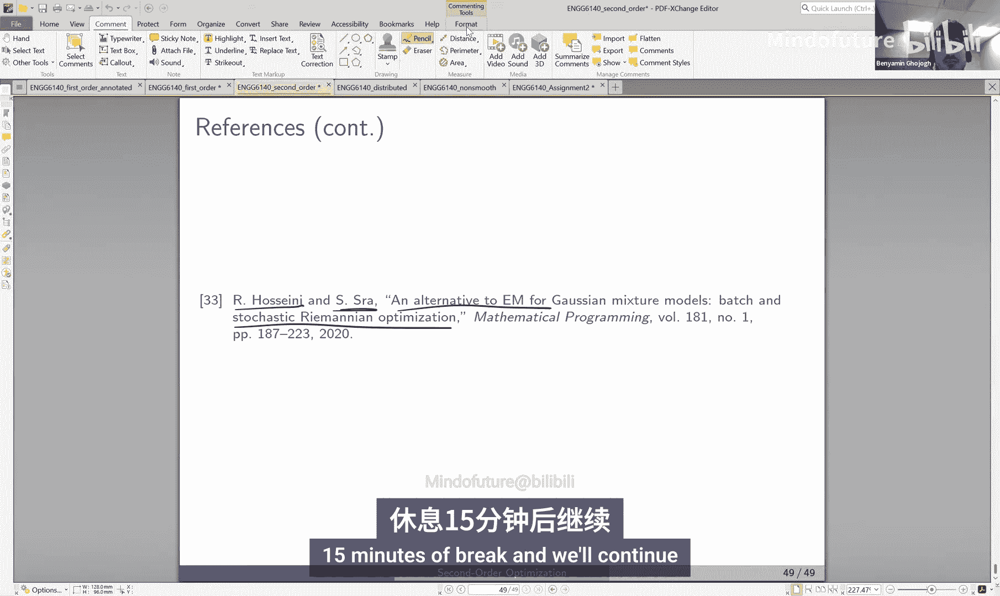
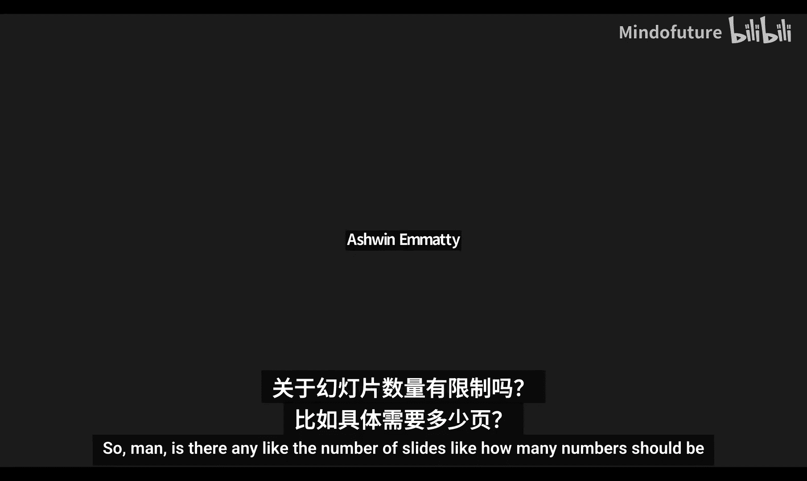
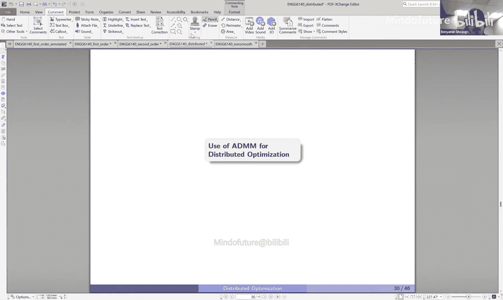

# 009：共轭梯度法、拟牛顿法与分布式优化

## 概述
在本节课中，我们将学习几种高级优化技术。首先，我们将回顾牛顿法中的快速求解技巧，包括共轭梯度法。接着，我们将探讨如何避免计算复杂的海森矩阵，即拟牛顿法。最后，我们将进入分布式优化领域，学习如何将复杂问题分解为多个子问题并行求解，重点介绍交替方向乘子法。

---

## 牛顿法的快速求解技巧

上一节我们介绍了牛顿法及其在约束优化中的应用。本节中我们来看看如何加速牛顿法中线性方程组的求解过程。

在牛顿法中，无论是无约束问题（更新公式为 **p = -H⁻¹∇f**），还是处理等式或不等式约束后形成的系统（如 **Mz = q**），最终都需要求解一个形如 **Mz = q** 的线性方程组。当变量维度 `d` 或约束数量 `q` 很大时，矩阵 `M` 的规模会变得非常庞大，直接求解非常耗时。

以下是几种加速求解的技巧：

### 矩阵分解法
通过将系数矩阵 `M` 分解为特殊结构矩阵的乘积，可以显著加速求解。
*   **LU分解**：将 `M` 分解为置换矩阵 `P`、下三角矩阵 `L` 和上三角矩阵 `U` 的乘积，即 **M = PLU**。求解 `Mz = q` 转化为依次求解三个更简单的方程组。
*   **Cholesky分解**：仅适用于正定矩阵。将 `M` 分解为 **M = LLᵀ**，其中 `L` 是下三角矩阵。然后通过前向和后向替代快速求解。

### 舒尔补法
当矩阵 `M` 能写成块矩阵形式时，可以使用舒尔补进行降维求解，尤其适用于某些块矩阵易于求逆的情况。

---

## 共轭梯度法

除了分解，另一种思路是使用迭代法近似求解线性方程组。共轭梯度法就是其中一种高效的方法。

共轭梯度法最初用于求解线性方程组 **Mz = q**。有趣的是，该方程的解 **z* = M⁻¹q** 恰好是下面这个二次函数的最小值点：
**f(z) = (1/2) zᵀ M z - zᵀ q**

因此，求解线性方程组可以转化为一个优化问题。共轭梯度法通过迭代方式求解该优化问题，其更新公式与梯度下降法非常相似：**z_{k+1} = z_k - η_k ∇f(z_k)**。其中步长 `η_k` 通过精确线搜索确定。与梯度下降不同的是，共轭梯度法在确定搜索方向 `p_k` 时，不仅考虑当前梯度，还考虑前一步的方向，以确保新的方向与旧方向关于矩阵 `M` 是“共轭”的。这使其收敛速度远快于普通梯度下降。

### 非线性共轭梯度法
将共轭梯度法的思想推广到最小化一般非线性函数 `f(z)`，就得到了非线性共轭梯度法。它不再要求目标函数是二次型，但其核心思想——利用历史信息构建共轭方向——得以保留。有多种公式用于计算方向组合时的参数 `β`，如 Fletcher-Reeves 公式和 Polak-Ribière 公式。

---

## 拟牛顿法

我们了解了牛顿法收敛快但需要计算海森矩阵 `H` 或其逆矩阵 `H⁻¹`，这在变量维度高时计算代价巨大。拟牛顿法旨在用近似矩阵 `B ≈ H` 或 `H ≈ H⁻¹` 来替代，从而在保持较快收敛速度的同时降低计算成本。

拟牛顿法的核心思想是利用当前迭代点 `x_k` 和下一步迭代点 `x_{k+1}` 的信息来更新近似矩阵。定义：
*   **s_k = x_{k+1} - x_k** （自变量的变化）
*   **y_k = ∇f(x_{k+1}) - ∇f(x_k)** （梯度的变化）

对于凸函数，海森矩阵满足割线方程 **H s ≈ y**。拟牛顿法要求其近似矩阵 `B` 或 `H` 也满足类似条件。

以下是几种著名的拟牛顿法更新公式：

### BFGS 方法
这是最流行的拟牛顿法之一。它直接更新对海森矩阵逆 `H` 的近似：
**H_{k+1} = (I - ρ_k s_k y_kᵀ) H_k (I - ρ_k y_k s_kᵀ) + ρ_k s_k s_kᵀ**
其中 **ρ_k = 1/(y_kᵀ s_k)**。

### L-BFGS 方法（有限内存BFGS）
当维度 `d` 极大时，存储 `d×d` 的矩阵 `H` 可能内存不足。L-BFGS 不再显式存储整个 `H` 矩阵，而是只保存最近 `m` 步（例如 `m=10`）的 `{s_i, y_i}` 向量对，并在需要计算搜索方向 **p = -H ∇f** 时，利用这些历史信息通过一个递归算法高效地计算出 `H ∇f` 的结果。这种方法极大地节省了内存，成为许多现代优化工具箱的首选。

---

## 分布式优化

当优化问题涉及多个可分离的变量块时，我们可以采用分布式优化方法，将原问题分解为多个子问题并行求解，最后协调得到全局解。

### 交替优化
这是最直观的分布式优化思想。对于一个关于多变量 `x1, x2, ..., xm` 的最小化问题，交替优化依次固定其他变量，只优化一个变量：
**x1_{k+1} = argmin_{x1} f(x1, x2_k, ..., xm_k)**
**x2_{k+1} = argmin_{x2} f(x1_{k+1}, x2, x3_k, ..., xm_k)**
...
理论上，每个子问题需要求解到收敛，但实践中对每个子问题只进行一步梯度下降等迭代也常常有效。

### 对偶上升与分解
考虑带等式约束 **Ax = b** 的问题。其拉格朗日函数为 **L(x, ν) = f(x) + νᵀ(Ax - b)**。对偶上升法交替优化原始变量和对偶变量：
1.  **x_{k+1} = argmin_x L(x, ν_k)** （最小化拉格朗日函数）
2.  **ν_{k+1} = ν_k + η_k (Ax_{k+1} - b)** （梯度上升更新对偶变量，以促使约束满足）

如果目标函数 `f(x)` 对于变量块是可分解的，即 **f(x) = Σ f_i(x_i)**，那么第一步的 `x` 更新可以分解为多个独立的子问题并行求解，这就得到了对偶分解法。

### 交替方向乘子法
ADMM 结合了对偶上升法的思想和增广拉格朗日法（在拉格朗日函数中加入约束违反的二次惩罚项）的优点，用于求解如下形式的问题：
**minimize f1(x1) + f2(x2) subject to A x1 + B x2 = c**

其增广拉格朗日函数为：
**L_ρ(x1, x2, ν) = f1(x1) + f2(x2) + νᵀ(A x1 + B x2 - c) + (ρ/2) ||A x1 + B x2 - c||²**

ADMM 的迭代步骤非常简洁：
1.  **x1_{k+1} = argmin_{x1} L_ρ(x1, x2_k, ν_k)**
2.  **x2_{k+1} = argmin_{x2} L_ρ(x1_{k+1}, x2, ν_k)**
3.  **ν_{k+1} = ν_k + ρ (A x1_{k+1} + B x2_{k+1} - c)**

ADMM 的强大之处在于，`x1` 和 `x2` 的更新可以完全分离并行，并且算法对于许多凸问题具有良好的收敛性。它还可以推广到处理多个变量块以及不等式约束（通过引入松弛变量将不等式转化为等式），是当前分布式和大规模优化中非常重要的工具。

---

## 总结
本节课中我们一起学习了三类重要的优化技术。我们首先探讨了加速牛顿法的数值线性代数技巧，如共轭梯度法。然后，我们介绍了拟牛顿法家族，特别是BFGS和L-BFGS，它们用近似矩阵巧妙地避免了海森矩阵的直接计算。最后，我们进入了分布式优化的领域，从交替优化出发，讲解了对偶上升、对偶分解，并重点介绍了目前广泛应用的交替方向乘子法，这些方法为求解大规模、多变量的复杂优化问题提供了强有力的框架。