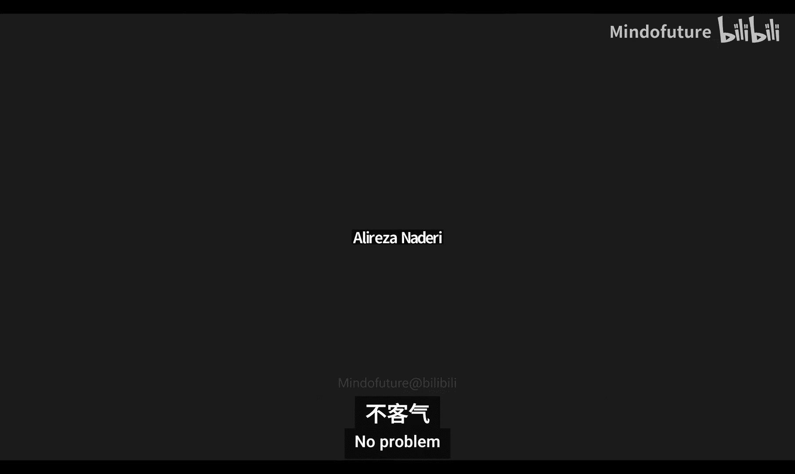
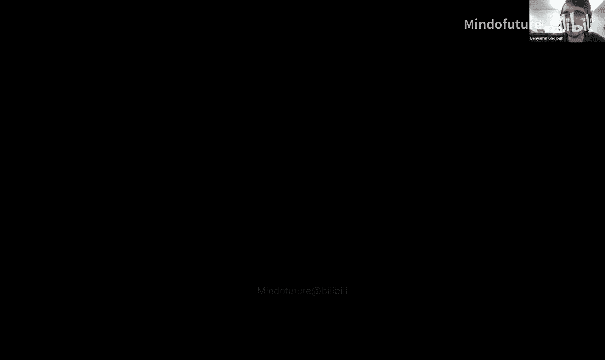
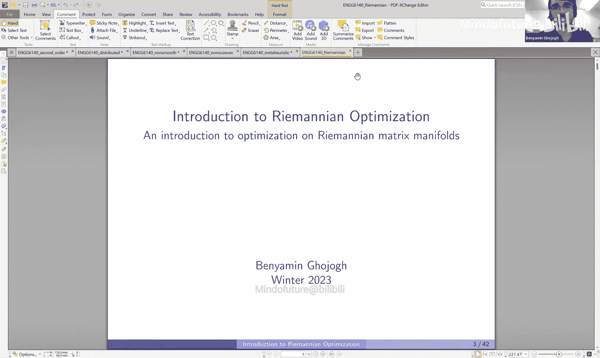

# 010：分布式优化与非光滑优化






## 概述
在本节课中，我们将要学习分布式优化与非光滑优化的核心概念与方法。我们将首先回顾交替方向乘子法（ADMM）及其在分布式优化中的应用，然后探讨如何处理目标函数不可导（非光滑）的优化问题，例如包含L1正则项的问题。

---

## ADMM与分布式优化

上一节我们介绍了ADMM算法。本节中我们来看看如何利用ADMM进行分布式优化。

ADMM是分布式优化中最著名的算法之一。如果优化问题可以分解为多个互不相交的块或原始变量，我们就能将每个变量的优化分配到不同的核心或服务器上并行计算，从而实现并行化。

以下是ADMM更新步骤的回顾：
*   **原始变量更新**（可并行）：
    ```math
    x_i^{k+1} = \arg\min_{x_i} \left( f_i(x_i) + \frac{\rho}{2} \|x_i - z^k + u_i^k\|^2 \right)
    ```
*   **辅助变量更新**（需聚合）：
    ```math
    z^{k+1} = \arg\min_{z} \left( \sum_{i} \frac{\rho}{2} \|x_i^{k+1} - z + u_i^k\|^2 + g(z) \right)
    ```
*   **对偶变量更新**：
    ```math
    u_i^{k+1} = u_i^k + x_i^{k+1} - z^{k+1}
    ```

在每次迭代中，原始变量的更新可以在分布式服务器上并行执行。迭代结束时，更新后的原始变量被聚合到中央服务器，以便更新对偶变量。这种模式让人联想到联邦学习，其两大用途是：处理大数据（通过并行加速）和保护隐私（各服务器数据不互通）。

即使原问题不是分布式的，我们也可以通过引入辅助变量和等式约束，将其转化为分布式问题，从而利用ADMM求解。一个常见的技巧是：对于单变量问题 `min f(x)`，我们引入M个变量 `x_1, ..., x_M` 和一个辅助变量 `z`，并添加约束 `x_i = z`。这等价于要求所有 `x_i` 相等，从而将原问题转化为ADMM可解的形式。

对于多变量问题，我们可以将约束嵌入目标函数，并使用指示函数。例如，对于约束 `x_i ∈ S_i`，定义指示函数 `Φ_i(x_i)`，当 `x_i ∈ S_i` 时为0，否则为无穷大。然后引入辅助变量 `z_i` 和约束 `x_i = z_i`，将问题转化为：
```math
\min_{x, z} \sum_i [f_i(x_i) + Φ_i(z_i)] \quad \text{s.t.} \quad x_i = z_i
```
这同样可以通过ADMM求解。有趣的是，此时的ADMM更新步骤与近端算子密切相关。例如，`z` 的更新步骤 `z_i^{k+1} = \arg\min_{z_i} (Φ_i(z_i) + (ρ/2)\|x_i^{k+1} - z_i + u_i^k\|^2)` 就是函数 `Φ_i` 的近端映射。如果 `Φ_i` 是集合 `S_i` 的指示函数，那么这个近端映射就是向集合 `S_i` 的投影。

---

## ADMM应用实例：图像结构成分分析

为了理解ADMM的实际应用，我们来看一个图像处理领域的例子：图像结构成分分析（ISCA）。该方法受主成分分析（PCA）启发，但用结构相似性距离（SSIM）替代了PCA中的均方误差，以更好地符合人类视觉感知。

其优化问题如下：
```math
\min_{\{U_b\}} \sum_{b=1}^{B} D_{SSIM}(X_b, U_b U_b^T X_b) \quad \text{s.t.} \quad U_b^T U_b = I, \forall b
```
其中 `X_b` 是图像块，`U_b` 是投影矩阵，约束要求 `U_b` 为正交矩阵。这个问题天然是分布式的（针对每个图像块 `b`）。我们可以使用ADMM来求解：引入辅助变量 `V_b` 和约束 `U_b = V_b`，将正交约束以指示函数形式嵌入关于 `V_b` 的目标函数中。构建增广拉格朗日函数后，交替更新 `U_b`, `V_b` 和对偶变量。其中，`V_b` 的更新步骤正是向正交矩阵集合的投影（通过将矩阵的奇异值设置为1来实现）。实验结果表明，该方法能有效提取图像的结构信息。

---

## 非光滑优化导论

到目前为止，我们假设成本函数是可微且光滑的。然而，许多实际问题涉及非光滑函数，例如在点处不可导的函数。本节将探讨处理非光滑优化问题的方法，特别是包含L1正则项的问题。

L1正则化（又称Lasso）在机器学习和信号处理中广泛应用，因为它能产生稀疏解，并且对异常值比L2正则化更鲁棒。然而，L1范数在零点不可导，这给优化带来了挑战。

我们处理非光滑L1范数优化的一些主要方法包括：
1.  使用Huber函数进行光滑近似。
2.  使用近端算法（如软阈值法）。
3.  使用坐标下降法。
4.  使用次梯度法。

---

## 方法一：Huber函数光滑近似

处理非光滑函数的一种思路是将其“光滑化”。对于L1范数，我们可以利用凸共轭来定义它的一个光滑近似——Huber函数。

首先，回顾凸共轭的定义。函数 `f` 的凸共轭 `f^*(y)` 定义为：
```math
f^*(y) = \sup_{x} (y^T x - f(x))
```
对于凸函数，取两次凸共轭可以恢复原函数：`f(x) = f^{**}(x)`。L1范数的凸共轭是单位 `L∞` 范数球的指示函数。基于此，并为了在零点获得唯一解，我们添加一个强凸的邻近项，最终可以推导出Huber函数：
```math
H_\mu(x) = 
\begin{cases} 
\frac{x^2}{2\mu} & \text{if } |x| \le \mu \\
|x| - \frac{\mu}{2} & \text{if } |x| > \mu 
\end{cases}
```
其中 `μ > 0` 是一个参数。Huber函数处处可导，其导数如下：
```math
H'_\mu(x) = 
\begin{cases} 
\frac{x}{\mu} & \text{if } |x| \le \mu \\
\operatorname{sign}(x) & \text{if } |x| > \mu 
\end{cases}
```
参数 `μ` 控制近似的精度：`μ` 越小，近似越精确，但函数在零点附近的“弯曲”区域越窄，计算可能越不稳定；`μ` 越大，近似越平滑，但偏离L1范数越远。

---

## 方法二：近端算法与软阈值法

近端算法是处理非光滑复合函数优化的强大工具。我们之前已经学过，函数 `g` 的近端算子定义为：
```math
\operatorname{prox}_{\lambda g}(v) = \arg\min_x \left( g(x) + \frac{1}{2\lambda} \|x - v\|^2 \right)
```
对于L1范数，其近端算子有一个闭合形式的解，称为**软阈值函数**：
```math
\operatorname{prox}_{\lambda \|\cdot\|_1}(v)_j = \operatorname{sign}(v_j) \max(|v_j| - \lambda, 0)
```
这个公式可以按元素应用。它的含义是：如果元素 `v_j` 的绝对值小于阈值 `λ`，则将其置为零；否则，将其向零方向收缩 `λ` 个单位。`λ` 越小，近似越精确。

对于形如 `min f(x) + λ\|x\|_1` 的Lasso问题，我们可以使用**近端梯度法**：在每一步，先对光滑部分 `f(x)` 做梯度下降，然后对结果应用L1范数的近端算子（即软阈值函数）。

---

## 方法三：坐标下降法

坐标下降法的思想类似于交替优化，但交替的是变量的各个坐标。它每次只优化一个坐标（或一个坐标块），而固定其他所有坐标。对于最小化 `f(x)` 的问题，其基本更新格式为：
```math
x_j^{k+1} = \arg\min_{x_j} f(x_1^{k+1}, ..., x_{j-1}^{k+1}, x_j, x_{j+1}^k, ..., x_d^k)
```
我们按顺序或随机选择坐标进行更新，并循环往复直至收敛。

将坐标下降法应用于Lasso回归问题 `min (1/2)\|y - Xβ\|^2 + λ\|β\|_1` 时，针对每个坐标 `β_j` 的子问题可以导出闭合解。令人惊讶的是，这个解正是软阈值函数：
```math
\beta_j^{new} = \frac{1}{\|X_j\|^2} S_{\lambda} \left( X_j^T (y - X_{-j} \beta_{-j}) \right)
```
其中 `S_λ` 是软阈值函数。这意味着，即使使用坐标下降法求解Lasso，最终每个坐标的更新也归结为软阈值操作。

---

## 方法四：次梯度法

当函数在某些点不可导时，梯度不存在。为此，我们引入**次梯度**的概念作为梯度的推广。对于凸函数 `f`，向量 `g` 是 `f` 在点 `x` 的一个次梯度，如果满足：
```math
f(y) \ge f(x) + g^T (y - x), \quad \forall y
```
所有在点 `x` 的次梯度构成的集合称为**次微分**，记作 `∂f(x)`。在函数光滑的点，次微分只包含一个元素，即梯度；在不可导的点（如L1范数的零点），次微分是一个集合（例如，对于绝对值函数，在0点的次微分是区间 `[-1, 1]`）。

基于次梯度，我们可以推广一阶最优性条件：点 `x*` 是凸函数 `f` 的最小点，当且仅当 `0 ∈ ∂f(x*)`。这意味着，在最优解处，零向量是函数的一个次梯度。

**次梯度法**是梯度下降法在非光滑函数上的推广。其更新公式为：
```math
x^{k+1} = x^k - \alpha_k g^k, \quad \text{其中 } g^k \in \partial f(x^k)
```
这里 `g^k` 是当前点 `x^k` 的任意一个次梯度。在光滑点，它就是梯度；在非光滑点，则从次微分中任选一个。需要注意的是，由于在非光滑点选取的次梯度可能不是下降方向，所以该方法不保证每一步函数值都下降，因此通常不称为“次梯度下降法”。

类似地，我们可以定义随机次梯度法、投影次梯度法等变体，以处理大规模或带约束的非光滑优化问题。

---

## 总结
本节课中我们一起学习了分布式优化与非光滑优化的核心内容。

我们首先深入探讨了ADMM算法如何用于分布式优化，通过引入辅助变量和约束，可以将许多问题转化为分布式形式并行求解，并看到了其在图像处理中的一个应用实例。

接着，我们转向非光滑优化，重点讨论了包含L1正则项的问题。我们学习了四种主要处理方法：
1.  **Huber函数光滑近似**：通过凸共轭推导出一个处处可导的近似函数。
2.  **近端算法与软阈值法**：利用L1范数的近端算子（软阈值函数）来设计迭代算法。
3.  **坐标下降法**：通过轮流优化单个坐标来求解，对于Lasso问题，每个坐标的更新恰好是软阈值操作。
4.  **次梯度法**：将梯度下降推广到非光滑函数，使用次梯度进行迭代更新。




这些方法为解决机器学习、信号处理等领域中常见的非光滑优化问题提供了有力的工具。