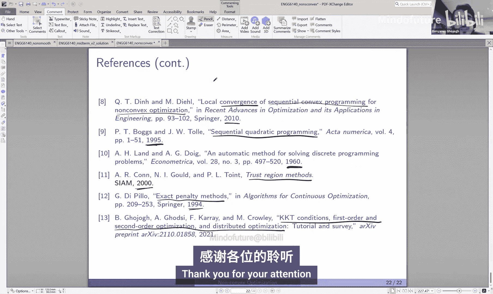

# 011：非凸优化与序列凸规划


在本节课中，我们将学习非凸优化问题及其解决方法。我们将首先了解什么是非凸优化，然后重点介绍两种主要的求解方法：序列凸规划（一种局部优化方法）和分支定界法（一种全局优化方法）。课程内容将尽可能简单直白，以便初学者理解。

## 概述

非凸优化问题是指目标函数或约束条件不满足凸性要求的优化问题。这类问题在现实中非常普遍，例如神经网络的训练。与凸优化不同，非凸优化通常存在多个局部最优解，找到全局最优解更具挑战性。本节课将介绍处理这类问题的核心思路和具体算法。

## 非凸优化简介

在预备知识中，我们介绍了凸函数和凸集。如果一个优化问题的目标函数是凸函数，并且可行域是凸集，那么它就是一个凸优化问题。反之，如果目标函数非凸或可行域非凸，那么这就是一个非凸优化问题。

考虑以下一般形式的优化问题：
```
最小化 f(x)
满足 y_i(x) ≤ 0, i = 1, ..., m1
      h_j(x) = 0, j = 1, ..., m2
```
其中，函数 `f`, `y_i`, `h_j` 不一定都是凸的。

之前介绍的一阶和二阶优化方法（如梯度下降、牛顿法）虽然是为凸问题设计的，但在许多非凸问题上（如机器学习和信号处理）也能取得不错的效果。这是因为在这些领域，局部最优解通常已经足够好。然而，这些方法不能保证找到全局最优解，其结果依赖于初始点的选择。

一个典型的例子是神经网络的训练。神经网络的损失函数（如均方误差）关于网络输出是凸的，但关于网络权重参数则是高度非凸和非线性的。然而，反向传播算法（本质上是梯度下降加链式法则）通常能很好地工作，这是因为在高维特征空间中，局部最优解往往彼此接近，质量都差不多。

## 非凸优化方法分类

非凸优化方法大致可分为两类：
1.  **局部优化方法**：速度较快，但不保证找到全局最优解。
2.  **全局优化方法**：能保证找到全局最优解，但通常计算较慢。

此外，还有元启发式或基于搜索的优化方法，它们通常属于局部方法，不保证全局最优，我们将在下一部分讨论。

上一节我们介绍了非凸优化的基本概念和分类，本节中我们来看看第一种具体的局部优化方法：序列凸规划。

## 序列凸规划

序列凸规划是一种局部优化方法。其核心思想是：**通过一系列凸优化问题来迭代地逼近原始的非凸优化问题**。

在每次迭代 `k` 中，SCP 解决以下凸近似问题：
```
最小化 f̂(x)
满足 ŷ_i(x) ≤ 0, i = 1, ..., m1
      ĥ_j(x) = 0, j = 1, ..., m2
      x ∈ T_k
```
其中：
*   `f̂`, `ŷ_i`, `ĥ_j` 是原非凸函数在当前迭代点 `x_k` 附近的凸近似。
*   `T_k` 称为**信赖域**，它确保变量 `x` 停留在一个局部凸区域内，使得凸近似是可信的。

这个凸近似问题本身可以用之前学过的任何凸优化方法（如内点法）来求解。因此，SCP 包含一个嵌套循环：外层是 SCP 迭代，内层是求解凸近似问题。

### 凸近似的构建方法

以下是构建凸近似 `f̂`, `ŷ_i`, `ĥ_j` 的几种常见方法：

**1. 泰勒级数展开**
使用一阶或二阶泰勒展开来获得线性（仿射）或二次凸近似。
*   **一阶近似（仿射函数，总是凸的）**：
    `f̂(x) = f(x_k) + ∇f(x_k)^T (x - x_k)`
*   **二阶近似（二次函数，需保证凸性）**：
    `f̂(x) = f(x_k) + ∇f(x_k)^T (x - x_k) + 1/2 (x - x_k)^T P (x - x_k)`
    其中，`P` 是原函数海森矩阵在正半定锥上的投影，以确保 `f̂` 是凸函数。投影可以通过特征值分解实现：将负特征值置零，然后重构矩阵。

**2. 粒子法**
在信赖域 `T_k` 内选取若干点，通过求解一个最小二乘二次回归问题来拟合凸函数。
```
最小化 Σ_{i=1}^m [ (1/2 x_i^T P x_i + b^T x_i + a) - f(x_i) ]^2
满足 P ≽ 0 (半正定)
```
求解得到 `P, b, a` 后，凸近似函数即为 `f̂(x) = 1/2 x^T P x + b^T x + a`。

**3. 拟线性化**
将函数重新参数化，使其形式上类似于线性函数。例如，对于二次近似 `f̂(x) = 1/2 x^T P x + b^T x + a`，可以将其重写为：
`f̂(x) = a(x)^T x + c(x)`
其中 `a(x) = 1/2 P x + b`，`c(x) = a`。虽然 `a(x)` 依赖于 `x`，但形式上是线性的，故称“拟线性”。

### 信赖域及其更新

信赖域 `T_k` 通常定义为当前迭代点 `x_k` 附近的一个简单区域，例如：
*   **超立方体（框）**：`|x_j - x_{k,j}| ≤ ρ_j`，对每个维度 `j`。
*   **椭圆（或球）**：`(x - x_k)^T P (x - x_k) ≤ ρ`，其中 `P` 对称正定。

信赖域需要在迭代中更新。更新策略基于近似解的质量。我们定义两个量：
*   **预测下降量**：`Δ̂ = φ(x_k) - φ̂(x̂_k)`，其中 `φ` 是原问题的正则化成本函数，`φ̂` 是近似问题的正则化成本函数。
*   **实际下降量**：`Δ = φ(x_k) - φ(x̂_k)`。

更新规则如下：
1.  如果 `Δ̂ ≥ α Δ`（例如 `α=0.1`），说明近似解质量好。**接受** `x̂_k` 作为新迭代点，并**扩大**信赖域（例如 `ρ := ρ * β, β>1`）。
2.  否则，说明近似解质量差。**拒绝** `x̂_k`，将当前点保持不变（`x_{k+1} = x_k`），并**缩小**信赖域（例如 `ρ := ρ * γ, 0<γ<1`）。

通过这种机制，SCP 在解质量好时探索更大区域，质量差时收缩到更可信的局部区域。

上一节我们介绍了作为局部方法的序列凸规划，本节中我们来看看能保证全局最优的**分支定界法**。

## 分支定界法

分支定界法是一种全局优化方法，其思想与用于整数线性规划的分支定界法类似。它能保证找到全局最优解，但计算成本通常较高。

### 核心思想

算法的核心思想是：
1.  **分支**：将整个可行域递归地分割成更小的子区域（通常是超矩形）。
2.  **定界**：在每个子区域上，计算目标函数最优值 `f*` 的**上界**和**下界**。
3.  **剪枝**：通过比较不同子区域的边界，排除那些不可能包含全局最优解的子区域。

随着分割的进行，上下界会越来越紧，直到足够接近，从而确定全局最优解。

### 上下界的计算

*   **下界 (L)**：在子区域上，求解原问题的一个**凸松弛**问题。对于最小化问题，凸松弛的解 `f_relax*` 一定不大于原子区域上的全局最优解 `f*`，即 `L = f_relax* ≤ f*`。
*   **上界 (U)**：在子区域内任意选取一个可行点 `x_feas`，计算其目标函数值 `f(x_feas)`。根据定义，全局最优值 `f*` 一定不大于该值，即 `U = f(x_feas) ≥ f*`。

因此，在子区域上有 `L ≤ f* ≤ U`。

### 算法步骤

以下是分支定界法用于最小化问题的简化步骤：

1.  **初始化**：将整个可行域作为初始区域 `R`。计算其下界 `L(R)` 和上界 `U(R)`。设置全局下界 `L_global = L(R)`，全局上界 `U_global = U(R)`。
2.  **循环**：当 `U_global - L_global > ε`（ε 为预设容差）时：
    a. **选择区域**：从当前活跃区域中选择一个区域（例如，下界最小的区域，因为它可能包含更优解）。
    b. **分支**：将所选区域分割成两个子区域 `R_left` 和 `R_right`。
    c. **定界**：计算每个子区域的下界 `L_left`, `L_right` 和上界 `U_left`, `U_right`。
    d. **更新全局边界**：
        *   `L_global = max(L_global, L_left, L_right)` （我们希望下界更大）
        *   `U_global = min(U_global, U_left, U_right)` （我们希望上界更小）
    e. **剪枝**：如果某个子区域的下界 `L_sub` 已经大于当前全局上界 `U_global`，则该子区域不可能包含全局最优解，将其丢弃。
3.  **终止与返回**：当循环结束时，全局最优解 `f*` 被夹在 `L_global` 和 `U_global` 之间，且两者非常接近。通常返回使得下界最小的那个区域对应的解作为全局最优解的近似。

对于最大化问题，逻辑类似，但需要注意比较方向（例如，我们关注上界更大的区域）。

## 总结

本节课中我们一起学习了非凸优化及其两种核心求解策略：
1.  **序列凸规划**：一种高效的局部方法，通过迭代求解凸近似问题来逼近非凸问题的局部最优解。其关键在于构建凸近似和动态管理信赖域。
2.  **分支定界法**：一种能保证全局最优性的方法，但计算量较大。它通过系统地分割可行域并计算上下界来搜索全局最优解。



这两种方法代表了在求解难度和求解质量之间进行权衡的经典思路。对于许多实际应用（如深度学习），找到高质量的局部解通常已经足够，因此SCP等局部方法及其变种被广泛使用。而当问题要求找到全局最优时，则需考虑分支定界法等全局方法。在下一部分，我们将探讨另一类强大的工具——元启发式优化算法。