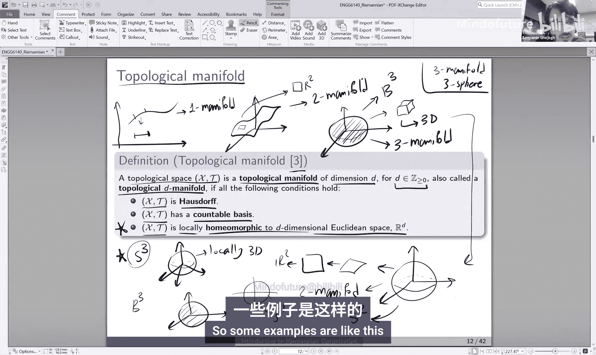
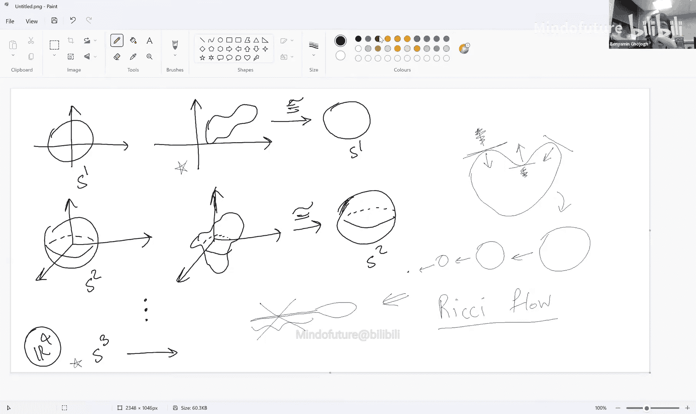
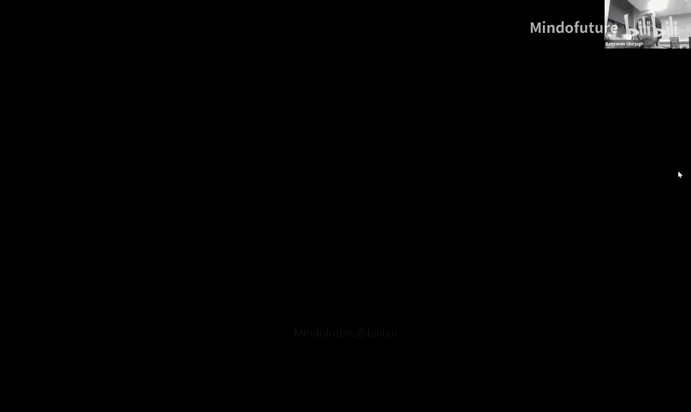
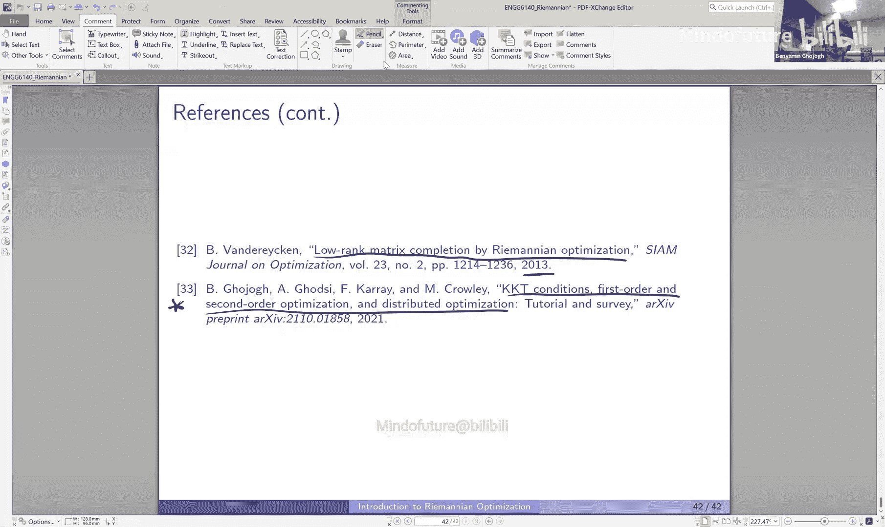

# 013：黎曼矩阵流形上的优化

## 概述
在本节课中，我们将学习黎曼优化的基本概念。我们将从向量空间和流形的基础知识开始，逐步深入到黎曼流形、黎曼优化问题，以及如何将欧几里得优化问题转化为黎曼优化问题。我们还将介绍黎曼流形上的核心概念，如切空间、度量、测地线、梯度、Hessian矩阵、指数映射和对数映射等。最后，我们会简要介绍一些重要的黎曼矩阵流形和相关的工具箱与文献。

## 向量空间与流形

上一节我们介绍了课程概述，本节中我们来看看优化问题所涉及的基础数学空间。

**向量空间**，也称为线性空间，是一个集合，其元素（通常称为向量）可以相加，并可以与称为标量的数字相乘或缩放。简单来说，我们可以用标量缩放向量，然后将它们相加。我们可以在这个空间中进行向量的加法和线性组合。向量空间包含原点，因为一个向量减去它自身等于零向量（即原点），而原点必须在这个空间中。

**欧几里得空间**是一个定义了欧几里得距离度量的向量空间。这意味着当你在该向量空间中有两个点时，每个点都可以表示为一个从原点到该点的向量。两点之间的欧几里得距离，即连接这两点的线段的长度，可以通过连接两点的向量的 L2 范数来计算。

**光滑流形**，简单来说，是一个可微的弯曲超曲面。在一维中，它是一条线；在二维中，它是一个平面（线性）或非线性曲面；在三维中，它可以是一个平面或非线性曲面。在更高维度中，我们无法可视化，只能想象。超曲面不一定是线性的，超平面是超曲面的一个特例。一般来说，弯曲的超曲面可以看作光滑流形，它是可微的，意味着你可以在流形上的所有点求导。在数学定义上，它需要拓扑空间、图卡和同胚的概念。

## 黎曼流形

上一节我们介绍了光滑流形，本节中我们来看看黎曼流形，它为流形赋予了距离概念。

**黎曼流形**，记为 **M**（M 代表流形）。简单来说，它是一个实光滑流形（流形也可以是复的），并且其上定义了一个黎曼距离度量。这个度量是定义在弯曲超曲面上的距离。当你在流形上有两个点时，连接它们的最短曲线（测地线）的长度就是这两点之间的黎曼距离。在数学定义上，黎曼流形是一个实光滑流形，并且在每一点的切空间上都配备了一个正定内积，这个内积称为流形的度量。有了度量，你几乎可以计算流形上的一切：内积、距离、测地线和曲率。

## 欧几里得优化 vs 黎曼优化

上一节我们定义了黎曼流形，本节中我们来看看在这两种不同空间中的优化问题有何异同。

在之前的优化技术课程中，所讨论的通常是**欧几里得优化**。常规优化通常是欧几里得优化，我们在欧几里得空间中优化。例如，成本函数是从欧几里得空间到标量的映射：`f: R^D -> R`。优化问题可以看作 `minimize f(x) with respect to x subject to x ∈ R^D`。当只有这个约束时，可以将其视为无约束优化问题。如果优化问题有约束，我们实际上有不等式和等式约束，这些约束的交集定义了可行集。

欧几里得空间是平坦的黎曼流形的一个特例。因此，我们可以将欧几里得优化算法推广到黎曼优化算法。在**黎曼优化**中，我们优化一个成本函数，而变量位于一个黎曼流形 **M** 上。优化变量通常是一个矩阵，因此黎曼优化也称为矩阵流形上的优化。函数是从流形到实数的映射：`f: M -> R`。优化问题写作 `minimize f(X) with respect to X subject to X ∈ M`。比较这两个公式，可以看出欧几里得优化是黎曼优化的特例，其中流形 **M** 就是欧几里得空间。

## 将欧氏优化转化为黎曼优化

上一节我们对比了两种优化，本节中我们来看一个有用的技巧：将某些欧氏约束优化问题转化为黎曼优化问题。

有时，我们可以将欧几里得优化问题转化为黎曼优化问题。一些约束实际上是某些众所周知的流形。例如，考虑优化问题：`minimize f(X) = trace(X^T A X) subject to X^T X = I`。这个约束 `X^T X = I` 意味着矩阵 **X** 是正交矩阵，其列是标准正交的。这实际上是一个著名的流形，称为**Stiefel流形**。因此，我们可以将问题重写为 `minimize trace(X^T A X) subject to X ∈ Stiefel manifold`。通过这种技术，我们将欧几里得优化问题转化为了黎曼优化问题。

如果约束要求 **X** 是正定矩阵，那么这对应**对称正定（SPD）流形**。如果想找到子空间上的投影（例如在PCA中），则对应**Grassmann流形**。许多机器学习算法可以表述为Grassmann流形上的优化问题。

## 拓扑与光滑流形概念

上一节我们介绍了问题转化的技巧，本节中我们需要深入一些微分几何和代数拓扑的基础概念，以更好地理解流形。

设 **X** 为一个集合。**X** 上的一个**拓扑** **T** 是 **X** 的子集（称为开集）的一个集合，满足以下三个条件：
1.  空集和整个集合 **X** 属于 **T**。
2.  **T** 中任意有限个开集的交集也属于 **T**。
3.  **T** 中任意多个开集的并集也属于 **T**。

**拓扑空间** 就是配备了拓扑 **T** 的集合 **X** 所构成的对 **(X, T)**。

一个拓扑空间 **(X, T)** 是 **Hausdorff空间** 当且仅当对于 **X** 中任意两个不同的点 **x1** 和 **x2**，存在开集 **U** 和 **V**，使得 **x1 ∈ U**，**x2 ∈ V**，且 **U ∩ V = ∅**。简单来说，这意味着点是可分离和可区分的。

**同胚** 是代数拓扑中的一个重要概念。它是从一个拓扑到另一个拓扑的变换，且不撕裂拓扑。你可以变形它，但不能撕裂。两个拓扑在同胚变换前后被称为是同胚的，记为 `≅`。例如，一个咖啡杯和一个甜甜圈（环面）是同胚的。

**微分同胚** 是一个光滑且可微的同胚变换。例如，一个有尖角的形状和一个光滑形状可能是同胚的，但不是微分同胚的。

一个拓扑空间 **(X, T)** 是一个 **d维拓扑流形**（或称拓扑d-流形），如果它是Hausdorff空间，具有可数基，并且局部同胚于d维欧几里得空间 **R^d**。“局部”意味着如果你像蚂蚁一样站在流形上，你看到的局部区域类似于 **R^d**。例如，一条嵌入在二维空间中的曲线局部是一维的（一个线段），所以它是一个一维流形。一个球的表面（二维球面 S^2）嵌入在三维空间中，但局部是二维的（像一个平面），所以它是一个二维流形。而一个实心球（三维球体 B^3）嵌入在三维空间中，局部是三维的，所以它是一个三维流形。

## 图卡与光滑图册

上一节我们定义了拓扑流形，本节中我们来看看如何用“地图”（图卡）来覆盖和描述流形。

考虑一个d维拓扑流形 **M**。对于所有 **x ∈ M**，存在一个包含 **x** 的开集 **U** 和一个同胚映射 **φ: U -> φ(U)**，其中 **φ(U)** 是 **R^d** 的一个开子集。这个二元组 **(U, φ)** 称为流形 **M** 的一个**坐标图卡**或简称**图卡**。

一个**光滑图册** **A** 是覆盖流形 **M** 的图卡集合 `{(U_α, φ_α)}`，并且其中任意两个图卡是光滑相容的。两个图卡 **(U, φ)** 和 **(V, ψ)** 是光滑相容的，如果转换映射 `ψ ∘ φ^{-1}: φ(U ∩ V) -> ψ(U ∩ V)` 及其逆是光滑的（C^∞）。一个**极大光滑图册**是一个不被任何其他光滑图册所包含的光滑图册。

一个**光滑d维流形** 就是一个配备了极大光滑图册 **A** 的d维拓扑流形。

## 黎曼流形概念

上一节我们完成了对光滑流形的定义，本节中我们最终正式定义黎曼流形及其相关核心概念。

**黎曼流形** **M** 是一个光滑流形，并且配备了一个**度量**或**内积** **g**。注意，这个度量不是距离度量，而是定义在流形每一点切空间上的内积。有了这个度量 **g**，我们可以计算切向量的内积、流形上曲线的长度、两点之间的（黎曼）距离（即连接它们的测地线长度）、测地线本身以及流形的曲率。

以下是黎曼流形的一些核心概念：

*   **切空间 T_x M**：在流形 **M** 上点 **x** 处的切向量的空间。可以将其视为在该点与流形相切的超平面。如果流形是d维的，则切空间也是d维的。
*   **黎曼度量 g**：一个函数，它取切空间中的两个切向量 **ζ** 和 **η**，并输出一个标量，即它们的内积：`g_x(ζ, η)`。
*   **范数**：利用度量，可以定义切向量的范数：`||ζ||_x = sqrt(g_x(ζ, ζ))`。
*   **曲线长度**：流形上一条参数曲线 **x(t)**（t 从 a 到 b）的长度由积分给出：`Length = ∫_a^b ||dx/dt|| dt`。
*   **测地线**：流形上连接两点、局部长度最短的曲线。
*   **黎曼梯度 grad f(x)**：成本函数 **f** 在流形上点 **x** 处最速上升的方向。它是欧几里得梯度在黎曼几何中的推广。
*   **黎曼Hessian Hess f(x)**：黎曼梯度的导数，是欧几里得Hessian矩阵在黎曼几何中的推广。它可以表示为 `Hess f(x)[ζ] = ∇_ζ grad f(x)`，其中 **∇** 是仿射联络。
*   **对数映射 log_x(y)**：黎曼几何中减法的推广。它取流形上两点 **x** 和 **y**，返回切空间 **T_x M** 中的一个切向量，该向量代表了从 **x** 到 **y** 的方向。
*   **指数映射 exp_x(ζ)**：黎曼几何中加法的推广。它取流形上一点 **x** 和切空间 **T_x M** 中的一个切向量 **ζ**，返回流形上沿着 **ζ** 方向“走”一段距离后到达的点 **y**。
*   **收缩 Retraction R_x(ζ)**：指数映射的近似。它提供了一种更简单的方式从 **x** 沿着方向 **ζ** 移动到流形上的新点，通常是通过在切空间中沿直线移动，然后投影回流形来实现。
*   **平行移动**：沿着流形上一条曲线移动一个切向量，使其相对于联络保持“平行”。如果流形有曲率，沿着闭合曲线平行移动一个向量后，返回的向量可能与原始向量方向不同，这个差异角反映了流形的曲率。
*   **向量传输 T_{x->y}(ζ)**：平行移动的近似。它将切空间 **T_x M** 中的一个向量 **ζ** 映射到另一个切空间 **T_y M** 中的一个对应向量。

## 黎曼优化算法

上一节我们介绍了黎曼流形的数学工具，本节中我们来看看如何利用这些工具构建优化算法。

欧几里得优化算法可以推广到黎曼优化算法。以下是两个例子：

**1. 黎曼梯度下降**
欧几里得梯度下降的更新公式为：`x_{k+1} = x_k - λ ∇f(x_k)`。
在黎曼几何中，加法被指数映射推广。因此，黎曼梯度下降的更新为：`x_{k+1} = exp_{x_k}(-λ grad f(x_k))`。
由于指数映射可能计算复杂，常用收缩来近似：`x_{k+1} = R_{x_k}(-λ grad f(x_k))`。

**2. 黎曼牛顿法**
欧几里得牛顿法的更新通过求解 `∇²f(x_k) Δx = -∇f(x_k)` 得到 `Δx`，然后 `x_{k+1} = x_k + Δx`。
推广到黎曼几何，我们求解关于切向量 **ζ** 的方程：`Hess f(x_k)[ζ] = -grad f(x_k)`。
然后通过指数映射或收缩进行更新：`x_{k+1} = exp_{x_k}(ζ)` 或 `x_{k+1} = R_{x_k}(ζ)`。

对于大规模问题，二阶方法中需要近似Hessian矩阵。**L-BFGS**（有限内存BFGS）是一种流行的拟牛顿法。**黎曼L-BFGS** 将L-BFGS推广到黎曼流形。一个关键区别是，在黎曼几何中，不同迭代点的梯度位于不同的切空间中，因此需要使用**向量传输** 来将向量从一个切空间移动到另一个切空间，以便进行向量运算。

## 重要的黎曼矩阵流形

上一节介绍了算法，本节中我们简要介绍优化中常见的几个具体矩阵流形。

*   **Stiefel 流形 St(p, d)**：所有满足 `X^T X = I_p` 的 `d × p` 矩阵 **X** 的集合，即列标准正交的矩阵。记为 `St(p, d) = {X ∈ R^{d×p} : X^T X = I}`。
*   **Grassmann 流形 Gr(p, d)**：所有 **R^d** 中 p 维线性子空间的集合。它可以表示为Stiefel流形关于 `p × p` 正交群的商流形：`Gr(p, d) = St(p, d) / O(p)`。Grassmann流形与线性投影矩阵密切相关，出现在PCA、FDA以及神经网络（在非线性激活之前）中。
*   **对称正定 (SPD) 流形 S_{++}^d**：所有 `d × d` 对称正定矩阵的集合。正定性意味着所有特征值为正。协方差矩阵、二次型中的权重矩阵、广义马氏距离中的权重矩阵都是SPD矩阵的例子。

## 工具、文献与学者

上一节我们了解了几种具体的流形，本节中我们来看看这个领域有哪些可用资源和重要贡献者。

**工具箱**
*   **Manopt** (MATLAB): 最著名的黎曼优化工具箱。
*   **Pymanopt** (Python): Manopt 的 Python 版本。
*   **Geoopt** (PyTorch): 用于深度学习的几何优化库。
*   **ROPTLIB** (C++): Manopt 的 C++ 版本。
*   **Mixtools** (MATLAB): 实现了黎曼L-BFGS和混合模型。

**重要书籍**
1.  *Optimization Algorithms on Matrix Manifolds* by P.-A. Absil, R. Mahony, and R. Sepulchre.
2.  *An Introduction to Optimization on Smooth Manifolds* by N. Boumal.
3.  *Introduction to Topological Manifolds* by J. M. Lee.
4.  *Introduction to Smooth Manifolds* by J. M. Lee.

**重要学者（部分）**
*   P.-A. Absil (UC Louvain, 比利时)
*   N. Boumal (EPFL, 瑞士)
*   S. Sra (MIT, 美国)
*   R. Hosseini (University of Tehran, 伊朗)
*   S. Hauberg (Technical University of Denmark, 丹麦)

## 总结
本节课中，我们一起学习了黎曼优化的基础知识。我们从向量空间和流形的定义出发，理解了黎曼流形是如何为光滑流形添加度量结构的。我们比较了欧几里得优化和黎曼优化，并学习了如何将某些带约束的欧氏问题转化为黎曼优化问题。为了深入理解流形，我们介绍了拓扑、图卡、光滑图册等概念。接着，我们探讨了黎曼流形的核心工具，如切空间、度量、梯度、指数与对数映射等。基于这些工具，我们看到了如何将梯度下降和牛顿法等经典算法推广到黎曼流形上。最后，我们认识了Stiefel流形、Grassmann流形和SPD流形这几个重要的矩阵流形，并了解了该领域的常用工具箱和重要文献。黎曼优化为处理变量属于特定弯曲空间（如正交矩阵、子空间、正定矩阵）的优化问题提供了强大而优雅的框架。