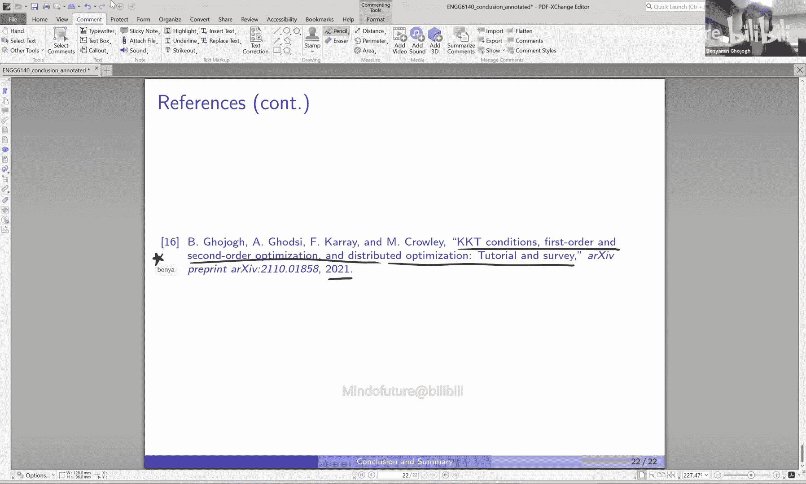

# 014：总结与结论 📚

在本节课中，我们将对本课程所学的优化技术进行全面的回顾与总结。我们将梳理核心概念，并提供一个清晰的框架，帮助你在面对具体优化问题时，能够选择和应用合适的方法。

---

## 课程概述 📖

本课程涵盖了优化技术的主要方法。我们从预备知识开始，包括集合、范数、函数、局部与全局极小值、导数、梯度、雅可比矩阵、海森矩阵、集合与函数的凸性。我们还介绍了标准问题形式，如凸优化问题、线性规划、二次规划和半定规划。

---

## 补充内容：未涵盖的重要方法 🔍

上一节我们回顾了课程的核心内容。本节中，我们来看看一些课程中未深入讲解，但值得了解的重要优化方法。

### 割平面法

割平面法，也称为定位法，是一类方法的统称。其核心思想是：从一个包含待求解的大可行集开始，然后迭代地通过“切割”掉一部分不含解的区域来缩小可行集。

以下是其基本步骤：
1.  从一个大的可行集（由不等式约束、等式约束和优化变量定义域决定）开始。
2.  在每次迭代中，找到一个超平面将当前可行集分割成两个互不相交的部分。
3.  通过某种算法判断解位于哪个部分，然后舍弃不含解的那个部分。
4.  重复此过程，直到可行集变得非常小，收敛到解。

**核心思想**：我们虽然不知道解的确切位置，但可以判断它位于分割后的哪个部分。这类似于“猜数字”游戏中的二分查找法。

**与二分法的关系**：二分法是割平面法的一个特例，它总是将可行集平分为两个相等的部分。割平面法则允许以不同方式（如选择重心、最大体积椭球中心等）进行分割。

**重要算法**：重心法、最大体积椭球法、切比雪夫中心法、解析中心法。

**应用**：与次梯度法类似，割平面法也可用于优化非光滑函数。

### 椭球法

椭球法由多位学者在1976-1977年间提出，最初应用于线性规划。它在迭代缩小可行集这一点上与割平面法相似。

以下是其工作原理：
1.  在每次迭代中，以当前解 **x_k** 为中心构造一个椭球 **E_k**。
    *   椭球定义为：**{ z | (z - x_k)^T P^{-1} (z - x_k) ≤ 1 }**，其中 **P** 是对称正定矩阵。
2.  判断解位于椭球的哪一半，并舍弃不含解的那一半。
3.  在更新后的解处构造一个新的、更小的椭球。
4.  重复此过程，直到椭球体积变得非常小，收敛到解。

**关键点**：与割平面法使用超平面切割不同，椭球法直接构造并切割椭球。对于凸优化问题，可以利用梯度方向来判断应保留椭球的哪一半。

### 极小极大与极大极小问题

考虑一个双变量函数 **f(x1, x2)** 的优化问题。

*   **极小极大问题**：先关于 **x2** 最大化，再关于 **x1** 最小化。
    *   **公式**：**min_{x1} max_{x2} f(x1, x2)**
*   **极大极小问题**：先关于 **x1** 最小化，再关于 **x2** 最大化。
    *   **公式**：**max_{x2} min_{x1} f(x1, x2)**

**核心概念**：这两个变量具有冲突的目标。一个想最大化函数值，另一个想最小化函数值。因此，这类问题在博弈论中应用广泛。

**等价条件**：在特定条件下（当极大化和极小化的变量对象保持一致时），极小极大问题与极大极小问题是等价的。

**应用实例**：
*   **机器学习**：生成对抗网络（GAN）中，生成器试图最大化判别器的损失，而判别器试图最小化该损失。
*   **经济学**：双头垄断市场中竞争者的策略分析。

---

## 课程内容总结 🧠

现在，让我们系统地总结在本课程中学到的所有优化方法。

课程提供了优化的主要方法。首先，我们从预备知识开始，包括集合、范数、函数、局部与全局极小值、导数、梯度、雅可比矩阵、海森矩阵、集合与函数的凸性。我们还介绍了标准问题形式，如凸优化问题、线性规划、二次规划、半定规划。

我们涵盖了线性规划，介绍了单纯形算法及其表格法实现。我们还介绍了整数线性规划，以及用于求解它的分支定界法。

我们介绍了KKT条件、拉格朗日函数和拉格朗日乘子法。

我们涵盖了无约束一阶优化，包括梯度下降、反向传播、加速梯度法、随机梯度下降、SAGA算法、神经网络。为了处理约束一阶优化，我们还涵盖了近端方法，如投影梯度法。

我们涵盖了无约束和约束二阶优化。对于二阶优化，我们需要一阶和二阶导数。我们介绍了用于无约束二阶优化的牛顿法，以及用于约束二阶优化的内点法（如对数障碍法）。我们还介绍了分解方法和共轭梯度法来加速牛顿法。我们介绍了拟牛顿法，如BFGS和有限内存BFGS，用于近似牛顿法中的海森矩阵或其逆矩阵。

我们学习了分布式优化，如交替优化和交替方向乘子法，以解决复杂的多变量优化问题。

我们涵盖了非光滑优化，通过凸共轭和Huber函数进行近似，并介绍了近端算法、软阈值化、坐标下降和次梯度法。

我们涵盖了非凸优化，将其分为局部方法和全局方法。局部方法（如序列凸规划）更快，但不保证找到全局解。全局方法（如分支定界法）较慢，但能保证并验证全局解。

我们涵盖了重要的基于搜索的元启发式优化方法，用于处理高度非线性和非凸问题，例如遗传算法、粒子群优化、模拟退火和MATLAB中`fminsearch`使用的Nelder-Mead单纯形算法。

最后，我们在课程的附加讲座中介绍了用于黎曼流形优化的黎曼优化。

---

## 如何应对优化问题：决策流程 🗺️

学习了这么多方法后，面对一个具体的优化问题，我们该如何着手解决呢？本节将提供一个清晰的决策流程。

假设我们有一个优化问题，需要最小化或最大化一个成本函数，并可能带有等式和/或不等式约束。

### 1. 判断问题类型

首先，识别问题是**无约束**还是**有约束**的。如果有约束，进一步区分是仅等式约束、仅不等式约束，还是两者混合。

### 2. 无约束问题的处理

对于无约束最小化问题 **min f(x)**：
*   **第一步**：求导并令其为零 (**∇f(x) = 0**)。这是基于一阶最优性条件（也是KKT条件的推论）。
*   **若能求出闭式解**：检查该点是极小值、极大值还是鞍点。通过计算该点处的二阶导数（海森矩阵）来判断：
    *   若在邻域内海森矩阵半正定，则为（局部）极小值。
    *   若半负定，则为（局部）极大值。
    *   若不定，则为鞍点。
*   **若无法求出闭式解**：需要使用数值优化方法。这本质上等同于寻找 **∇f(x) = 0** 的根。数值方法分为：
    *   **一阶方法**：只需梯度，更简单但收敛慢（如梯度下降）。
    *   **二阶方法**：需要梯度和海森矩阵，更复杂但收敛快（如牛顿法）。

### 3. 约束问题的处理：转化为无约束问题

对于约束问题，一种策略是将其转化为无约束问题。
*   **软惩罚/正则化**：将约束作为惩罚项加入目标函数。
    *   **公式**：**min f(x) + Σ λ_i * penalty(g_i(x)) + Σ μ_j * penalty(h_j(x))**
    *   当约束满足时惩罚为0，违反时惩罚增加。
*   **硬惩罚/指示函数**：使用指示函数 **I_S(x)**，当 **x** 在可行集 **S** 内时为0，否则为无穷大。
    *   **公式**：**min f(x) + I_S(x)**
    *   由于无穷大难以计算，通常用**障碍函数**（如对数障碍）来近似，这引出了**内点法**。

### 4. 针对特定问题结构的专用方法

*   **线性规划**：目标函数和约束均为仿射函数。可使用**单纯形算法**（如表格法）或内点法求解。若只有2-3个变量，可视化是最简单的方法。
*   **整数线性规划**：变量为整数。使用**分支定界法**，其中每个子问题可用单纯形法求解。
*   **可用拉格朗日乘子法的问题**：对于不太复杂的约束问题，可建立拉格朗日函数并应用KKT条件求解方程组。
*   **分布式/多变量问题**：使用**交替优化**或**交替方向乘子法**，这些方法易于并行化。
*   **非光滑问题**：目标函数在某些点不可微。可使用**近端算法**、**软阈值化**、**坐标下降**、**次梯度法**，或用Huber函数等光滑函数进行近似。
*   **非凸问题**：目标函数非凸和/或可行集非凸。
    *   **局部方法**：如**序列凸规划**，每次迭代将问题近似为凸问题，速度快但不保证全局最优。
    *   **全局方法**：如**分支定界法**，速度慢但能保证找到全局解。
    *   **元启发式方法**：适用于高度非线性、非凸、梯度难以计算或函数为黑盒的情况。例如**遗传算法**、**粒子群优化**、**模拟退火**。
*   **黎曼流形上的问题**：如果约束集可以视为一个黎曼流形（如正交矩阵集、正定矩阵集），则使用**黎曼优化**方法。

---

## 优化之精髓：KKT条件与拉格朗日函数 💡

回顾本课程的所有算法，你会发现一个共通的精髓：**大多数优化算法的核心是KKT条件和拉格朗日函数**。

这是优化领域的“顿悟时刻”。无论是推导一阶、二阶方法，还是内点法、交替方向乘子法，我们几乎总是在利用拉格朗日函数和KKT条件。拉格朗日函数可以看作是对约束的软惩罚，而KKT条件则系统化地表述了最优解必须满足的一阶条件。

各种算法之间也存在着深刻的联系和共享的思想。例如，加速梯度法中交替更新变量的思想与交替优化相通；坐标下降可以视为在坐标方向上的交替优化；许多算法都利用了“动量”或历史信息的理念。

建议你回顾所学算法，体会它们是如何以KKT和拉格朗日函数为基石，并通过共享的思想相互关联的。

---

## 致谢与参考资料 📚

本讲稿的部分内容受Stephen Boyd教授关于椭球法和割平面法的讲义启发。课程教程也包含了本讲稿的一些材料。

**主要参考资料**：
1.  Boyd 等人的割平面法讲义。
2.  数值分析相关书籍。
3.  解析中心割平面法相关论文 (1993, 1995)。
4.  椭球法相关论文 (1976-1977, 1980, 2009)。
5.  关于极小极大原理及其在博弈论中应用的论文 (1972)。
6.  优化教程论文。

---

## 总结 🎯

本节课中，我们一起学习了优化技术课程的全面总结。我们回顾了从基础概念到高级算法的知识体系，梳理了包括割平面法、椭球法、极小极大问题在内的补充内容。最重要的是，我们建立了一个清晰的决策框架，帮助你根据优化问题的具体特征（如是否有约束、是否线性、是否光滑、是否凸等）来选择最合适的求解路径。最后，我们指出了KKT条件和拉格朗日函数作为贯穿整个优化理论的核心支柱。希望本课程对你深入理解和应用优化技术有所帮助。