# YannicKilcher【中英⚡AI经典论文领读(全203篇)(上)｜Papers Explained】 p02 P2 Jukebox：一种音乐生成模型（论文解读） [BV1o3xLznExj_p2]

🎼Yeah。🎼Oh you。🎼我要你。🎼TheFor。🎼それなら。🎼怎么笑。Alright， so what you're hearing is the open AI Duke box。

 This paper came out and it is a surprisingly good quality generative model for music。

 including lyrics， so including singing。

Which I believe is pretty novel。 And the fact that it works so well and has musical consistency throughout entire songs is something that is very。

 very novel and cool。Alright， so we're looking at the papers it's called Jukebox a generative model for Music。

 and it's by Perfola Darrival， Hewo Jun， Christine Pine， Jg Wu Kim。

 Alec Raford and Elias Setzkiver of Open AI。

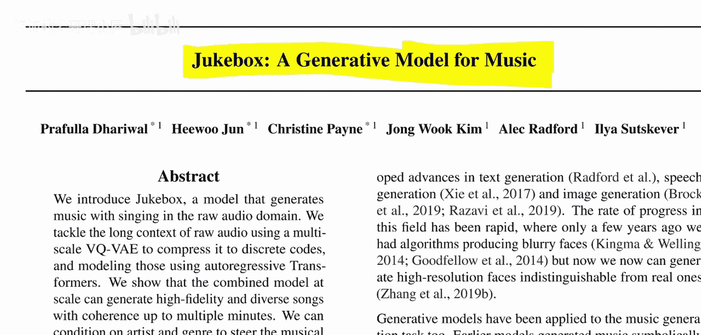

So the model here is a， is not very novel， but I think the。

 the way they set it up makes a lot of sense and will quickly go through it and look at what comes out of this。

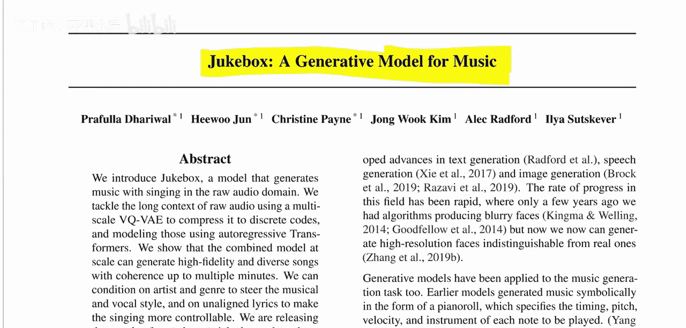

This is not a very technical paper， but I think it's it it's well written。

 And their main thing is these VQ V AE models。 So these models， if you know。

 you might know what a variational autoenr is。 So in a variation autoencor I have an input。

 let's say an image。Here of our typical cat。And I put it through what is called an encoder。

In order to get a hidden representation， now， this hidden representation。

Usually called something like Z or H is then in a， in a classic autoenr， I would here have a decoder。

 and then。I train that decoder to match that in that original picture as closely as possible。

 So I train these two neural networks， the encoder and the decoder to just basically compress to this representation。

 and then reproduce again， the original image。 and thereby。

 I think I can learn a good hidden representation。 Now， in a variational autoencoder。

 What happens is there is an in between step namely。

 This Z representation here is not directly fed to the decoder。

 but this representation is actually used to parameterize Gaussians。So in the easiest case， we have。

 let's say， we have。6 dimensions here in the hidden representation。

 The first two are used to parameterize the first Gaussian。 One is going to be the mean。

 and one is going to be the standard deviation of that Gaussian。

 And the second two are going to parameterize the second Gaussian。

 and the third are going to parameterize the third one。 So we have now three Gaussians。

 And then from those three Gaussian distributions。 We're going to sample。A three dimensional vector。

And then were going to feed that three dimensional vector to the decoder。Every input image。

 in essence， is giving us a distribution in the latent space and not just a single vector。

 It's just is giving us a vector that describes an entire multivariate Gaussian distribution。

 And then we train the decoder basically to reconstruct the encodeder。Given that distribution。So。

The variational auto encodeder has improved over the classic autoencoder because it tends to circumvent some of the shortcomings。

 but still variational autoenderrs have their problems and in terms of generative model for images。

 people， as you know， have gone to things like GNs and so on。

But here this new thing is called the VQ VAAE。And that's a because I。

 I believe this stands for vector quantization， not entirely sure honestly。

 but so what it does is it takes the input。Right here。 and again， it maps it to a latent code。

And these latent code， I believe， are， are here called H。So it maps it to a vector called H。

 Now here is where it gets different。 We do have a so called code book。Here。

So a code book is just a list of vectors。 This is the code book， and these are here called E。

So what we'll do is we'll simply look for H which one's the closest neighbor in the code book that we have of hidden vectors and we'll map it to that and say this is this here is the closest neighbor so we'll basically quantize the hidden representation to these codes so we end up only with vectors that are these codes and now instead of saving the vector H first of all。

 we get a super compresspressed representation because if these are like 616 code book vectors。

 we can just simply enumerate them right and then we can simply encode the image as one or a sequence of these indices here。

But second of all， it tends to bring a more kind of a。Diversity and accuracy。

 if we then decode from these， these code vectors。 Now， of course， everything is trained here。

 So the encoder is trained and the code books themselves are also trained。

 and the decoder is also trained to give you the maximum kind of benefit。

So this is what is described here。 What they have is， first of all。

 their are loss for these V Q V As。 and you'll see how they are using them to generate music in a second。

 Their loss is part this reconstruction loss， which you can see here。 This is the original image。

How far is it away from the decoded hidden quantized representation， This E here。

 this is the quantized the codebook vector that belongs to the hidden representation of x。

 So this is your standard reconstruction loss。The next part of the loss is this code book loss。

 Now the codebook loss is for training these codebook vectors。

 so it basically pulls the codebook vector closer to the actual hidden representation So that is where you train these。

 This here is a stop gradient。So basically just means that you want your codebook vectors to be better representing of the data that you feed in because otherwise it would be useless codebook vectors。

And the third part of their loss is the these commit loss right here。

 and that is exactly the opposite。 Now you put the stop gradient on the codebook vector。

 and you simply want to pull the hidden representation closer to the code book vector such that。

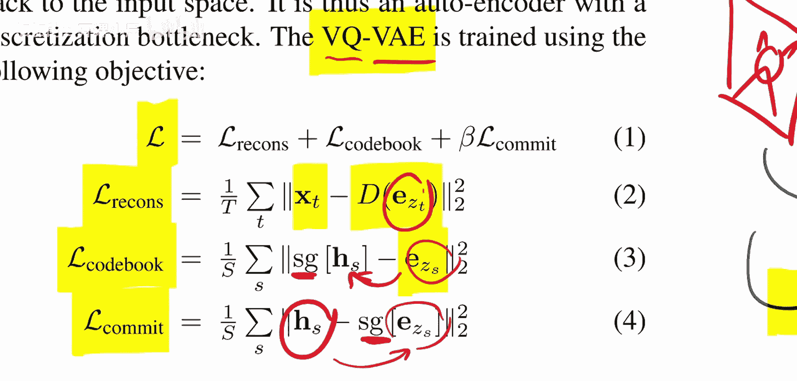

And imagine the encoder must learn to。Approximately hit one of these code book vectors， right。

 Otherwise it， it can， it cannot not really learn something meaningfully。

 It must learn to deal with the code book vectors that are there and to approximately map the input into the vicinity of one of one of the code book vectors。

 Otherwise， there's no information flowing。

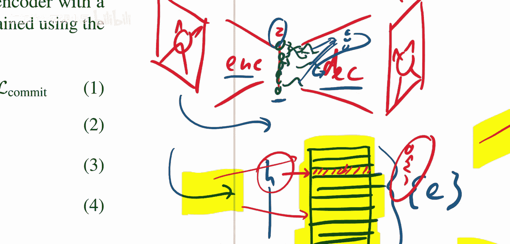

So that's how you train things。 you train the encoder and the decoder。To reconstruct。

 you train the codebook vectors， to represent the data。

 and you also train the encoder to make good use of the codebook vectors， Honestly。

 now that I think about it， I am pretty sure in the reconstruction loss you might only train the decoder because you do have this quantization step in between in this in this thing here。

 So technically you could not backproagate through that。

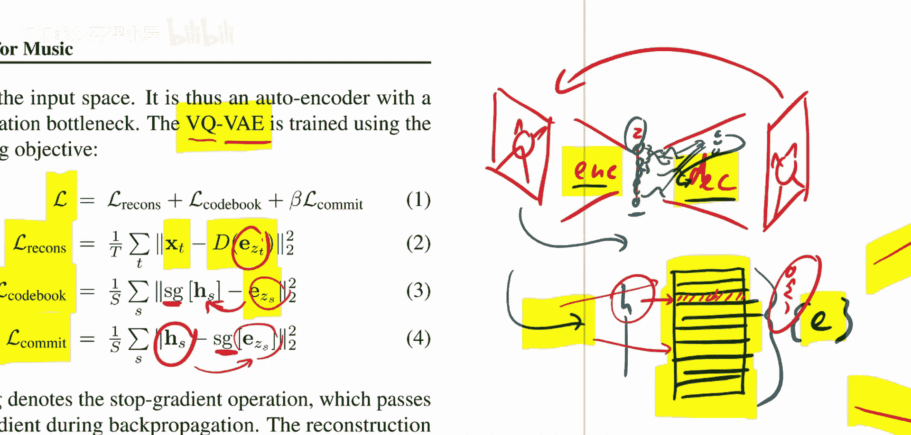

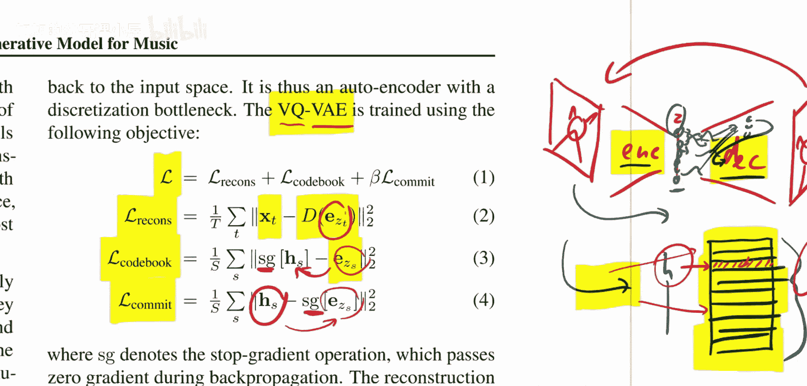

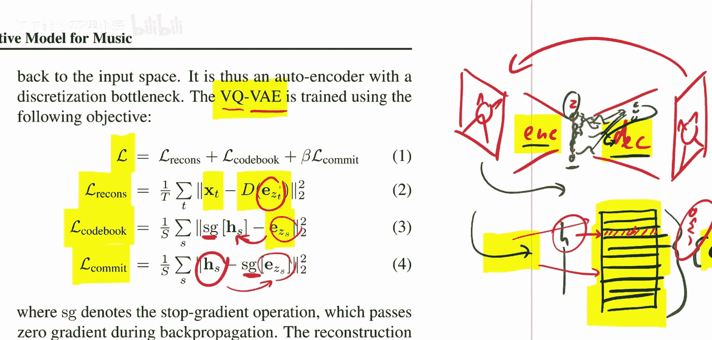

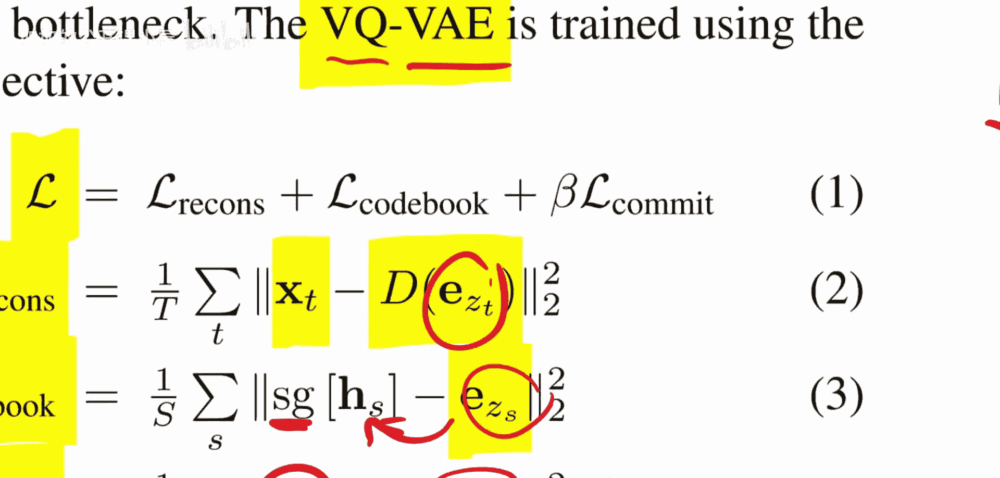

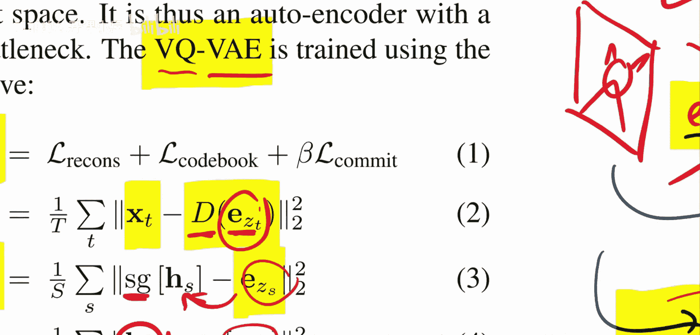

Allright， so that's how you train the individual parts of a VQ VAE and we'll see how they use it in order to produce music。

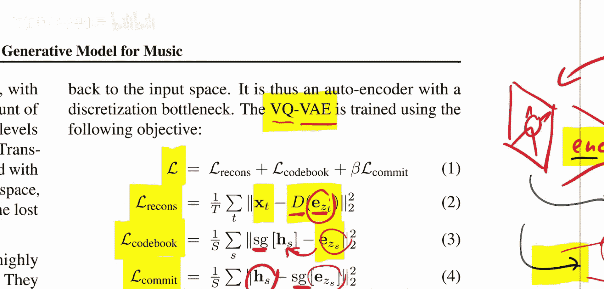

Alright， so what they do is they start off with a sample of music。And they send it through this。

Thing。Through this an architecture。 and at the end。

 they are trying to reconstruct the same thing they had at the beginning。

 So you see this overarching autoenr architecture。 that's why it's an autoencoder。

 You try to reconstruct your input and thereby you try to learn something about the data because a model that can compress and then uncompress all of your data has learned something useful about it。

Now， you have these VQ V AEs here in the middle， but you have them at different scales。

You'll have three of those here。 There is a course scale1， middle scale 1 and a high frequency one。

 right， So three VQ VEs right here。

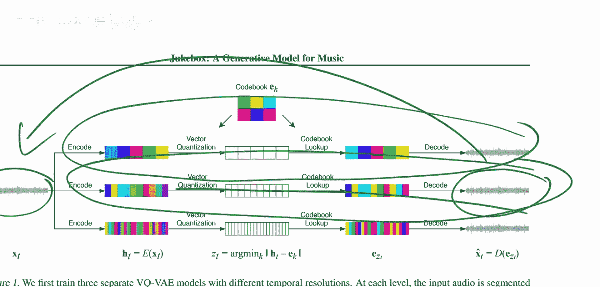

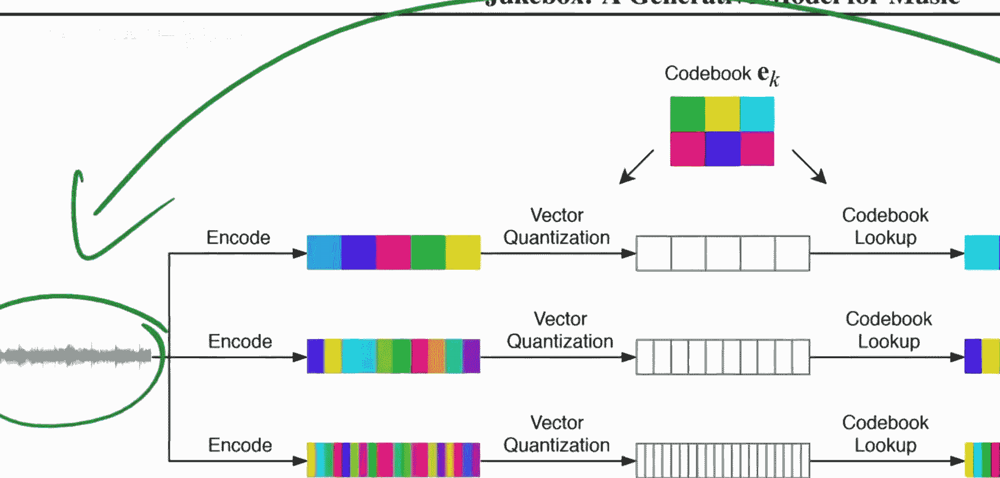

And you train each one of them separately。

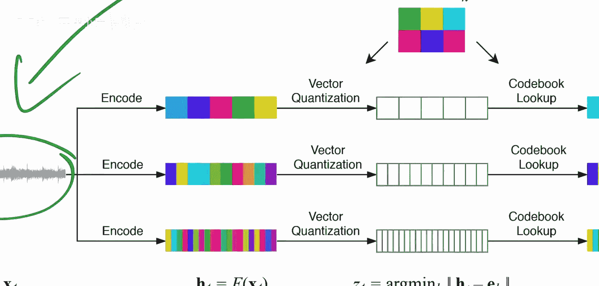

And the difference between them is that the。So because this is a continuous signal。

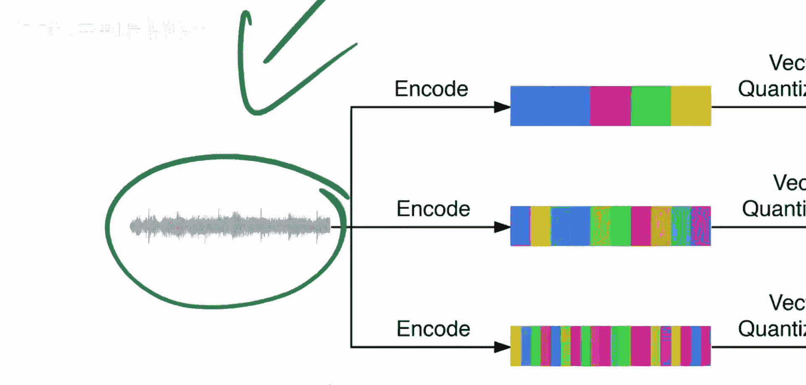

You cannot just encode a container。