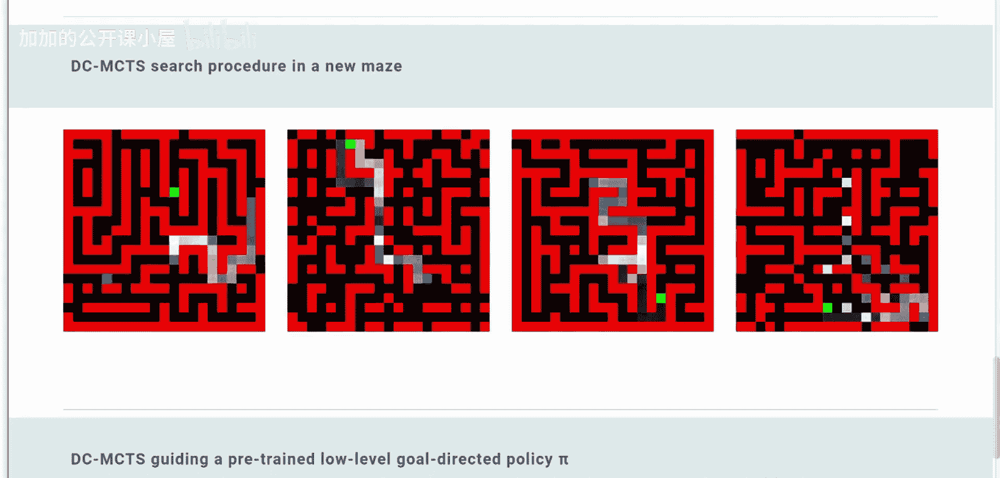
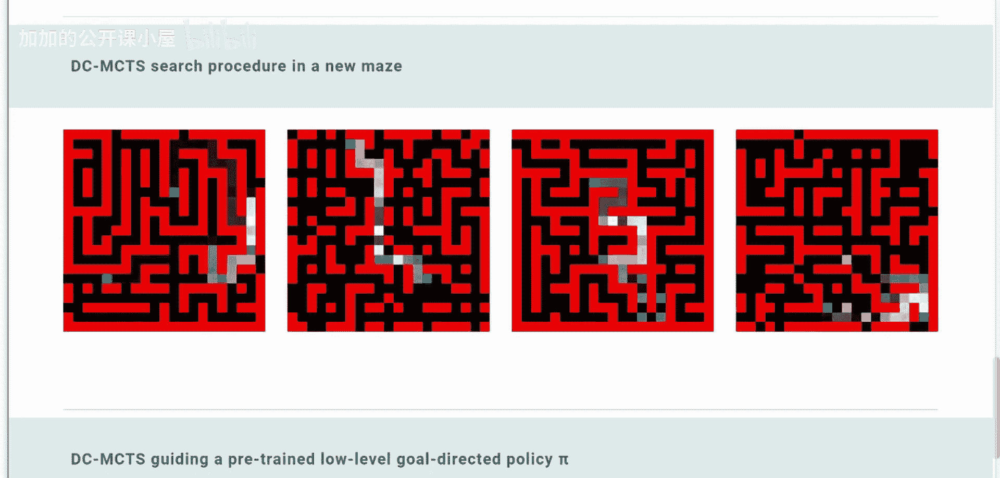
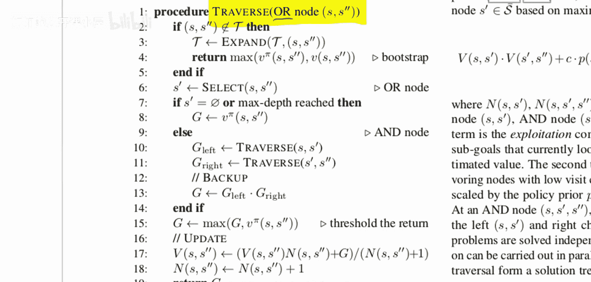

# YannicKilcher【中英⚡AI经典论文领读(全203篇)(上)｜Papers Explained】 p05 P5 分治蒙特卡洛树搜索在目标导向规划中的应用（论文详解） [BV1o3xLznExj_p5]

Hi there What you're seeing here is a divide and conquer Monte Carlo research in action this is a planning algorithm that plans in a kind of an unconventional fashion。

 so we're going to explore this today in this paper divideiv and conquer Monte Carlo research for goal directed planning。

By Jabaista Parconlo and Lars Buusing and a list of other authors。

And I believe this is from Deep Mind and Mubunk。And Aar and。Yeah， that's it。All right。

What does this thing do， It is a planning algorithm and planning might be not really familiar for you。

 So let's say you are in this room and or this set of rooms right here。

 there is a bunch of walls and you are up here and you want to reach the goal down here So first of all。

 this is a goal directed problem right here it says goal directed goal directed means that you give the algorithm a goal to reach and this could be a different goal each time you're on the algorithm right。

So you give it a goal to reach then the second thing here we see is planning so it is a planning algorithm。

 What does planning mean planning means if if you if you're traditionally reinforcement learning。

 you would think I'm just gonna go ahead and run my my agent here and maybe you can move in the four different directions。

 run my agent here， do some things right maybe I hit a wall and get a negative reward at try again。

In planning， you don't have to move initially what you can do is think about moving and you can think ahead of what's going to happen and that's usually because you have some sort of model what happens this is very famous applied in。

 for example， Al go or alpha 0 where you have， you know if I move to the right here I'm going to be here right so you will know once you've reached the goal right if you if I'm here。

 I go down， I reach the goal Co。So you can think all of this without actually moving in the environment。

 you can think yourself ahead what would happen if I did certain things。

 and that in turn also means that you can think ahead multiple different paths so you can think ahead what would happen if I move right。

 what would happen if I move down。And then you can think in the next layer。 if I move right。

 what would happen if I moved right again， What would happen if I moved down instead。

So you can easily see the planning problem becomes a tree search problem in this first， in this case。

We've done a bread first search， right and eventually you'll see that this will get you to the goal。

 So this bread first searcher， maybe you one employee depth first search will ultimately get you to the goal。

 We can represent this as a search tree。 So you're here in a particular state and you have a bunch of actions。

 in this case，4 to move left up down or right。And you can choose any of them and you will get into a new state and from each of those。

 you could choose any again， and you can think ahead all of this。

 you can construct this entire tree and one of these branches will lead you to the goal， promise。

What is the problem， the problem is if the path to the goal here is， let's say D steps long。

 then this tree here is going to be D layers deep and in our case that means we'll have four to the D nodes in that tree before we even reach the goal。

And that is just a long， long or a big tree， and we can't construct all of it。

So algorithms have come along， for example， the a star algorithm where you can incorporate something like a heuristic and the heuristic would be。

 well， it's generally good if I'm close to the goal in L2 distance。

 So you would not build the entire tree here， but you would prefer nodes that will bring you towards this heuristic。

 So this node down here is closer to the green node in terms of L2 distance and this node down here is even closer。

 but then you're kind of stuck。 So a star will explore a bit probably along this wall here。😊。

And once you're here， you have a clear path again， right。

 so you can simply take the actions that minimize this L two distance。

 So this will already get you to a real good point。 Monte Carlo research。

 as it was employed in Alphago or Alpha star has a similar。Structure where it after a certain while。

 it stops and evaluates a heuristic to say what's the the value here and so on。

 So it is in for some problems， an even better method of constructing the search tree in a way where you don't get overblown by the number。

So the Monte Carlo search tree in this algorithm refers to the fact that we are generalizing Monte Carlo tree search from the。

 let's say， the Alphago paper。So what's the the idea here so far， We've known everything。

 The idea is the following。 If I had an oracle， if I am the master here。

 and I can tell the agent agent。Look， I guarantee you that this state right here in the middle。

 you will pass that state if you want to reach the goal， you will pass this。For sure。

 if I tell this to the agent now， what can the agent do， the agent can say， oh， okay， if I know that。

 I can simply， I don't have to search for a way to the goal。

 I'd much rather search for a way from my start point to that point where I know that I'm guaranteed to be at some place。

 and then。I can search also from a way from there to the go。Right， so this now， remember， our long。

 our path was D steps long for the original problem。 This is now， let's say， D half long。

Each of these paths and that means we just construct two trees。

 each one of them is going to be4 to the D half and the other one is also4 to the D half。

 and if we add them that is much smaller than the original4 to the D3 that we build。

So right there we have subdivided our problem into two sub problems。

 and each of them are much easier than the original problem。

This paper basically does this recursively， so it will subdivide the problem by proposing some middle state where you are going to be at some point for sure and that for sure we're going to take a look at and then for each of those problems again。

 it will try to subdivide it into sub problems and therefore recursively solved these sub problemsble until they're small enough that they can be basically solved in one step。

So that's the big idea here。And this is illustrated in this point right here。 So you are in this S 0。

 the start state， and you want to go to this S infinity， the goal state in your case。

 what this paper does is it proposes to split the problem here in the middle and then simply solve the two problems recursively。

Now， what is a bit confusing right here is that it is the planning already is a tree search right so a plan is like a tree。

 but we are searching over plan。 So we're searching for the best plan。

 which means that we are searching over trees， and that search itself is a tree search。

 So the search itself is a problem where we go down one route and then oh no。

 and then we maybe go down another route and here and then here。 So the search is a tree。

 So we're now tree searching over trees。 That's the kind of tricky thing to remember。

 So each of these plans， even if it's half if it's only half done。 like this is only half a plan。

 We don't know what's going to happen in here。 This half a plan。

Is a node in the tree that we're searching over， and then it splits， it splits， as you can see here。

 into two sub problemsble。 The two sub problemsble also are nodes in that search tree。

 So you see that this top thing here would correspond to this node， even though in itself。

 it is a plan， a tree， a string in this case。 And each of the two sub problemsble would become these predict these nodes in the search tree。

 So keep that in mind as we。Go through this paper。 It is very easy to get confused， in this respect。

The algorithm。Is pretty simple in this case。 So this algorithm rests on this traverse procedure。

So we're going to。We're going to traverse this， what they call this or nodes。 So they。

 they divide the problem into end nodes and or nodes。 I。

 I don't believe that's particularly necessary for us to think about。 But here's how this works。

 So they traverse the or node S to S prime。 This is simply。

