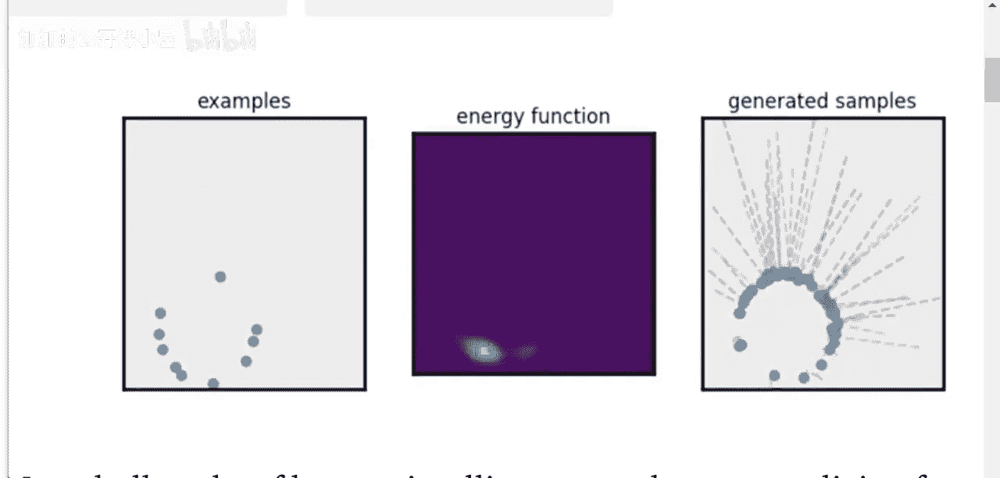
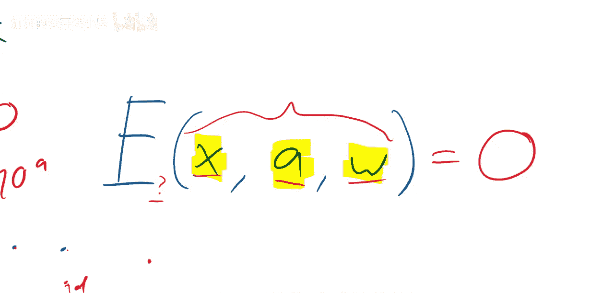

# YannicKilcher【中英⚡AI经典论文领读(全203篇)(上)｜Papers Explained】 p07 P7 基于能量的概念学习模型（论文详解） [BV1o3xLznExj_p7]

Hi there。 What you're seeing here is an energy based model that learns the concept of a shape from a demonstration on the left。

 So on the left you can see a demonstration of data points sampled from a shape in these cases。

 circles or squares。And then the corresponding energy function that the model infers from that。

 and then it can replicate that shape on the right using that energy function。

So the paper we're going to analyze today is called concept learning with energy based models by Igor Mordoch of Open AI。

 and this is a very cool paper or at least I think it's a very cool paper。

 but it is also a very hard paper so therefore。

First， I want to kind of make a bit of an introduction into the concepts that we are facing in this paper。

So the first thing you need to know are energy functions or energy based models what is an energy function and energy function sometimes called E is simply a function with one or multiple inputs。

 let's call them X and。You can make the if the energy function is happy with x。

 it will be the value 0， and if the energy function is not happy with x， it will be a high value。

 like larger than 0。So this is happy。 This is not happy。 So let's give some examples of this。

 We can formulate almost any machine learning problem in terms of an energy function。

 Let's say we have a classifier。 The classifier is。Text as an input。I。Here。Maybe of a cat。

 and a label。So if the label is cut。Then。The energy will be zero if the energy function is。

 of course， working correctly。And if we give the energy function the same image。

But we give it a wrong label， dog。Then it is very high in the case of the classifier， of course。

 we can simply take the loss function as the energy function and we automatically get an energy based model。

 so the loss function here would be something like the negative log probability of the sorry if the correct class。

But。In any case， it is just going to be a high number。 Let's call it 10 to the 9。

 So the energy function says， this is very， this is very bad。 This thing here is very bad。

 The entire thing you input。 It won't tell you yet what's bad about it。

 So that also means you can change any of the two things to make the classifier happy。 Now。

 usually we're concerned with changing the label。 right It's like， tell me which other label。

 do I need to input to make you happy。 And if we make the labels differentiable。 Of course。

 we never input the true label， we actually input like a distribution Softm distribution over labels。

 And that's。Differentiable， we can use gradient descent to update the dog label。

 we can use gradient descent to find a label that would make the energy function more happy so we could use gradient descent to get the cat level if we had a good classifier。

But we can also we can also optimize the image to make it compatible with the dog label。

 that's things that if you ever saw deep dream or something like this。

 those models do exactly that they optimize the input image for a particular label and there you can view the entire neural network。

 including the loss function as the energy function。So what's another example， Another example is。

Let's say you have a K means model and the energy function simply input a data point and for the data point。

What you're going to do is you're going to find the min cluster index， the min K over， you know。

 you have your multiple clusters here and your data point might be here。

 So you're going to find the cluster that's closest。 And then the distance here。

 this distance D will be the。Energy of that。 So the model is very happy when your data point comes from one of the clusters。

 but your model is not happy when the data point is far away。

 And that would be the cost function of the K means function。 So that's an energy based model， too。

 Now， currently， energy based models have come into fashion through things like GNs or。

Any sort of noise contrastive estimation。 So in a jet， in a ga。

 what you have is you have a discriminator， and the discriminator will basically learn a function to differentiate data from non data。

So that by itself is an energy function， so the discriminator will learn a function and that function will be low wherever the discriminator thinks there is data so it will usually do this around the data points so the data points form the valleys right and then the generator will basically take that discriminator function and will try to infer points that are also in these valleys to produce points that are also in the valleys。

And then you basically have an energy learning competition。

 The discriminator now tries to push down on the energy where the true data is and push up on the energy。

 where the generated data is， and that will give you basically a steeper energy based function in the future。

I hope so in this case， the discriminator neural network is the energy function。

And the de generator just tries to produce data that is compatible with that energy function。

 So I hope that concept of what an energy function is， is a bit clear。 any any， again。

 any machine learning problem can be formulated in terms of an energy function。 Now。

 what is not done so far is what we alluded to a little bit before in the classifier example。

And also here。Right now when we want to train again。

 we simply take the generator to produce data Now what's the generator's goal。

 the generator's goal is to hit those valleys in the energy function and we produce a generator in one shot。

 produce this data， but what we could also do。Is， of course， we could just start somewhere。

 Let's say here， we pick a random data point， and then we use gradient descent because the energy function in this case is smooth。

 We use gradient descent to just。Drop down this valley and then find ourselves in this valley。

 so without ever training a generator， we can use these methods to produce points that are in the valley of the energy function。

RightAnd this， I don't know if people， I'm guess people have trainedgans like this。

 The reason why it doesn't work， let's say in the real world。

 is because that procedure will just produce adversarial examples for the discriminator and those usually look like nothing like data because if you keep the discriminator just stable and gradient descent against it。

 what you'll get isn't really qualitatively good， but in principle。

 if the discriminator was a good energy function for the data to describe the data。

 we could use gradient descent。 the same up here。In order to find a good label for an image。

Given that we have a good energy function， so this is that we could simply gradient descent on the label。

😊，In order to find a in order to find a better label。So in this paper。

 we're going to have a situation where。We say were given an energy function and we're given a bunch of inputs。

 They are then called X， A and W。And if I have my energy function already。

 if I have given my energy function and I have given two of those three things， any two， right。

 I can infer the last thing。Simply by gradient descent on my energy function。

 because I know the energy function is 0 when all of these。

 when the energy function is happy with the input。 So when all of these things agree。

Basically the energy function is happy， it will output 0， otherwise it will output a high value。

 therefore， if I'm given any of those any two of those three things。

 I can find a compatible third thing by descending。And then， of course。

 over here in these machine learning problems， the task was always actually to learn an energy function right so usually in the training data set we are given images and labels and we want to learn this energy function which would be parameterized so we want to learn the parameters and the same here in our general case if we are now given three things but we are not given the parameters of the energy function。

 we don't know what those are as long as we're given all of the inputs。

And our training data set and our training dataset guarantees these are actually， you know。

 these are inputs that are compatible with each other。 The energy function should be low。

 We can simply。

