# YannicKilcher【中英⚡AI经典论文领读(全203篇)(上)｜Papers Explained】 p08 P8 群组归一化（论文详解） [BV1o3xLznExj_p8]

Hi there。 Today we'll look at group normalization by Yushin Wu and Kimminghe。Of Facebook AI research。

 So this paper is basically an engineering paper about a new normalization technique called group normalization。

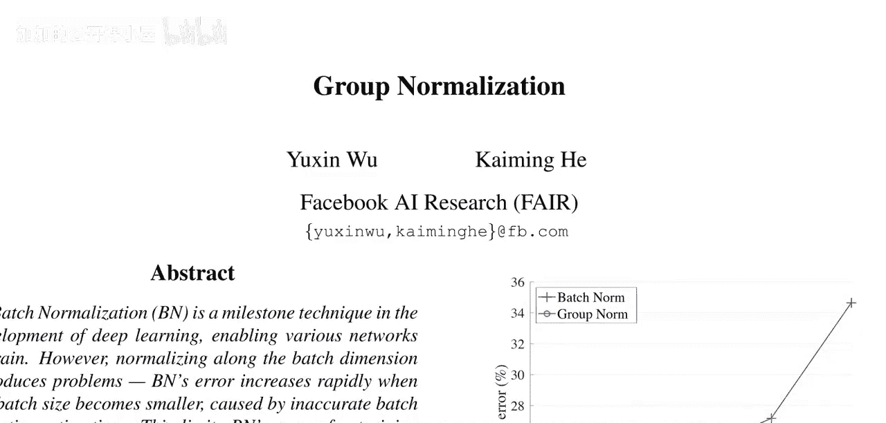

So what's the issue here， the issue is that pretty much throughout neural network learning。

 we're using this technique called batch normalization。

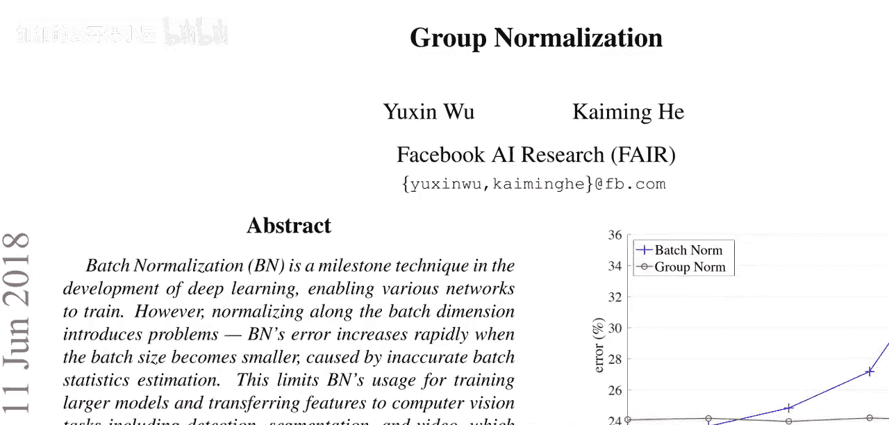

Now， batch normalization is a pretty reasonable thing and it works very， very well。

 So what's the idea behind batch normalization。

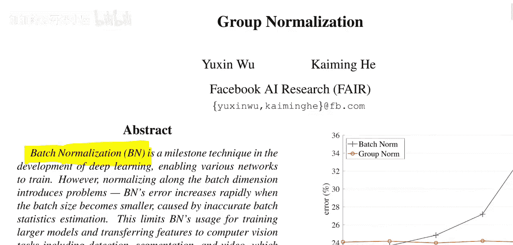

The idea is if you have data points。For machine learning methods and your data is in a 2D coordinate system somewhere down here。

 right and you're trying to separate that from the dots which are here。

It is often very beneficial to shift that distribution before you do anything。

 you want to shift it to the middle of the。Basically， want to center it。First of all。Such that the0。

 the origin point is in the middle of the data。 And then sometimes you also want to do what's called normalize it。

 And by normalizing， we mean you want to kind of rescale the axis such that things are more or less。

Sort of like Gaussians。So if you， if you look at this distribution first is the centering。

And then second is what is called a normalization。Normalization。

And usually we know that any sort of machine learning methods work better if you do that。

 and that's mostly in classic machine learning methods with conditioning numbers of the data being better and so on。

 but if you just want to learn， let's say a linear classifier you can see here。

 you can even save one parameter because you can make it just go through the origin。

And that's true in general。 So if we draw this in1D。

 you'd have a distribution that maybe is very peaky right here。

 you first center it to the middle of the coordinate system。And sorry， that's not really centered。

 And then you would divide it by its standard deviation such that after it it is a unit standard deviation Gaussian。

 So a normal distribution。The closer your data seems to be to a multivariate normal distribution。

 the better these machine learning methods work， especially if you look at how signal in deep network is propagating through the layers。

 So the idea is if it's good for the general machine learning method that the input has a multivariate normal distribution or is normalized。

 then it's probably good that the input to each layer is normalized。

 So when you look at how signal features are。

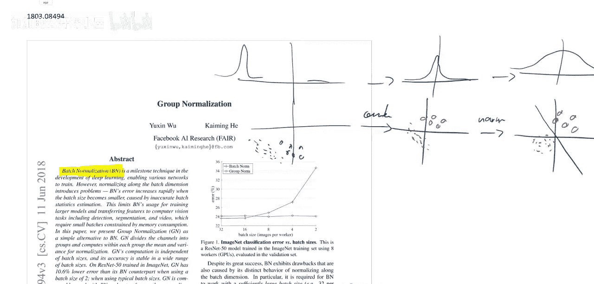

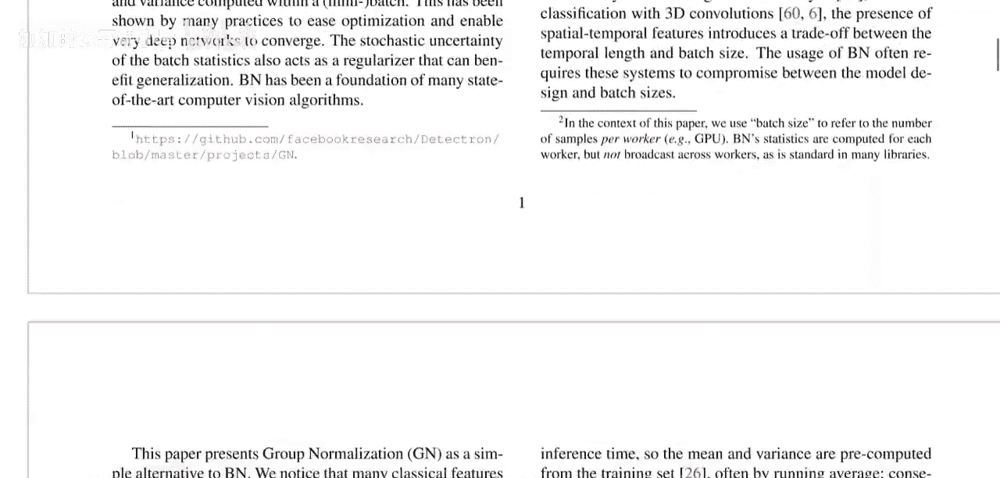

In between layers。 so this is， for example， the con5，3。

 This is a layer somewhere in the middle of a convolutional neural network。

 And if you look at the spread of how features feature signals are throughout training。

 you'll see that the more training progresses the larger the kind of spread of features is。

 So you might get really large numbers or really large negative numbers or maybe really small numbers in your neural networks。

 And it would be better if。You had a layer and the input， you've normalized it right。

 and the output then is again a distribution， but it may be shifted that you would first transform that back into a normal unit normal distribution before you put it through the next layer。

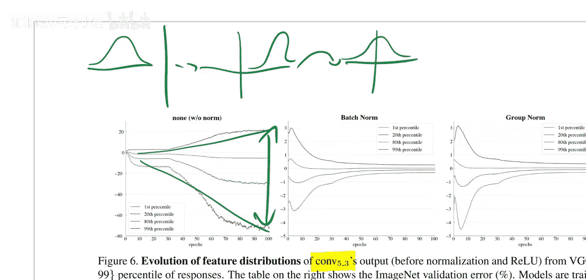

So what patch or b is at each layer before each layer。

 it will do a normalization procedure on the data before giving it to the next layer。

And you can do a basically back prop through that， it's also common to learn bias and variance parameter to add after that。

 but the important thing is that after each layer the data is normalized。

 such that it is kind of in the most comfortable regime。What's the problem。

 the problem with this is that you actually need the distribution right if you want to center this data up here。

You need to know what the data is so you need to know the entire data if I want to figure out what is the mean of this distribution。

 I need all of the data points to decide here is the mean I need to shift that up to here。

If I just have a mini batch like we usually do in machine learning。

 so if I just have this or this and this and this point I just have four points。

 I can't determine the mean， but what I can do is I can sort of guess the mean from the four points right so my guess of the mean would be somewhere here and that would be usually close enough and you can also see that the larger your batch is if you sample at random。

 the more accurate your mean estimation is going to be。

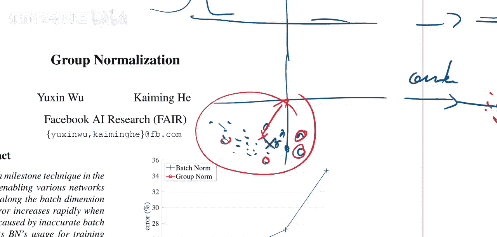

So people have been training neural networks with large batch sizes for。

These basically batch size have gotten larger and larger in the last year。

 so that has not been a problem， but what people are doing now is they are doing distributed machine learning。

 where you do have your data set and you draw a batch and the batch might be large so this might be I don't know。

1 million images。 this might still be 4000 images in your batch but what they'll do especially with things like TPUus is they'll distribute that across many。

 many， many machines into batches of sometimes as small as eight samples per per unit。

And if if this is not images， but maybe something longer like a sequence of text。

 or if this is a sequence of speech or something like this。

 you can sometimes even go down to two or one samples per unit of computation。

 and of course you can't do batch normalization， you can't calculate the mean of one sample。

 It's just going to be that one sample itself。 So either to you have two options。

 if you're in small batch sizes。 let's say two。 either you take the hit and have your very bad estimate of the mean from just two samples or eight samples or after each layer。

 you basically do as synchronization step such that every communicates to everyone else。

 their statistics， and you can basically aggregate the statistics across the batch。

 Both are not cool。 Usually these frameworks， they don't do the synchronization because it's just too slow。

So they'll go with the bad statistics。 And you can see this right here in this graph。

 They have the imagenet classification error versus batch sizes。

 So this is a Resnet 50 model trained on the Inet dataset using 8 workers， So 8 GPus。

 And if they do 32 images per。

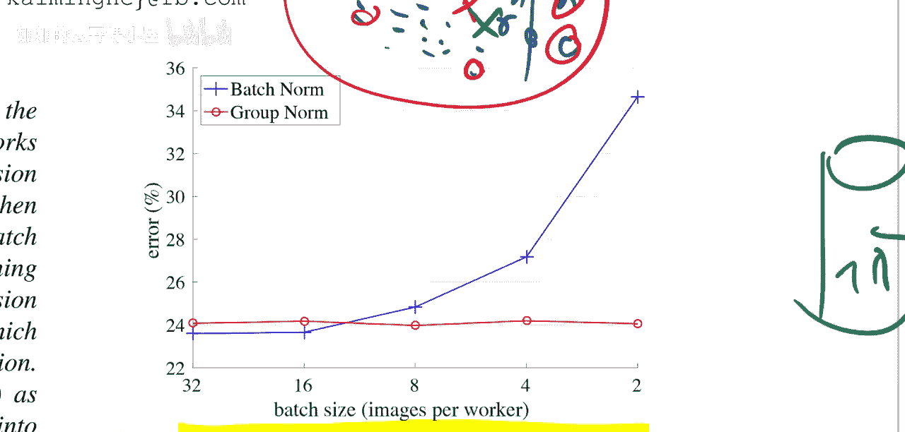

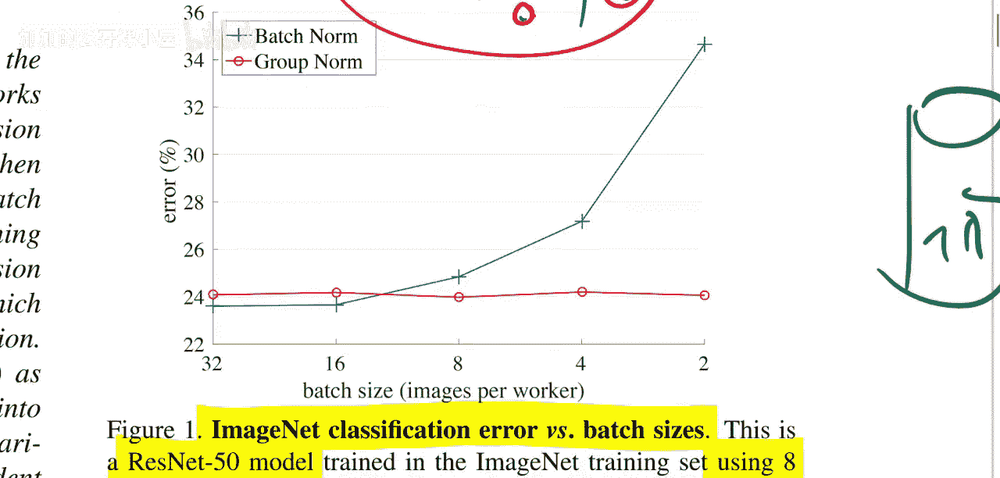

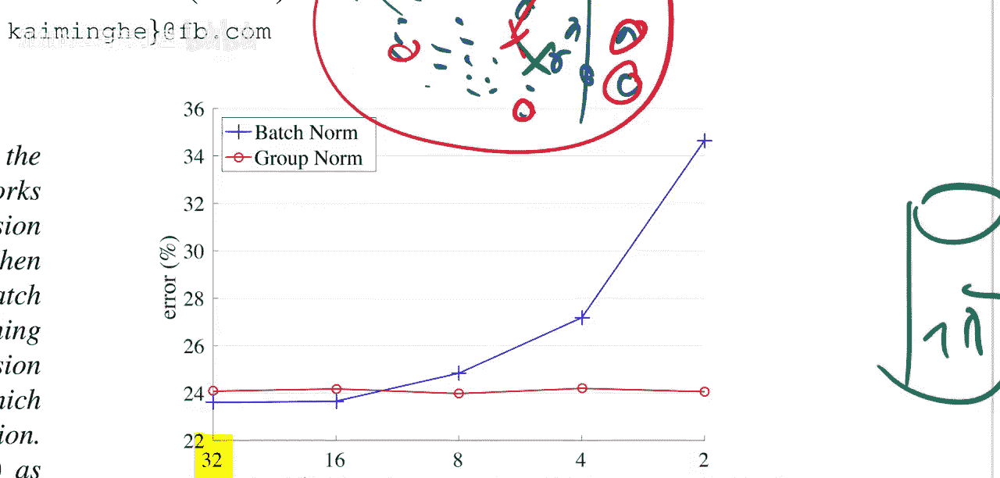

Now just look at the blue line here。 if they do 32 images per worker， so it's eight workers。

 it's 8 times 32。 that's the batch size。 That is a large number， 256， maybe yeah。

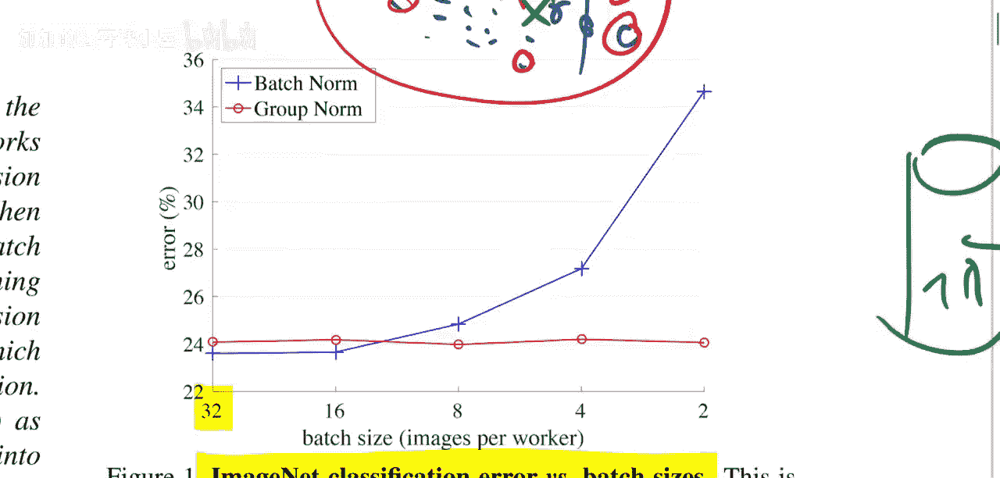

Alright， so， so if they do that， then。You can see the error is on a state of the art for a resnet 50。

 if they go to 16， it's still pretty good， but then as they go lower and lower and lower。

 so if they go to smaller and smaller batches and spread them out over the workers then。

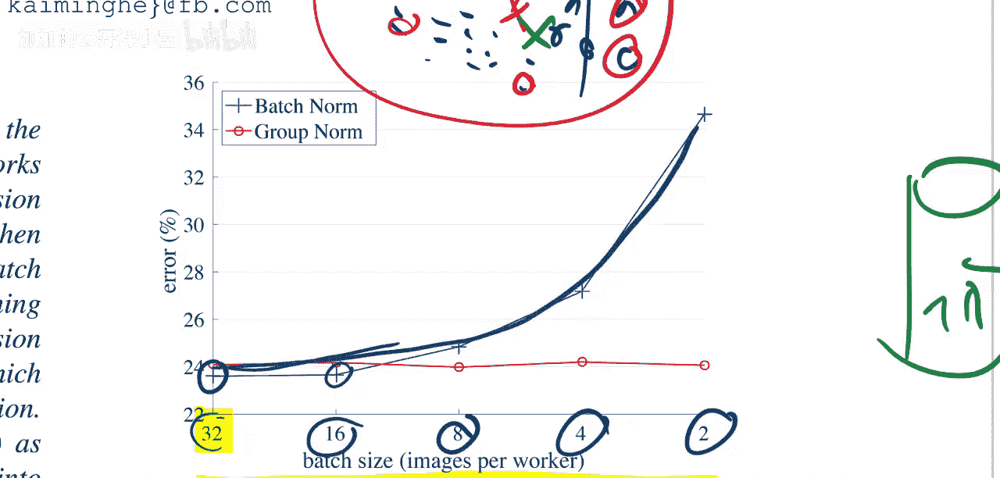

The error starts going up and this is because the batchche norm statistics get worse and worse。

 so the goal of this paper is to find this group norm thing here， the group norm。

 this paper claims is another normalization technique that pretty much does the same thing。

 this centering and the normalization， the scaling。

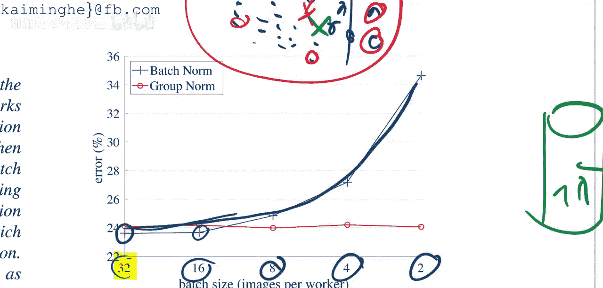

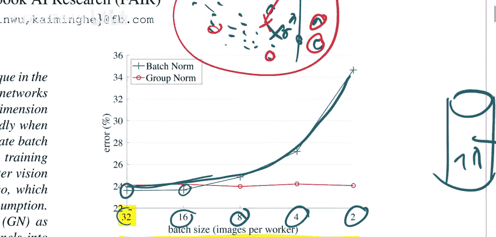

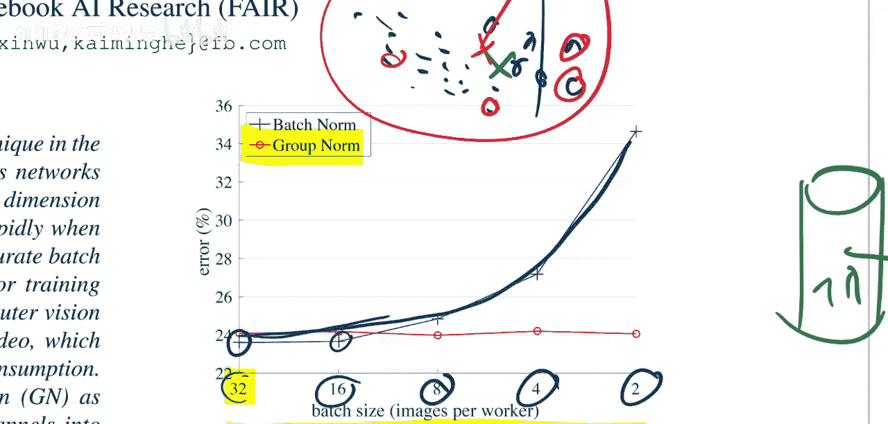

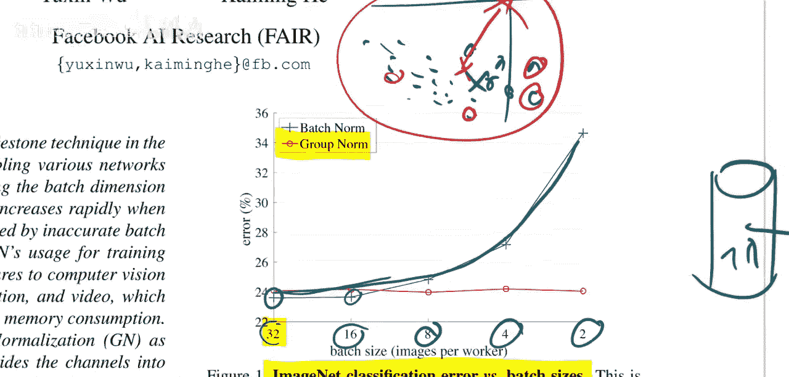

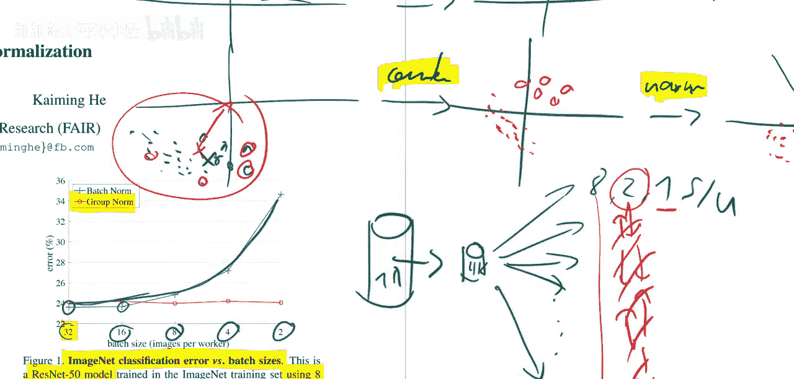

But it does it without relying on the batch statistics。 It basically does it within a data point。

 and that means that the performance， even though it's a bit smaller at the beginning for this particular example will stay constant with even in small batch size regime。

 so this is potentially applicable， as I said to things where you have to go to like two or one sample per worker because it's just the data points。

 the single data points are just too large。

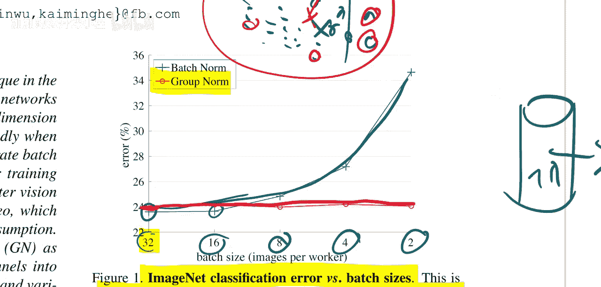

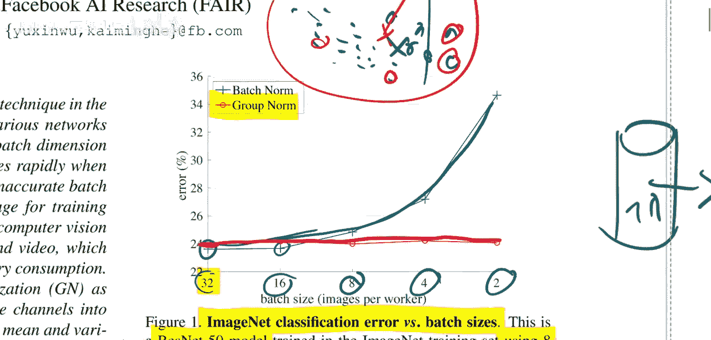

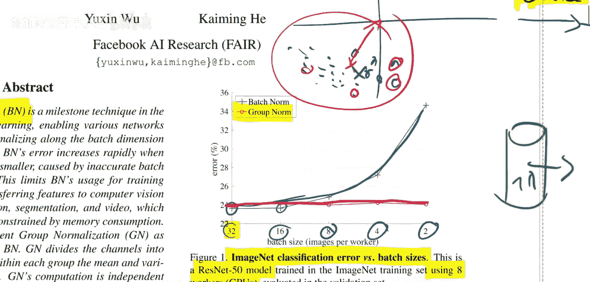

So if you maybe want to train something like Bert on a GPU。So。

What is group normalization group normalization， as I said。

 works within a sample now there have been other methods that work within a sample instead of across the batch and they tend to not work as well as batch norm now this paper here claims that group norm works on par with batch norm for large batch sizes and better than on small batch sizes so here they have a schematic of what's happening。

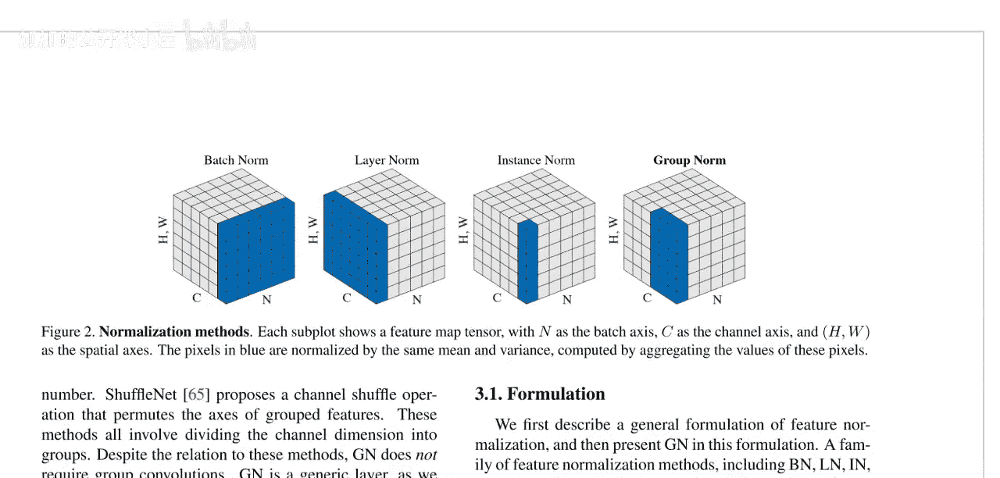

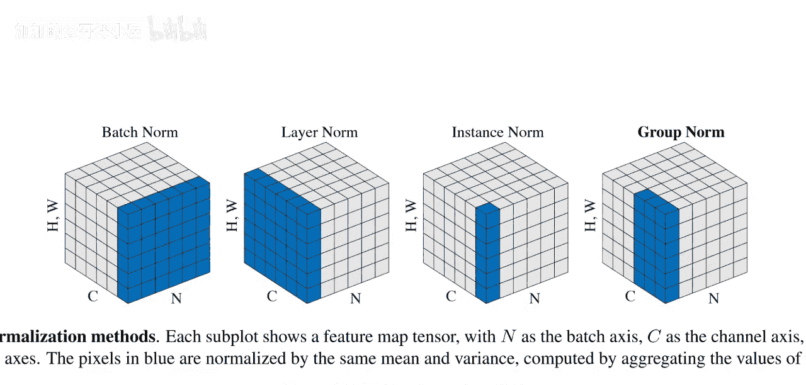

In batch norm， as you can see here， you have this cube， now this cube here n means the batch size。

 so these are the data points。Points in your mini batch。

This is the thing that is going to get small in the if you don't have enough memory。

Then C would be your channels。

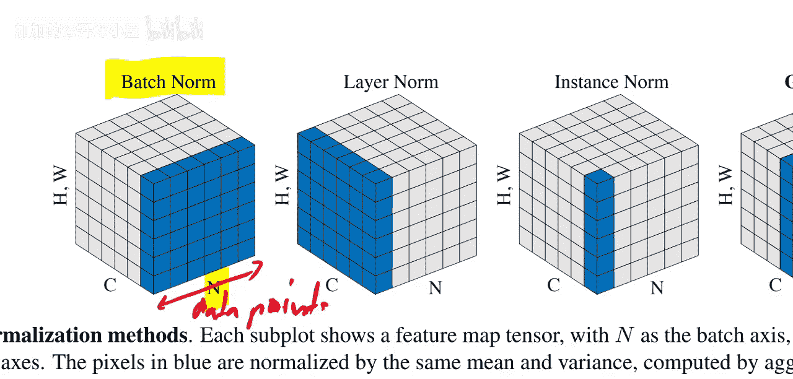

So。We are talking about convolutional neural networks。

