# YannicKilcher【中英⚡AI经典论文领读(全203篇)(上)｜Papers Explained】 p11 P11 自监督的关键分析，或从单张图像中能学到什么（论文解读） [BV1o3xLznExj_p11]

Al right， today we'll look at a critical analysis of self supervision or what we can learn from a single image by Yuki M Asano。

 Christian Rupert， and Andrea Valdi。This paper， I。

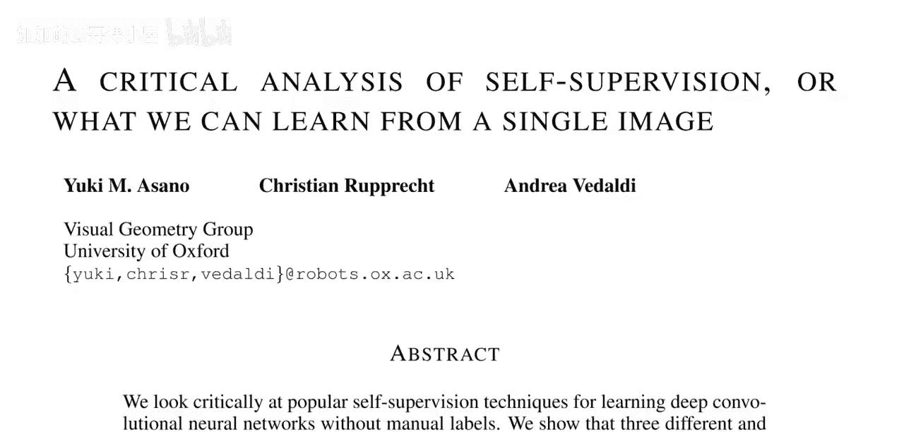

Really was excited when I saw this paper because the the outset is so cool and the experiments have are very promising。

 So we'll take a look。😊，Msically say we show that three different and representative methods by again rotnet and deep cluster。

 so this is self supervision techniques， can learn the first few layers of a convolutional network from a single image as well as using millions of images and manual labels provided that strong data augmentation is used。

However， for deeper layers， the gap with manual supervision cannot be closed。

 even if millions of unlabeled images are used for training。We conclude that first。

 the weights of the early layers of deep networks contain limited information about the statistics of natural images。

 that second such low level statistics can be learned through self supervision just as well as through strong supervision。

 and that three， the low level statistics can be captured via synthetic transformations instead of using large image data set。

Okay。So。I， as I said， I， I was kind of excited when I saw this。

 And what they're talking about is self supervision。 So really quickly， for those who don't know。

 self supervision is a technique where if you have images， but no labels。

 and you would still like to learn something from them， you can do。

 you can do a pre training step for your network。 So basically， you have your neural network。😊。

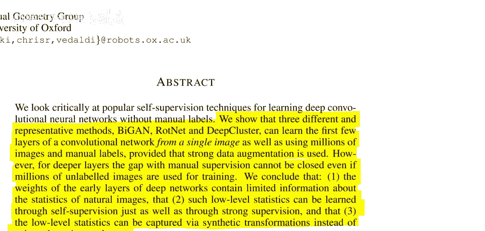

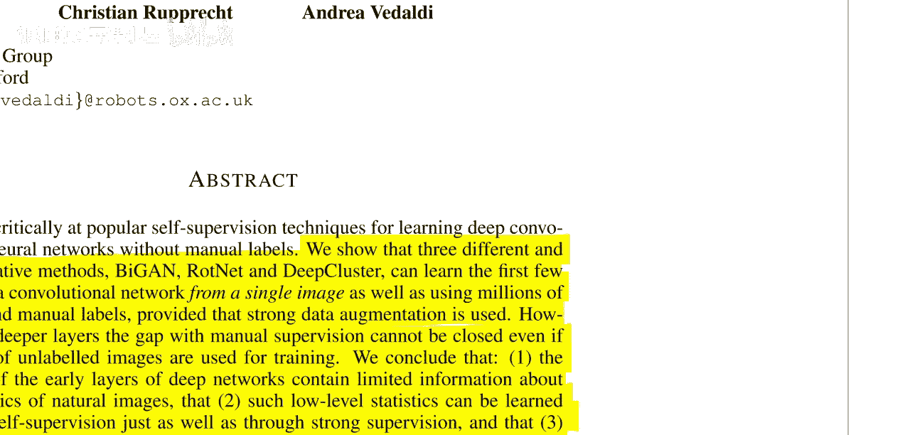

F， and what you would like to do is you would like f of x to be close to y for x and y2 in your training data set。

But you can， if you have a much larger data set of just x's。 right here。

 you have pairs of x and y of just x you that are sort of similar to the X in your。

 in your label dataset set。 you can do， you can kind of get。

 get your network used to the data by doing this self supervision。

So what you would do is you would sort of come up with your own labels for the data points。

 And one way is this will take just this rot net as a example。

 So what you'll do is you'll input an image。So maybe an image of the number three in handwritten digit recognition。

 but you flip it。You'll flip it to its side， right， So it's the number 3 right here。

 And then you ask the network to come up with an answer。 Is it upright， Is it flipped to the right。

 Is it flipped to the left or is it turned on its head。 Which one is it。And， of course， you。

 you who did the transformation know the correct label。 right。

 So this is how you come up with sort of fake labels for your data。 And this works surprisingly well。

 And what this paper basically says is that。You do not actually need this giant database here。

 It's actually sufficient。 Sometimes if you have one single image where you do this on。 Now。

 the claim is a bit of a cheat， I have to say， but。

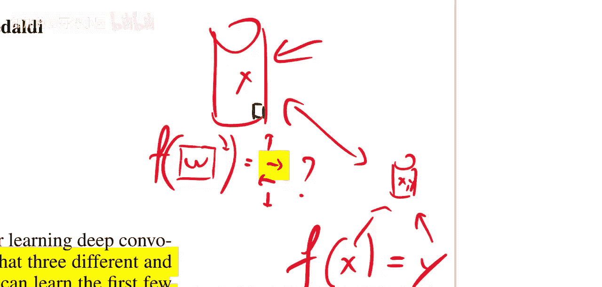

We'll go into that。And further they say， okay， it's enough to have one single images to learn the features of the lower layers of the neural network because they usually tend to extract lower level features that you know you can learn from a single image but the higher level features。

 you really need the supervised dataset set， it's not enough to have these self-supervision techniques and even if you have many。

 many， many self-supvision samples， so if you actually do have this giant dataset set it still doesn't help you for the higher layers。

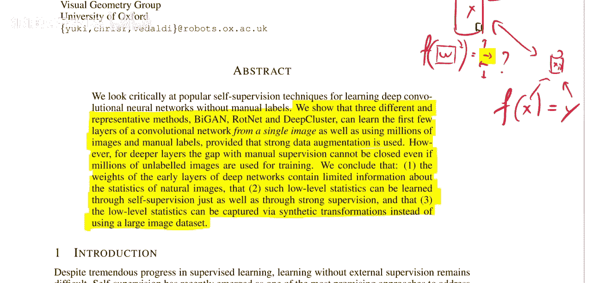

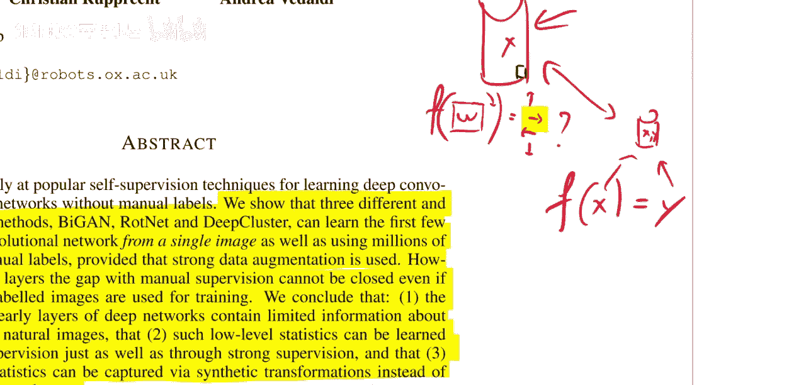

Almost causing to question this， you have a giant data set of unlabeled things。

Notion that is often presented， including by me。

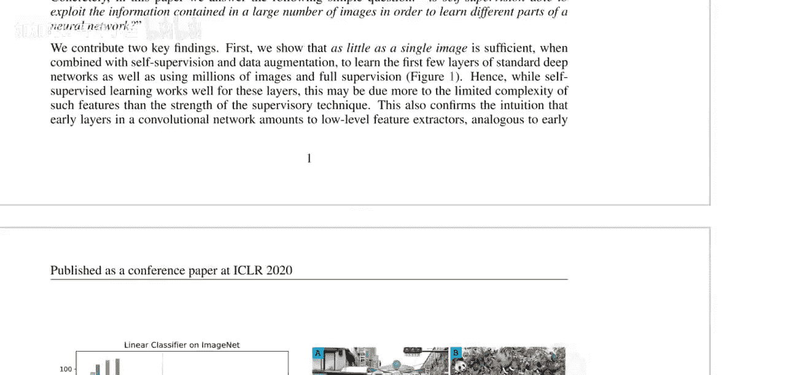

Okay， so what do they do。They do。 they take。Either single images or just very few images。

 So they also have a setting where they take 10 images for the single image。 They hand select it。

 So they hand select the following three images。 So this image right here。

 they select because it's very crowded。 There's a lot going on， right？ There's people。

 There is objects， there is lighting and so on。 there is。You know， houses， these lines， you know。

 there's perspective。So that's why they select image A image B here。

 they also experiment with image B is a drawn image。

 as you can see there's also lots of stuff going on。

 but they basically want to research how does a natural image compare to a artificial image。

And then in C， they have this as sort of a control because there is lots of parts here where there' is not much going on compared to here in most of the image。

 there is lots of stuff going on。 and this image on the this image number C。

Letter C has large areas where there's nothing going on。Okay， so these are the single images。 Now。

 why I say it's a bit of a cheat is that these images are actually super large。 They for。

 So for imagenet and for c for 10， they， you know， this might be one of the samples of the C for 10 or imagenet classifier。

 Now， of course， C for 10 is a lot smaller than imagenet。 but still for imagenet， these are。You know。

 there are many pictures here， not just one。 so to say this is from a single image。

 its technically true， but then if you split it into multiple images， it's technically not true。

So it would have been fun to see what actually happens with a single image when you downscale it。

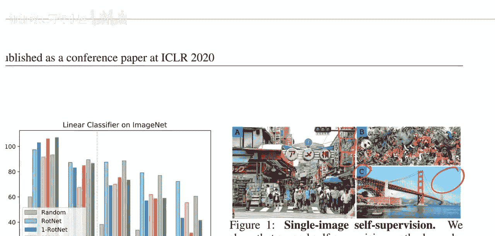

But okay， so how do they investigate this， They have this five layer neural network right here。

 So this five convolutional。 I'm gonna guess there's five convolutional layer。

 after each convolutional layer， I think there is some batch norm and relu And then to the next convolutional layer and so on。

And then at the end， maybe there is， or there's also some pooling here， Max pool。At the end。

 there is going to be some linear classifier that classifies it into either a 10 or 100 or 1 thousand classes。

 whatever you want。

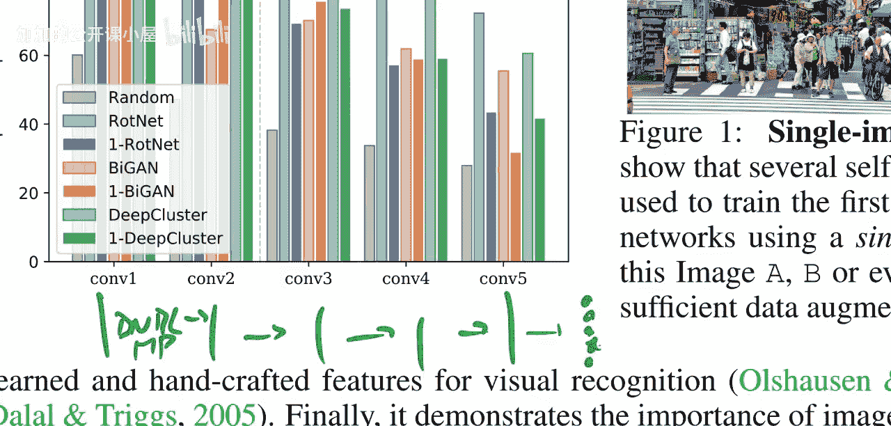

The way they investigate this is through linear probes， So called now， linear probes are。

Somewhat of a somewhat of a technique to inspect how much each of the layers learn。

 So if we again draw our network right here and this is the input X right so you have the hidden representation 1。

 hidden representation 2 hidden representation 3， and here you output it to the Y hat and that you compare with the Y from your dataset set。

 right the x is from your dataset set and the y is from your dataset set。Now。

 linear probe wants to investigate how useful a given hidden representation is to classify the output。

 So what a linear probe would do is it would take the hidden representation here and learn one single linear classifier to classify that hidden representation to come up with a Y hat。

Given H1 or something like this。 So the important part here is that this is linear。 right， This is a。

 this is a linear。Classifier。You do nothing more， you take the representation and instead of this entire giant neural network on top of it。

 you simply build a linear classifier and you can build these linear probes from any layer right here。

 you can build a linear classifier on top of this on top of this and then you basically look how good is your linear classifier when trained on that hidden representation that the network comes up with。

And that's how you estimate how much information about the target or let's say。

 know how how optimal the representation already is， because at the end of the network， right。

 you do have a linear classifier。 So at some point。

 this representation must go into a form where it is now linearly well classifiable。

 And the assumption is basically that these layers of the neural network successively make a representation that is more and more linearly classifiable。

And that is a strong assumption， right？And。

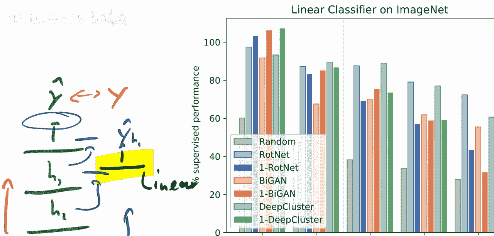

This paper here uses linear probes exclusively。And that is a bit worrisome to me because I have my troubles with this linear probe approach because this strong assumption that more linearly classifiable is better。

 it just rubs me in the wrong way we know that the information content can never increase from layer to layer。

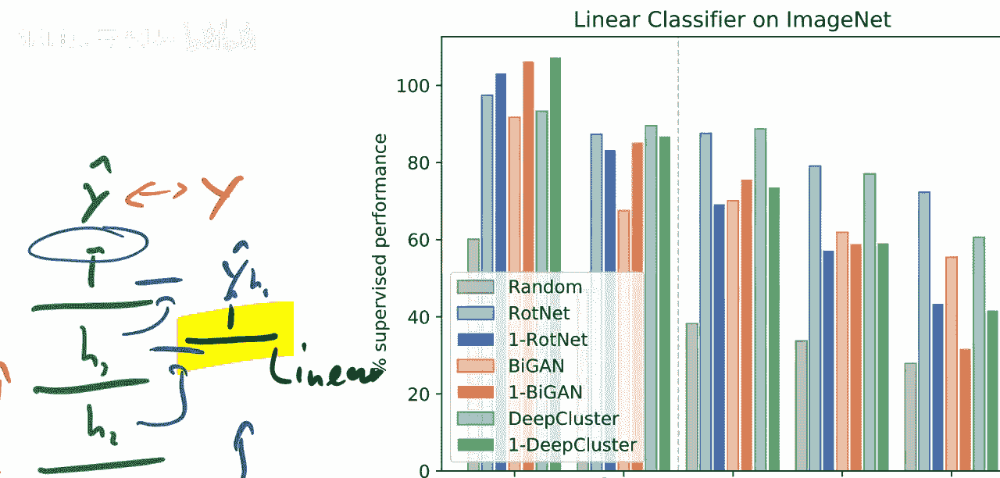

AboutAbout the label， so any information about the label that is in H1。Sorry。

 that is in H2 must also have been present in H1， so technically if we just built the correct classifier。

 we could predict from H1 just as well as from H2。

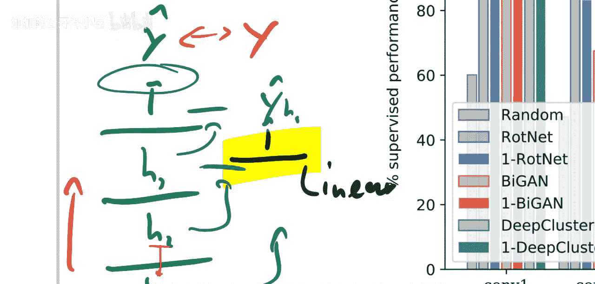