# YannicKilcher【中英⚡AI经典论文领读(全203篇)(上)｜Papers Explained】 p13 P13 Mixup：超越经验风险最小化（论文解析） [BV1o3xLznExj_p13]

Hi there。 Today we'll look at mix up beyond empirical risk minimization by Hong Yichang。

 Musttafa Cis Yan In Dofa and David Lopez P。

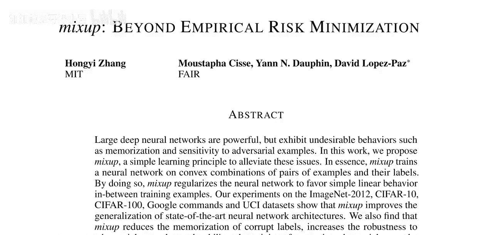

SoThis paper is actually pretty simple， but it introduces a technique that apparently helps with training classifiers and I haven't seen it used in practice。

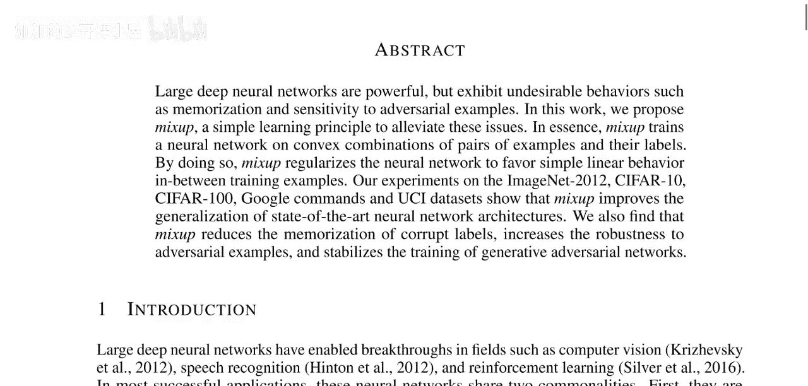

There must be at least something to it。 It is ultimately very simple。

 so usually you input a data point x into your neural network in deep learning。 So F of x。

 that's your neural network， your neural network has parameters， theta。

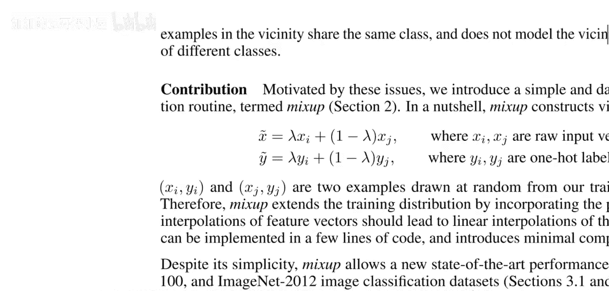

You get some output Y hat， and along with the x， you also have a y， a true label。

 and then you have a loss function that compares what you output with your true label。

 and then you just try to make that loss smaller， you want to adjust your parameters。

 So next time you see data point x。 It output will be a little closer to the true label Y。

And we call this empirical risk minimization。

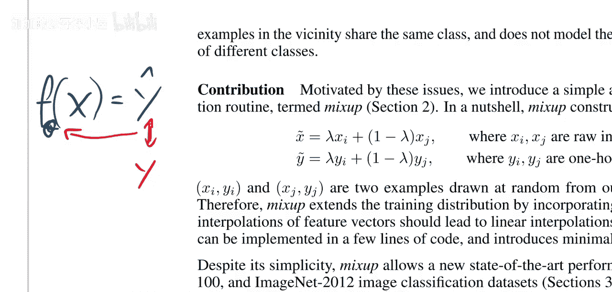

Because you don't actually what you think is that your x comes from some distribution。

 from some data distribution D， like the space of all natural images or the space of all of language。

 but what you actually have is you have a data set of a finite amount of data that you can put that you can sample X and y from and so instead of minimizing your true risk you minimize your empirical risk。

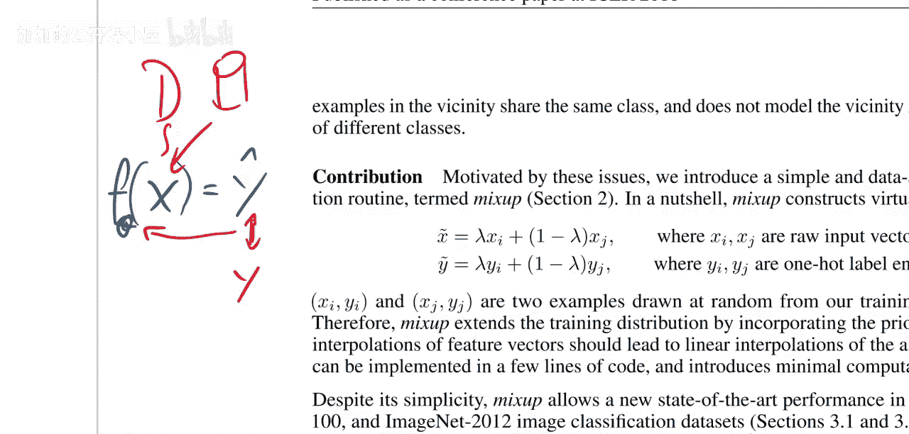

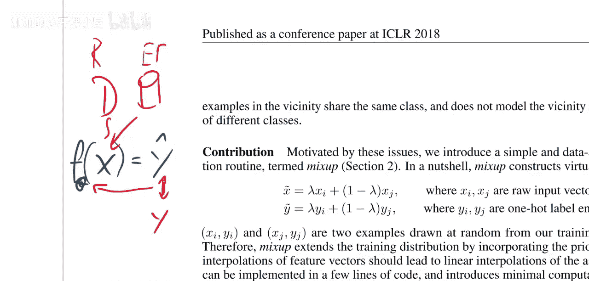

The empirical mis rhization， right here。

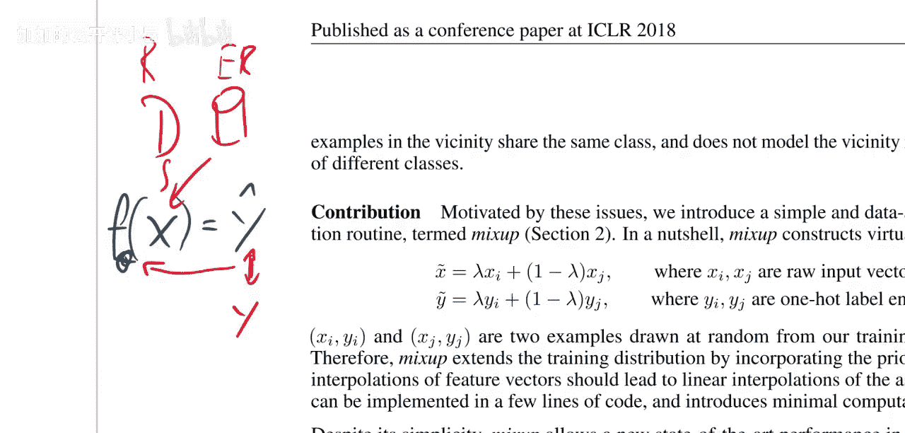

Now， what's the problem with that， the problem is that you can get overly confident about your data points and nothing else。

 and that will hurt your generalization。 So if you have a data point， let's say right here。

And another one right here， your network is basically， so this， this is this is class 1。

 This is class 2。 your network is going to maybe make decision boundaries like this and like this where it says。

 okay， here is class 1 and here is class 2。But it could。You know， it。

 it's very conceivable that here it says here is class 4。 and over here is class 7。

 And right here through is class 9。 And by the way， here， class 4 again。 so the the。

Empirical risk minimization leaves everything in between the data points open。

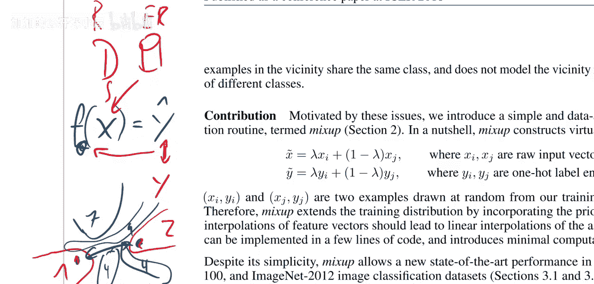

Now what this paper proposes is that we should not only train our classifier on these data points。

 but on all the data points。Sort of in between the two。And this is the mix up data points。

 So this data point here might be constructed if this is a and this is B from。0 point。1 times B。

 right， and plus 0。9 times a because it's mostly a and it's a little bit B。

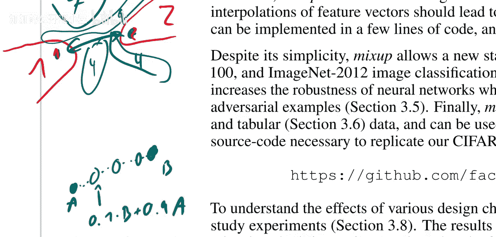

And now you think， what are the labels here if a belongs to class 1 and B belongs to class 2？Then。

 of course， the label of this data point is 0。1 times the class of B， which is 2 plus 0。

9 times the class of a， which is one。Ultimately， because what you do is you input a class like a class number two。

 If you want to input this into a machine learning model。 You just。

 you don't say it's class number two。 What you input is a distribution that is。

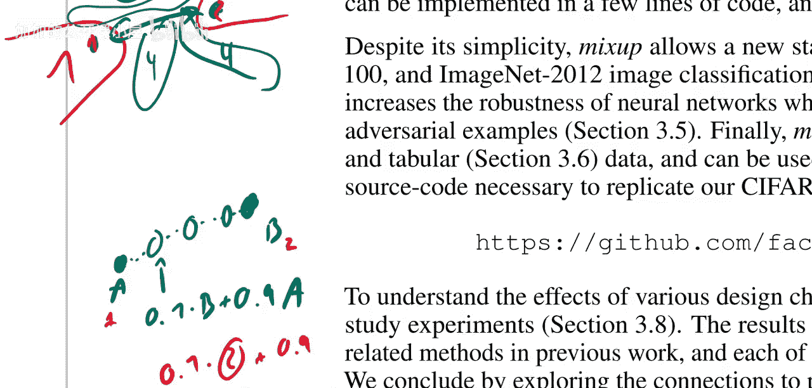

Basically has zeros everywhere， so these small things they're 0，00，1，0。

 and this here is at class number2， so this would be class number one， class number two。

 class number three right you input a distribution like this if you want to express class number two。

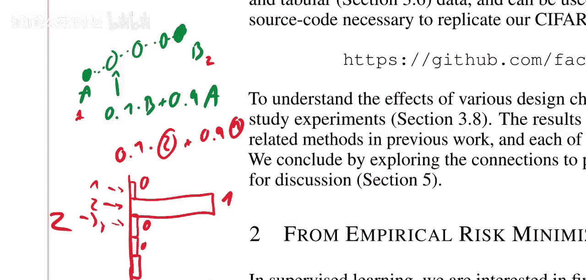

Now in our sample right here， what we would input as a label is simply a mix between class1。So 0。

9 so 0。9 of class 1。0。1 of class 2 and then 0 everywhere else。

 So this would be our label for the data point that we construct right here。

 This would be our sorry the top one would be our data point。

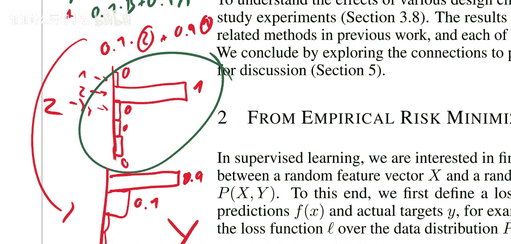

Formerally。You take two data to points。And you mix them using this Lambda mixing factor。

 That'll give you a new data point that's in between the other data points。

 And you take the two corresponding labels and you mix them accordingly as well。

 And that will give you the label for that data point。

 And now your model will learn to basically smoothly interpolate。

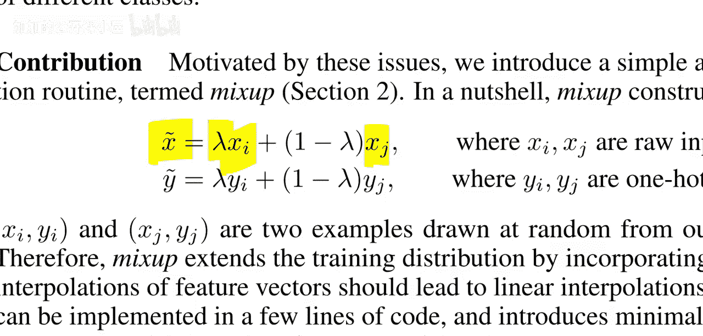

So you will teach your model。 The thing on the left here is class number one。 right。

 That's class number one。 The thing on the right is class number 2。 This here is。

AHalf of class 1 and a half of class 2。 So the model basically learns a smooth interpolation where the situation that's here on top is probably not going to happen anymore。

 But what it would do is it would sort of create these iso lines around class 2。

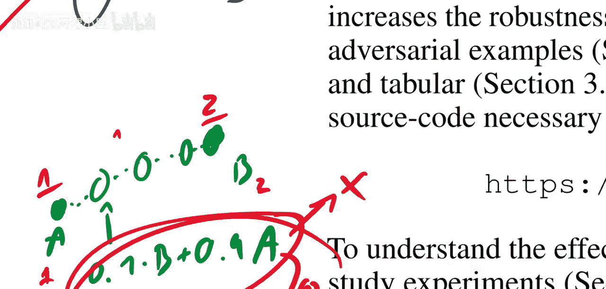

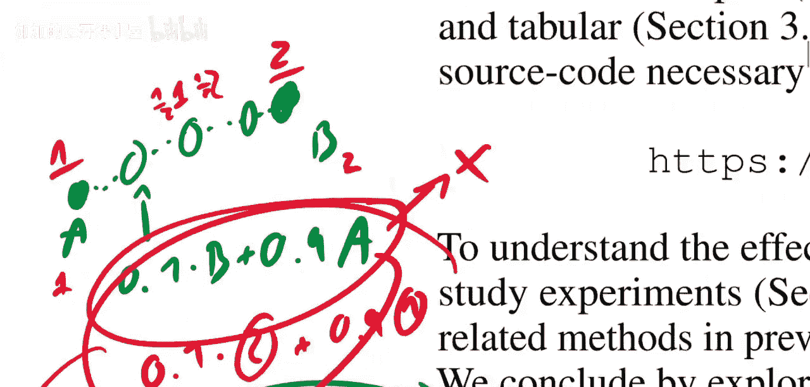

And then around class1， where it's sort of smoothly getting less and less sure about the class of the data points。

 but on the way， it is always either class1 or class 2。

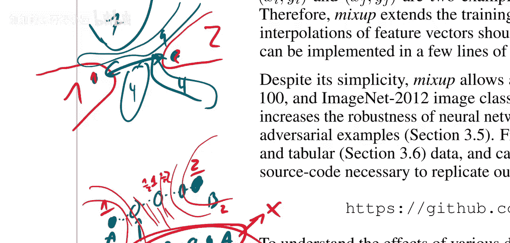

And they say that can help the generalization performance。 And it's visible why， right。

 it's just the only thing that's not it's not clear from the beginning is that this kind of interpolation actually makes sense because if this means we sort of linearly interpolate between two images。

 So if we have two images， we just take half of one and half of the other。

 And that will be not a natural image。 It will be kind of a blurry thing。 Otherwise， you know。

 all our problems would be solved。 and we could just linearly classify things。

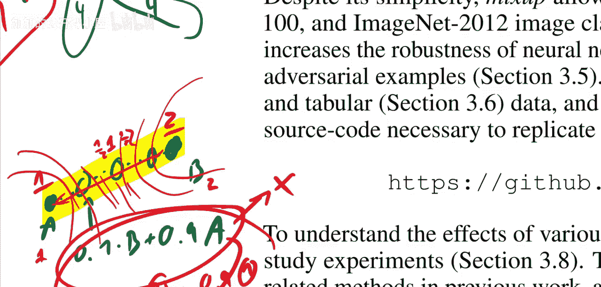

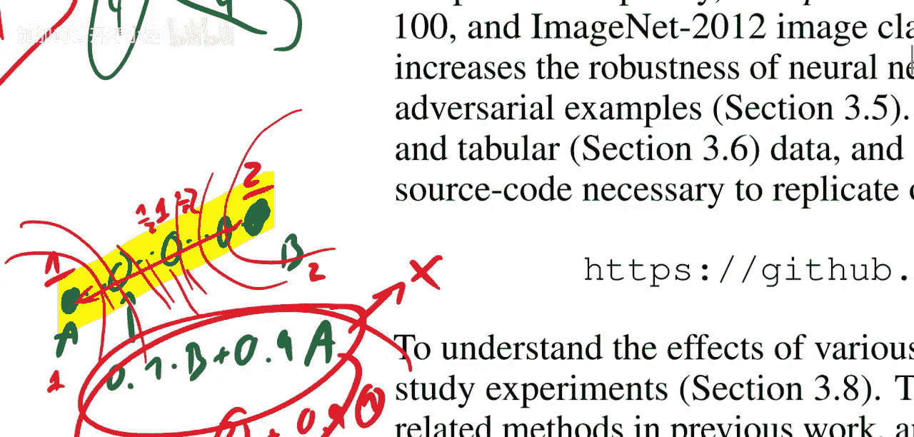

But in any case， in practice， it actually seems to help。

 probably because interpolations of two images， linear interpolations are still much more like something like a natural image than any random noise you could come up with。

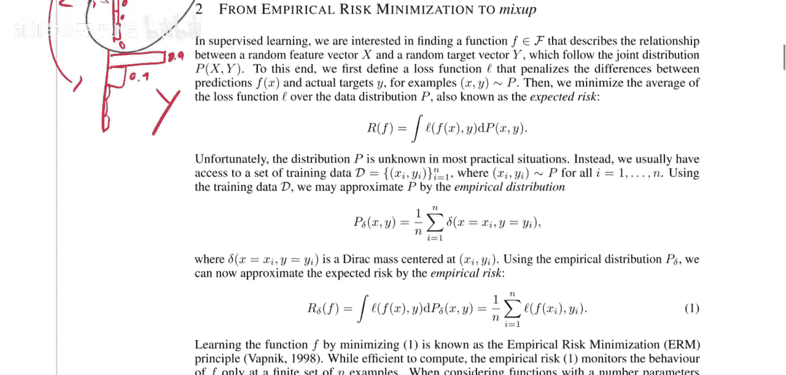

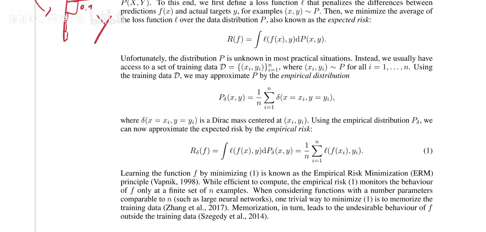

So they say this encode code right here， code is pretty simple。

 simply want to mix the two things and the mixing factor。

 this Lada here comes from a beta distribution and they use a beta I believe of 0。4 or something。

 just want to quickly show you this is the red line here。

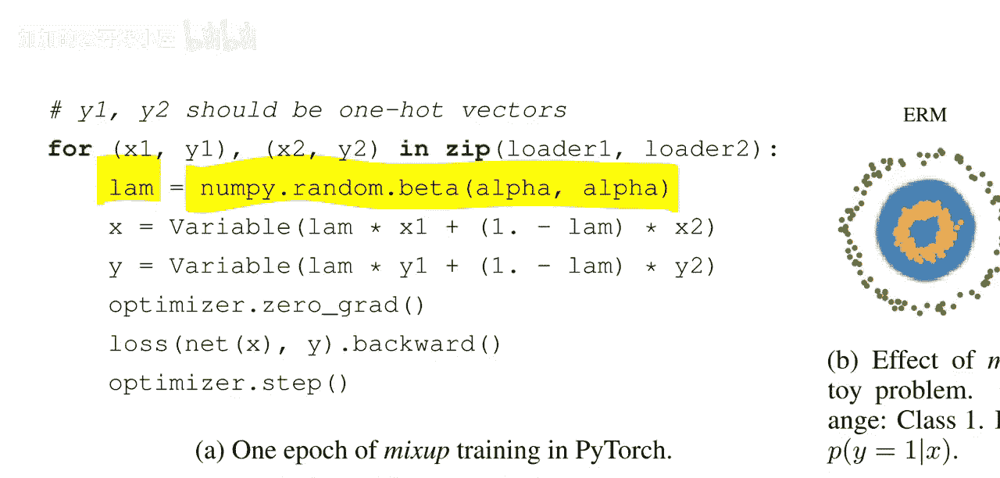

So the red line， as you can see， mostly， most of the time。

 they're going to either sample the thing on the very left or the thing on the very right。

That means they either sample the first or the second data point。

 but some of the time they actually sample something in the middle and it's it's fairly uniform in the middle so it appears like a good distribution to sample from if you want to sample these mixing coefficients and by adjusting the the actual number of alpha and beta here。

 you can determine how many times you sample the original data points versus how many times you sample something in the middle。

Okay。

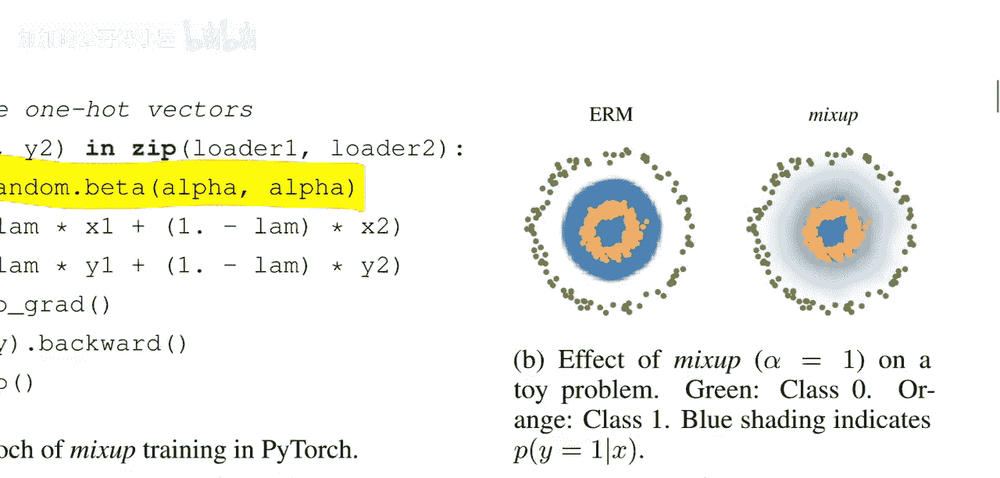

On this toy dataset right here， they showcase what mix up can do。 So in a classic model。

 you have the orange and the green data points and blue is basically where the classifier believes it's class 1。

 you see this very hard border here。 It's quite a hard border。 Now you only have two classes here。

 And so the hard border is sort of a problem in itself because if you think of， for example。

 adversararyial examples， all they have to do is basically get over that。1"。

 and the classifier is already super duper Sure。 It's the orange class right。

 Whereas if you use mix up， your border is much， much， much more fuzzy。 It's like。

 it's only really sure here and out out here everywhere。 But in the middle， it's sort of like me。

 I don't know。 And So that's kind of a more desirable situation。 Now， of course。

 this here works particularly in this， in this linear to the setting。 But as we can see。

 the same reasoning applies to sort of higher。😊。

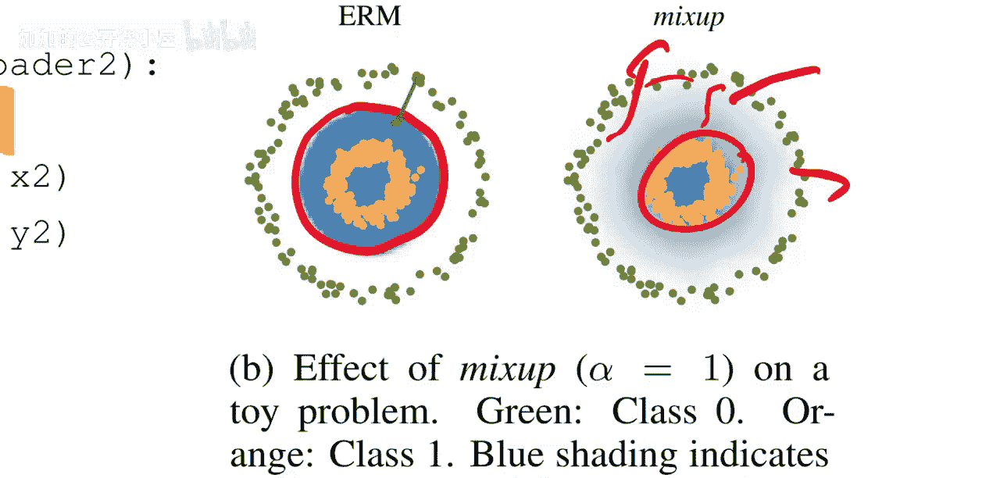

Higher layers and higher dimensionality data points， right， I have seem to lost the ability to zoom。

 Oh no， Now it's back。

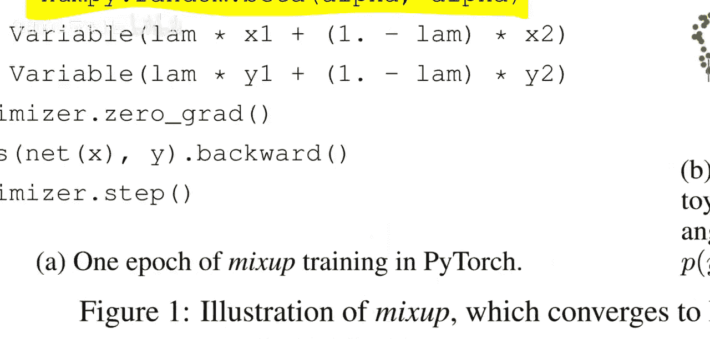

Okay， and that's basically it for this paper。 this is all they do。 they propose this method。

 and then they test it。They say something interesting here that mixup converges to the classical method as of approaches zero。

 so that would push your beta distribution basically in the middle all the way down。

 and you would only sample from the very left or the very right。

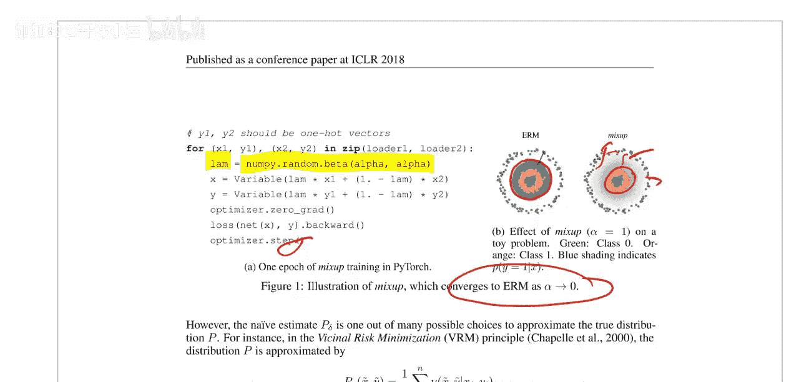

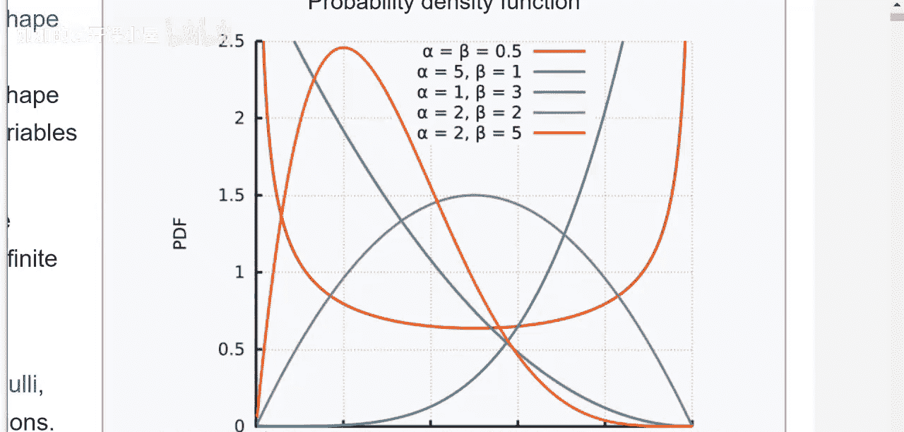

So you can smoothly interpolate between this mixing and the classic method。They。

So their main results are we apply this to classifiers and what I like is since a GN is also a classifier。

 so the discriminator is a classifier they also apply it to GNs and they outperform unstabilized a classic training on GNs。

 they show that it's more robust towards adversarial attack。

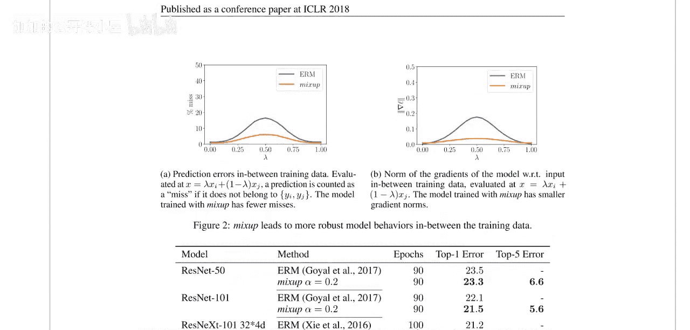

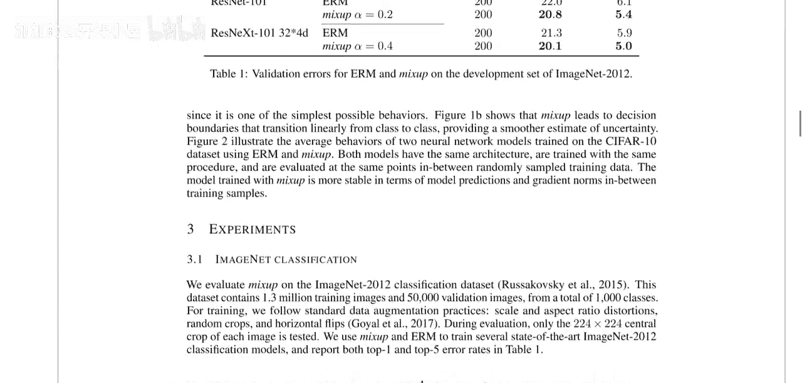

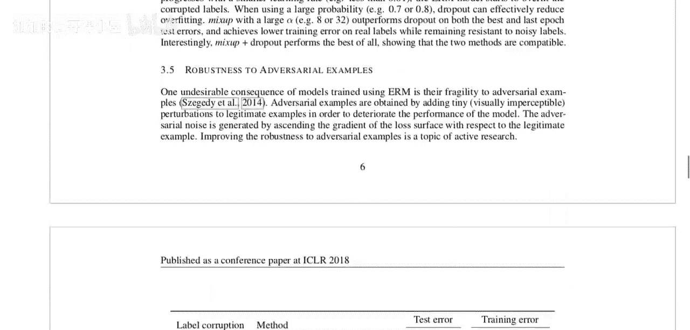

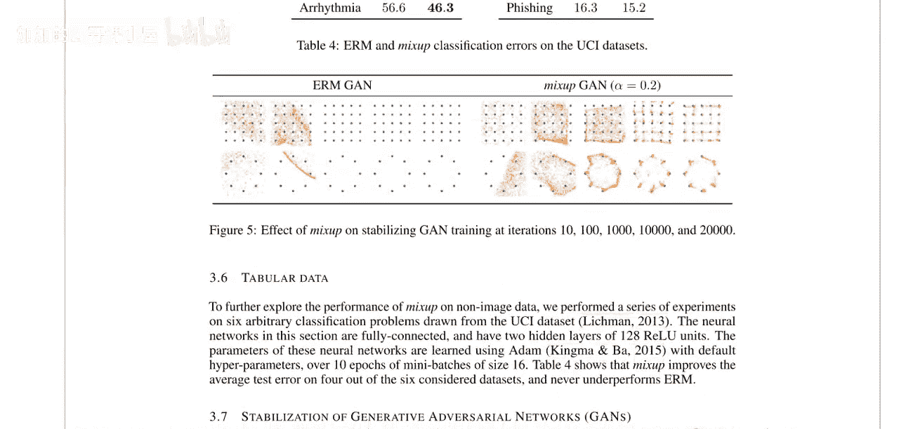