# YannicKilcher【中英⚡AI经典论文领读(全203篇)(上)｜Papers Explained】 p16 P16 探索人类玩电子游戏的先验知识（论文与演示） [BV1o3xLznExj_p16]

🎼Hey there what's going on today we're looking at investigating human priors for playing video games by Rachet Duy。

 Pkit Agraw Deepak Patak Tom Griffiths and Alexi I Ephros So there is a paper to go with this but actually don't want to get into the paper too much in order to not reveal too much of what's coming but basically they're trying to investigate what makes video games work for humans so what do humans pay attention to what priors bring humans into a video game and the fun thing is they've created these games where they abllate these individual priors and we are going to play them。

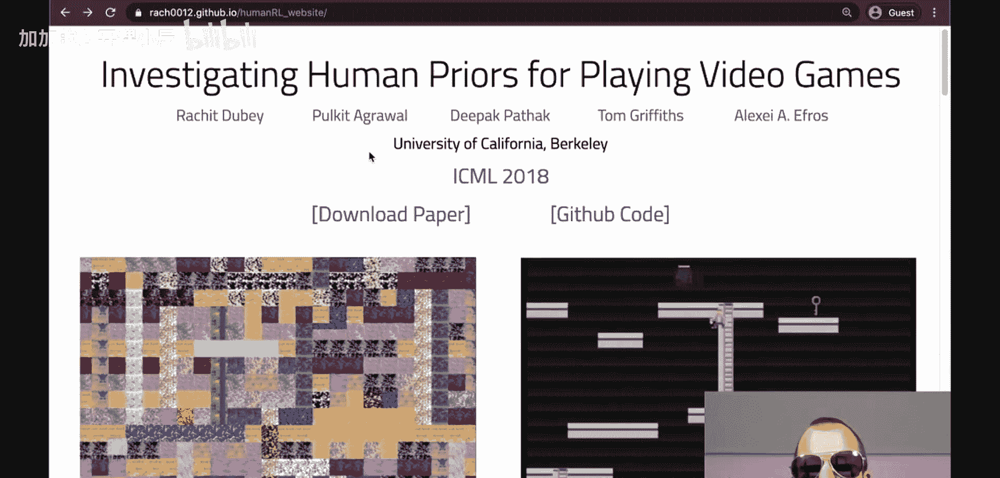

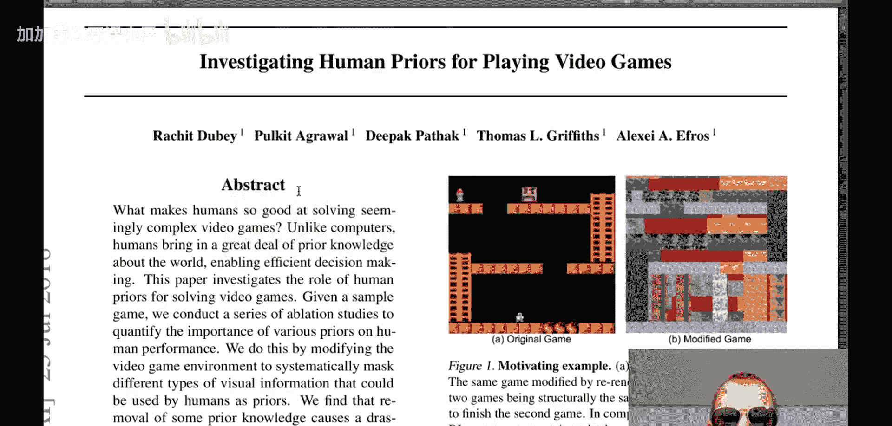

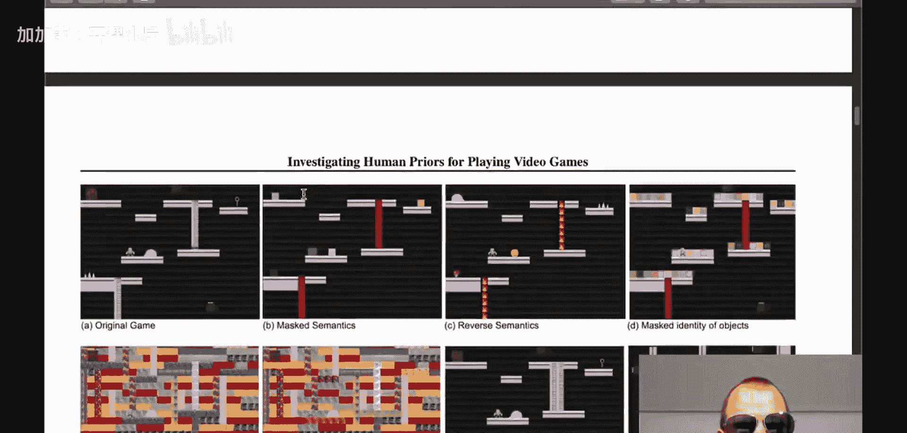

🎼So the original game right here as you can see is kind of this Monteezuma's revenge type of game so you only need the arrow keys if you go to a bad blob like this then you die and you can jump on them and you can use the ladders and the spikes they'll hurt you if you jump on them and also if you fall down between the platforms so what you got to do is basically get the key then go to the door over here。

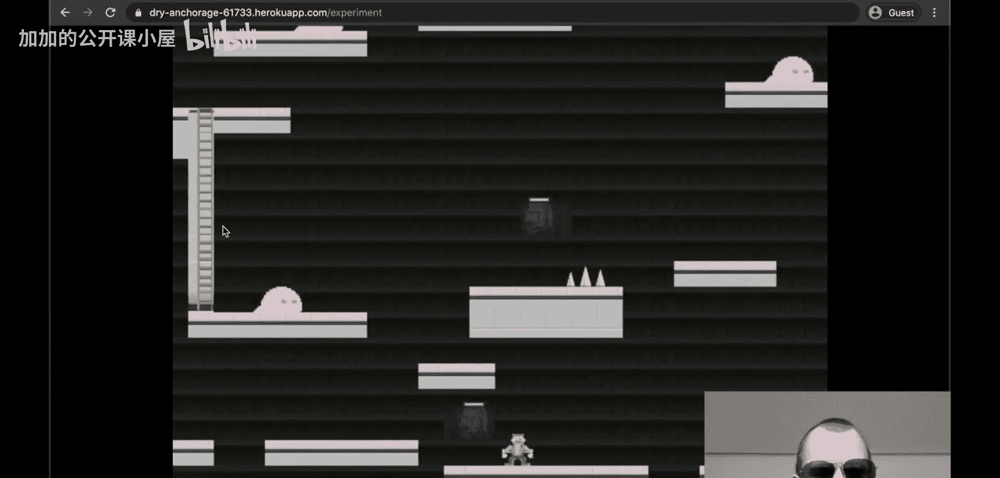

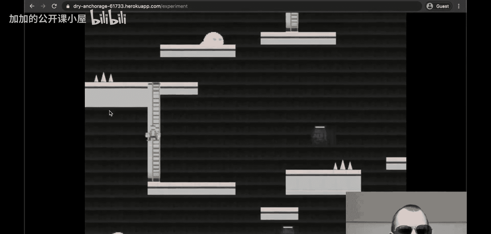

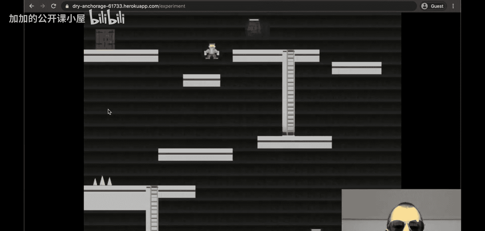

🎼And but boom， cool。🎼Let's try out so they basically alate different things here mask semantics means that you don't know what the objects are anymore so you might go over here and you might be what's the green thing can I jump on it oh so we're probably a bit biased because we've seen the game before so we know that these are the pink ones are the bad ones。

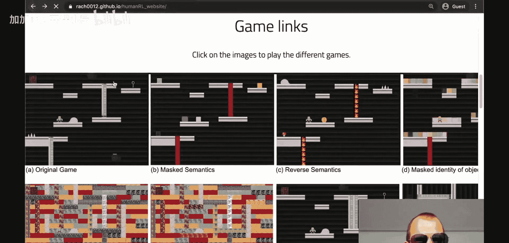

🎼And that's the key， so we should probably get it， but you can imagine that it is a bit harder。

 but you could still solve it right reverseverse semantics is very interesting if you play it for the first time because all of a sudden now。

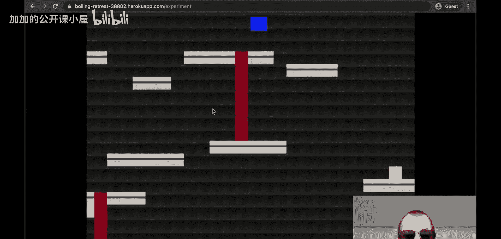

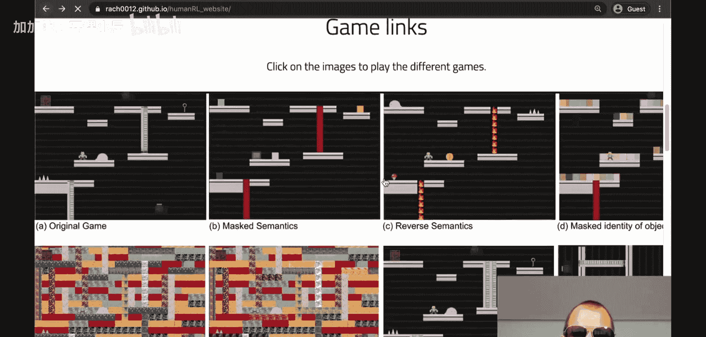

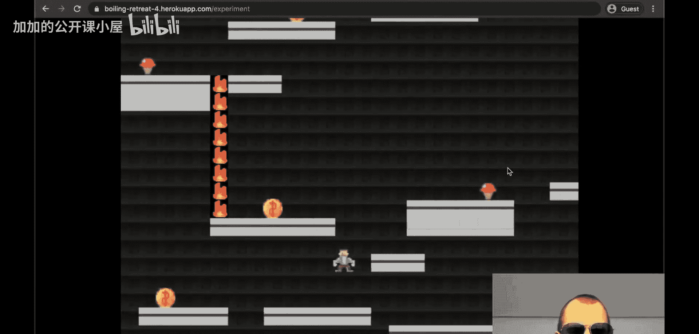

🎼there's the coins， oh， and the fire， but I think humans could probably still figure it out with like some minimal trial and error。

 right this ice cream cone， you realize， okay。

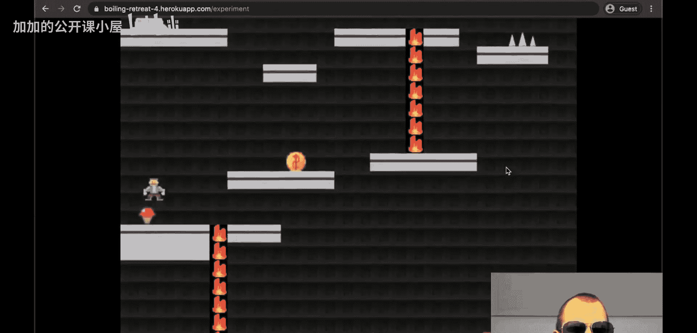

No， it's interesting。

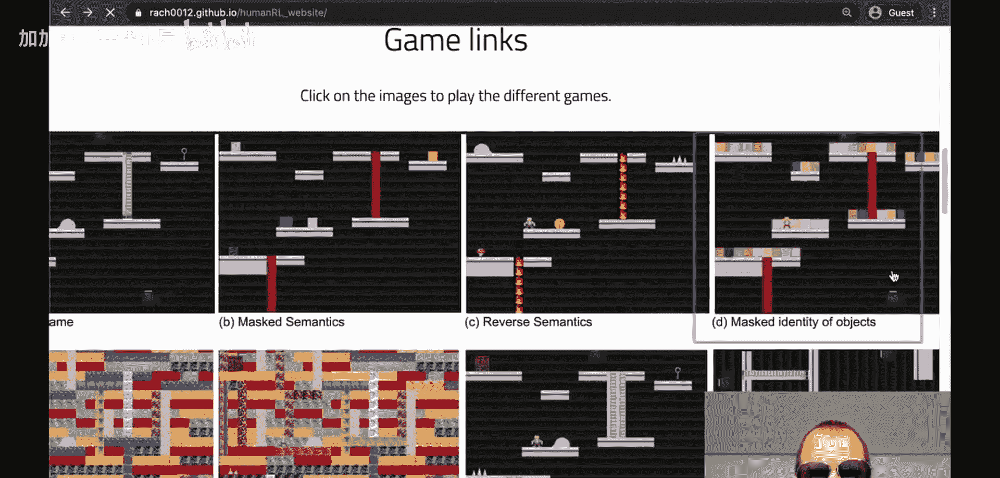

🎼Because。🎼Right now we've always had sort of we know that there's an object and there's no object on the platforms but now these are masks so basically you don't know what's like a relevant object and what isn't so I know that there's like a bad thing here and a bad thing down to the left so I I'm gonna guess these light these light pink things are the bad things Yeah yeah。

 these are the ladders cool bad thing right here he we are rocking this okay key where's that's the key and the door。

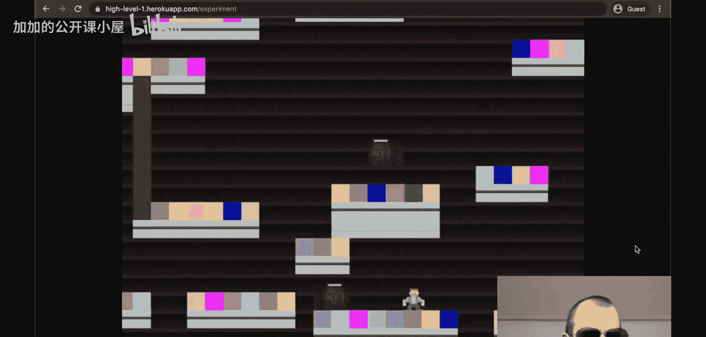

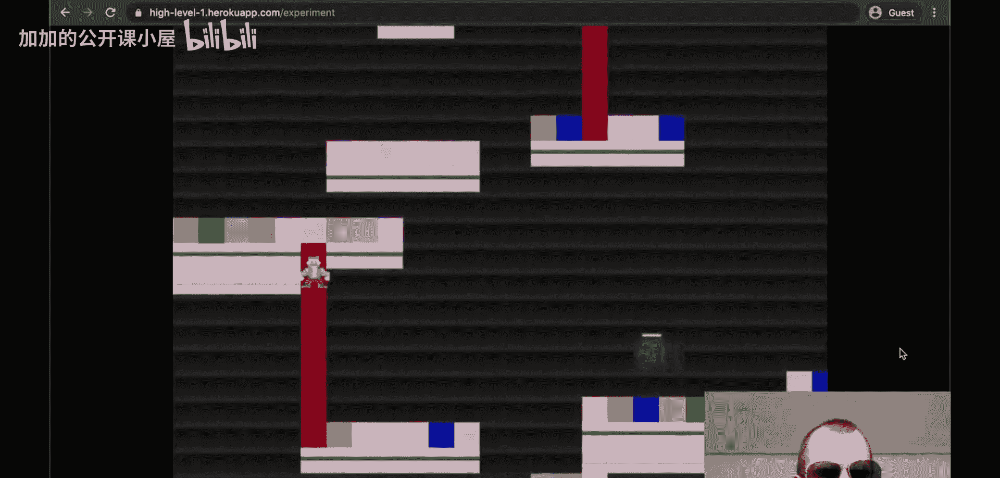

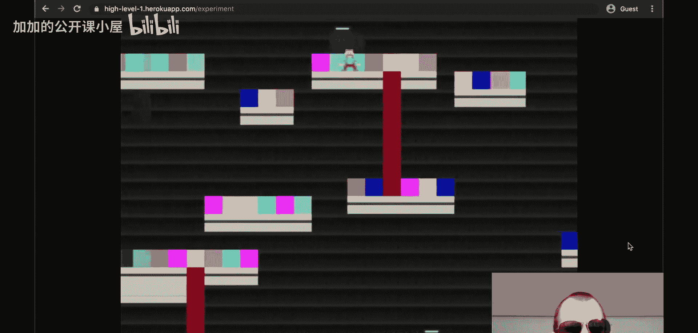

🎼So it gets harder because you kind of have to remember the colors right I know that the light pink ones are the bad squares still still solvable。

 So let's jump over these on the left because these gets really actually let's go into here So mask affordances what they're saying is that okay you can kind of from the way something looks you can tell what you can do with it。

 for example the platforms you can you know jump on them and the background is sort of empty space so you know that there's nothing much happening there So they trying to take that away by simply retexturing all the objects here such that you don't know how you can interact with them and it does get significantly harder because okay so。

These， these green ones are。These green ones are the platforms right here。 so。

 but I can still see that。 that must be the latter， right？

You can imagine if you were playing this again for the first time that this is significantly more difficult。

 but you still see the key and the green ones being the platforms， we got this。

Now it gets harder masked visual similarity so this is where they say maybe as we did so far。

 maybe you as a human can kind of make out that things that are visually similar to each other can you can do the same things with like we said the green ones are probably the platform so it took it away gee okay so that must be okay I can't go here fell down。

😊，Let's try again， this is a platform， is this one here， yes， these are platforms。あ。That was easy。

 too easy， too easy running into that bad bb there， okay， the ladders are still like this。

 but then okay you awesome。Yeah， this gets harder as as you can ch， okay。

 I'm too dumb to remember from before， I'm like the ideal subject because I don't remember。😊。

How did this work that？I'm going to solve this just so you know。

 even if this video gets to 50 minutes， I'm going to make it through this okay， here we can okay。See。

 my shorter memory is so bad。Okay， we got the key now just get over to the door， doors over there。

 yeah。Okay。Now let's wipe the shortter memory again here changed ladder interaction where they basically say okay one of the things that you know from the real world is how you know these objects work in the real world so there's not really any pink blobs with evil faces there might be spikes yes but ladder is something you know that works so if you want to go up here。

😊。

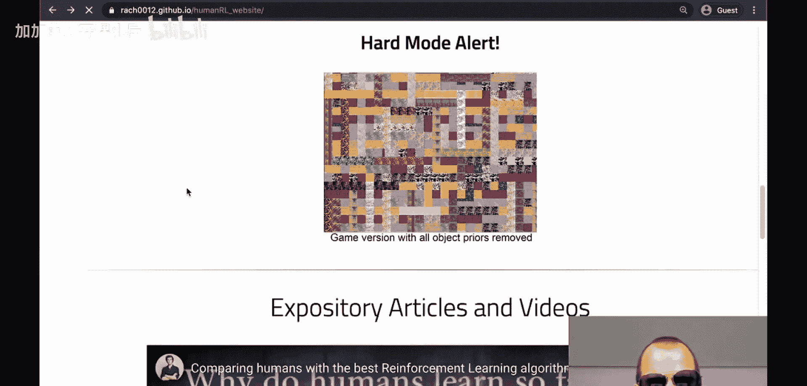

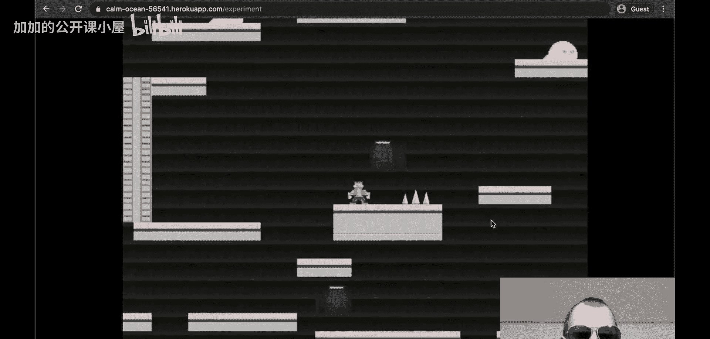

🎼That doesn't work。 So you kind of have to figure， okay。

 so you have to go kind of left and right to go up the ladders。

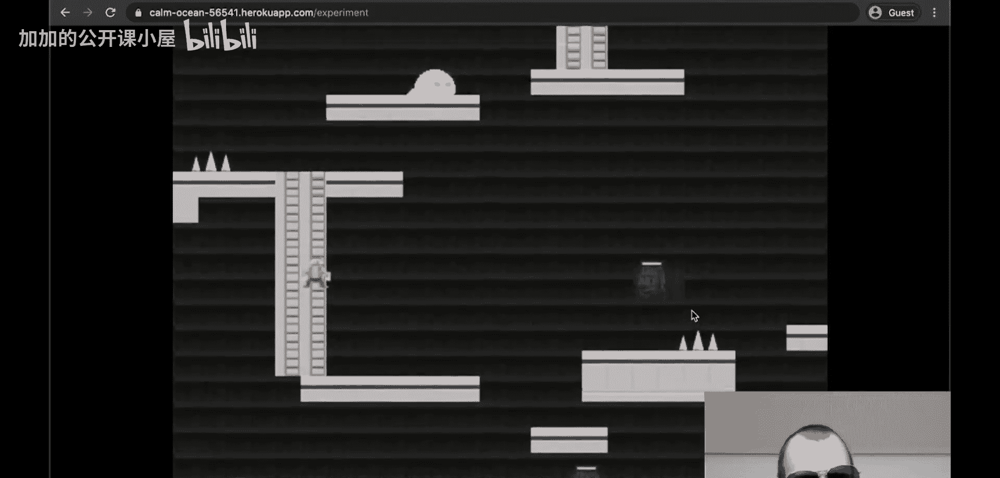

And。🎼So that one I actually tried before and I figured that out pretty quickly。

 I think humans are able to figure that out fairly quickly because you're kind of on the ladder right。

 you can actually go down un easily。😊，You're on the ladder and then it kind of doesn't work and then you kind of try to wiggle because there's two of them。

So I don't think that's necessarily super hard。

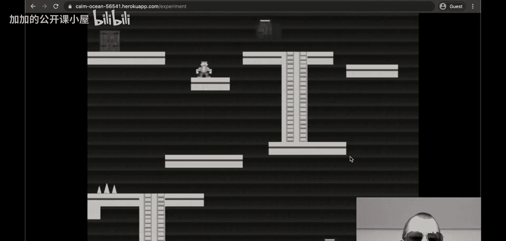

And。No。

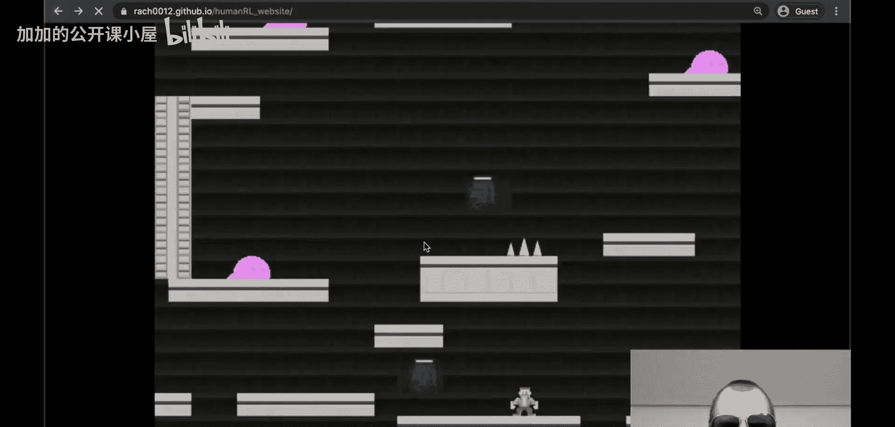

🎼It feels a bit like you know this super Mario maker thing where people just try to make levels as hard as possible and trick you with trick blocks and invisible stuff。

 this is hard so the direction of gravity so now the left key jumps right and here this key so this is like this is extremely extremely hard because I have to like think about every move I make before I do it。

😊，🎼And。

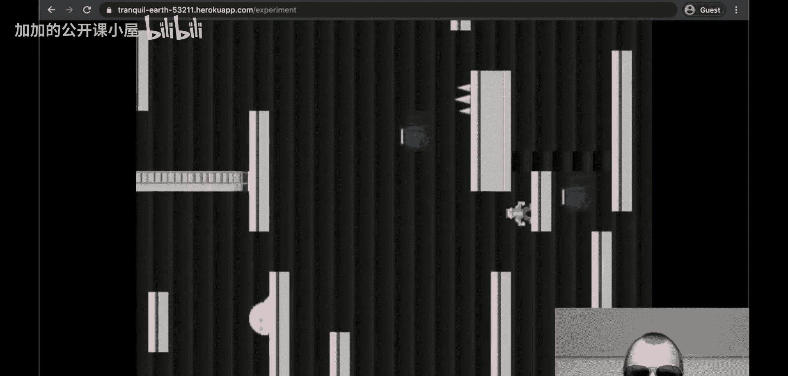

🎼Okay， now this is so unintuitive for real。😊，🎼Yeah， got it got it okay， really try this out。

 this is crazy。😊。

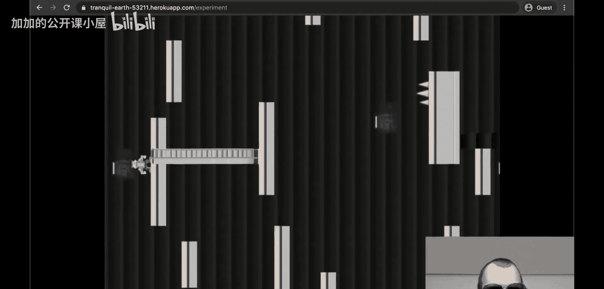

🎼イエーいう。

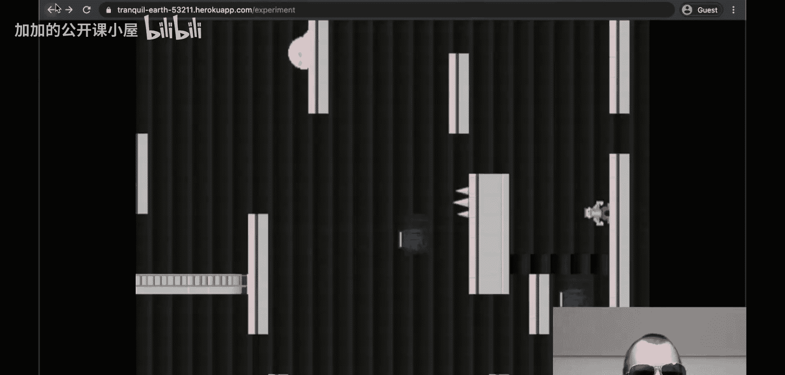

🎼Okay， so the last thing is we combine all of it， I guess except it changed gravity and changed interaction so now all the priors。

 all the visual object priors removed。😊，This is King's discipline right here， okay。

 so we figured out where're the blue。Cool， so where's the next？This is the next platform。

 where's the okay？🎼There must be like a year take that， okay。

 but we know the next so we can't really generalize from this because we know the next bad blob isn't going to be the same color。

 right， okay？😊，嗯。🎼The white than this I know there's a bad thing here。

 but we'd have to figure this out so basically kind of the point of the paper I think is to say that this is what you're doing to our。

No。Spikes。🎼This is what you're doing to RL algorithms if you're in the most case。😊。

🎼So they simply have to go and to basically try every single thing and remember what worked and what didn't work now of course the URL algorithms can also exhibit like can also use the visual similarity that was the key yeah yeah let's go the door door door no。

😊，There's like a bad thing here， right？No spikes。嗯。Okay。

🎼So either we build these priors into the RL algorithms。

 if we want to get them to human level or we have some sort of learning these priors before we let the people go you know。

 onto a paper。😊，Or。I' I don't know or we just you know take it that oral algorithms you know have to figure all of this out by themselves so they alate these things right here。

 you can see the masked object identity makes kind of the biggest difference in terms of time number of deaths。

 the number of states explored reverse semantics I believe these are humans that are you know trying it for the first time and they're just likeooh an ice cream so it can also hurt right the oral algorithm wouldn't be super impressed by it looking like an ice cream。

But the， the human is very much and。The crazy thing here。

🎼You can see exploration in the original game and then exploration in the no object prior game。

 especially if you play this for the first time this is just mad like no freaking way I would actually like love to see video games like this coming out this will be a worst sellingel video game of all times where dynamically it just removes these kind of priors but I think it's a really fun way to investigate what humans learn and what they already bring into the game So here they have another game and they do this same thing on an RL agent and you see here the RL agent just don't care about any of these things except visual similarity so visual similarity helps the RL agent to generalize across the game so if you see a bad blob the next bad blob will look similar and that's sort of kind of an invariance that we know they can exploit since。

😊。

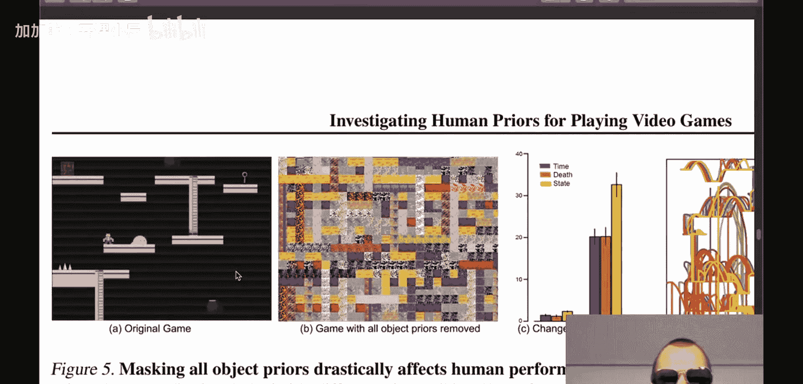

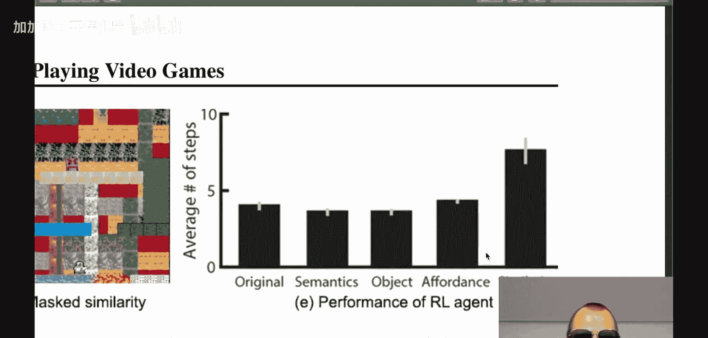