# YannicKilcher【中英⚡AI经典论文领读(全203篇)(上)｜Papers Explained】 p18 P18 使用降噪自动编码器进行轨迹优化的正则化（论文解析） [BV1o3xLznExj_p18]

Hi there， today we're looking at regularizing trajectory optimization with dennoing autoenrs by Renew Bonet。

 Norman Di Paullo and others。

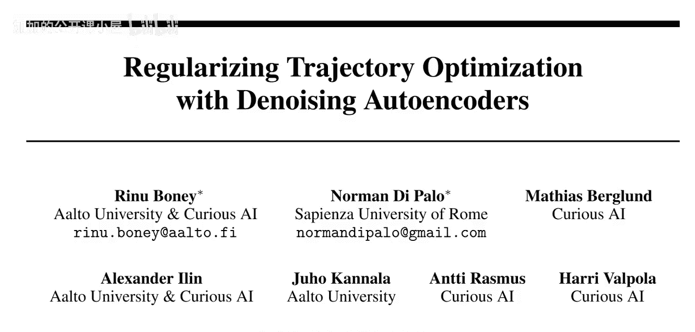

Of various places。 but a lot of the people are from Curious AI and we actually had a discussion with Hari。

 who is the CEO of Curious AI。 And this was on our machine learning street talk podcast。

 So this is another YouTube channel for those of you who don't know where every week or so。

 we try to have either an interesting discussion or a guest。

 like sort of an interview or talk about comment on the talk。

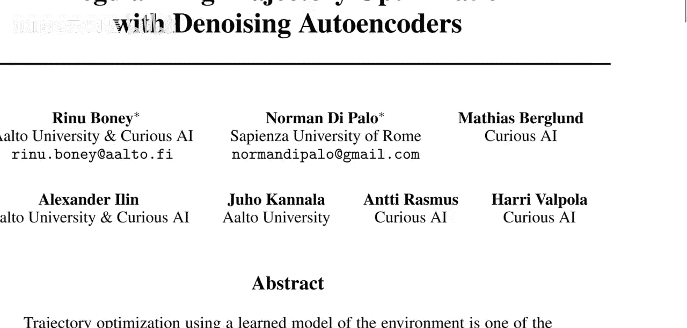

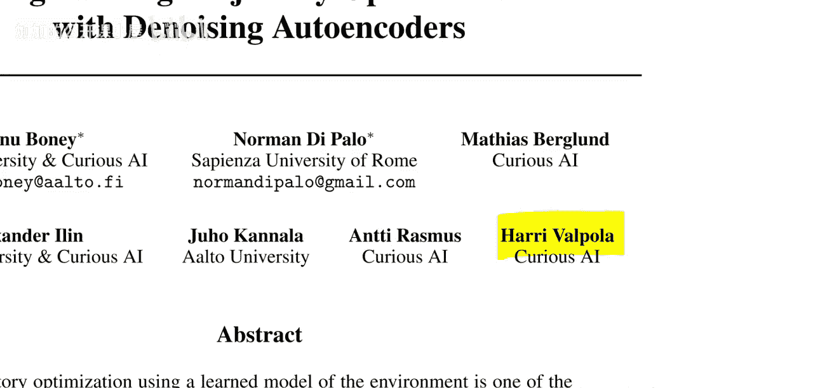

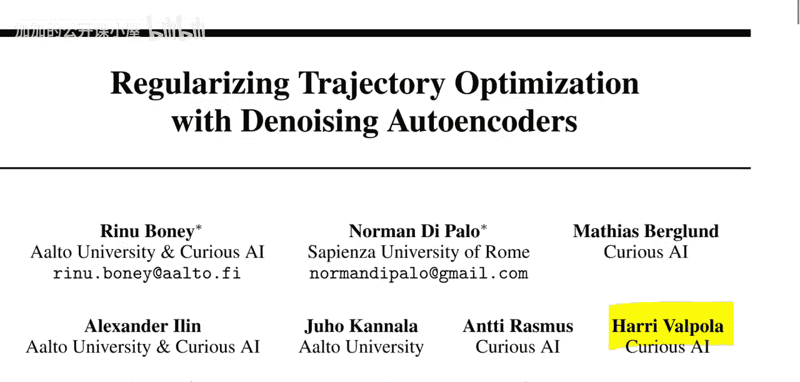

So if it is not out yet a link to it as soon as it comes out。

 but if you're watching this video later， make sure to check out our conversation with Harryri because it was absolutely fantastic。

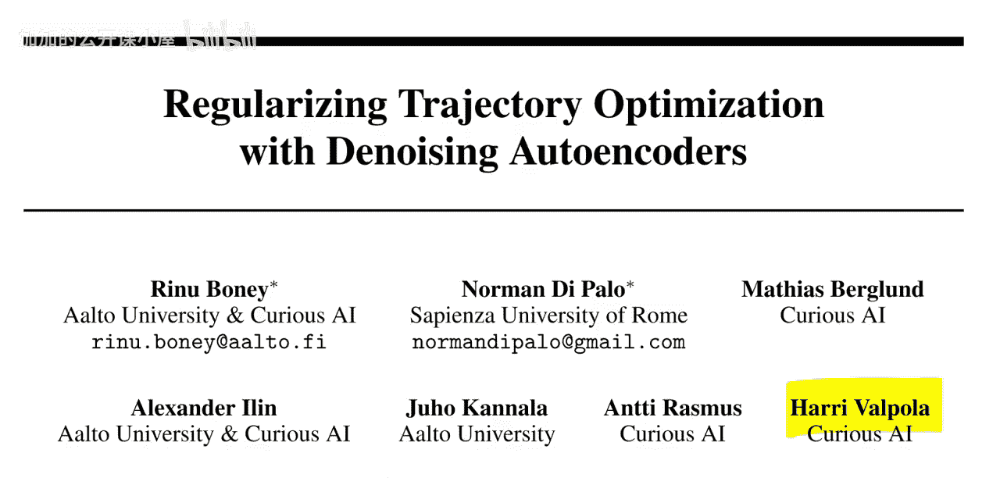

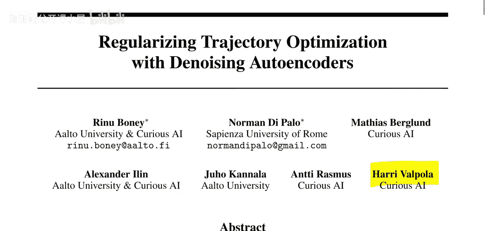

And in general， if you like videos like this， consider subscribing， liking。

 sharing if you're still here at the end and liked it。 Okay。

 so this paper on a high level deals with model based reinforcement learning。

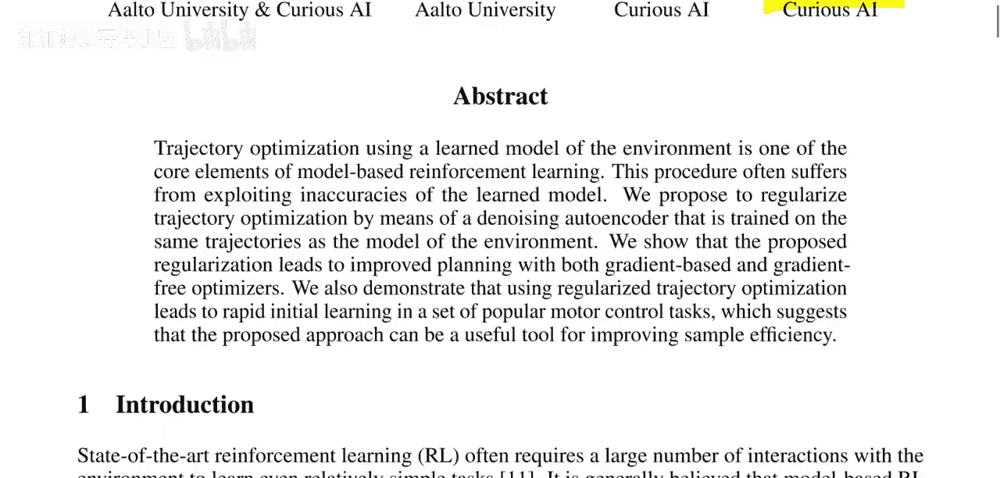

Model based reinforcement learning means that you are using a model of the world to do reinforcement learning。

 So in essence。If you have your reinforcement learning setup where you are an agent and you have to interact with a world。

 you have to do so in many steps in like a round trip fashion， so you put in action。

 you act and the world gives you back an observation and you have to act in the world over and over and over such that you will be able to maximize your reward。

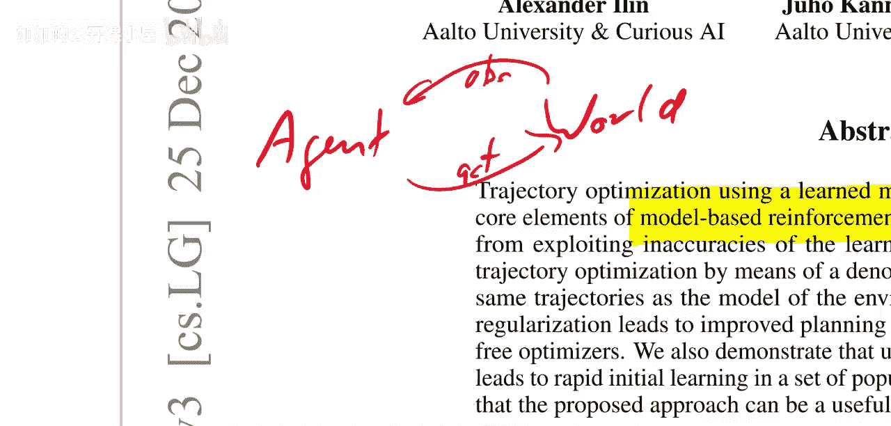

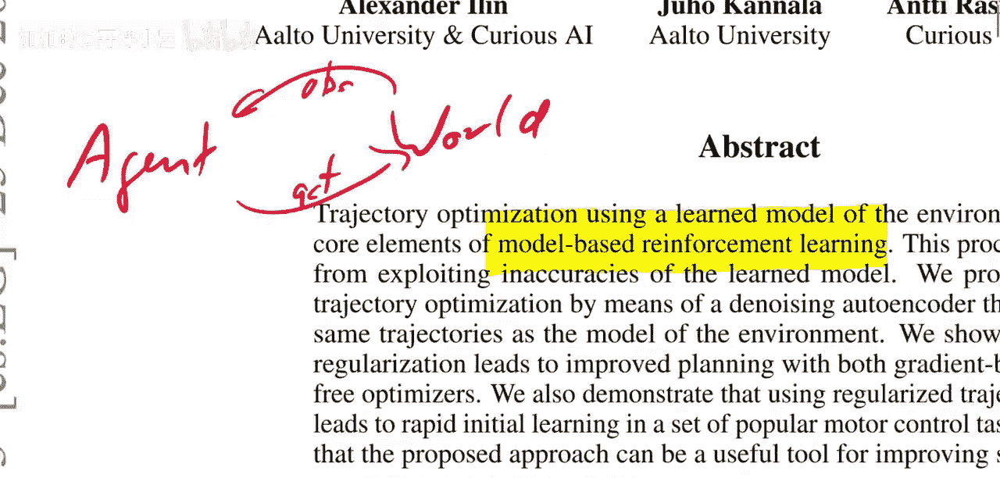

Now， what is model based reinforcement learning， Model based reinforcement learning basically means that the agent here has internally。

A model of the world。 So it sort of understands how the world works。

 situations where you have a accurate model of the world are things like chess。 So in chess。

 the rules are very clear。 You know how the world is going to behave if you perform a certain action。

 but in real world applications， it's very， very hard to actually make a model。

 So people usually rely on learned models。 So what does it mean you basically learn a neural network that tries to predict how the world is going to act。

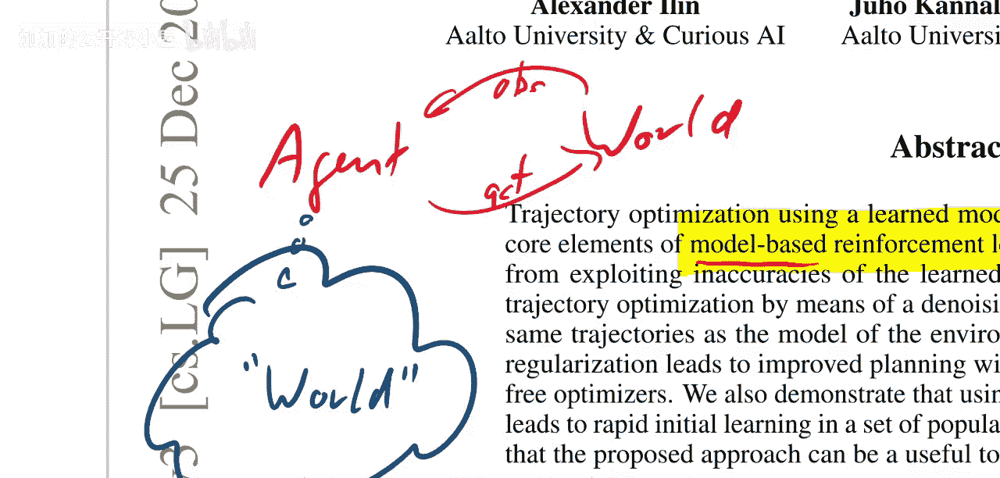

So this here is going to be a deep neural network。That you learn from what you see in the world。 now。

 trajectory optimization。

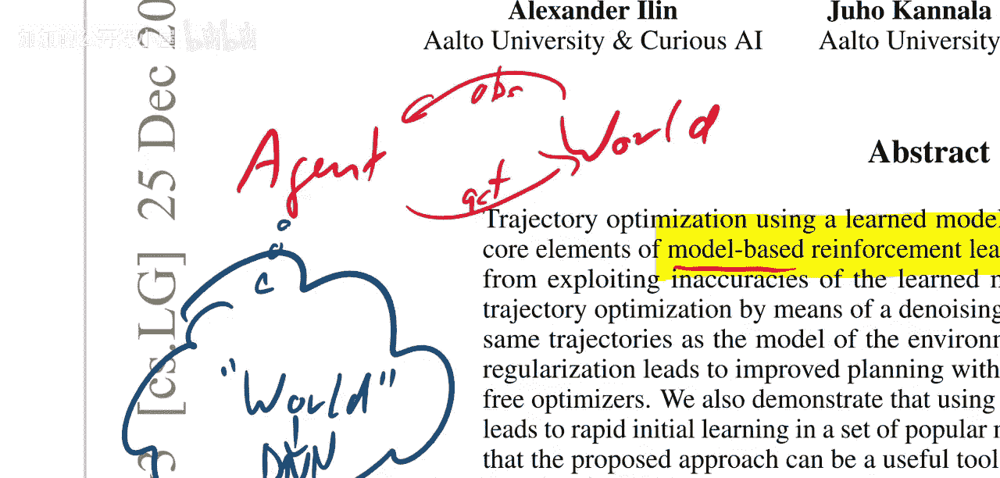

Basically means that you are now， you now have this world model and you use it to look ahead。

 as I said。 So you are in the state like here and you can do， let's say three different actions。

 And you use your world model here， world。

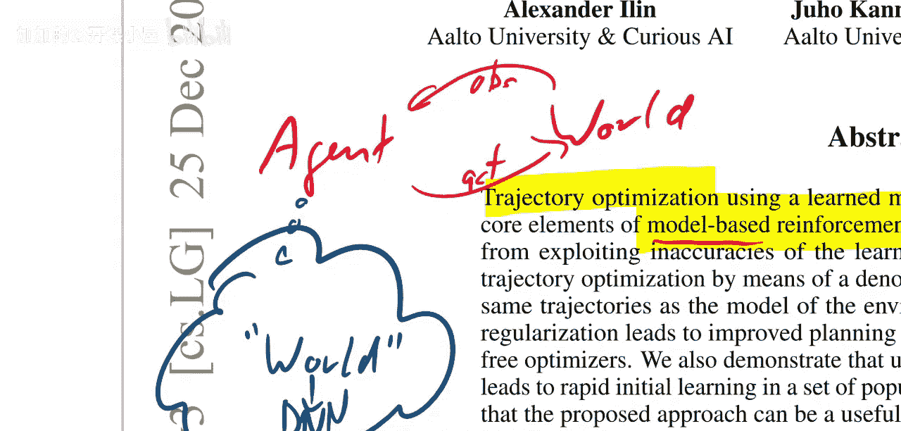

And you see you think how's the world going to react if I do either of those three things and then you get into three different states and then again after each one you consider three actions。

 three actions here， three actions here and so on so ultimately you're going to kind of have an overview over a planning horizon。

Which here we call H you kind of look ahead a couple of steps。

 or there are various ways of doing this。 but ultimately you will basically find that this。

 this path here is really good。 So I think I'm going to take this as a first action。

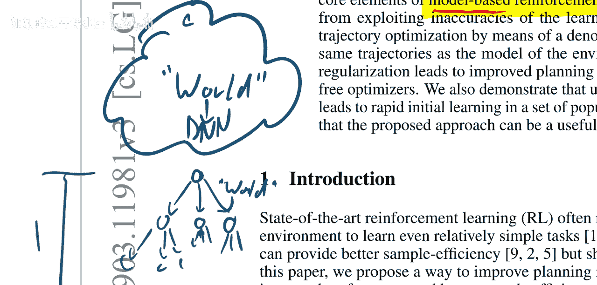

So trajectory optimization considers finding the best green path here in this tree of possibilities that your world model gives you。

 okay？

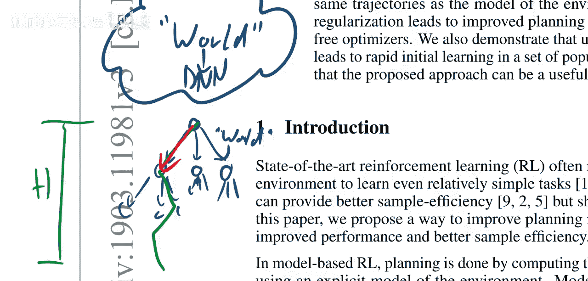

Now， what does， what do these people say， They say this procedure often suffers。

From exploiting inaccuracies of the learned model。What does that mean。

 That basically means that if I have a world model and it is not accurate， then it is basically。

 basically the the thing that tries to find the best green path here。

 the optimizer is sort of trying to find the the best path against this world model。 Now。

 if that world model is inaccurate that can lead to devastating consequences。

 So what do we mean by this。

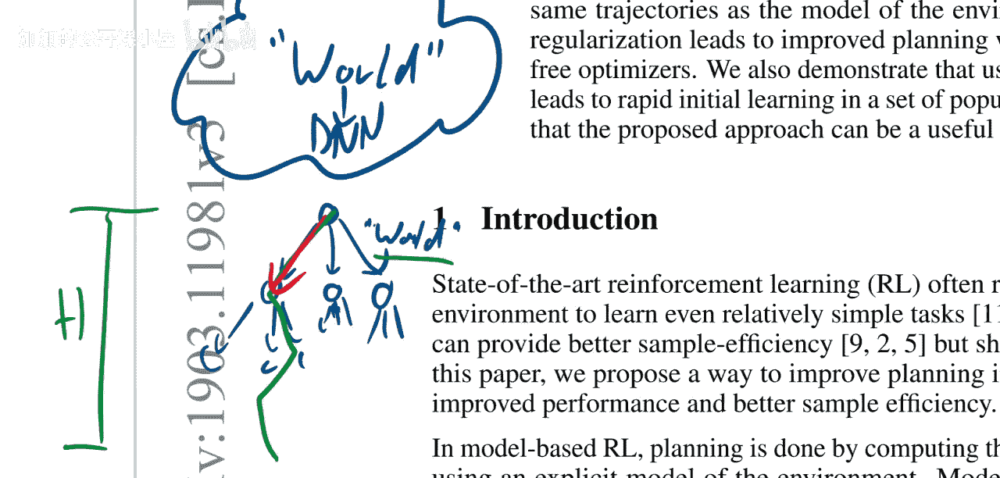

I'll give you an example。If you have a room， right， and the room is。

 let's take our classic room like this。And you are here and you would like to go here And so you're a reinforcement learning agent。

 Did you do some exploration right， you explore a bit here。

 the next episode you might go here and you might go here and so on。 And over time in this framework。

 you're going to build a model of the world so。At the beginning。

 we won't tell you how these rooms look。 You have to discover it by yourself。

 So maybe at the beginning， we only tell you there's these four walls。

 the rest you have to figure out。 So on and on， you're gonna fill in your blank。

 So you do your first explorations and you there's a bit of a wall here， right。

 and there might be some wall here。 I crashed into that right， you go into here。

 you crash into a wall。 you there's a wall here and here there's a wall here。 you go maybe here。 oh。

 there's no wall。 So you go further， there's no wall anywhere here。 you crash here。 Okay。

 we already knew there's a wall。 maybe you crash here。Allright， so right now you have， okay。

 you go here， you have， you have a model of the world in this situation where there's a wall here。

 a wall down。

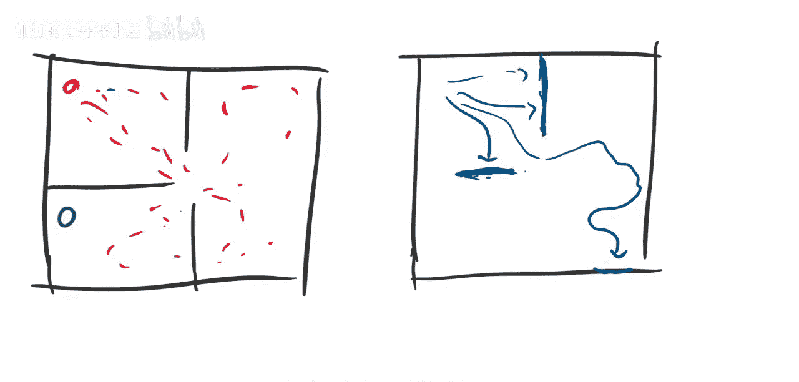

And if you now try to do trajectory optimization， remember， you have to go from here to here。

 If you try to do trajectory optimization， what is it going to turn out， It's going to turn out like。

 look。There you go。 That works just fine。 And that's be not because you're so good at planning。

 I mean， you are good at planning， but because your model is inaccurate here because it has never seen this。

 your entire training distribution that you trained the world model on only explored the area over here。

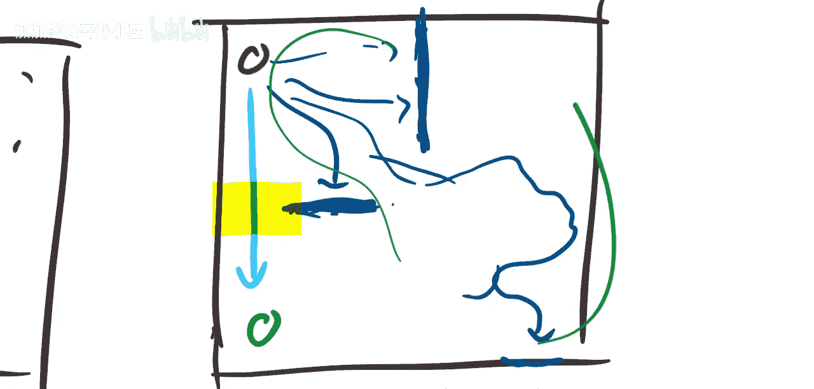

So you see how the more efficient this planning algorithm is， like the blue arrow。

 the thing that finds the blue arrow， the more efficient that is。

 the more consequential it is when your learned world model has mistakes because it will exactly exploit these mistakes in order to get the shortest path possible or the highest reward in that case。

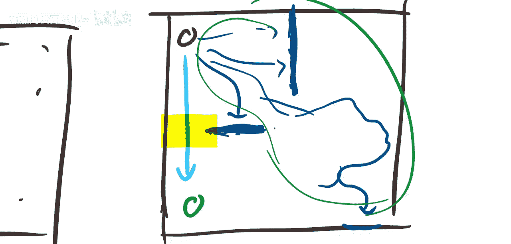

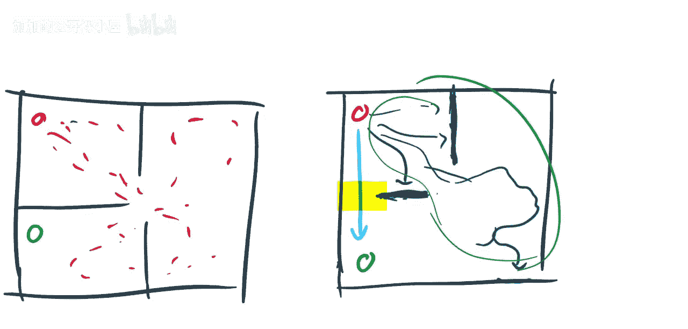

And they call this like almost an adversarial attack on the world model。

 which is a pretty good way of framing it。

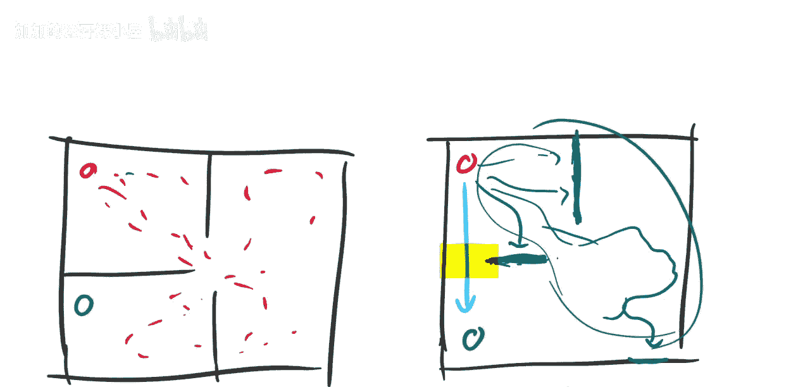

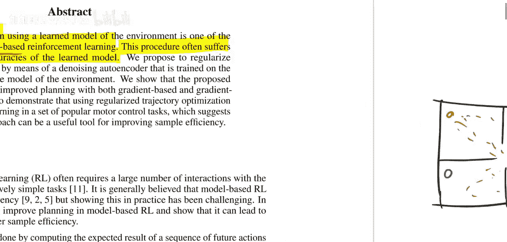

They propose actually to solve this problem， they say we propose to regularize trajectory optimization by means of a dennoing autoender that is trained on the same trajectories as the model of the environment。

We show that the proposed regularization leads to improved planning with both gradient based and gradient free optimizers。

 we also demonstrate that using regularized trajectory optimization leads to rapid initial learning in a set of popular motor control tasks。

 which suggests that the proposed approach can be useful tool for improving sample efficiency。

So in essence， what do they do？

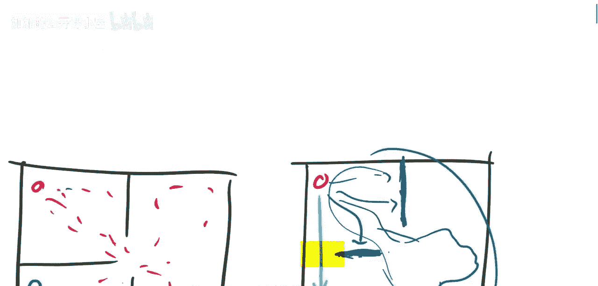

They basically say。Okay， we want to regularize this using a dennoising autoencoder。

And I think it's best if we look at the math for doing this。

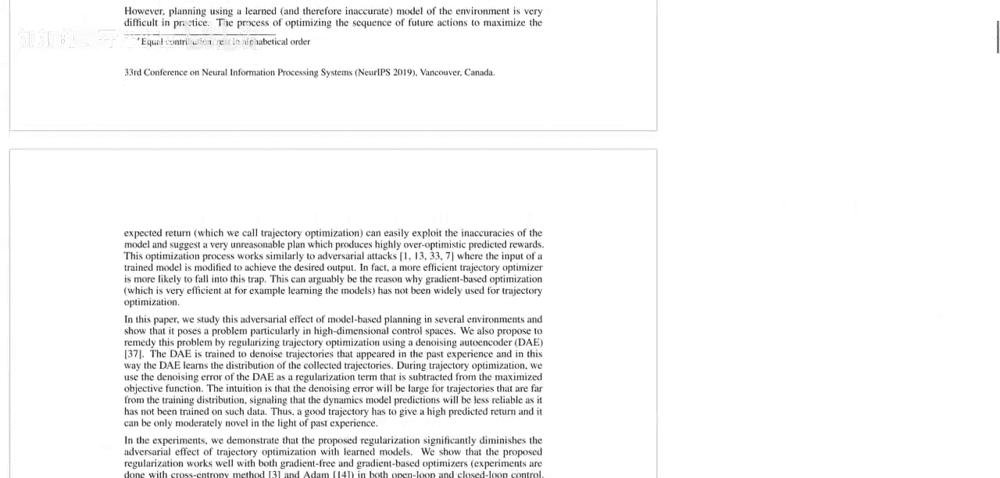

So。The mathhir。Starts off as follows， saying you want to learn a world model。 This is F here。

 F is the world model。 It takes in a state and an action。

 and it gives you the next state or an approximation to it。

 And the parameters here indicate that this is some sort of function that you learn like a deep neural network。

 you can do this in fully or partially observed environments。

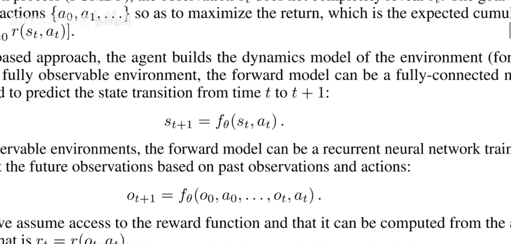

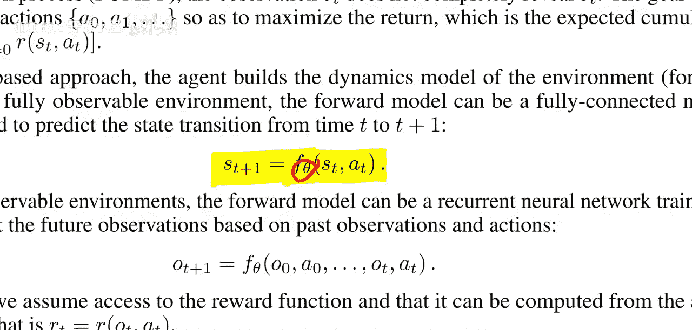

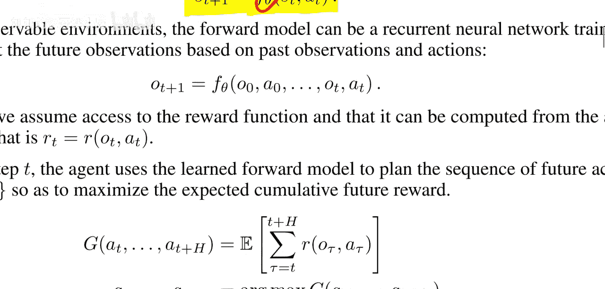

Now， when you plan， what you want to do is you say I have a planning horizon H。

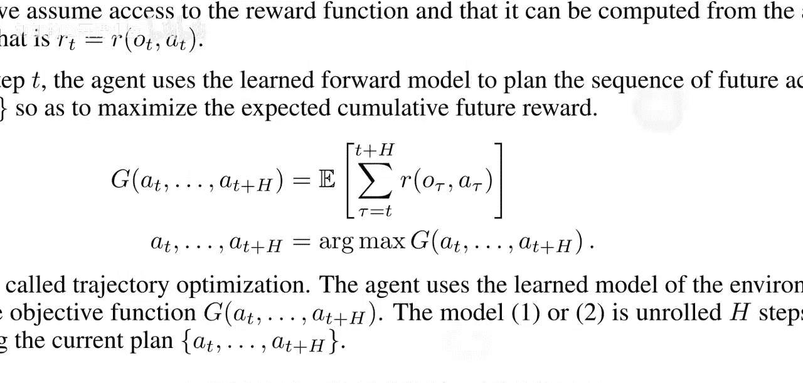

And I have a reward function。And the reward function is going to give me a reward for each state action pair so if I'm in a state and I do a certain action。

 I'm going to get some reward。 This could be you have reached the target or this could be。

 you know how much money you've collected or whatnot。So you're going to look a horizon H。

 You're going to look H steps into the future， and you want to maximize the sum of all the rewards here。

 So in the limit， this reduces to simply like， for example， reaching the target in our room case。

If H is infinite。But you can consider a lower planning horizon。

 so you want to find the action sequence that maximizes this reward in the future。

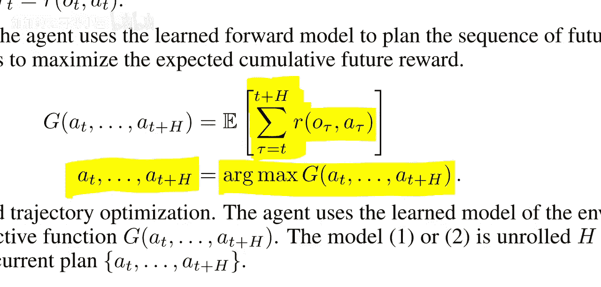

Okay， and now this reward。Relies on your environment model， okay。

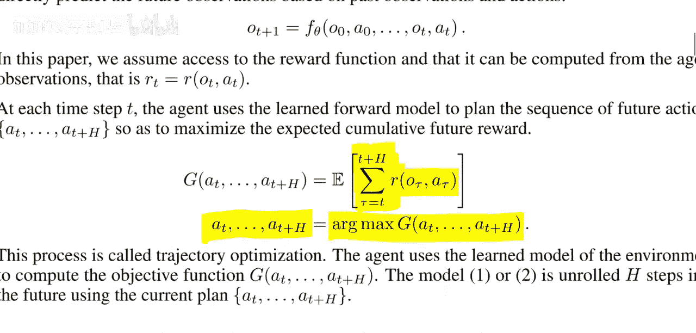

So here's the algorithm。First， you collect some data， okay。

 that's how you start off then train the dynamics model。

 the world model using the data you've already collected。 then for each time step T。

 you want to optimize this trajectory。 so want to find the best next action sequence and take the first action。

 implement the first action and get the new observation and do do this in a loop until the end and at the end you say at this data2 D。

 So thats what that's what you do， you use your world model。

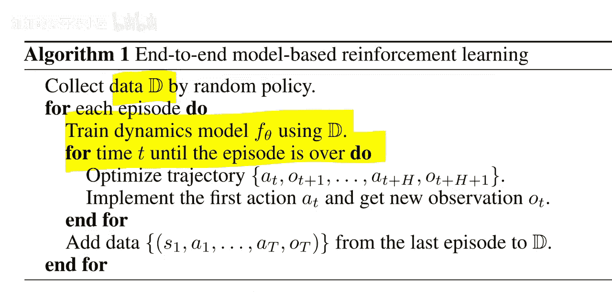

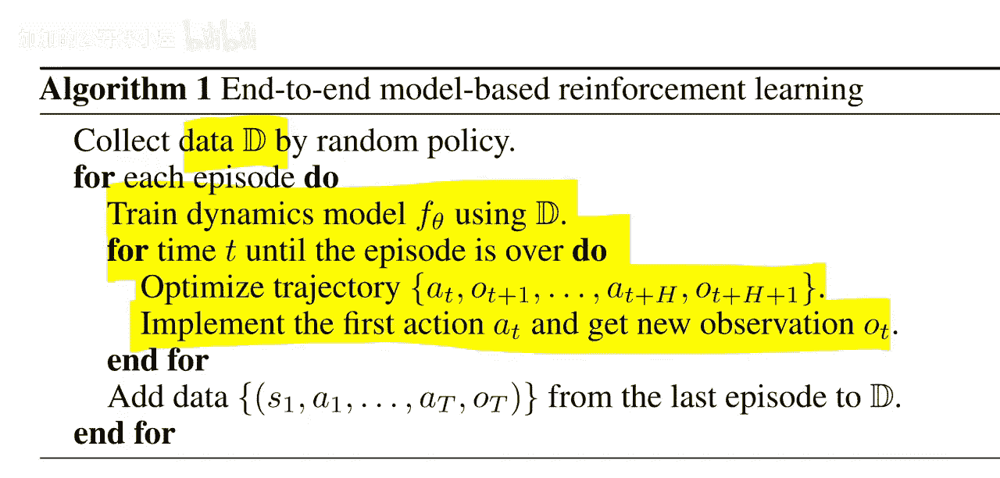

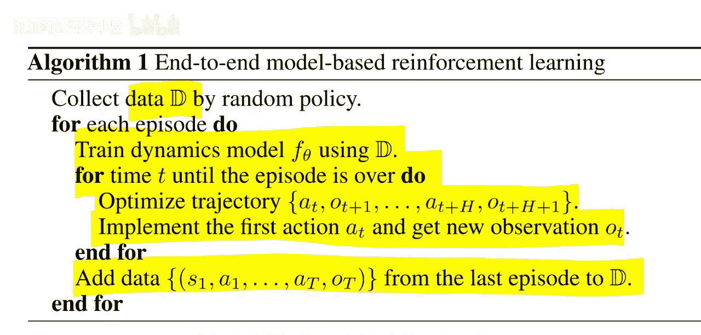

To get the best action sequence， that's how you optimize the trajectory。

And then at the end of the episode， you've done an episode， right， you went somewhere。

 you put all of this into your training data to make the world model better。

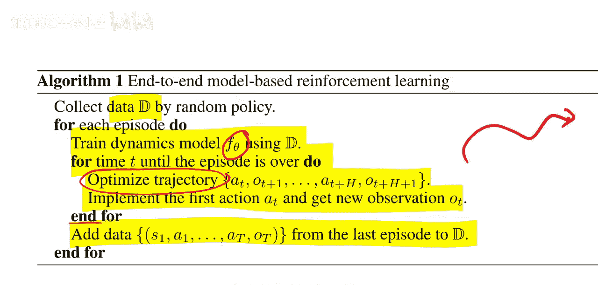