# YannicKilcher【中英⚡AI经典论文领读(全203篇)(上)｜Papers Explained】 p21 P21 合成器：重新思考Transformer模型中的自注意力机制（论文解读） [BV1o3xLznExj_p21]

Hi there。 Today， we're looking at synthesizer rethinking self attention in transformer models by Yi Tai Darrabari。

 Donald Mtzler， Da Cheng Chuan， Zhe Zhao and Zie Cheeng。

These people are of Google research and on a high level they're trying to replace the self attention mechanism。

 which is currently a dot product mechanism in a transformer by a sort of a a learned attention mechanism。

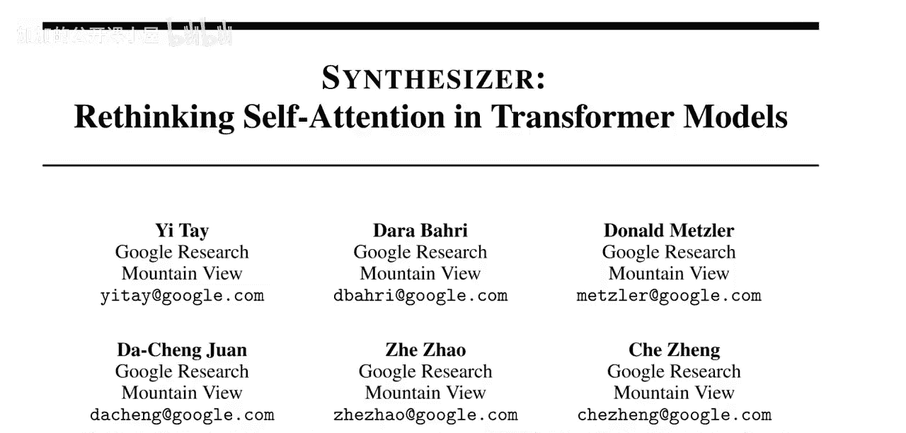

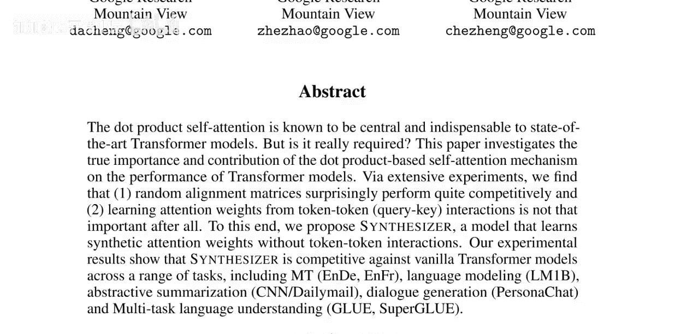

Therefore， eliminating this expensive dot product， and they test the model and conclude that it sometimes works a bit。

So the results are sort of inconclusive， but that's the paper on a high level and its it's fairly cool to go through and as always。

 if you like content like this， consider subscribing and sharing it out。😊，All right， so。

They say the dot product self attention is known to be central and indispensable to state of the art transformer models。

 so if you don't know what the transformer is it' best I made a video on the attention is all you need paper and that explains what the transformer is and what an attention mechanism is in detail。

But they are right， of course， the attention mechanism that is via the dot product of queries and keys is pretty much what makes transformers transformers。

And they here ask， is it really required， which is a bold question in light of that， right？

They say they investigate whether or not you really need this and they say via exp extensive experiments。

 we find that first random alignment matrices surprisingly perform quite competitively and two learning attention weights from token token。

 that means query key interaction， which is this dot product interaction。

 is not that important after all。They proposed this new model called synthesizer。

 a model that learns synthetic attention weights without token token interactions。

 our experimental results show that synthesizer is competitive against even vanilla transformer models across a range of tasks。

Let's dive in。So what is different here？

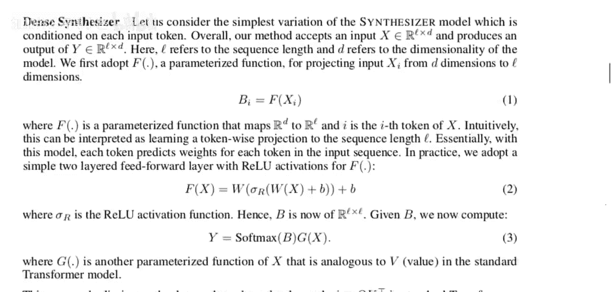

They're basically saying， look in each。In each。

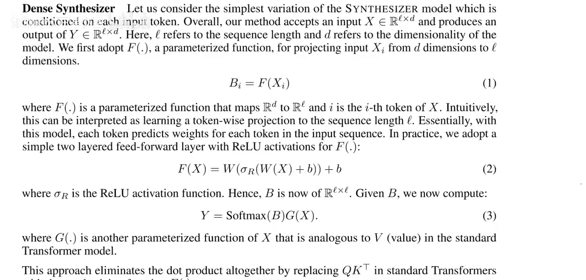

Each transformer layer boils down to something like this。

 where you have an input sequence x right here。And you want to get an output sequence y。

And in order to do that， you need some sort of this thing。

 which is the attention matrix multiplied by this thing， which are called the values。

 and we'll explore that a bit deeper over here。

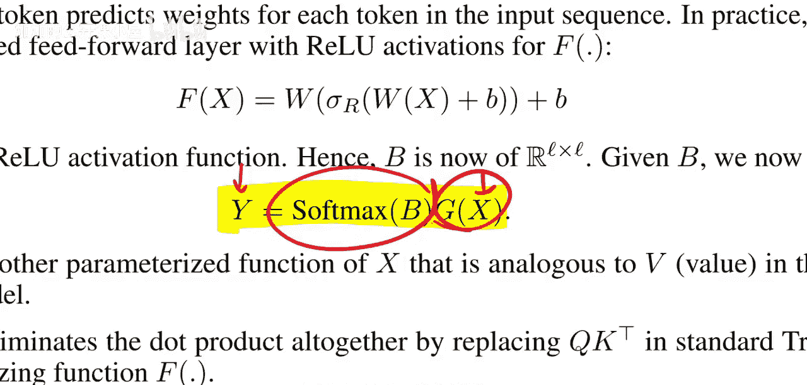

So in these transformers， it's always kind of。Helpful to visualize yourself the input sequence as sort of nodes and。

So this this would be one layer。 We have a five length sequence。

 and we want to transform it into the next length five sequence。

 and maybe it even helps to label maybe like a B C， D E。

 you can just imagine kind of these of course， as you go up the layers。

 it doesn't necessarily always correspond to the same input token。

 but the position labeling them is still， it's pretty helpful。 I find， especially for， you know。

 things like Bt or something like this。 So you want to transform the sequence that's incoming here into a another sequence and。

The basic the basic mechanism in a transformer， if you go up the layers is the routing of information。

 so you want to like route information around the sequence and basically such that at the end。

 the whole sequence knows about every word in the sentence knows about every other word that there is in the sentence knows about the associations between the other words and so on such that you gain sort of you start out with individual words and that the end what you want is sort of that every word has a pretty good idea of what's going on with every other word and that's why you continuously as you go up the layer route around this information。

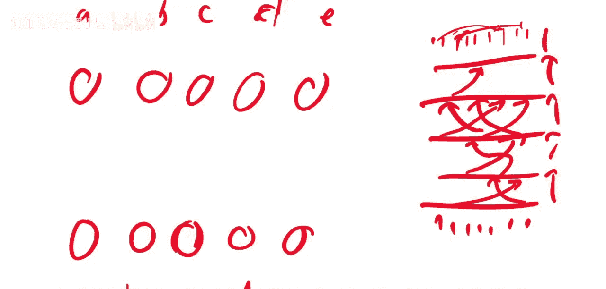

Now， the question is， how do you route this information。

 How do you know which word goes to which other word， and here。

 maybe the sentence starts with the word。

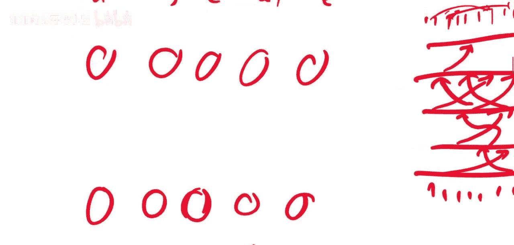

Let's call Sarah， okay， Sarah， and then it goes on and at some point it says she。Okay。

 so she is the pronoun and。We can also label these， Sarah。Shi。So if we want to。

 if we think how do we route information， it would be beneficial for us if the information that there is a word Sarah here in the sentence would be routed to the word she because the word she。

 it's a pronoun， it knows I'm a pronoun。And if there is like a person in the sentence that would be valuable information for me like to know what's kind of going on and to understand myself better。

 Basically， every word wants to understand itself。 and it kind of calls out for information from the other words in a transformer。

 this is done via what this paper calls this dot product attention。

 and that's the follows every word， every token emits what is called a key and a value。

 and the key and the value are just two vectors。 So every word is going to emit two vectors。

 I'm going to draw one at the bottom here。

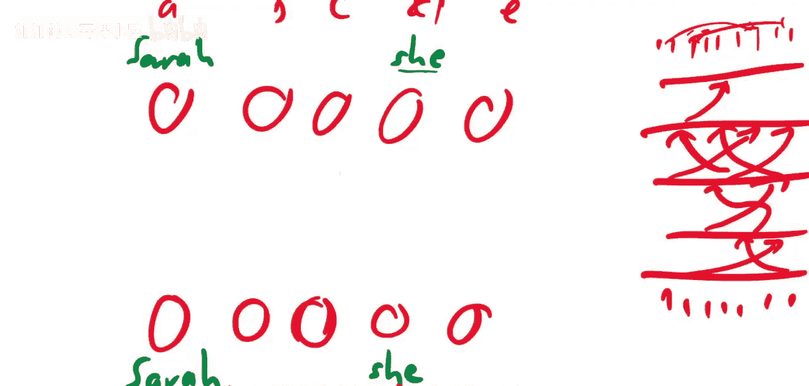

And I'm going to draw one at the top， okay。Like that。

So you can imagine the key as sort of the word advertising what it is to other words and so these are the keys down here and sorry the top。

 I think I call it value， that's wrong， it's called a query。嗯。

You can imagine the query as a word asking， describing what it wants from others to know， okay？

So in that case， you'll see that the vector here and the vector here。 the。

 these are now routed by dot product。 So the ones that align in the dot product in the angle。

 they will be routed to each other。 So this would be routed here。 And maybe， you know， okay。

 I drew this。 This one would be routed here。 And the others would be kinda routed some。

 a bit here and a bit here。 maybe。Okay， it gets， it gets fuzzy， but you get the concept。

 but in order to do that， you basically need the to pull to put the dot product from every single key with every value。

 sorry query。

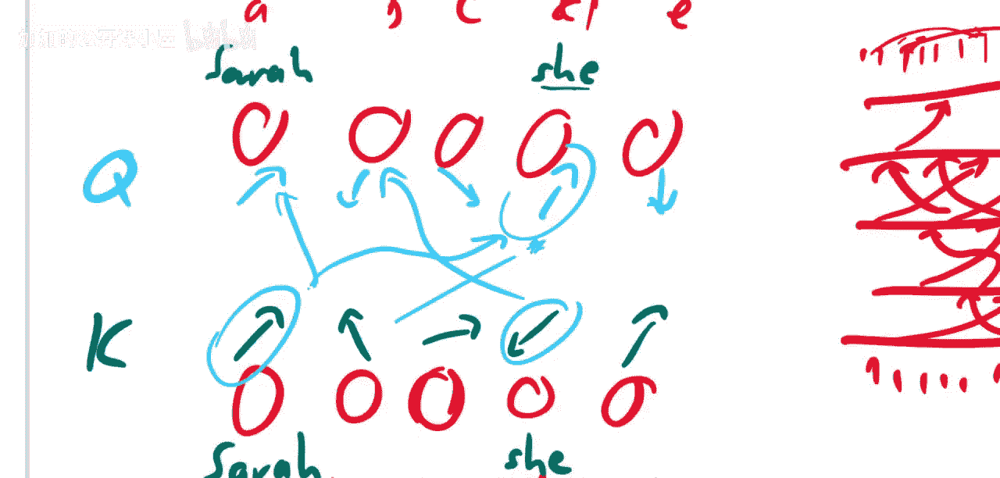

And that gives you basically this quadratic dot product that these transformers have and。

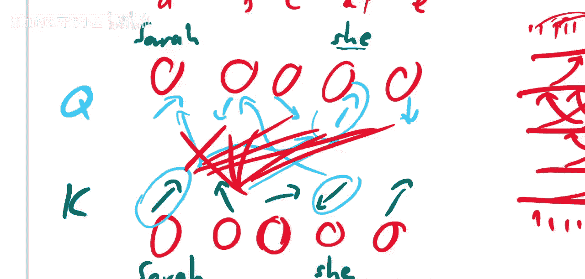

That's expensive。 Okay， so they have a little picture here。 This is what a vanilla transformer does。

 every input。

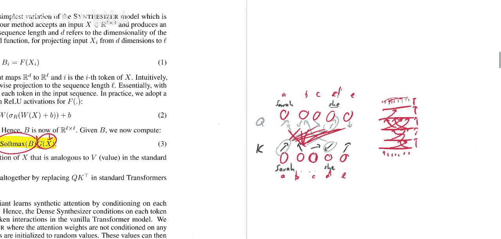

Here emits two things， a query and a key， and then there is a dot product attention to decide what's this attention matrix okay。

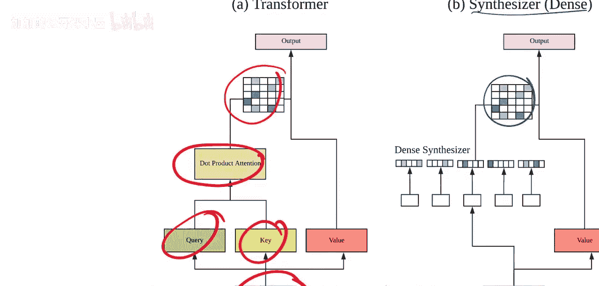

Now， this attention matrix is then used to aggregate these values。 So actually。

 every token emits three things， Also this value here， which is basically， it's not that important。

 but。

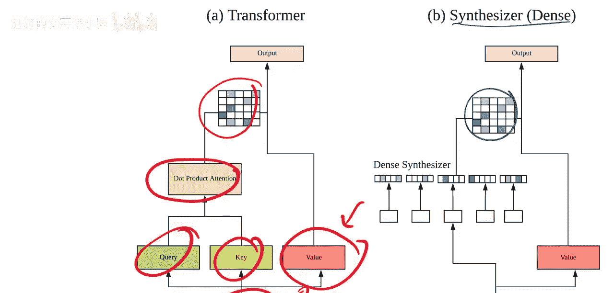

This just describes the information that you want to pass on to the next layer。

 and then it goes through this routing right here that routes the information to the correct output places and you get your output。

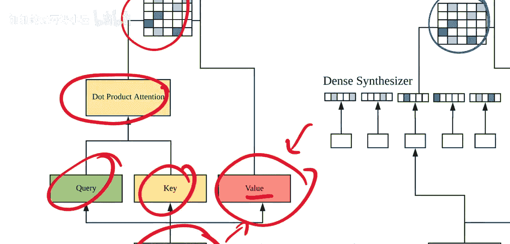

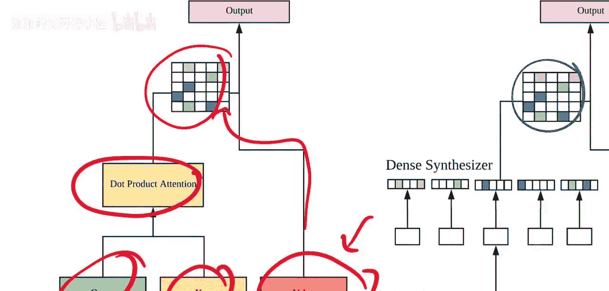

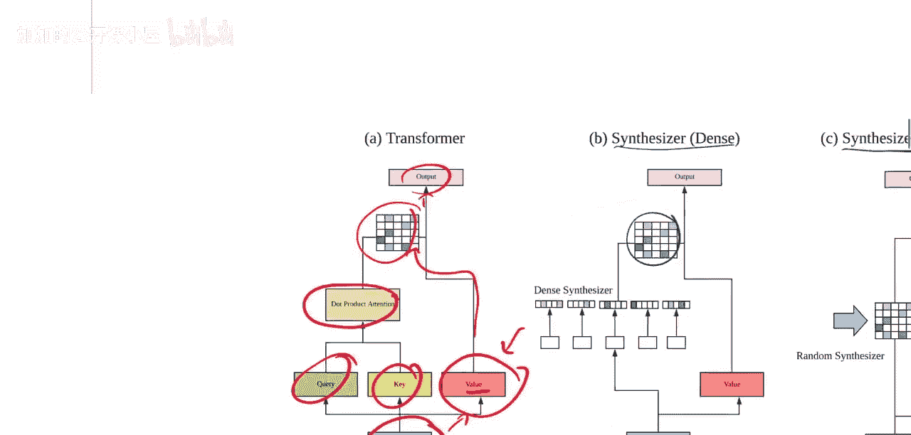

Now， what they propose is something different。 They propose this dense synthesizer right here。

 where instead of the dot product attention， every single。

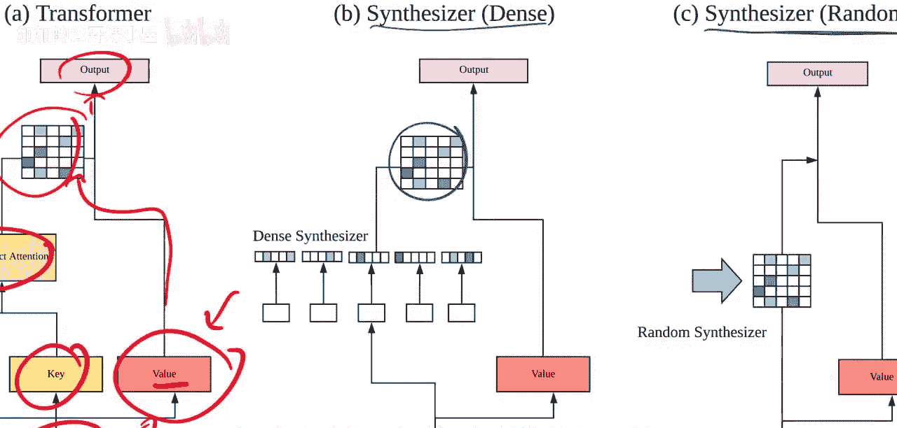

Every single input here emits a basically a row of this matrix directly without having to go through the dot product。

 Now it helps a bit if you imagine it in our little framework here。

 So let's draw this again and let's see what these synthesizer。 by the way。

 they call this the dense synthesizer because they have another variant as well。 Okay。

 heres here is our sequence， the lower layer， we want to transform it in the upper layer。

 let's this is the ser node and this is the she node。

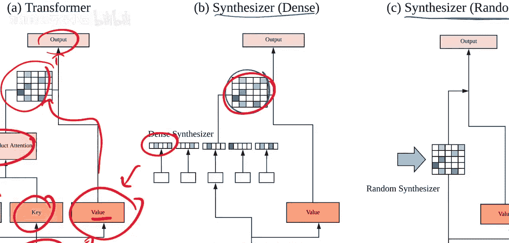

Sarah。She。Okay， so how do we route information now？Wow， okay。 I missed that。

In the dense synthesizer framework。Every token， just。Gets to output。Basically。

 it already gets to output where it wants information from。Every single token。Here。

Gets to output where it wants information to come from and by where。

 because in the original transformer， the where was basically defined by these inner product。

 now the where is just defined by the position Okay so it just says I want information from position2 and 3。

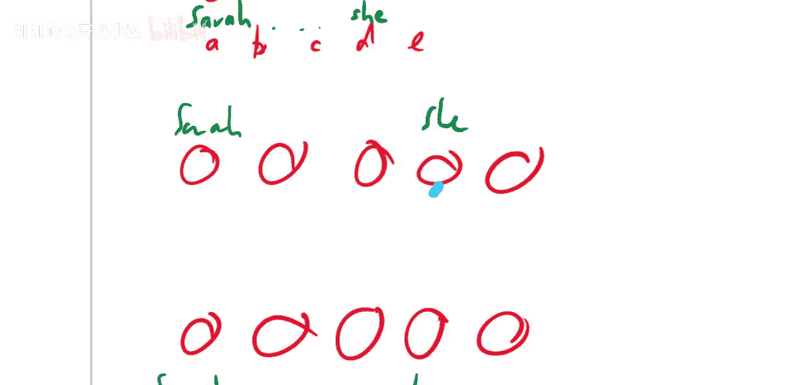

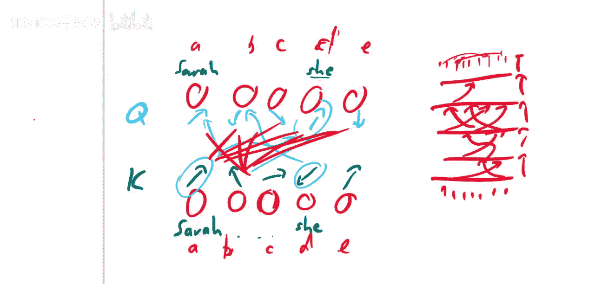

Or this node here could say I want I want information from position 5 and 3。

 Okay and this is dependent on which token there is。 so each token looks at itself。

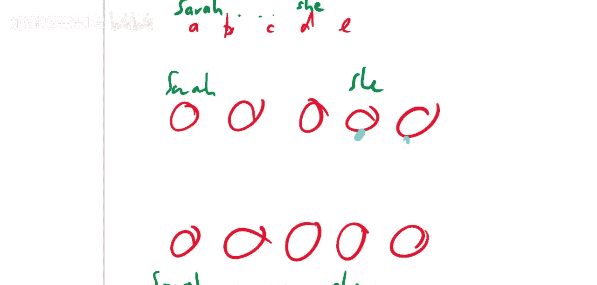

And in the case here。