# YannicKilcher【中英⚡AI经典论文领读(全203篇)(上)｜Papers Explained】 p23 P23 弗朗索瓦·肖莱《论智能的衡量》第一部分：基础（论文解析） [BV1o3xLznExj_p23]

Hello there。 Today， we're going to look at on the measure of intelligence by Hosoa Sholet of Google。

 This is a bit of a special episode， I would say， because if you look at the paper。 it is。

 first of all， it is very long。 And then， second of all， it is a wall of text。 Basically。 Now。

 it's very interesting text， but。😊。

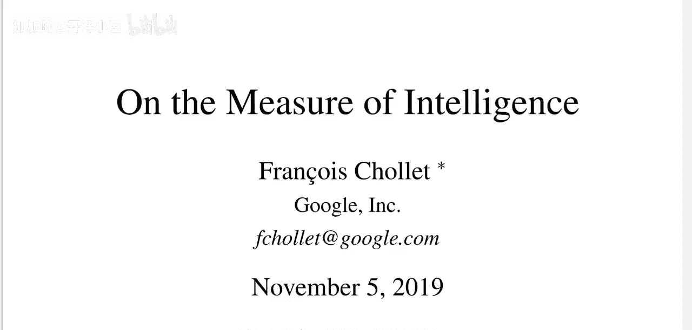

If I were to go through this with you， we'd basically just be kind of scrolling and reading along。

 So what I've done is I've basically read this and taken notes。

 and I will attempt to just tell you what happens。 at least for the first part。

 So intend for this to be a multipart series because it's so long。 So the first part。

 as you can see here， is context and history， which is a little less boring than it sounds。

 The second part is going to be a new perspective where Sholet proposes his measure of intelligence。

 And the third part is going to be about the benchmark。 the arc benchmark that is currently。

 I believe running on kle。

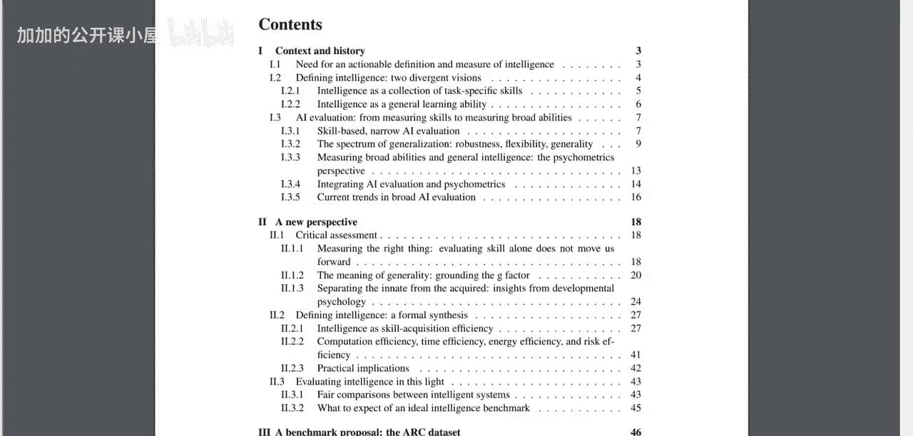

So as it sees， as it looks right now， three parts。 and today we're going to dive into that first part。

So here we go he basically says that we need to define what intelligence means。

 we need an explicit goal to measure where if we if we think about AI like artificial intelligence。

 what does intelligence mean， we need something where we can basically put a number or multiple numbers on it and says that's intelligent。

 that's not intelligence。What we have right now is just basically anecdotes is just we all kind of feel what seems intelligent。

 But we， we are not like， sure and。

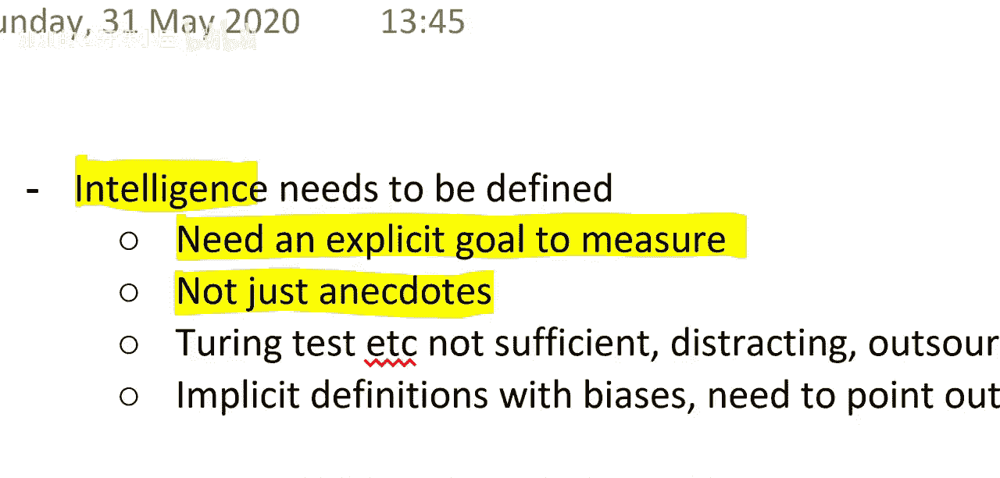

Sometimes it's very misleading， he brings up the touring test， for example。

 which is that you have a computer or a human behind a wall and on the other end say it's a human and the human needs to kind of communicate without seeing what he communicate or what he or she communicates with and then determine whether or not on the other side of the wall is a human or a computer。

 and if the computer could fool a human into kind of a 50-50 guess then the computer would be passing the touring test and therefore intelligent。

Now， Shi doesn't go right now into why that's not sufficient。

 but he's basically saying this is not sufficient， it's distracting。

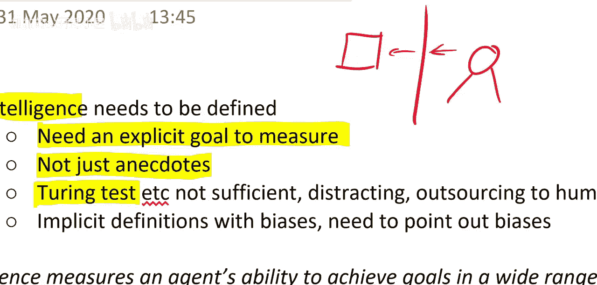

And second of all， it's basically just outsourcing the problems of defining intelligence to human。

 right， to this human right here， who is fallible and noisy And， you know， doesn't all。

 doesn't really know， all you all you tell the human is basically like， is this thing intelligent。

 Does this thing seem human to you。 It's also not clearly defined。

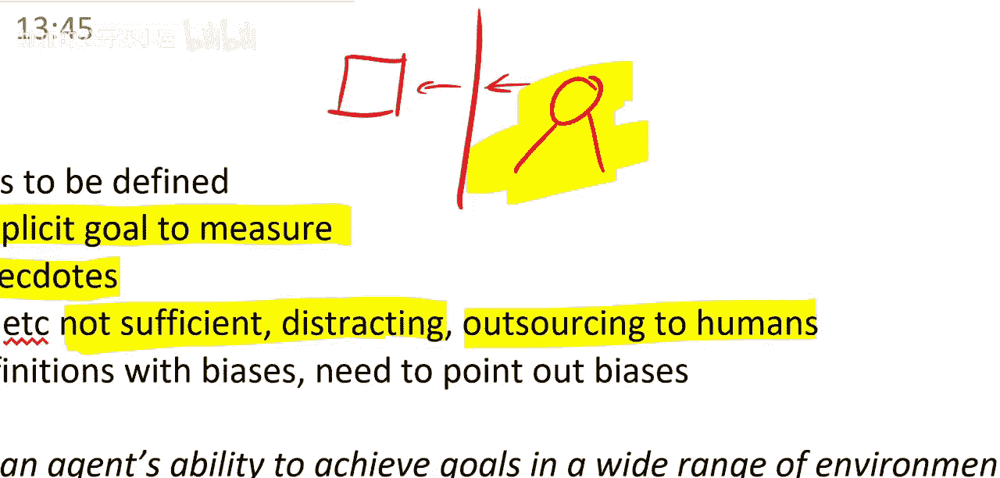

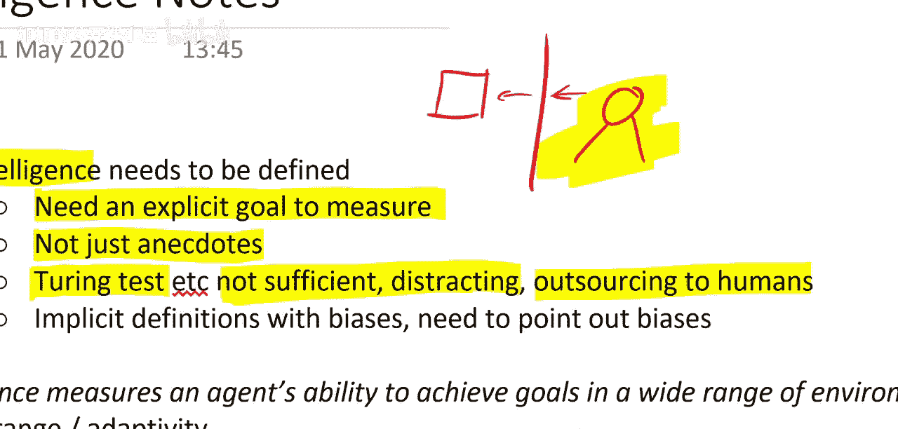

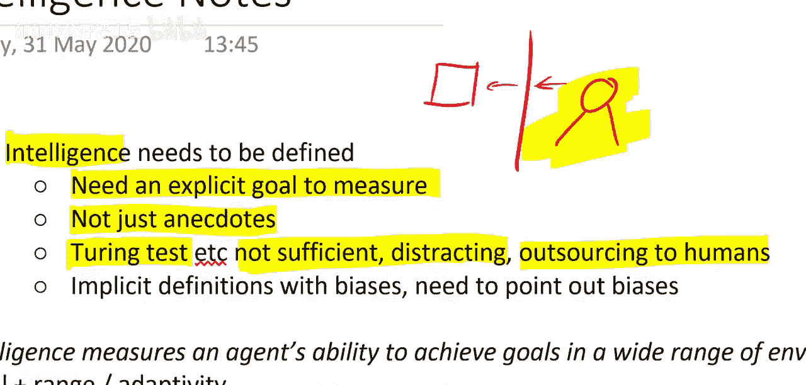

So we need some， something more。 And Shelet says the definitions that exist today of intelligence are。

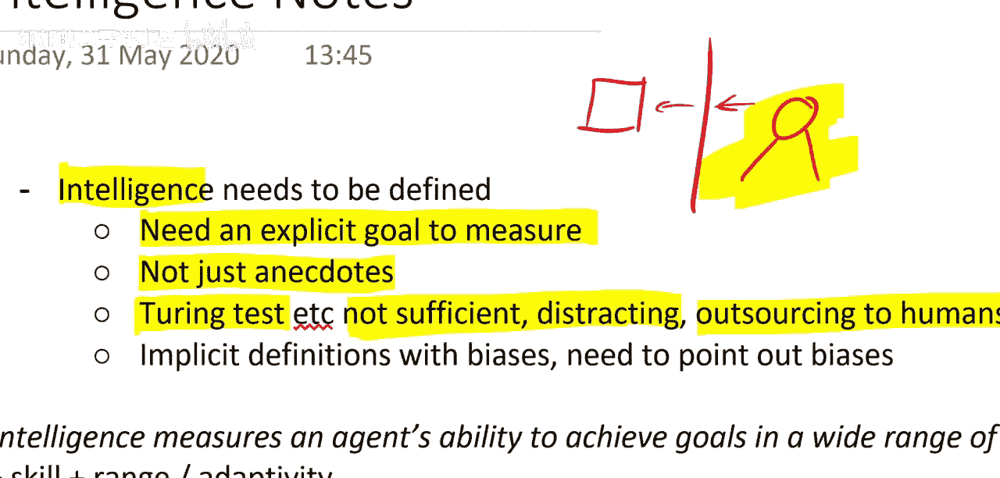

Basically theylic they are implicit definitions that are loaded with biases and biases basically from a human perspective on what intelligence is。

 and if we want to really make progress in terms of measuring intelligence。

 we need to point out these biases that are in these measures。

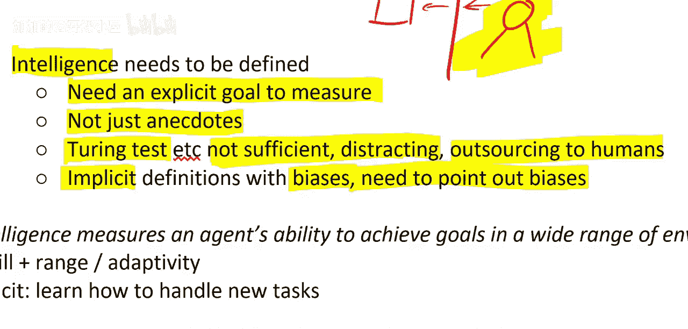

Okay。They has a range of quotes， namely one here， intelligence。

Measures an agent's ability to achieve goals in a wide range of environments。 That was， I believe。

 the conclusion of a an author that distilled lots of different definitions and tried to distill them into one。

One sentence， and that's it， intelligence measures and the agent's ability to achieve goals in a wide range of environments。

The crucial part here is to ability to achieve goals。

 so it must the agent must be you know doing something useful， doing like in reinforcement learning。

 we say it must be getting higher rewards and the second part is in a wide range of environments。

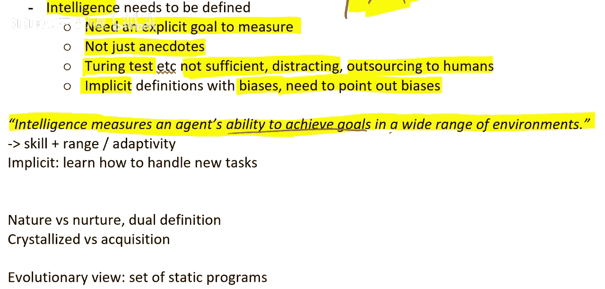

So the notion right here that we're going to encounter time and time again is basically an addition of skill and adaptivity。

 So if you have， it's not enough to have high skill， you also need to be kind of adaptive to very。

 very different environments to a range of environments。

And that this is the main issue that Chalet has with the current sort of definitions of intelligence and the current direction of the AI field。

 because it mostly measures skill and not generalization or adaptivity。

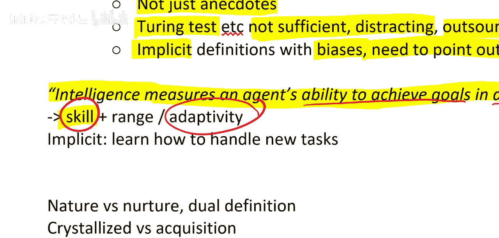

Now。He， he says in this thing， in this sentence right here that you just saw。

 there is an implicit sort of something is said implicitly， namely that this， this。These skills。

 this ability to achieve goals in this wide range of environments。 it must be acquired。

 It must be learned。 these， these new tasks， these different environments。

 the agent should basically learn to adapt to the different environments。 then。

 and then the agent is intelligent。 It's not。That intelligent when it is sort of pre programmed to already handle these environments。

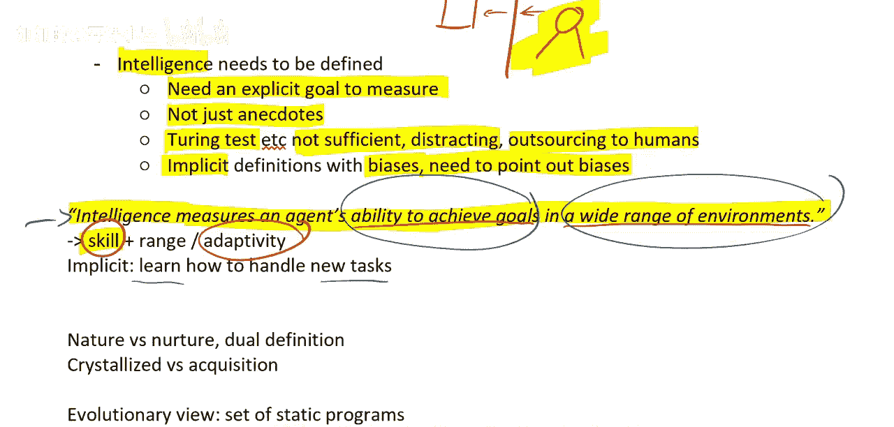

So he says that that's sort of implicit in that statement。

 and we're going to see how this is made explicit later。

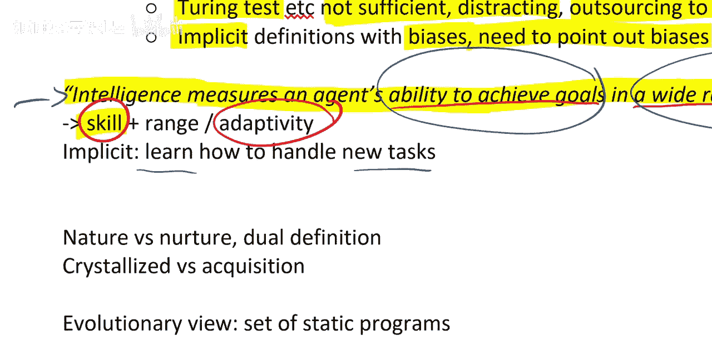

He goes into basically there are two different viewpoints on intelligence。

 this old nature versus nurture debate， and that refers to two things like crystallized intelligence versus skill acquisition intelligence。

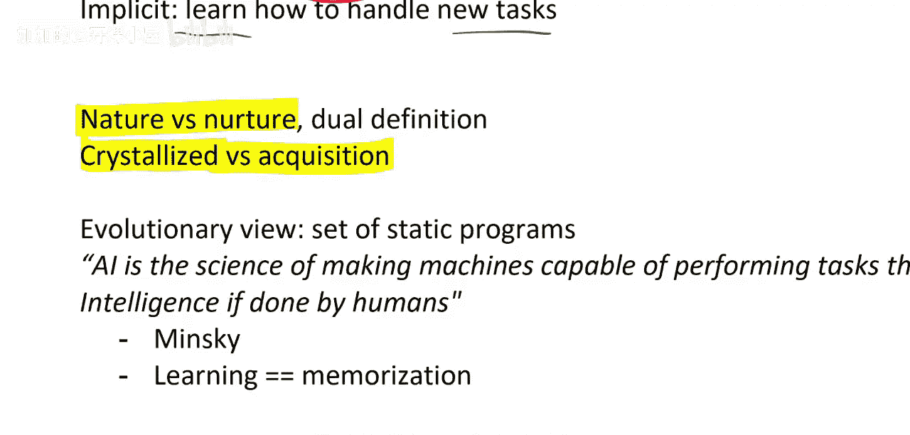

So the evolutionary view would be that intelligence is sort of this state of static programs。

 And here we， we simply kind of boil down these two views to their extremes， right。

 so don't I I don't think any major evolutionary biologist is complete like is apps is that extreme right now。

But these were historical set of views that were held。

 One of them was that intelligence is basically just it's。

 it's all pre pre programmegrammed into you by evolution， So you can。

 you can solve this puzzle because during evolution， you know。

 your ancestors that could solve these puzzles were， were survived。

 You can plan your path through a a tree jungle because you know， that was beneficiary to you。

 And so evolution put that into your brain。

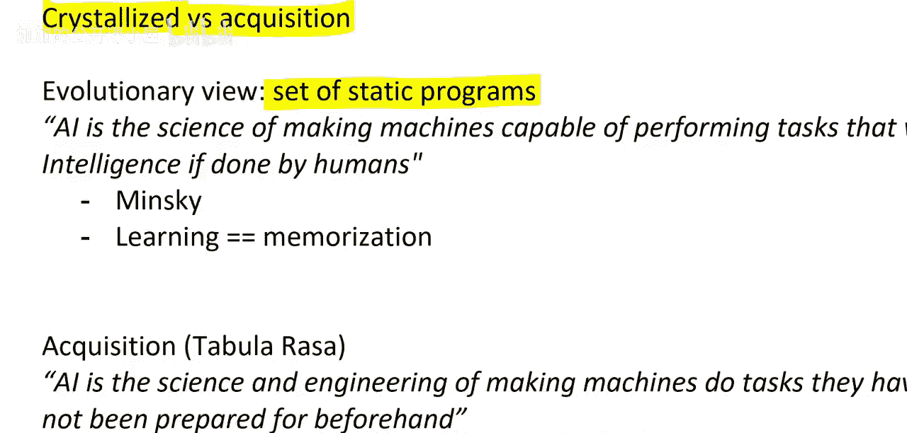

And therefore， what results is AI is the science of making machines capable of performing tasks that would require intelligence if done by humans that's basically what Minsky said the quote I believe by Minsky at least Chale says it's by Minsky or I misread。

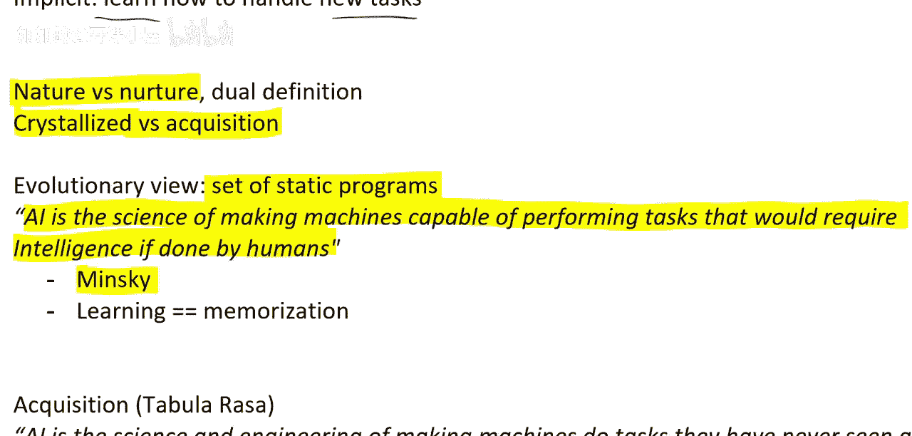

Where if you have this， this set of view that that AI is basically just this set of static programs。

 that means that if a human applies that set of programme to a task， right？

 and the human achieves 200 points。It means if if an AI comes along and achieves 201 points。

 then it is intelligent because it has simply the better set of the better it has outperformed the static set of programs。

 Inlig is this static set of programs and the AI has a better set of static set of programs so。

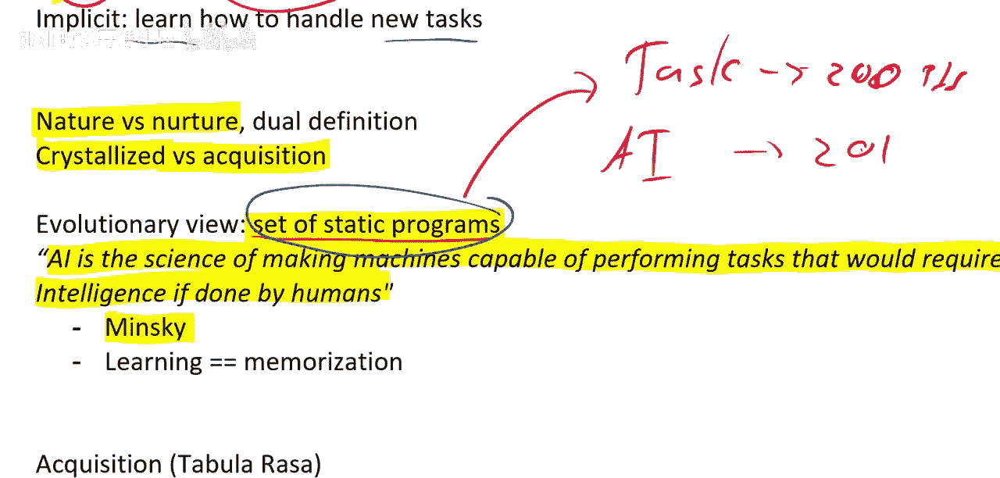

It's basically Minsky says， if we know of a task。That would require intelligence if done by a human。

 then if that。Something that can solve that task is intelligent。

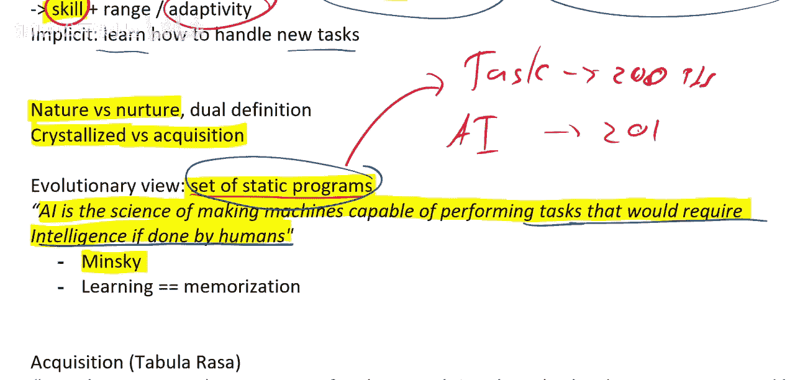

And this equates learning basically just to memorization if you。

 if you ask a proponent of this viewpoint， well whats what's learning like if everything's pre programmed why we we can still learn and they would say。

 yeah， but the learning is just you memorize situations and that particular ability is also pre programmed into you。

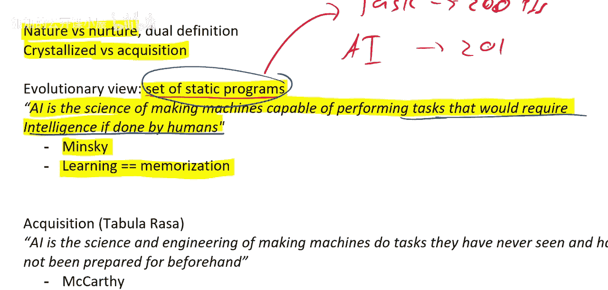

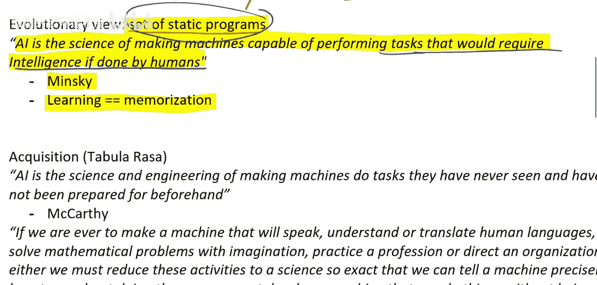

The other extreme viewpoint is this tabraa viewpoint where it basically says you come into this world and your brain is a blank slate and everything you。

 all of your abilities you basically must acquire through learning throughout your life。

 So this is another extreme viewpoint。

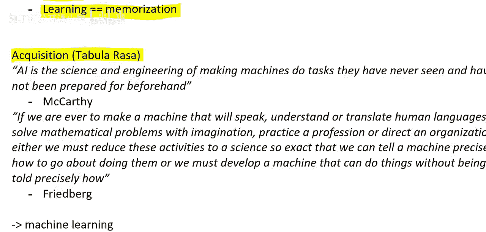

And in terms of intelligence， where that leads us， following AI is the science and engineering of making machines do tasks they have never seen and have not been prepared for beforehand。

And that's a quote by McCarthy and Fried Beck， if we are ever to make a machine that will speak。

 understand， translate human languages， solve mathematical problems with imagination。

 Pra a profession or direct an organization， Either we must reduce these activities to a science so exact that we can tell a machine precisely how to go about doing them。

 or we must develop a machine that can do things without being told precisely how。

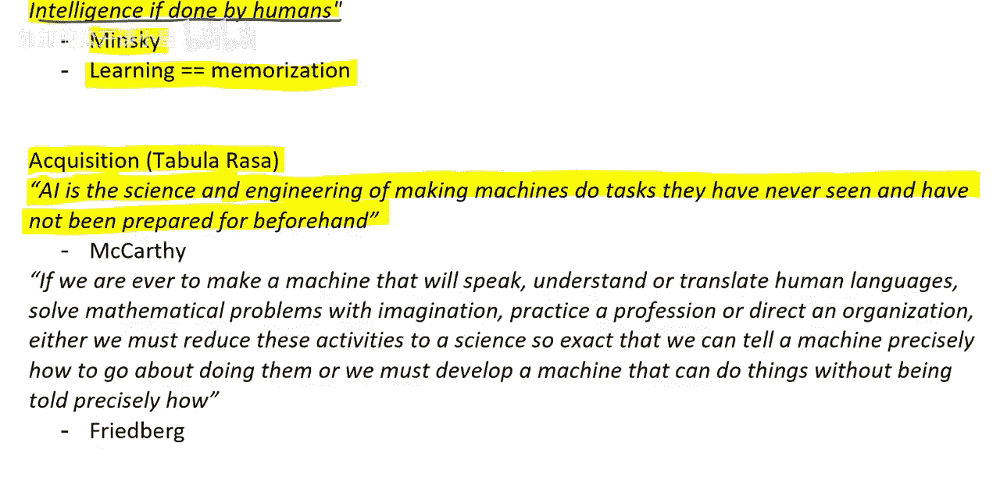

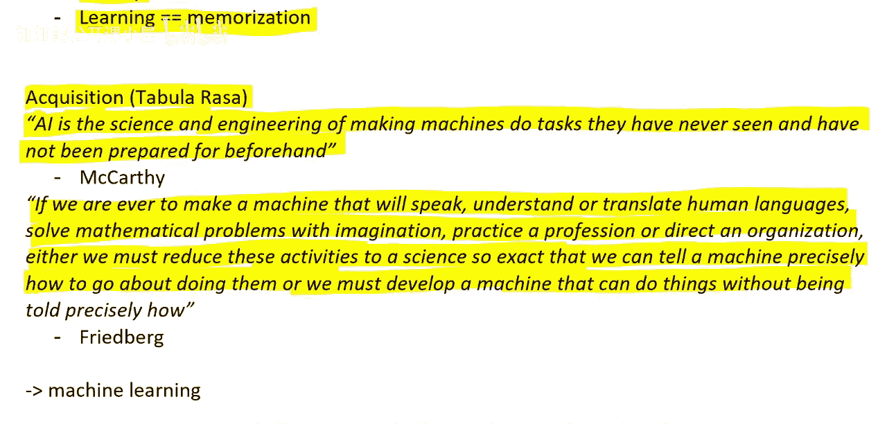

So this leads to more of， of these notions right here that。

You can see here the machines have not been prepared for a particular situation。

 so if we make a machine that can do a task that it has not been prepared for。

