# YannicKilcher【中英⚡AI经典论文领读(全203篇)(上)｜Papers Explained】 p24 P24 无需标签的图像分类学习（论文解读） [BV1o3xLznExj_p24]

Hi there。 Check out these clusters of images right here。

 And just have a look at how all of them are pretty much showing the same object。 So here's balloons。

 here's birds， here's sharks or other fish。 These are from images from the imagenet data set。

 And you can see that these clusters are pretty much the。Object classes themselves。

 So there's all the frogs right here， here， all the all the people that have caught fish。So this。

 the astonishing thing about this is that these clusters have been obtained without any labels of the Inet dataset。

 Of course， the dataset has labels， but this method doesn't use the labels。

 It learns to classify images without labels。 So today we're looking at this paper learning to classify images without labels by Wter Gzbeke。

 Simon Vanhene Stamats。

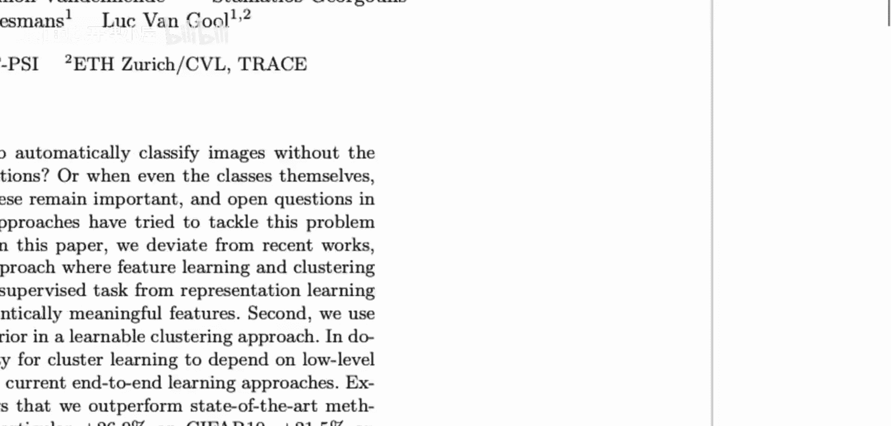

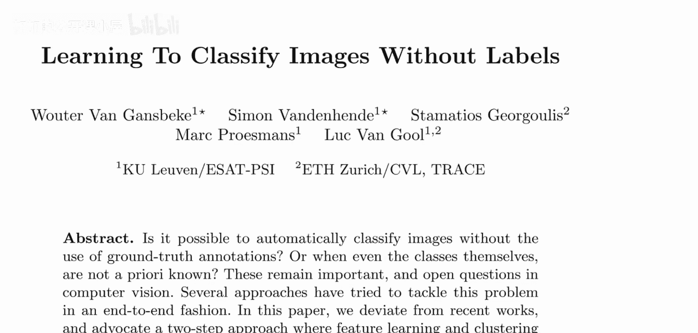

Kor Guulies， Mark Procemons and Lufan Goul。And on a high level overview。

 they have a three step procedure， basically first， they。

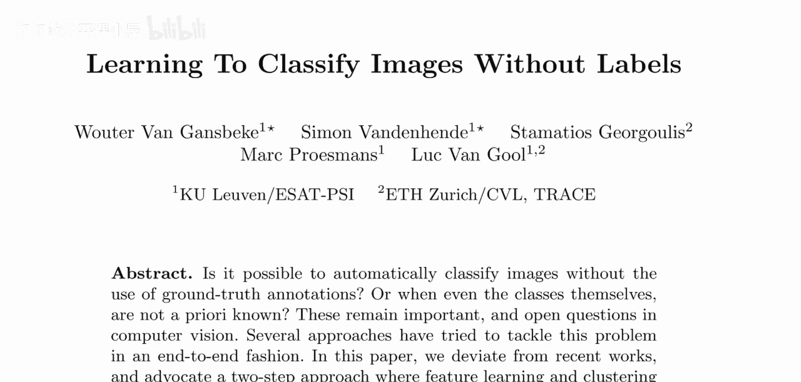

They use self supervised learning。In order to get good representations， second， they do a clustering。

They do a sort of can nearest neighbor clustering， but they do。Clustering on top of those things。

 but they do it in a kind of special way。 And then third， they do a refinement through self labeling。

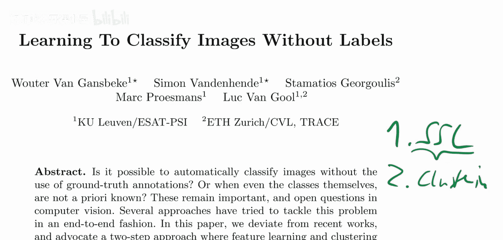

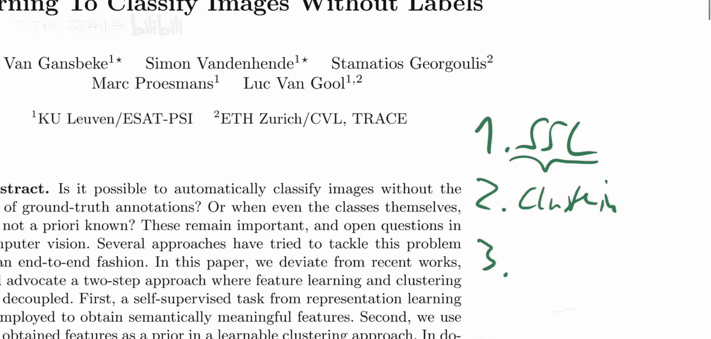

So if you know what all of these are， you basically understand the paper already。

 but there's a bit of tricky steps in there， and it's pretty cool that at the end it works out like you just saw。

 So before we dive in as always， if you're here and not subscribed。

 then please do and if you like the video share it out and leave a comment if you feel like commenting。

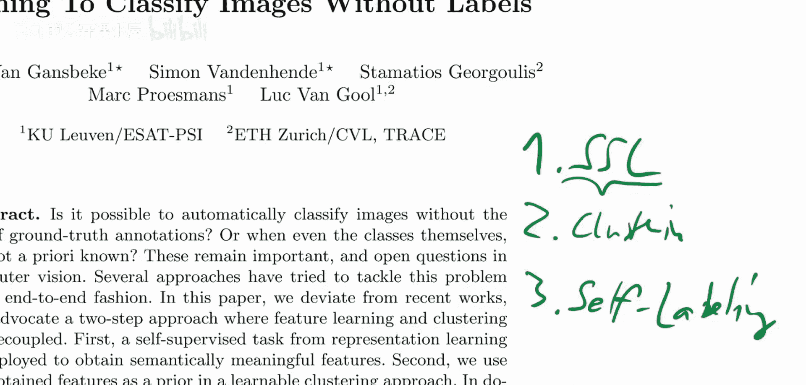

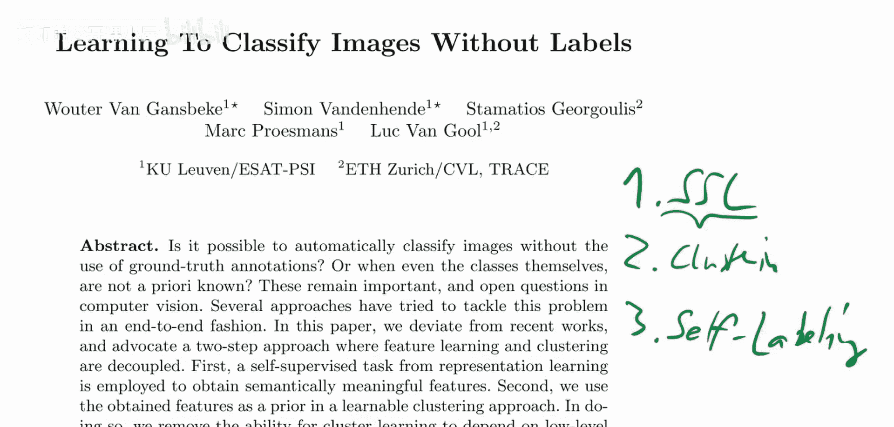

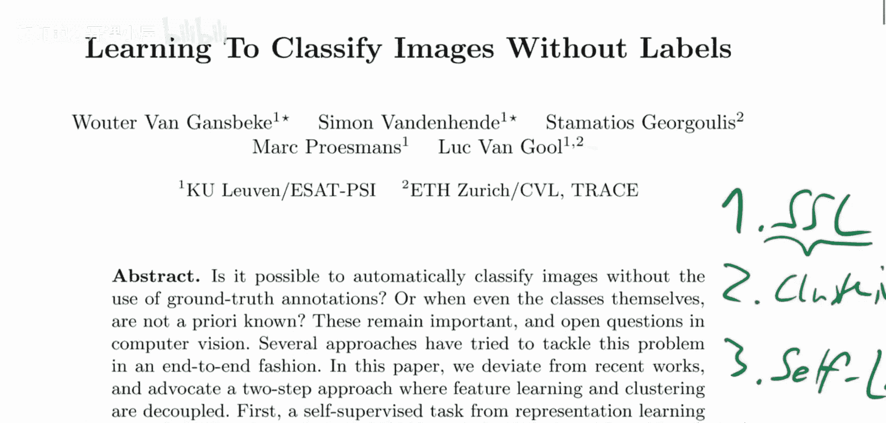

Cool， so。As we already stated at the problem， they ask。

 is it possible to automatically classify images without the use of ground truth annotations。

 or even when the classes themselves are not known a priori。 Now。

 you might seem like you might think that this is outrageous。

 How can you classify when you don't even know what the classes are and so on。

 So the way you have to imagine it going forward， And they are sort of they don't explicitly explain it。

 But it's， it's sort of assumed that。

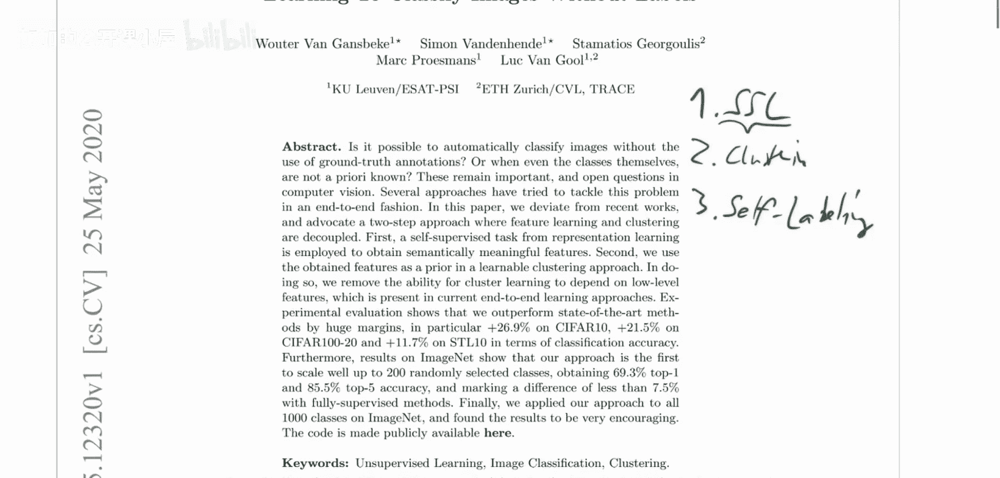

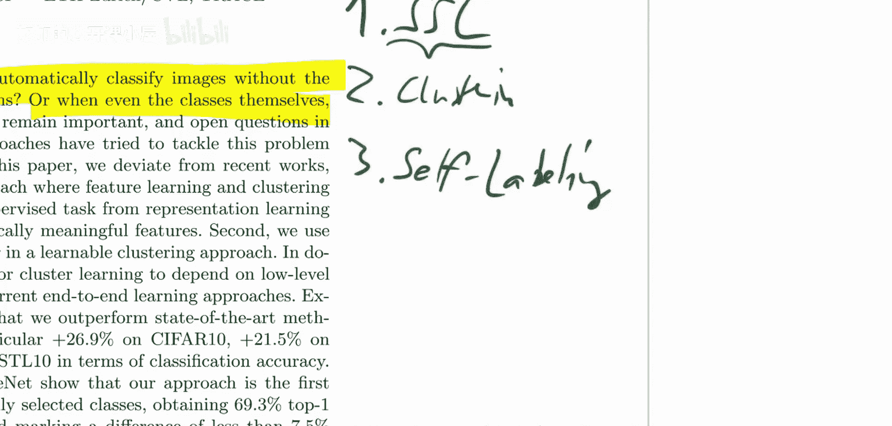

If you have a dataset dataset and you learn to classify it。

 what basically that means is you cluster it right you put some of the data points in in the same clusters and then of course the dataset I'm going to draw the same dataset right here the same data would have an actual class thing。

 So this would be class0， this here may be class1 and this here might be class 2 Now you can't possibly know how the classes are like called or something which one is the first。

 which one is a second So at test time， basically if you have a method like this that doesn't use labels What you're going to do is you basically going to find you're going to be as generous as possible and in the assignment of these and say oh look。

 if I assign this here to cluster0 and this here to cluster 2 and this here to cluster 1 and I just。

Over the labels。 what would my accuracy be under that labeling。

 So you you're as generous as possible with the assignments of the labels。

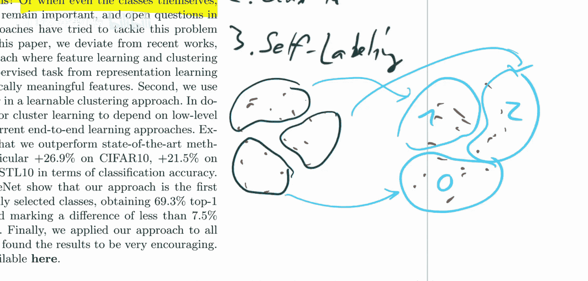

So that's how it's going to work right that's what you have to keep in mind we're basically developing an algorithm that gives us this kind of clustering of the data。

 and then if that clustering partitions the data in the same way as the actual labeling would。

 the actual labeling with the test labels， then we think it's a good algorithm。

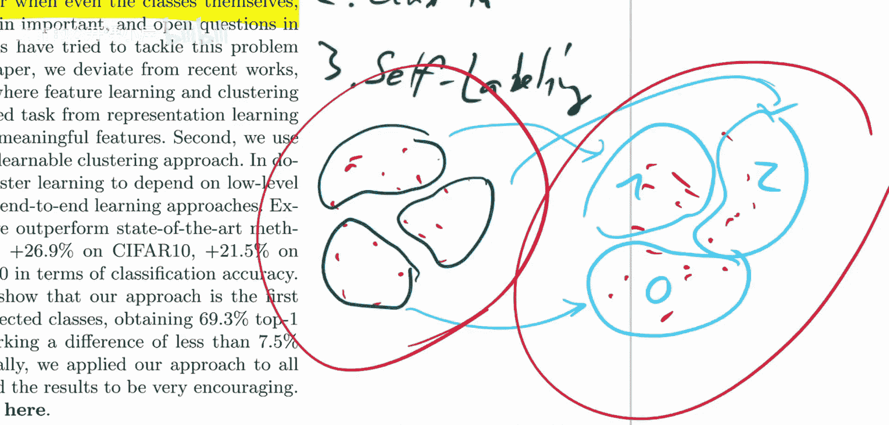

Okay， so they claim they have a。Okay。In this paper。

 we deviate from recent works and advocate a two step approach。

 And it's actually a three step approach， but。Where feature learning and clustering are decoupled。

Okay， why， why is that？ So they argue what you could do， what people have done is。

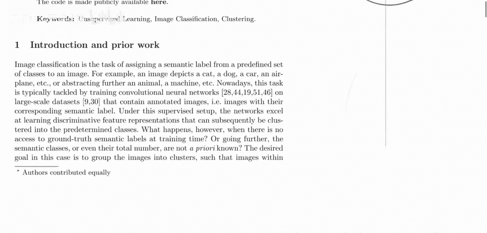

And I'm going to。Well， this is just a wall of text。

 So what you could do is you could just basically cluster the data。

 Like who says you can't use clustering algorithms。 But then the question is what。

 what do you cluster them by。 Like you need a distance。 So if I have points in 2D。

 it sort of makes sense to use the Euclidean distance here。

 But if I have images of cats and dogs and whatnot。

 then the Euclidean distance between the pixels is really not a good， a good thing。

 But also So you might think we could actually。

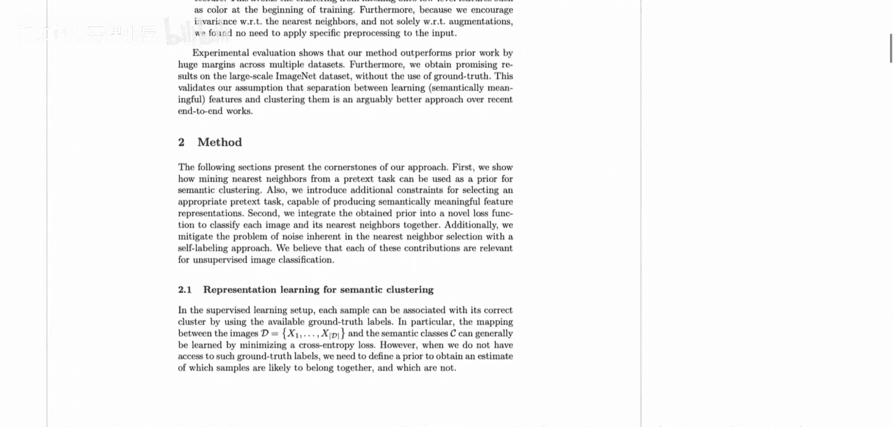

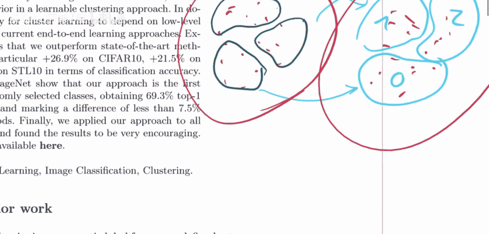

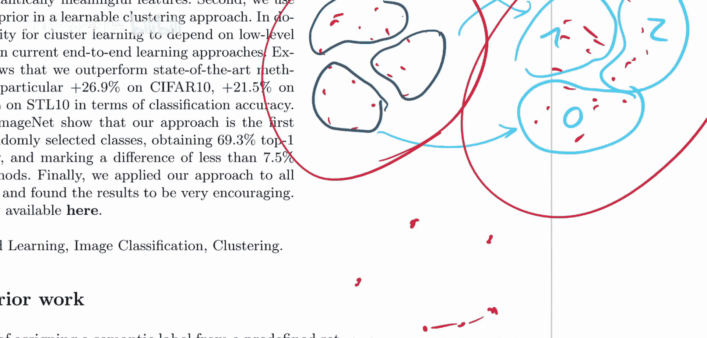

We could use a deep neural network and then basically send the image。 That's the image right here。

 sendend the image through the deep neural network。 and then either take these last state right here。

 So it goes through and through and through。We could get take either of the hidden states or we could just take。

 you know， the last state that is the sort of hidden representation right here and do the clustering with that。

 But then， of course， the question is， what do you。whichch neural network do you take。

 How do you train that neural network， And there have been a few approaches such as a deep cluster。

 which try to formulate basically an objective for that neural network where you first。

 you send all the images through， right you send a bunch of images through to get you in embedding space。

 you get you points and then in embedding space， you think。Well。

 the features that are in the embedding space， they are somehow latent。 and they， you know。

 if basically the entire thing is。If this neural network was used to classify images。

 you would have a classification head on top and a classification head。

 this is like a five class classification head is nothing else。

 then a linear classifier boundary that you put on top of this hidden representation So if you were to use this neural network for classification。

 it must be possible to draw a linear boundary between the classes and therefore the either things like the inner product distance or the Euclidean distance must make sense in that space。

 if they don't make sense in the picture space， but they must make sense in the hidden representation space because what you're going to do with them is exactly linear classification。

 the last classification head of a neural network is just a linear classifier。So。It the。

 the assumption is that。 and the conclusion is， well， in this space。

 you should be able to cluster by Euclidean distance。

 So what deep cluster does alternate turn like is first get the representations。

 you start off with a random neural network， then cluster these representations。Then basically label。

 self label the images in a way。Now I'm way over simplifyimpling that technique right。

 but you have these alternative steps of clustering and then kind of finding better representation and then clustering these representations and what it basically says is that the CNN itself is such a it's like a prior because it' this translation works very good for very well for natural images the CNN itself will lead to good representations if we do it in this way。

 and they have some good results there。 but this paper argues that if you do that。

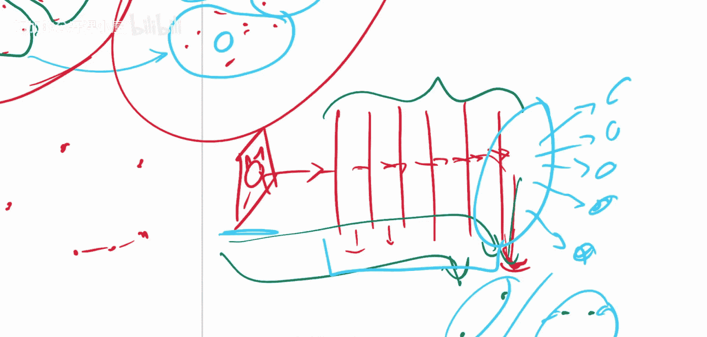

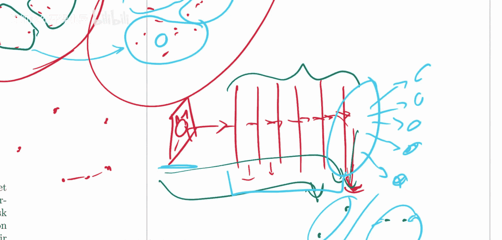

Then。The， the algorithm tends to focus a lot on very low level features。

 So if the pixel on the bottom right here is blue。Then you can and the neural network by chance puts two of those images where the blue pixel on the bottom right。

 it puts them close together， then in the next step it will because they're close together。

 it will cluster them together and then it will basically feed back the new representation should put the two in the same class it will feed back that it should focus even more on that blue pixel so it's very。

 very dependent on initializations and it can jump super easily onto these low level of features that have nothing to do with with the high level task you're ultimately trying to solve which is to classify these images later。

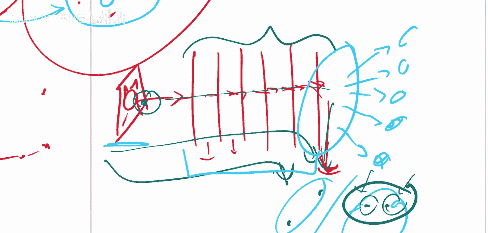

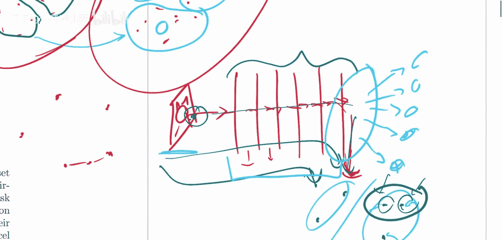

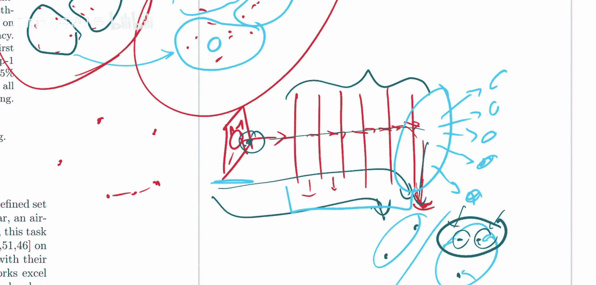

So what this paper does is it says we can eliminate this。 We can eliminate this。

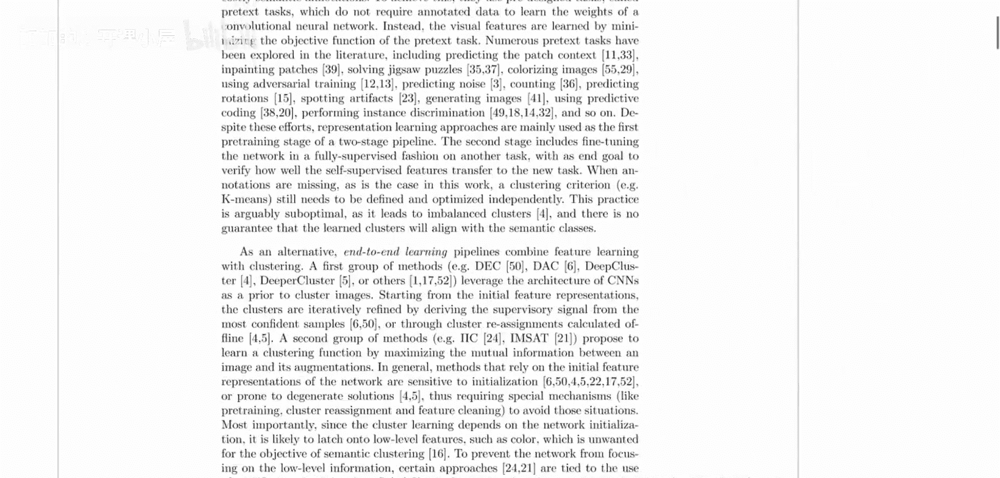

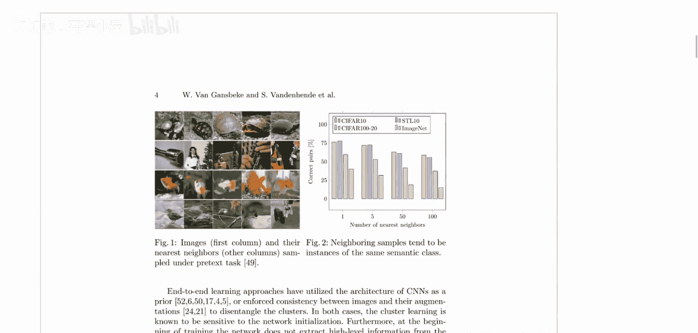

The fact that these methods will。We'll produce neural networks that focus on low level features and how do we do that。

 we do that by representation learning。 So representation learning。

 you might know this as self supervised learning。

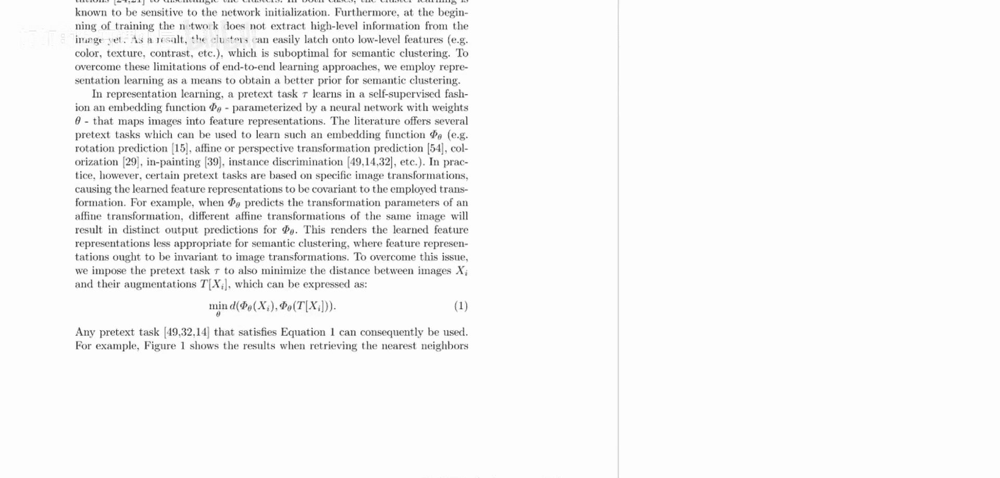

And this is the task they solve in the first step of their objective。 So let's go through this。

 This right here is an image。

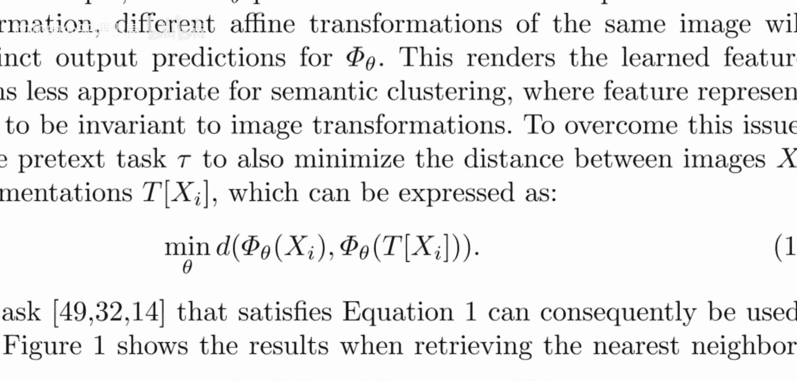

Now， the T is a transformation of that image。

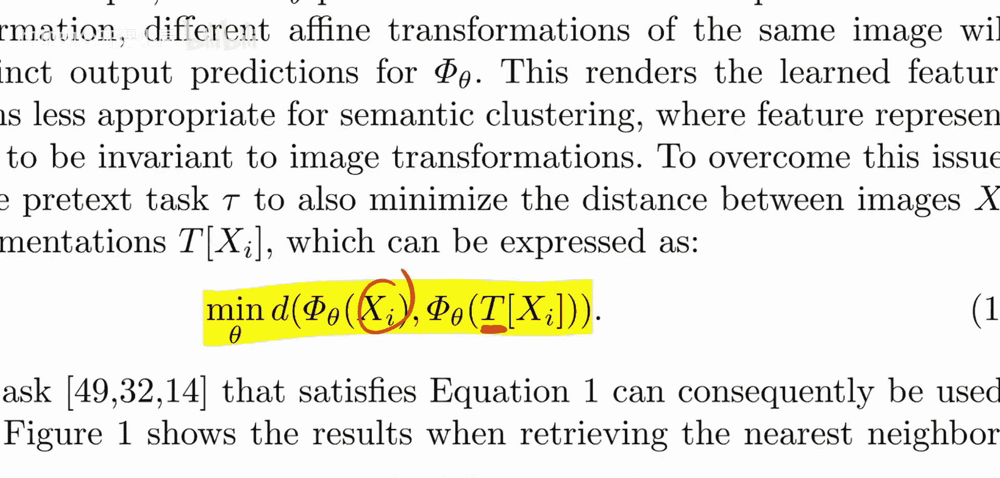

In self supervised learning， there are several methods that you can transform an image。

 So for example， you can random crop。

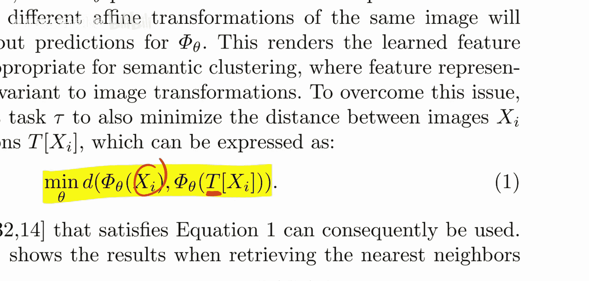