# YannicKilcher【中英⚡AI经典论文领读(全203篇)(上)｜Papers Explained】 p26 P26 合成培养皿：一种用于快速架构搜索的新型代理模型（论文详解） [BV1o3xLznExj_p26]

Hi there。 Today we're looking at syntheticyn Peridish。

 a novel surrogate model for rapid architecture research by Adi Tarawal， Joel Lehman。

 Felipe Petrorovski Suuch， Jeff Clon and Kenneth O' Stanley。This paper on a high level。

 it basically says if you want to do neural architecture search， if you。

 for example search for a better nonlinearity， you should be able to extract that nonlinearity instantiated in a very small network and then evaluate that very small network in order to predict the performance of a large network and therefore you can find a better nonlinearity in much less time now the exact procedure how you do this in the small network is a topic of this paper。

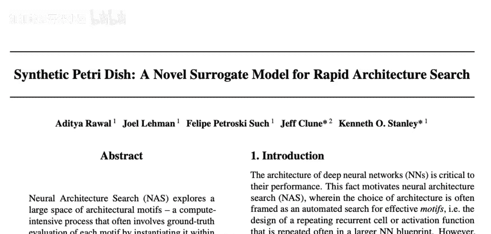

As always， if you like content like this， I encourage you to subscribe if you're not already and to share out the video so other people can in experience the joy in themselves。

😊。

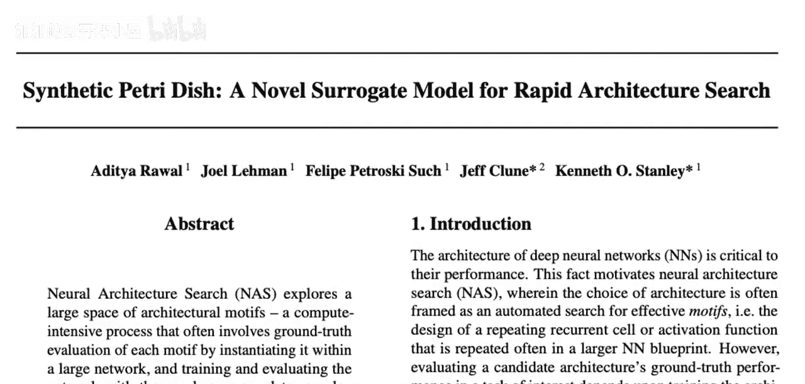

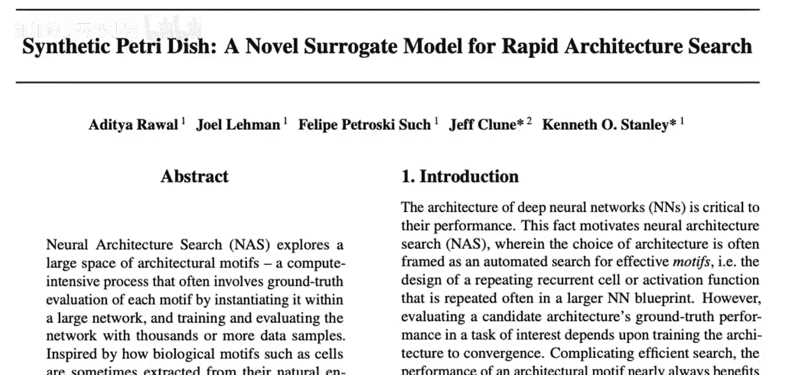

Alright， let's dive in。 So they say in the abstract。

 neural architecture search explores a large space of architectural motives， which， which basically。

So it basically means you want to find a neural architectureural。

 let's say you have a multi layer perceptron。Right here。Coup of layers， Okay。

 and they're all connected by， you know， feet forward weights。 whatnot。

 And each of these weights basically is a multiplication。

 So each one of these is a multiplication of x by your weight W。

 And then there is a non nonlinearity。 So the non nonlinearity could be a sigmoid。

 So the sigmoid would be something like one over。1 plus E to the negative X。 Now。

 there is a bit of an extension in a sigmoid where you can do a sigmoid that has like a temperature parameter attached or a slope parameter where you go C X。

 So in one case， you can set C such that the sigmoid has a shape like this。

 And in then if you put C to a different value， you can make this slope。

 you can make it like a shape。 Well， this is terrible like this。 You know what I mean， okay， so this。

 this C right here can potentially change the behavior of your network。

 And you want to find a good parametermeter C。 and this is a hyperparameter。 Now。

 there are many hyperparameters like this。 for example。

 how many units you have in a particular layer in a C and then it could be your filter size in a transformer could be the number of heads and so on。

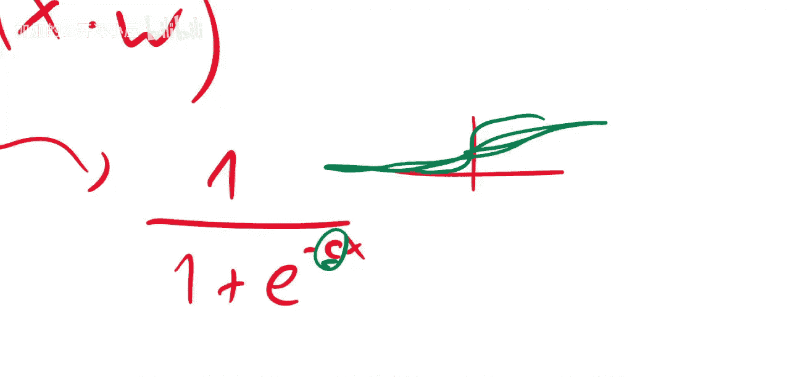

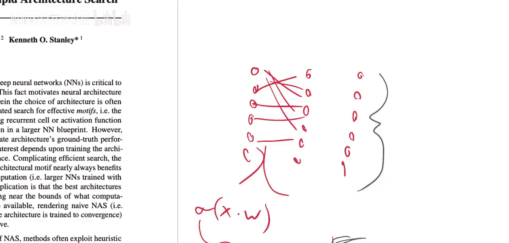

It could actually be not only the slope of the nonlinearity， but the actual non nonlinearity itself。

 or famously in recurrent neural networks， you have these recurrent cells and they're like， okay。

 we have an input signal and a carry signal and then the input here is like dot multiplied here and then there is like a gate with an nonlinearity and then it's kind of like multiplied by the carry。

 but then there is also a like a forget gate and whatnot。

 there's a minus right here it's very complicated And so people do architecture search over these kind of problems to find better architectures for a particular problems。

 Now the problem is of course that how do you know if if a given architecture is good。

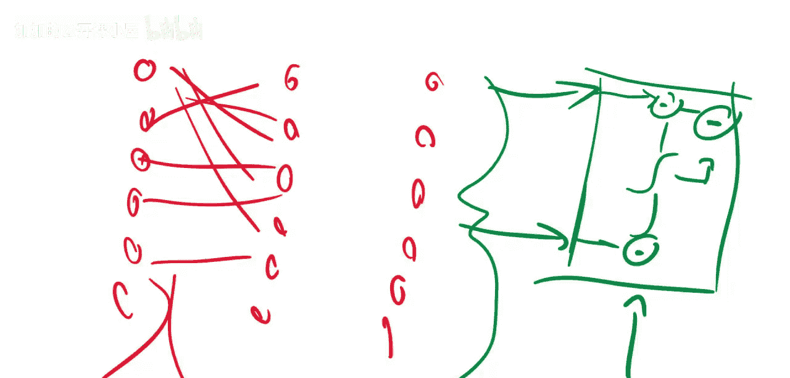

What you have to do is you'll have to go take that cell that you have dreamed up。 You think， well。

 I think that's a good cell。 And you have to train it on the full training dataset。 This is a data。

 a database， right， This is a full training dataset。

 Then you need to evaluate it on your validation data。 And then you have like a number。

 You have like， okay， this is8 good。 And then you go back。 and you say， okay。

 what if I change this cell here， What if I change it to a plus instead of a minus。

 And you do the entire thing again， train it for， I don't know how much validate it。

 And then this is like a 9。 And you can say， oh， cool， that's a 9。

 So this is a very basic architecture search， And there has been a lot of。

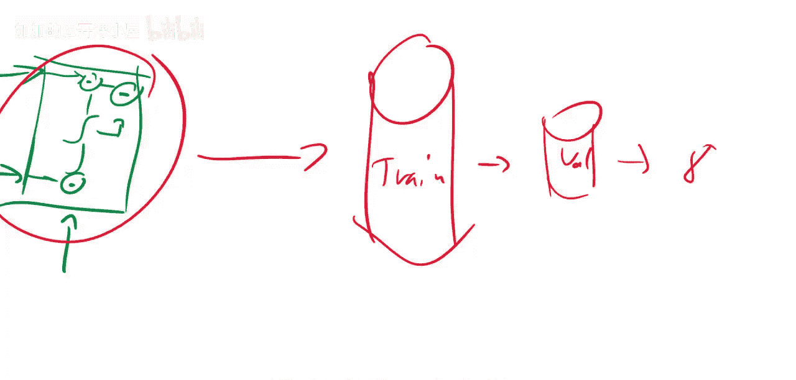

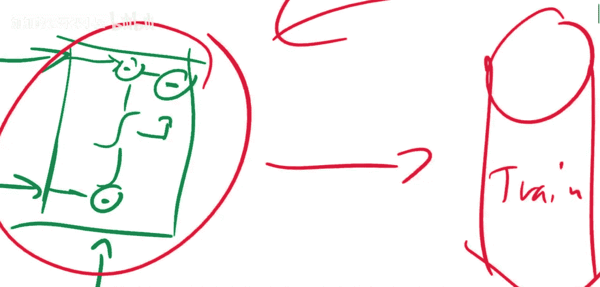

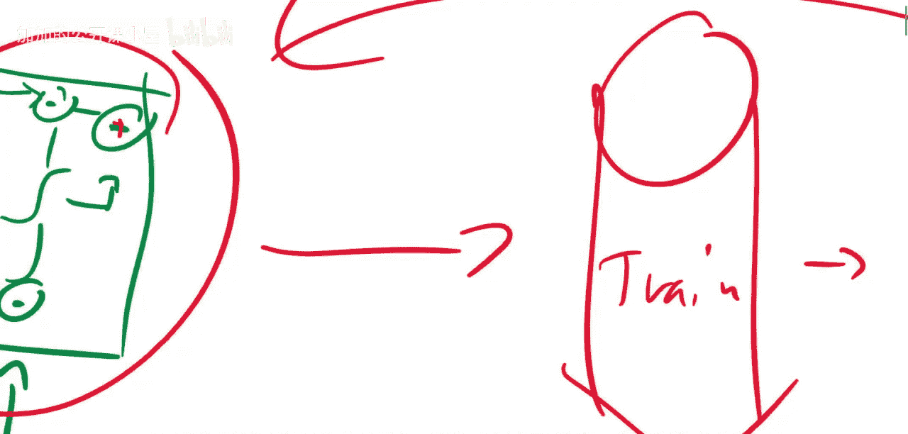

Development in this space。 So like evolutionary search and so on。 But they most of the time。

 they require pretty much evaluating the entire thing on the full data。 So you get a good。

 you get a good estimate of what your final performance back here is going to be。Now。

 people have come up with methods to counter that and they say， well。

 if we can sort of encode the cell structure， let's go with the let's go with the R and N cell。

 if we could encode the cell structure in in a sort of continuous way。 So， you know。

 we can encode text in a continuous way。 let we could also encode a cell structure because the cell structure。

 I can write it down as an equation， I can say like okay。

 it's the forget gate of the carry times the sigmoid output of x plus the so this is the plus here and plus the sigmoid output of X multiplied by the input let's call that I something like this。

 This is text。 I can like write it down。 and then I can encode that into a vector much I can。

 for example， build another R and N ironically or or something to。

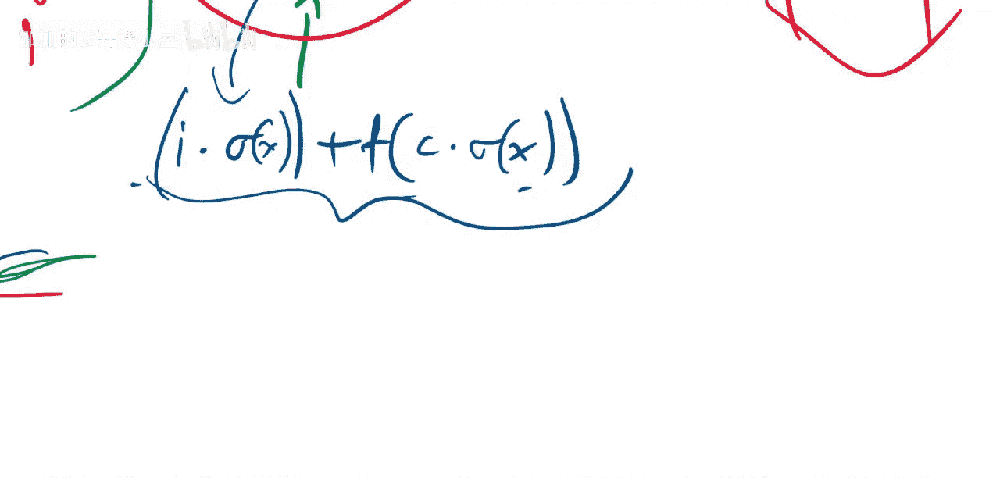

U。To encode that， or I can represent it as a computation graph like it is here and use a graph neural network to encode that into a single vector。

 And then I have sort of an embedding space where each。

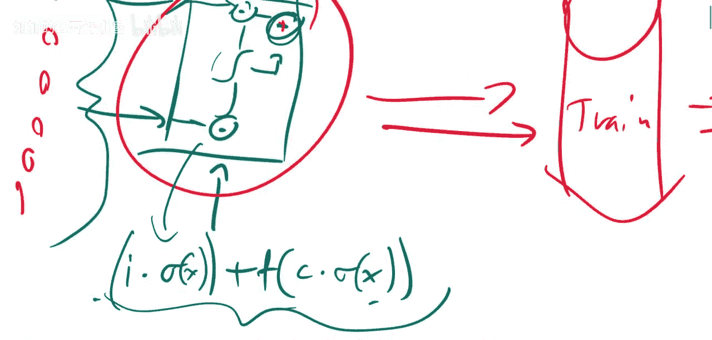

Seell that I could build is a point in that embedding space。And then I can evaluate a couple of them。

 I can， for example， say， okay， this one here， this one here， this one here， this one here。

 I'm going to train them， this cells， I'm going to do the full training eval and so on。

 get their scores。 and then I can learn。Basically， in this latent space， I can learn a predictor。

 I can say， okay， here I get， I got an8， I got a9， I got a2， and I got a4。

 So it appears to be that in this direction， the the good cells are in this direction。

 and then I can do it again。 I can sample or I can do gradient descent in this space since this is now a continuous space。

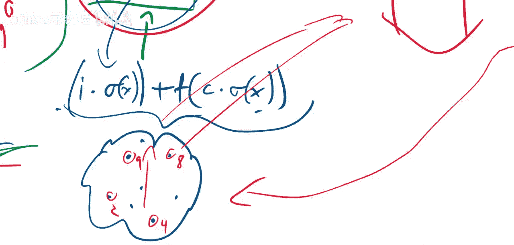

Aular gradient descent on the model that gives me the space。 So right， So this。

 this method basically tries to take in the building plan of a cell and learn to predict the performance just by looking at it if。

 if you're thinking of the a touring machine right now， then you like I。

 I immediately thought of like this， this halting problem because it appears to be exactly what it is。

 So you're trying to build a machine that takes the building plan of another machine and tries to predict its performance。

 Now， in， in a general sense， we can。

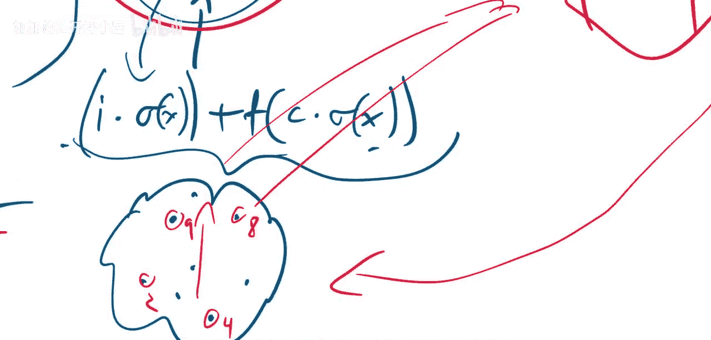

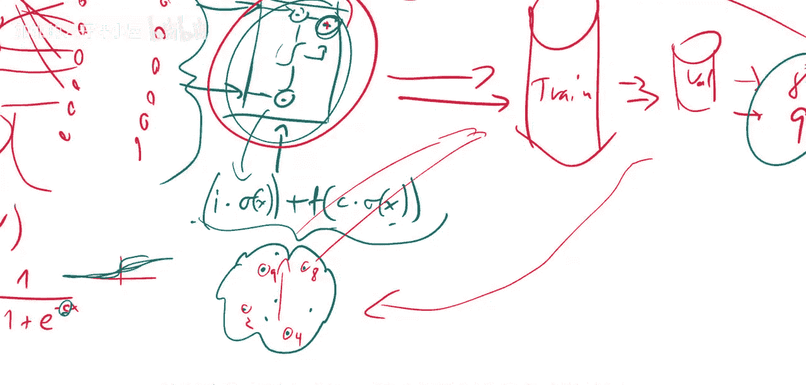

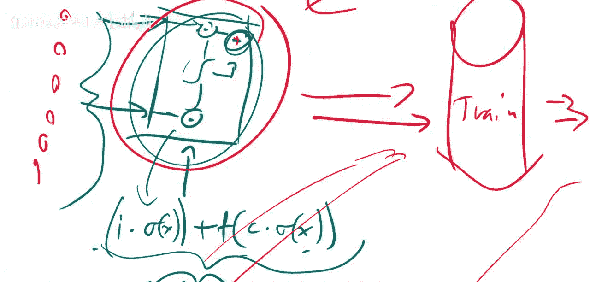

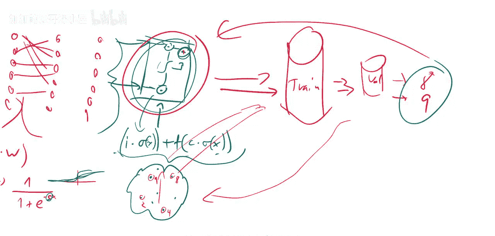

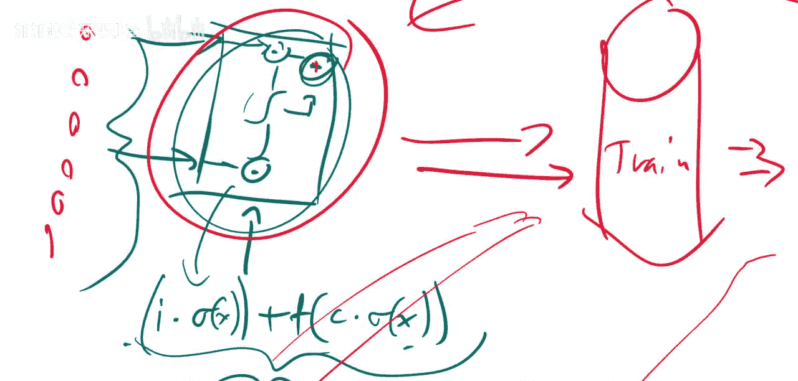

Already states that this problem is sort of。The difficulty of this problem is equivalent to the difficulty of the original problem。

 So I'm not sure， but it appears to， you know it appears to work if you throw lots of compute at it。

 but of course that's a problem。 You need lots of compute。

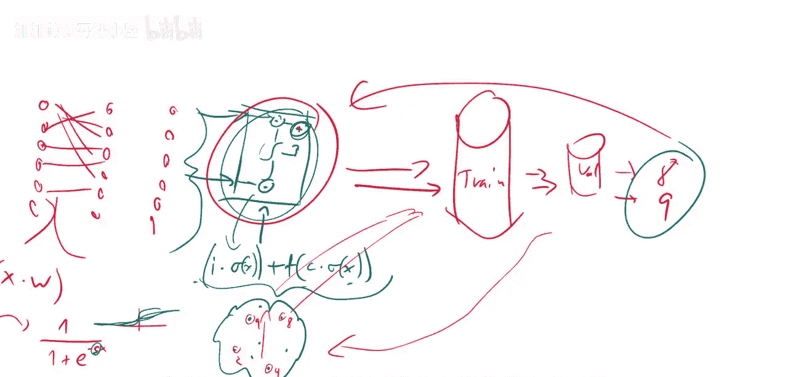

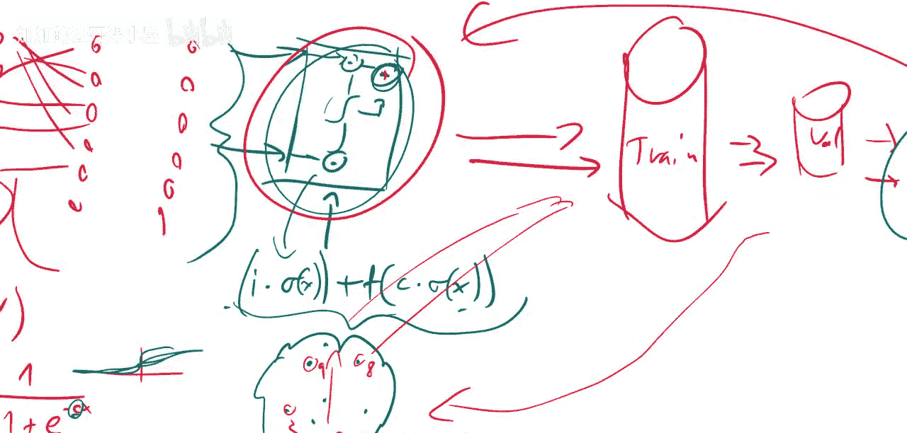

Right so either your your option one is to run all of these things and kind of iterate them in a neural sorry in an evolutionary way or your second option is to take the building plan and predict the performance from that。

 Both are not satisfactory and both use lots of compute Now。

 neural Peri dish is a or synthetic petri dish is a way to combine the two together。 It says， can we。

Take the building plan here， but actually run on the data on data to predict the performance。

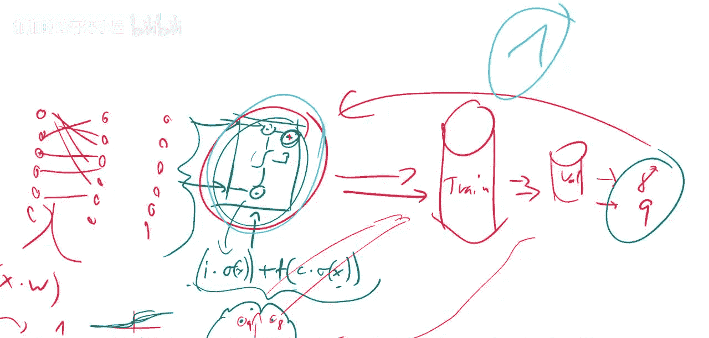

So。

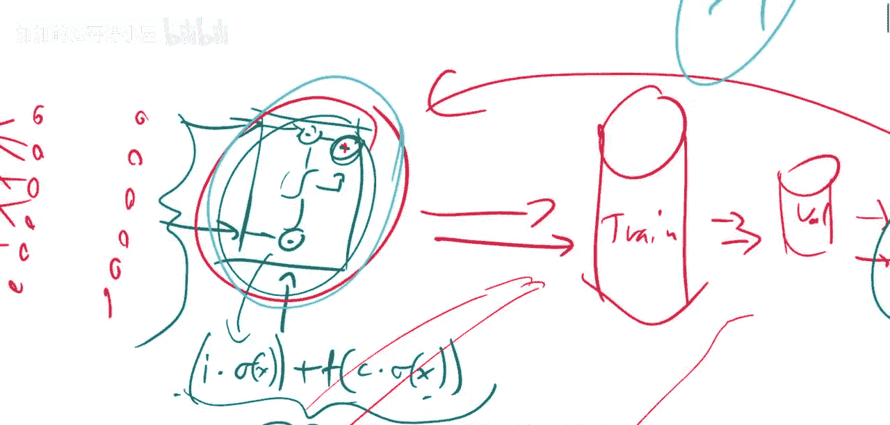

What they're saying is basically， if I have this cell right here。 and usually this cell， you know。

 it deals with vectors of， let's say， size 512 and so on。It will say it since this is。

Let me draw it again up here。 So here you have the cell。

 and here you have somehow the connections in there when you carry and the input and the input here。

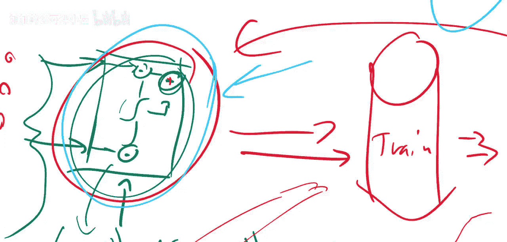

Okay， and this is the output or the carry。I have 512 embedding like size of this。

 So this is a giant cell。 There's 512。 The vector has 512 dimensions going in。 Basically。

 Can't I take the exact same thing。But， and keep the connection pattern。

 So I would keep the entire pattern of connection right here。 But I only do it for。1 or 2。

 So this is 512。 And this is just 2， right， just the the， I just reduce the dimensionality。

 But I sort of keep the connection pattern alive。If I only do that。

 I have like a very small network right now and the same goes for if this is so a lot of times these RNNs。

 they have multiple layers of these things， so theyd have another exactly equal box up here and then another up here。

I can just reduce this to one layer and out of the regularity of these neural network things。

 it is known that or one can make the assumption that the performance on this thing will sort of kind of be correlated to the performance of the entire thing。

 and that's one of the things that this petri dish paper does。

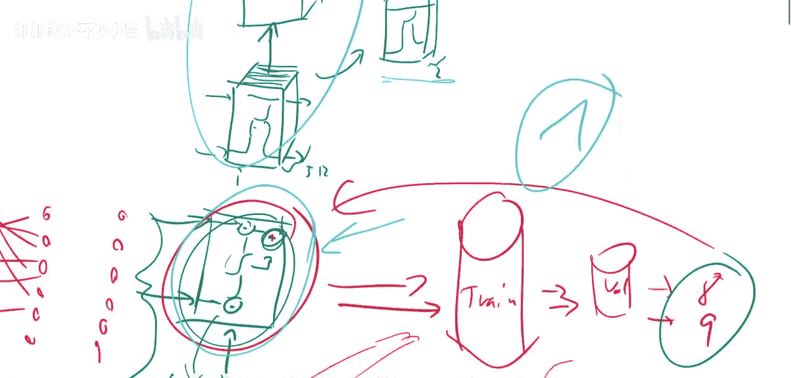

So we try to take out what we are trying to search over， namely the connection pattern。

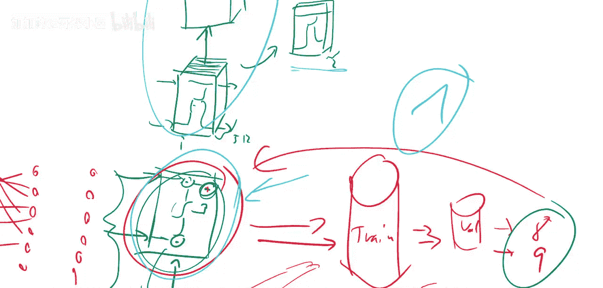