# YannicKilcher【中英⚡AI经典论文领读(全203篇)(上)｜Papers Explained】 p27 P27 BLEURT：学习文本生成的稳健评价指标（论文详解） [BV1o3xLznExj_p27]

Hello there， today we'll look at Bt， learning robust metrics for text generation by Tbal Salaam。

 Ti Panja Ds and Ankor P Par。So this paper on a high level proposes a new metric for text generation tasks such as machine translation by leveraging a BRT model to produce like an automated metric and automated quality metric。

 and they make this BRT model robust by pre-training it on a very wide array of tasks that they can use synthetic data to train it。

 and therefore the model and resulting score is very robust to shifts in distribution and they advocate that this could be used in the future to assess text generation systems。

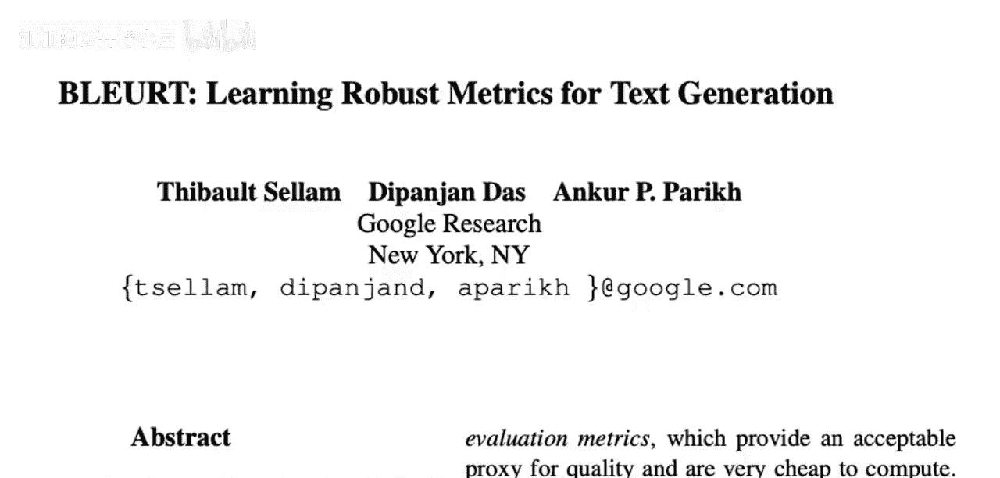

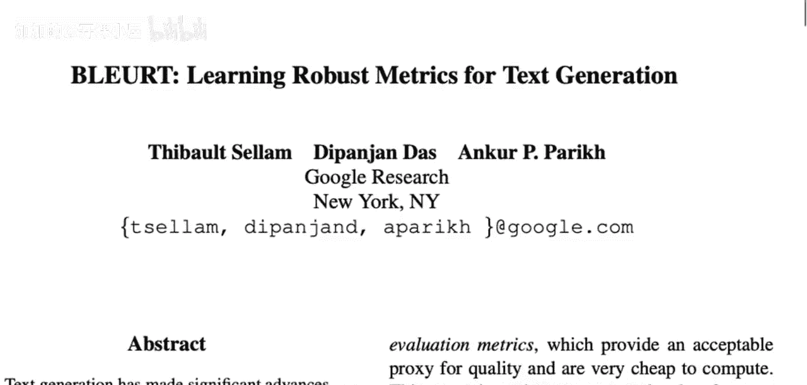

All right， as always， if you like content like this。

 consider subscribing and sharing it out and leaving a like， tell YouTube that it's good content。

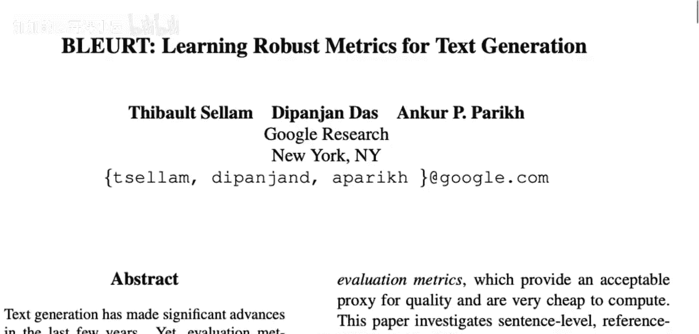

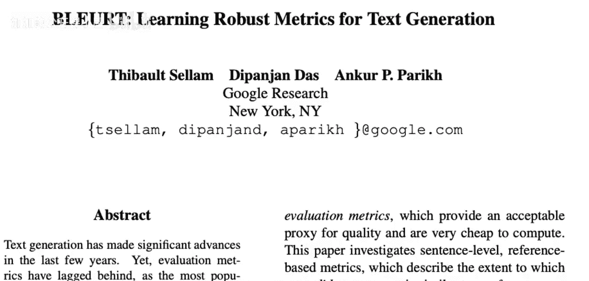

Of course， only if you agree。

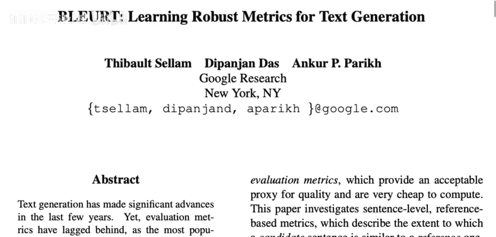

So what's the problem with with evaluation for text generation so if you know the machine translation community basically what they do is they have these data sets where they translate from one language into another。

 let's say English to French。

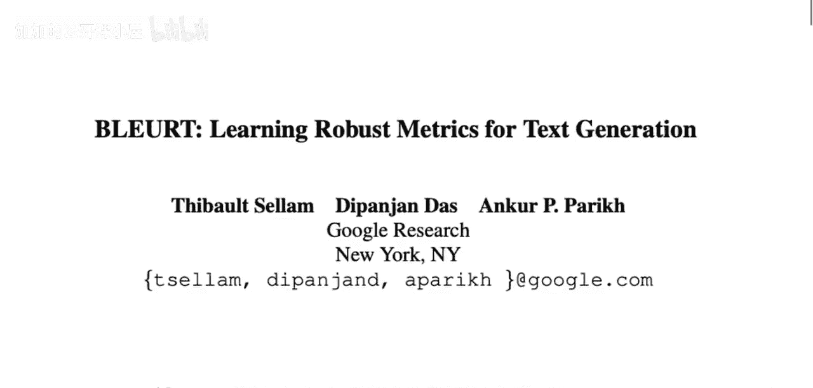

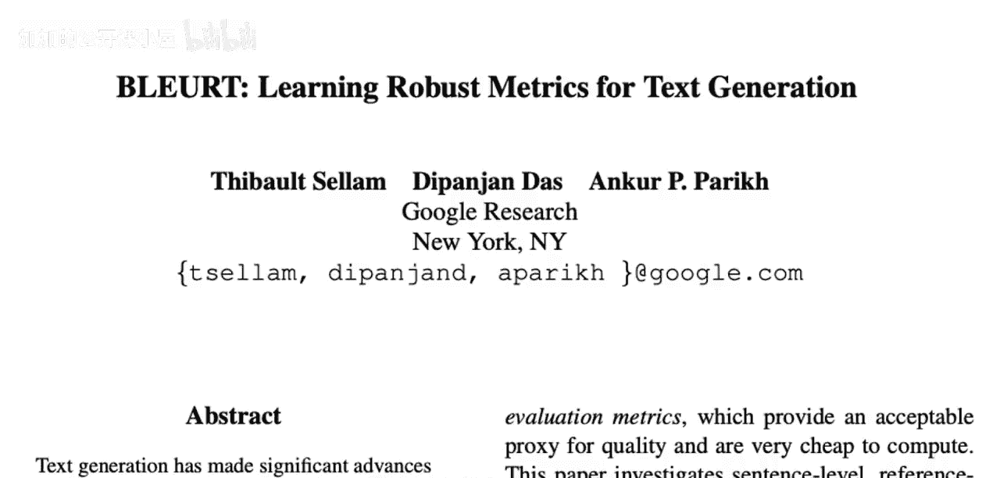

And they have a training data set that is fairly Oishly large。

 And then they somehow need to evaluate this。 Okay， so you have like a test data set。

 But all you can really do is sort of。

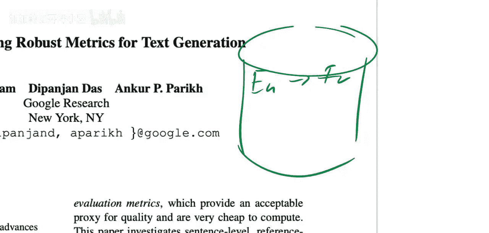

Calculate the perplexity of a language model that you produce or of a translation model that you produce。

 There' is not really a metric for translation。 So the gold standard is to get it to humans。

 So you train on this data set。 You produce a program。

 Let's This is your machine translation program that you produce from the data。 and you。

 you let this run on your evaluation data set， and you give the results to a bunch of human raters。

 these could be regular people。 These could be linguists that are experts in in translation in both languages and they will score the each of the outputs of the machine translation systems。

 and at the end， you will get like a number like 8。 your system is8 good。

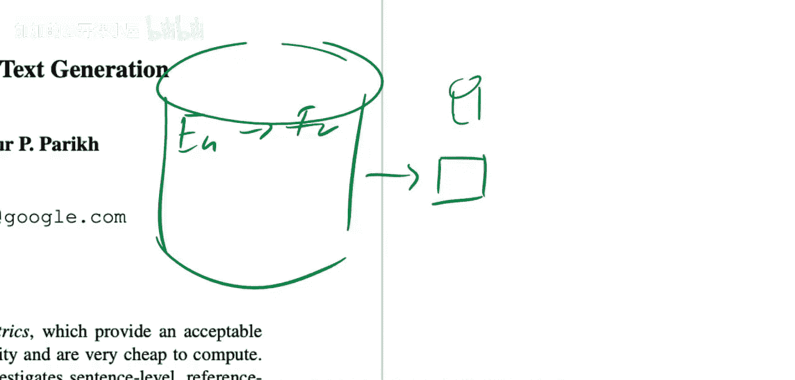

The problem， of course， is this process is very， very slow。

 so the machine translation community does this every year and it its quite slow and it's quite expensive as you know it requires these humans here to assess all of these systems output and you want sort of a sizable output right。

 because you want sort of a good sample of the machine translation system。

So this is not really satisfactory， but like an automated score like perplexity is also not satisfactory。

 what people have done is they've come up with proxy scores for the humans and two of those scores are called Rouge and blue and specifically blue。

Is one of these metrics that people use and it it kind of it takes ngrams in the sentences。

 So ngrams would be like snippets of like let's say four words after one another and there would be these snippets and that the machine translation system produces and then it would go into the validation data set and look at the gold standard translation that it was also produced by humans and it would also look at these snippets of size4 and it would just kind of assess how many of the snippets overlap。

 Of course， the machine translation system has never seen the label like the gold standard for that particular and otherwise it wouldn't you know。

 be fair。But you basically compare ngrams of output and gold and some gold standard。

 You can have multiple gold standards and so on。 So this blowmetric is more of like a heuristic。

And it has been found to correlate fairly well with the humans up until recently， of course。

 with the explosion of neural machine translation and especially Transer based machine translation。

 I guess， and but also their， their system that use LSTMs with attention。

 these systems have become extremely extremely good。 I don't know you notice。

 but Google Trans has been getting better and better really fast。

 I remember the the first years of Google Trans when people still made fun of it。

 I don't think many people make fun of it now， at least it's not a meme anymore。

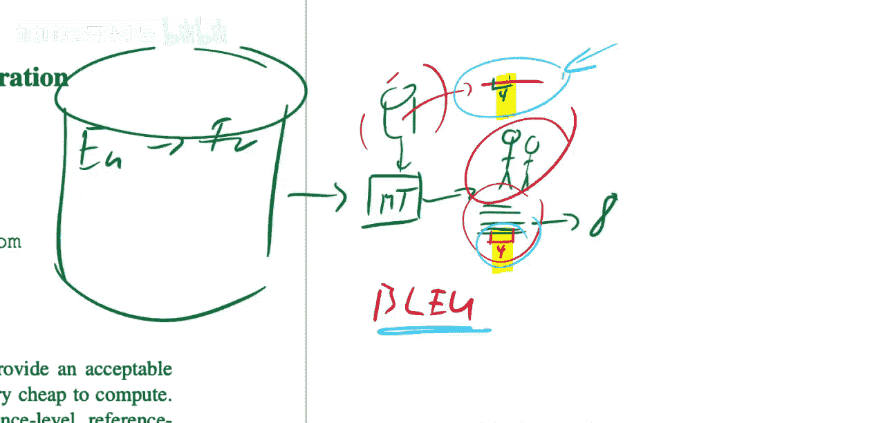

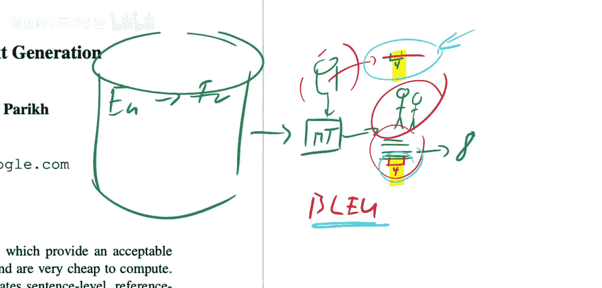

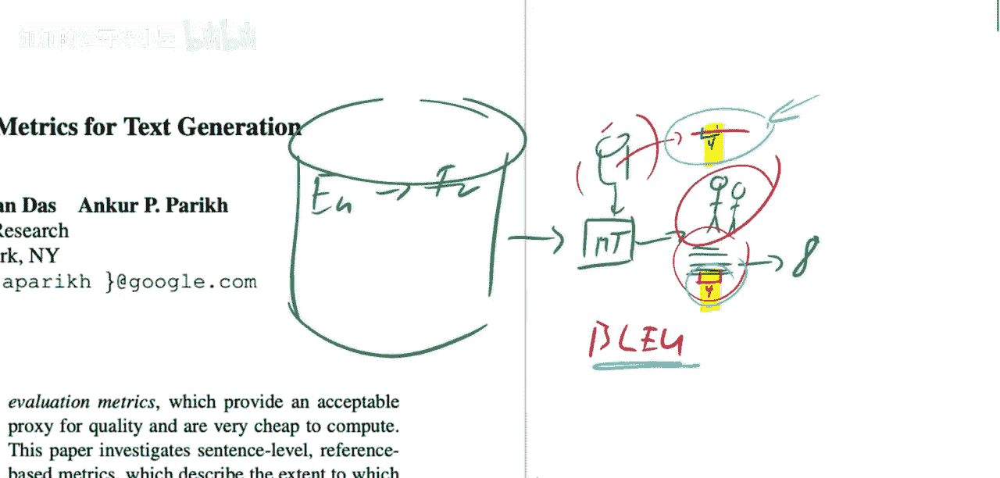

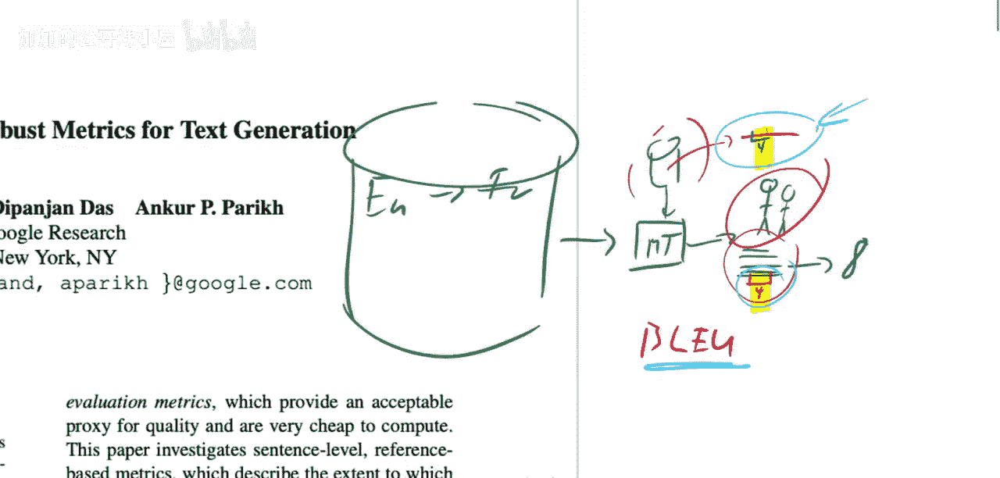

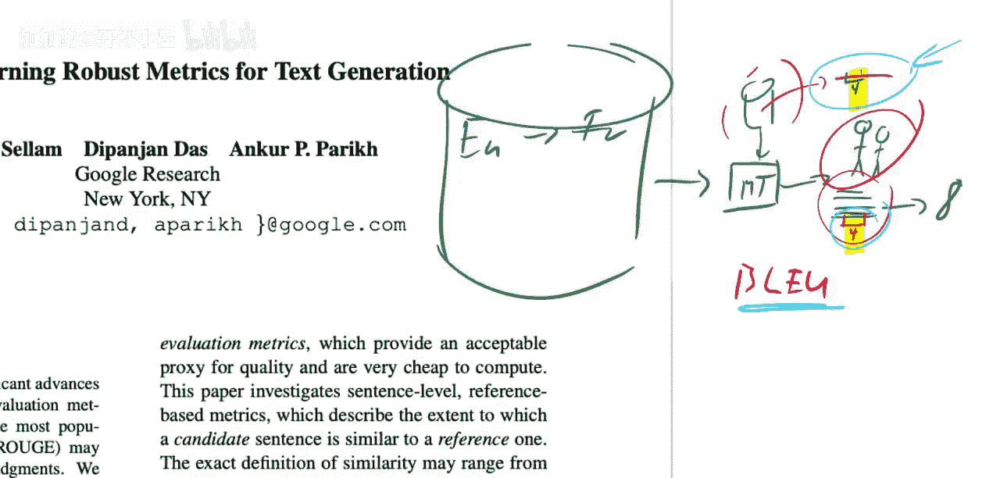

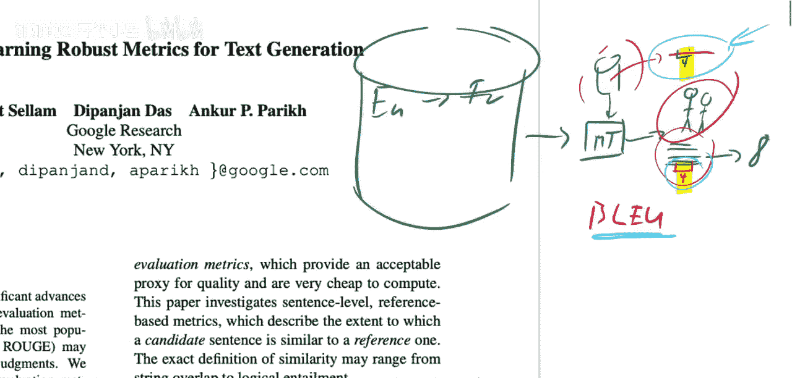

So。the better and better these systems were， the more these metrics like Blue and Rouge have diverged from the humans。

And they're not really reliable anymore， especially if you compare really high skill systems to each other。

 blur tends to not correlate well with humans。

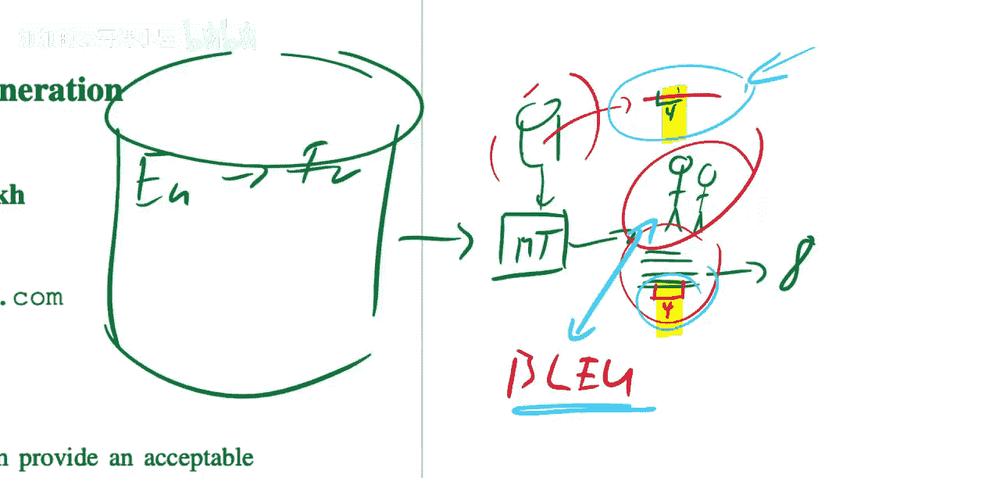

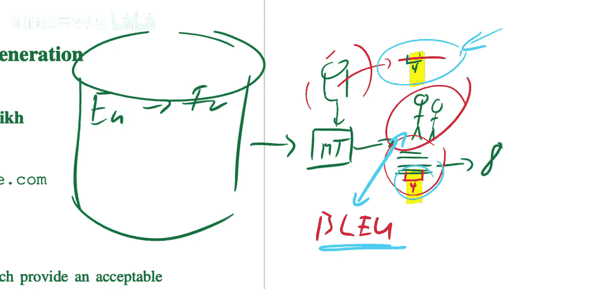

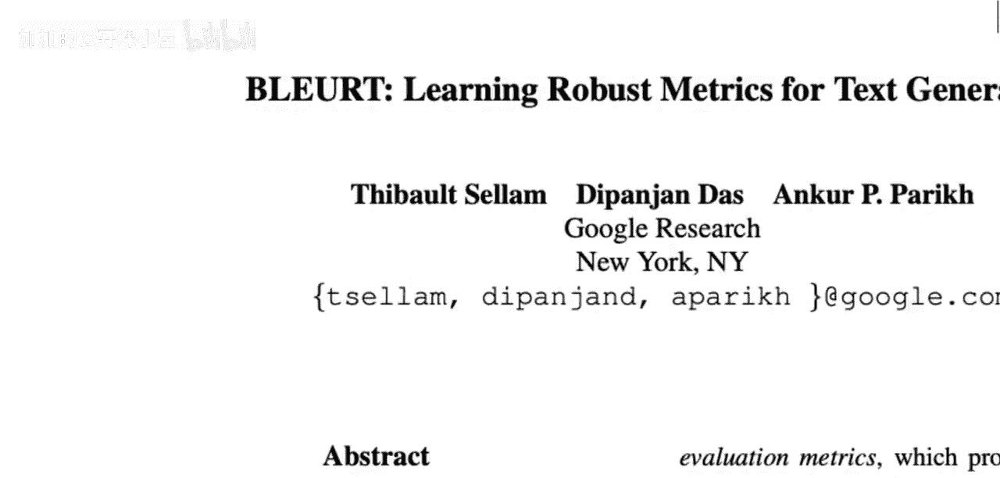

And therefore， we're looking for a new metric， a new metric that correlates well with humans。

 but can be evaluated。

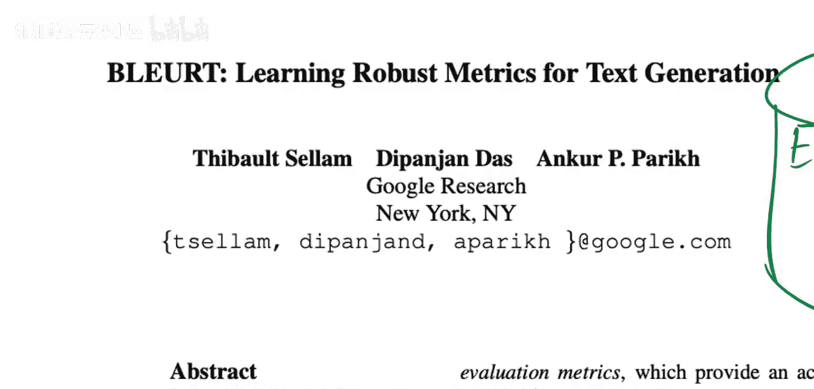

Automatictically。And this， this paper here proposes this blurt。

 Can we just stop with the variance on bird， We get a use bird for everything， but， you know。Yeah。

 so they say it's a learned evaluation metric based on BRT that can model human judgments with a few thousand possibly biased training examples。

Okay， so what， what you what you would do。In these cases is now the。

 the creation of a metric becomes a machine learning task itself。

 So what you'll have is you'll have a data set of。Things that are gold standard translations by humans。

You will have。The output of the machine translation system。 Okay， you put them together。

 So you have the gold standard sentence。 This is， this would be the optimal translation。

 You'll have whatever the machine translation produced。

 and then you'll have a human look at it and create a score like this 8 right here。 So it says this。

 these two sentences。 they match。8th good。Okay， so so eight， maybe it's out of 10。

 so this this bottom thing is a very good translation for for the top thing。

 like to match the top thing or。

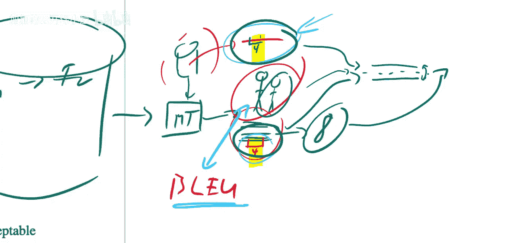

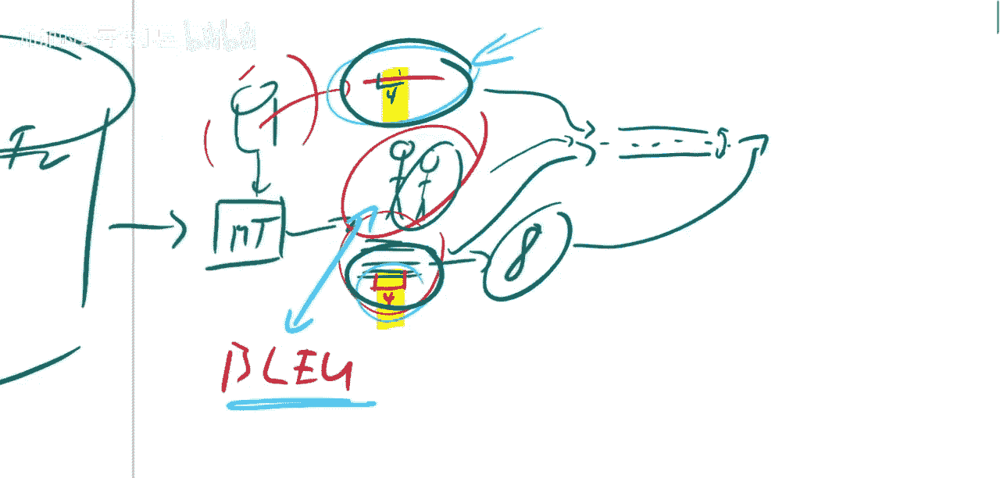

The human assesses the quality of the sample。 and now you have a training data set， right， you have。

A。Z， they call， I think this Z and Z tilde or something or y。 Yes， this is。日日。They call this y。

 which is the gold standard label， this is y tilda whatever the machine produced。And or X， X。

 X tilde。 And then y is the label。 So your task is now given X and x Tilde。

 predict whatever the human would say about this。 Okay。

 so if you can collect a few of these samples right here of different machine translation systems。

 then you can formulate， you can make a data set out of this。 right。

 and formulate a machine learning task。

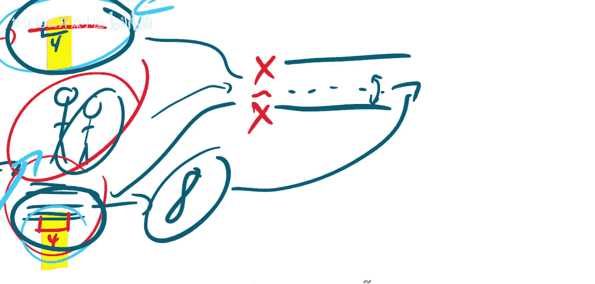

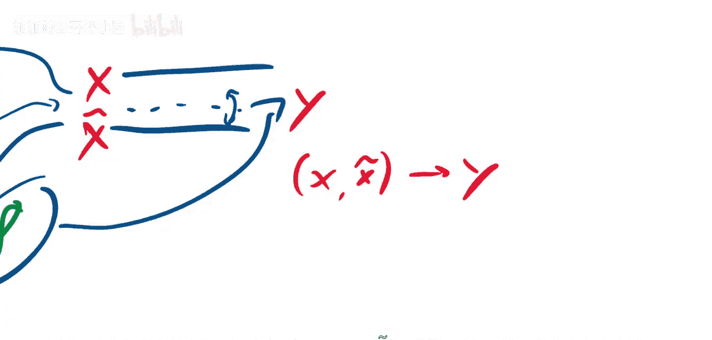

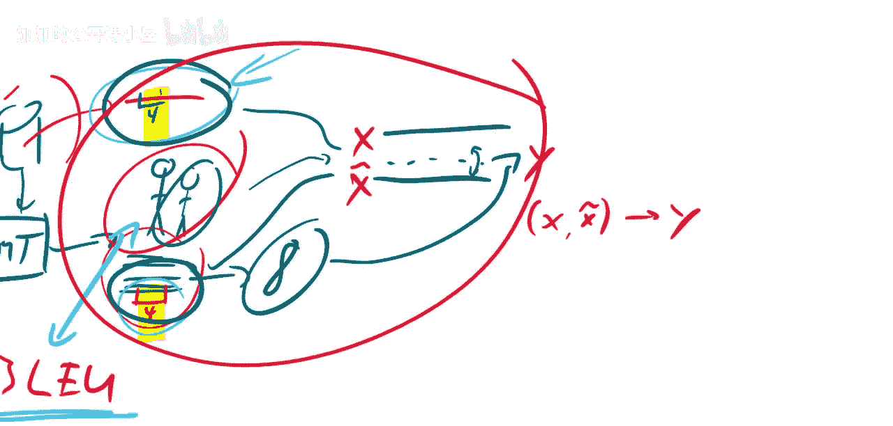

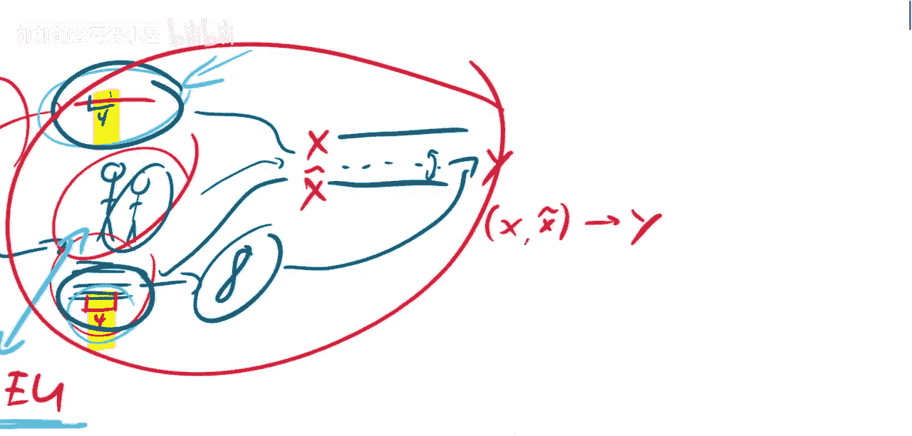

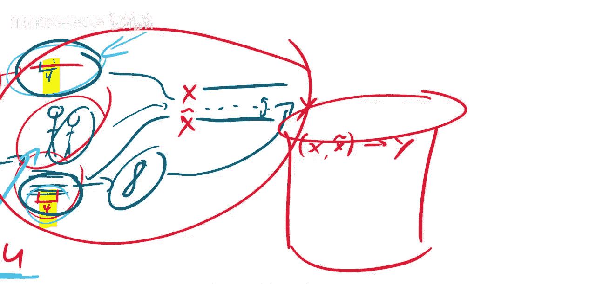

AndThat's exactly what these competitions have done， so it's like a meta competition now can。

 it's a competition for designing the best metrics of the other competitions， basically。😊。

And of course， the difficulty here is that the data set isn't static because if you come up with a metric such as blue。

 let's say you come up with a better blue， you would want。

These other tasks to use it in the next years as well。The。

 the thing about metrics is you need to be able to compare to like previous years and so on。

 So you would want a metric that is still valid for other years and other sort of other slightly different tasks。

 and also for other machine translation systems。 So if you just learn on data from now from this year's。

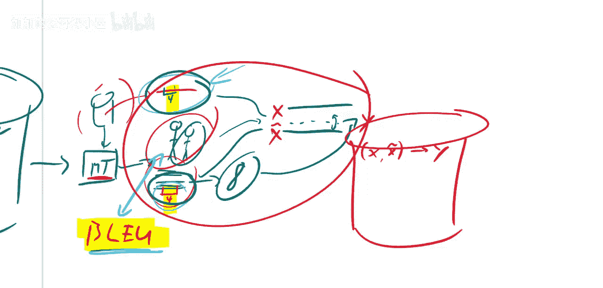

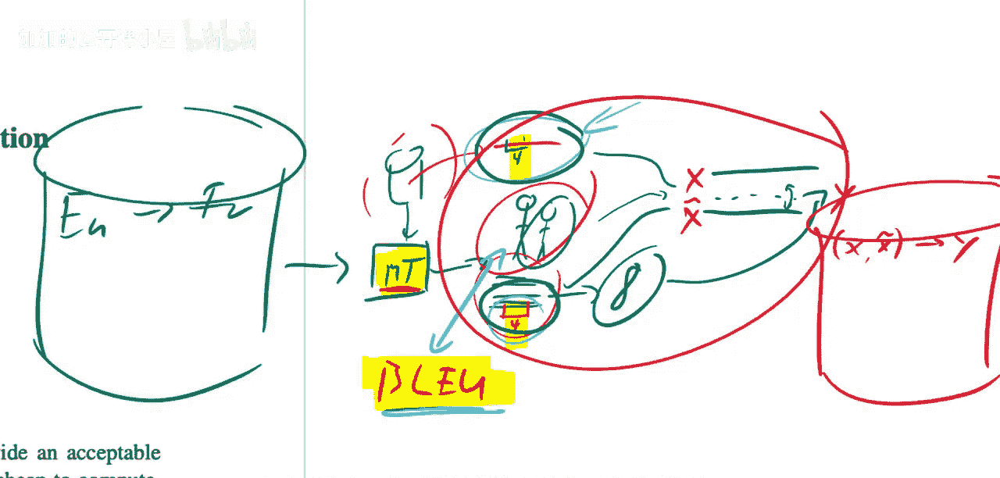

This year's competitions。 and in five years， all of these models will have become so much better。

 and they'll produce different output。 And that's the difficulty。

 Your metric should still be valid at that point。 And this paper basically deals with the。

Deals with the fact that can you learn such a metric from data that exists at one point in time that will be robust to shifts in distribution。

 So in five years， the machine translation systems， They're better。

 They maybe use different language constructs to translate certain things because that they assess that better。

 can you still make a good judgment about which one which of these systems is better than the other system。

 can you still assess how humans would rate these systems。

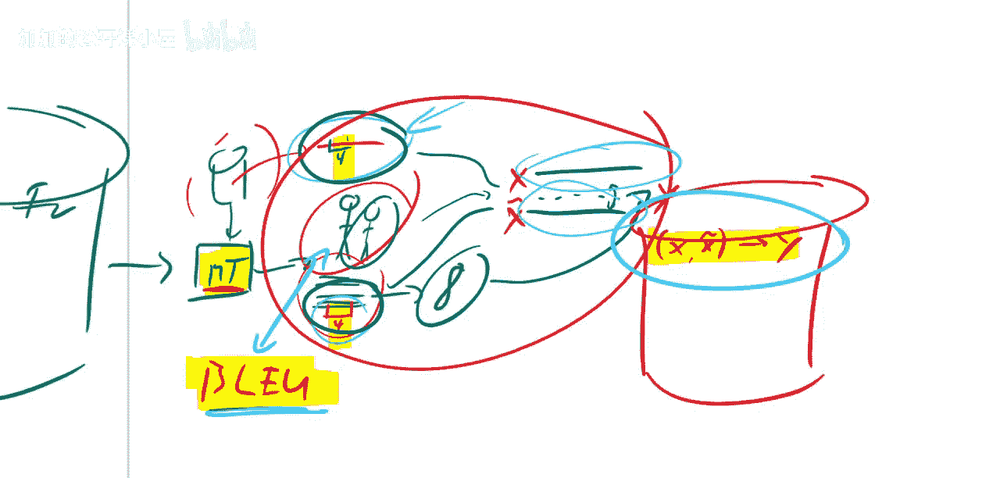

And they're saying that they found the method to do this。This blurt as as they said。

 not only have they found the method， but their method only uses a few thousand possibly biased training examples。

 and they do this via a new pretrain scheme So they say a key aspect of our approach is a novel pretraining scheme that uses millions of synthetic examples to help the model generalize Now why is it important that it only uses a few thousand training examples because these are generated by humans right and humans are expensive so and。

And it's not like like like Inet， you do it once you have it for for 20 years。

 This is done year after year。 and you need real experts， like translation experts。

 So this is expensive。 So the fewer of these actual training exam。

