# YannicKilcher【中英⚡AI经典论文领读(全203篇)(上)｜Papers Explained】 p28 P28 TransCoder：无监督编程语言翻译（论文解读） [BV1o3xLznExj_p28]

Hi there。 So the paper we're looking at today can take the code on the left。

 which is written in Python and can output the code on the right， which is written in C plus plus。

 Now the point here is that the code on the right does the same thing as the code on the left。

 So it is implementing the same function。 The surprising thing here is that this model that takes the Python as an input has never been explicitly trained to output C plus plus So this is an unsupervised translation model。

 And that's the cool thing about this paper is that by having no target at having no supervised signal at translating source code languages into one another。

 it can perform pretty well at the task nonetheless。

 So we're going to look at this paper it's called。

Unsupervised translation of programming languages by Maria An Lasux， Baptist Roser。

 Loig Shaniso and Jion Lompo at Facebook AI Research。

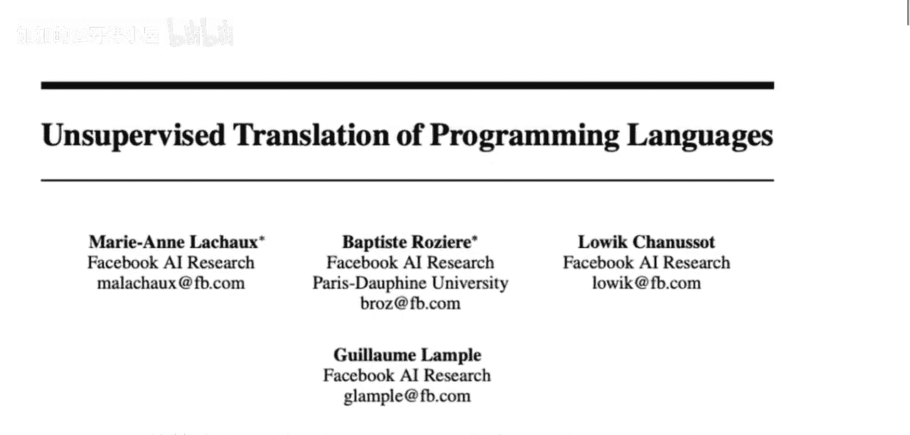

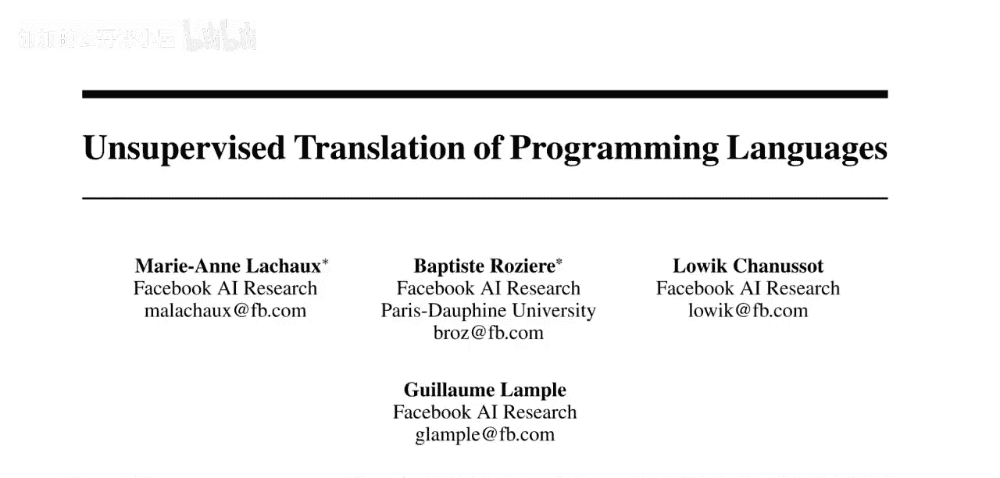

As always， if you like content like this， consider sharing it out and leaving a like and also leaving a comment if you have something to say about it。

They say a trans compiler， also known as a source to source translator is a system that converts source code from a high level programming language such as C++ or Python to another。

They say trans compilers are primarily used for interoperability and to port code bases written in an obsolete or deprecated language such as Cobal or Python 2 to a modern 1。

So for Python 2 you might know this tool that's called2 to3。

 so 2 to3 is a tool that ships with the Python 3 standard library， I believe。

 that allows you to take Python 2 code and produce Python 3 code。

 and that is to kind of push people convert their old code bases of Python 2 to the modern Python 3。

Now，2 to3 is handwritten program。 It has specific rules built in that the programmers know if we modify Python2 like this。

 Python 3 gets out。 for example， the print statement in Python 2 requires no brackets。

 So we make a rule that whenever there's a print statement with no brackets will add the brackets such that it's Python 3 compliant。

 most of this code will transfer， transform the source code first into an abstract syntax tree modify that applies specific rules to that and then output the language from the abstract syntax  tree。

 Now， the problem here is manyifold。 first of all。There there can only be so much translation as there are rules。

 so every one of these rules has to be coded as a modification to the abstract syn texttry。

 and every one of these rules is handcrafted and therefore needs sort of human ingenuity。

 humans need to go and write these rules of how to transform one language into another。

And oftentimes this doesn't even though you can write these rules。

 oftentimes whatever comes out is sort of a bit of cryptic source code because you kind have to make sure that your rules cover all the possible things and the source code that comes out is oftentimes very cryptic and a bit hard to understand because it's been sort of expanded and formalized to make sure that it still does the same thing as the original source code。

Now for Python 2 to Python 3， this is still easy right。

 these languages are extremely similar because it's not that big of a step to Python 3 except if you use very low level language constructs or language features which have been obsoleted with Python 3。

On the other hand， if there's something like Cobalt。

 So a lot of this old banking code or insurance code or government agency code whatnot is written in these really old programming languages and they've been kept alive by these old school programmers that are slowly but surely all retiring now And there are just not many new programmers around that can support these languages and the languages themselves aren't really updated that much anymore。

 So you would like to transform cobalt into something like I don't want to call Java modern programming language but。

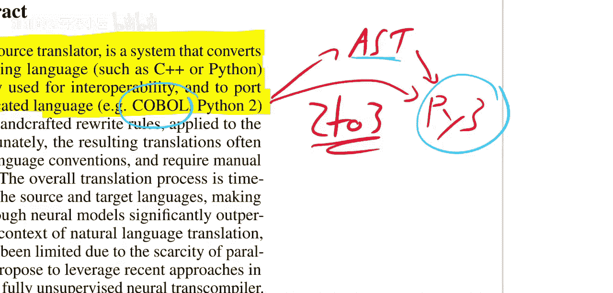

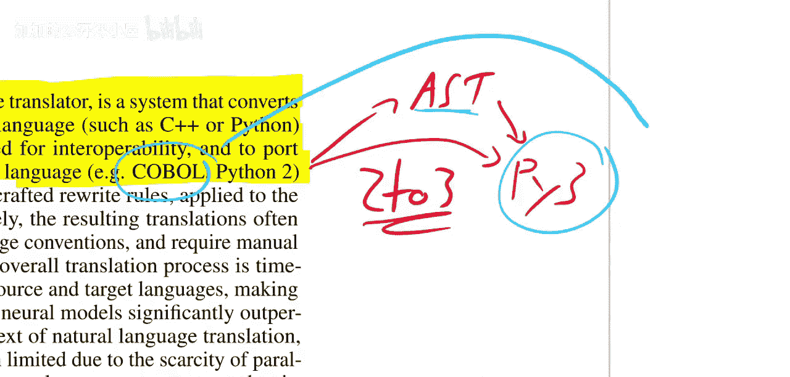

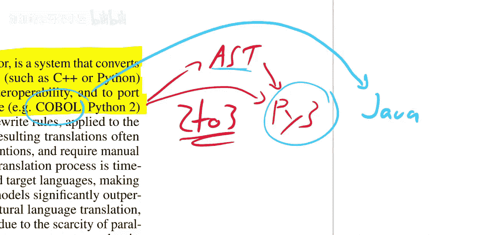

It is used in modern times。 I'd rather not call it modern per se Java itself is a beast that's been sort of supported since forever。

 but in any case you would like to transform something like Cobalt to something like Java where you have a lot of programmers that can develop and further develop your code。

 this is much harder。 Cobalt and Java are much more away from each other than our Python 2 and Python 3。

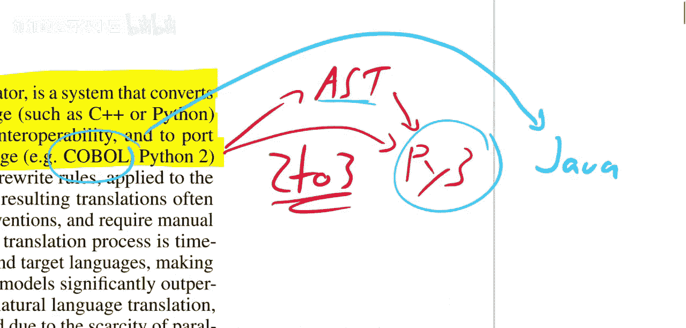

So what you would like to do is you would like to have a tool that is like two to three， but humans。

 because now if you want a tool like this， you need someone that's really proficient in cobal and Java in order to write a tool like this and you need lots of them and they need to invest lots of time What you would rather like to do is you would like to learn a system that translates from one language into another such that the meaning is conserved and this。

 of course， is exactly the domain of natural language machine translation except it's source code。

 So we all know that we've all realized in the last years。

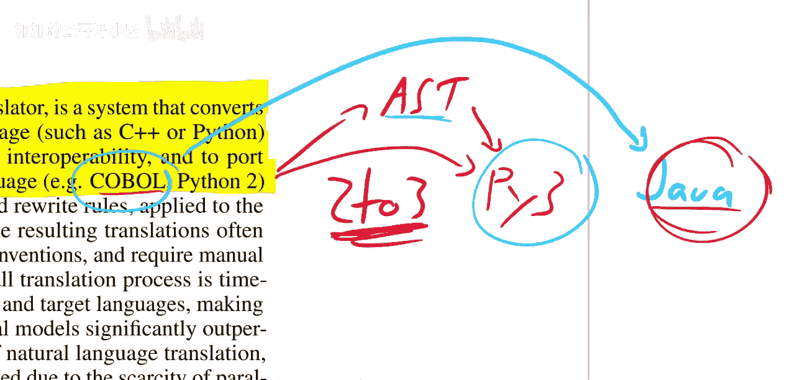

That things like Google Translate have become extremely good at translating， so。They say right here。

 although neural models significantly outperform their rule based counterparts in the context of natural language translation。

 which is Google Translate is all learned right now。

They say their applications to transcompilation have been limited due to the scarcity of parallel data in this domain。

 So what's the problem with just going and saying， oh， we you know。

 we can build really good neural machine translation models。 Let's just apply them to source code。

 The problem is， if you build a neural machine translation models。

 say something that transforms English to German。 So you have the word hello。

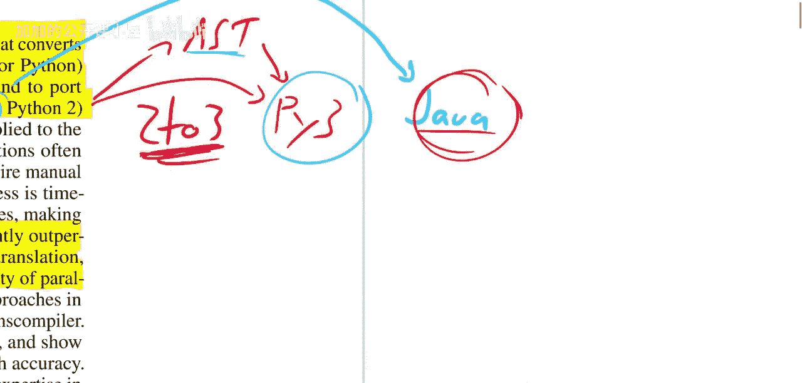

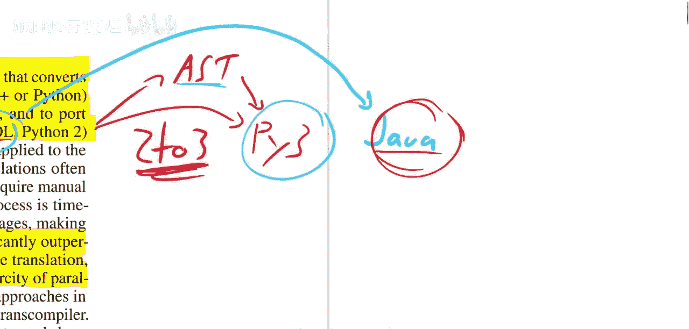

And you output hollow。You can do it not with just one word， but with entire sentences and so on。

 these models， they usually are in the classical sense， what they need are parallel corpora。

 which means that you have documents that are written。

In many languages and you can guarantee that they mean the same thing。

 So this is a supervised signal。 One example of this is let's say press releases of the United Nations。

 So the United Nations will make some press release and they will then have professional translators translate that press release into all of the different or into many different languages and so you can pretty much guarantee that these mean the same thing。

 So these pairs of documents or triplets or whatnot they are supervised training data for a machine translation model that translates from one language into the other and the neural machine translation models rely heavily on these parallel corra。

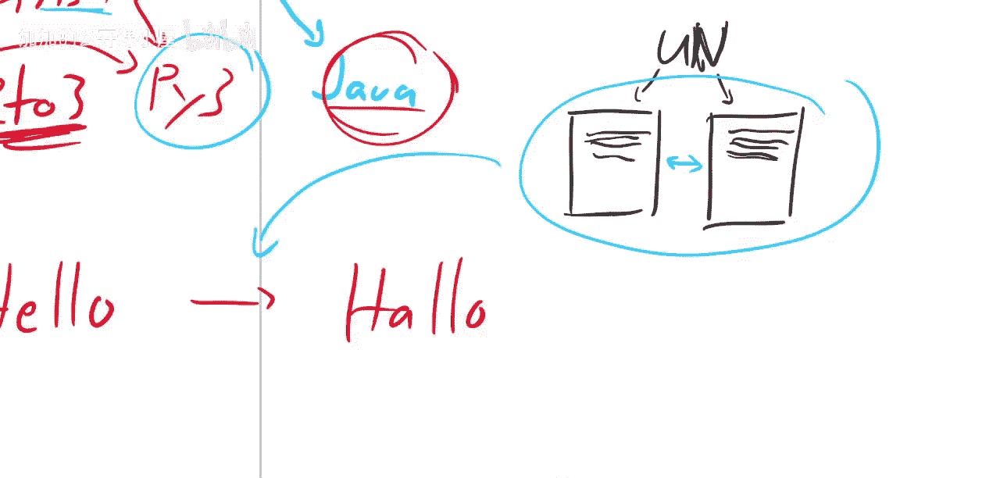

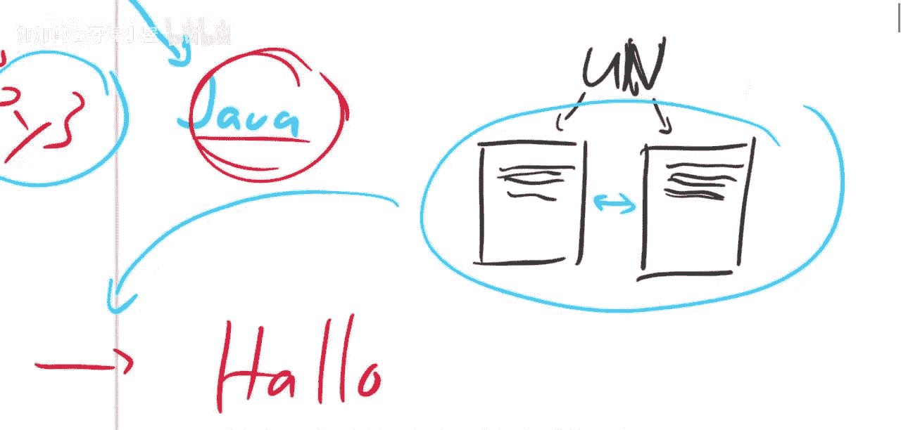

For source code， you just don't have that as much。 You don't have big code basiss in。

 in great numbers， where the exact same thing is implemented in one language and in the other language。

 Theres just not that much data available。 It is the case that sometimes。

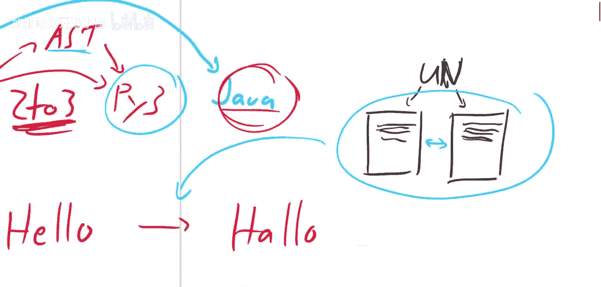

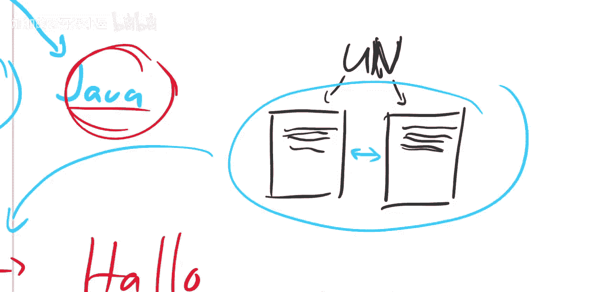

Sorry， that sometimes let's say in the case of torch。

 it started as Lua and then it went to Pytorrch and the developers had to translate the code from torch to Python。

 but in the same in the same step， they've also made improvements they sort of reengineered and reinvent it the framework and made it better and so you can't really say these are the same things。

 and likewise there's not a lot of code available where the same thing is implemented in two languages。

 so we just don't have these parallel corpora for the source code translation。

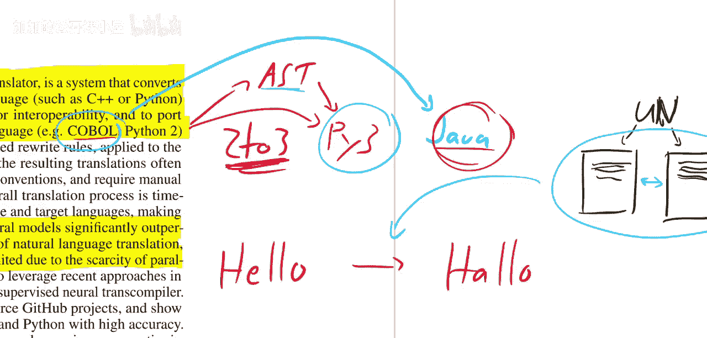

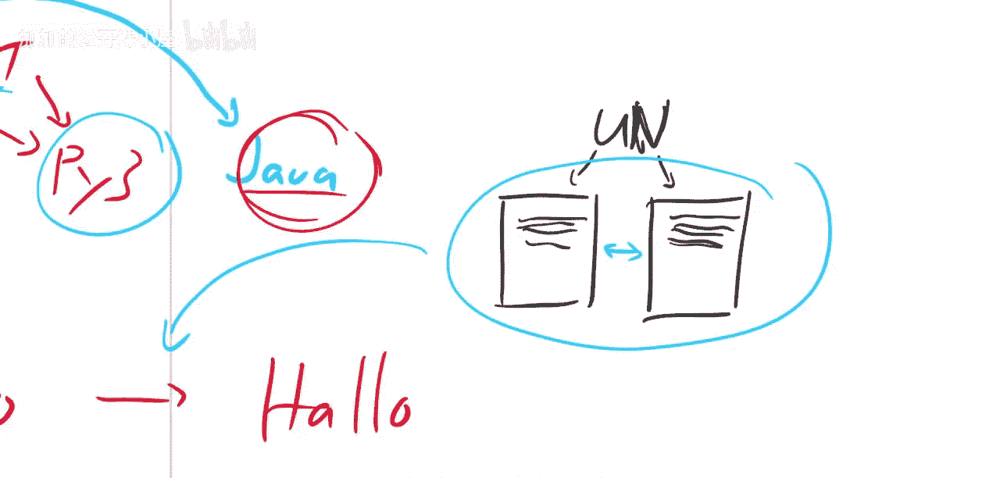

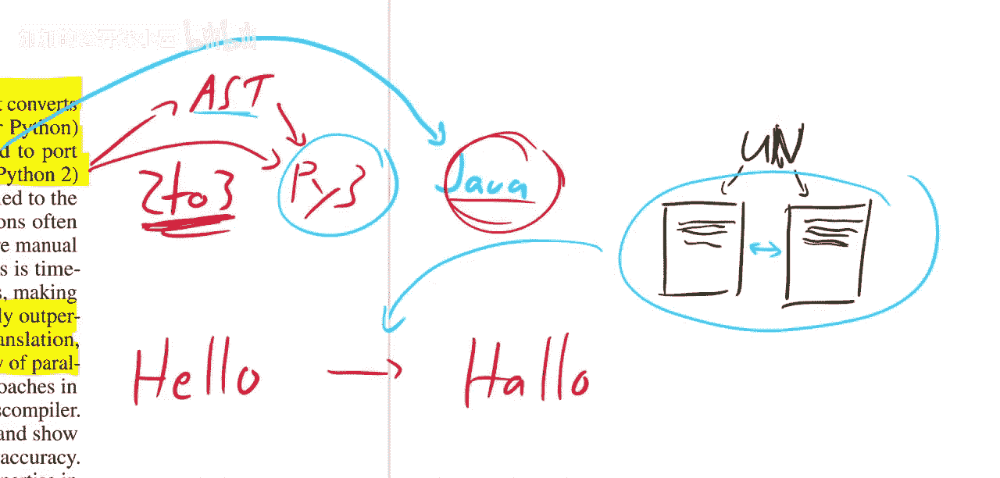

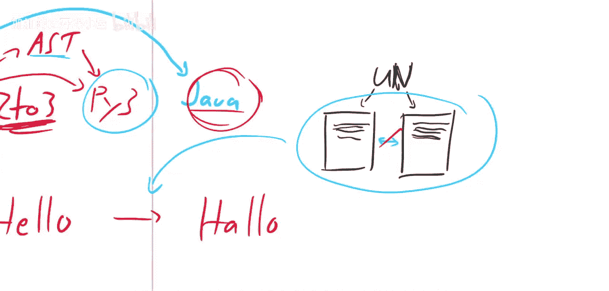

So rather， what this paper does is this paper goes into。

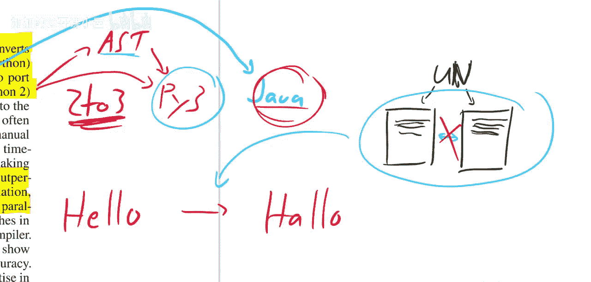

Unsupervised machine translation。 Now， what does unsupervised machine translation mean。

 unsupervised machine translation， you imagine I have just a big database of documents。

And these documents， I know they're all in English。Okay， and I have this other big database。

 and I know that they are all in German。 I just know their documents are in German。

 but they don't correspond to each other。 They're just German documents。 And over here。

 they're just English documents。 They don't， I don't say that these two here are somehow the same。

 No， I just have a bunch of German， a bunch of English。 They don't even have to correspond。

 They're just text。 And now what I want to do is I want to learn a shared embedding space。

 I sort of want to learn a shared space。Of embeddings for these two languages such that similar things are mapped to the similar place。

 So if these two documents just happen to talk about the same thing。

 I want them to be mapped to similar spaces in this shared embedding space。

 So I'm going to have one model， a single model where I input the text and it goes into this shared embedding space。

 Okay now。

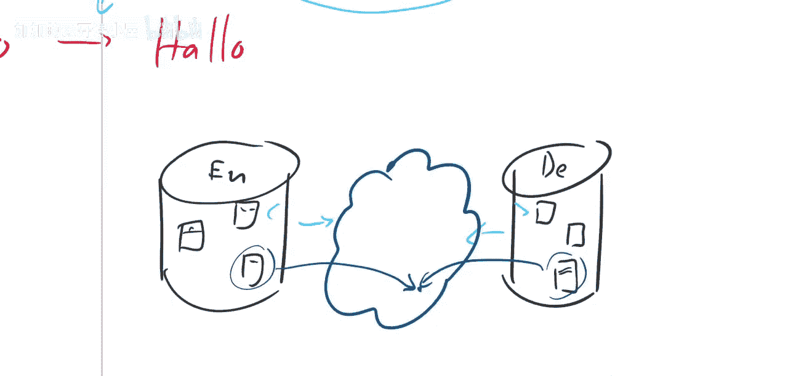