# YannicKilcher【中英⚡AI经典论文领读(全203篇)(上)｜Papers Explained】 p30 P30 Linformer：具有线性复杂度的自注意力机制（论文解读） [BV1o3xLznExj_p30]

Hi there。 Today we're going to look at lean formerer self attention with linear complexity by Son Wang。

 Belinda Lee， Madian Kaaba， Han Fang and Hama of Facebook AI。

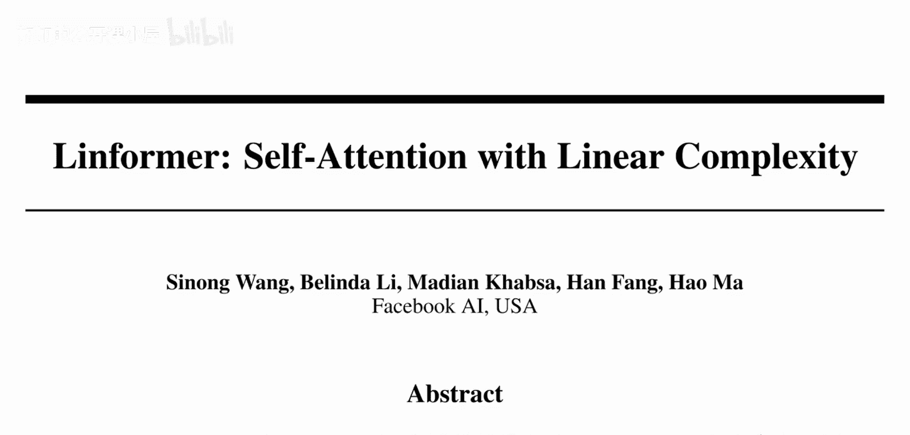

So on a high level， this paper observes that often the way we build transformers。

 the self attention matrix is low rank and can be approximated by first projecting the signal to a lower dimensional space and then performing these inner products that are responsible for attention in there and thereby you save a lot of the complexity of multiplying full sequence length。

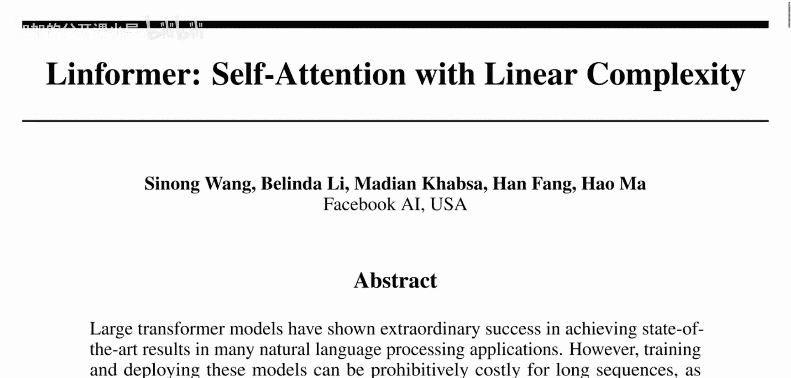

Full sequence length by full sequence length matrices。

 but instead do these operations in the lower dimensional space。

 and they achieve a linear scaling of the transformer attention。

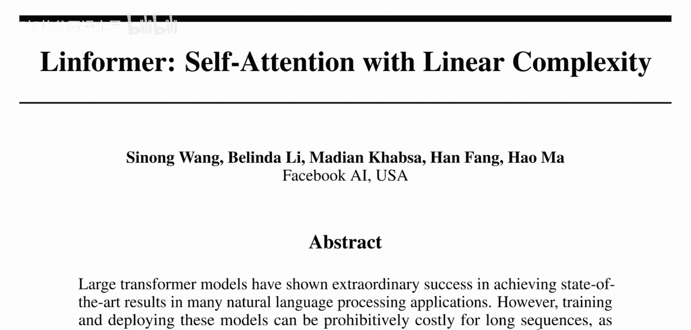

And we'll figure out how that is。As always， if you like content like this， consider subscribing。

 sharing， liking， and commenting if you feel like it。

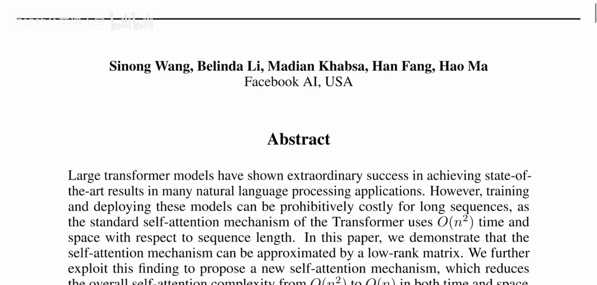

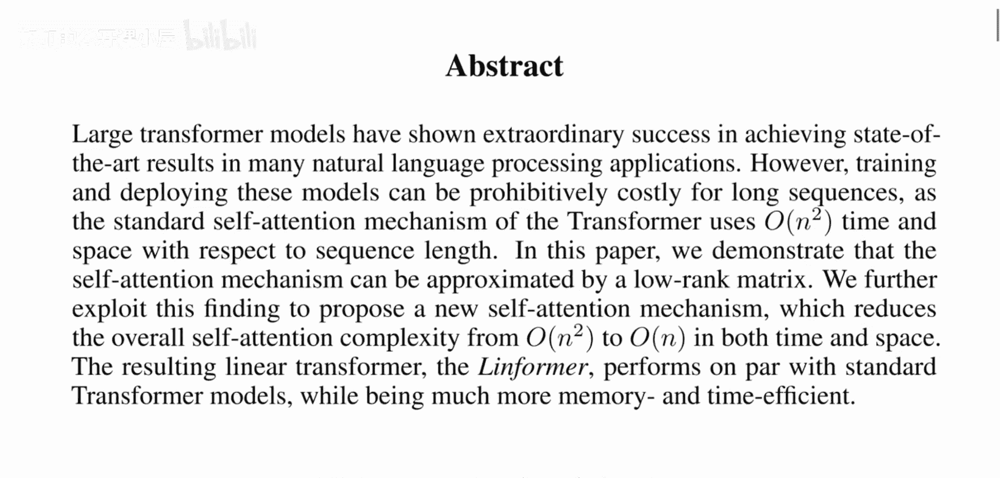

Okay， let's dive in。They say large transformer models have shown extraordinary success in achieving state of the art results in many natural language processing applications。

Okay， so these if you don't know what a transformer model is。

 you can watch my video on the paper attention is all you need that was sort of the beginning of these transformers and it introduces the attention mechanism that we're going to look at today if you don't know what an attention mechanism is you're not going to have a fun time in this paper。

They say， however， training and deploying these models can be prohibitively costly for long sequences as the standard self attention mechanism of the transformer uses n square time and space with respect to the sequence length。

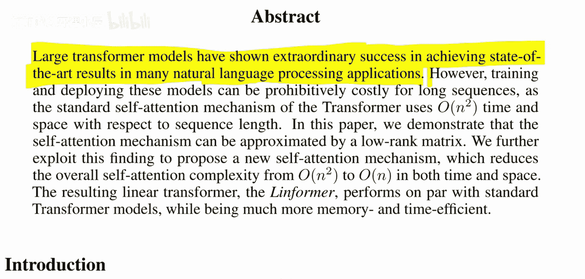

Now， why is that， So really shortly to recap recap this the attention mechanism， the these attention。

 these transformers， they transform for basics， let's say they transform one sequence into another。

 So here we have five tokens and。The next layer will output five tokens case for five tokens in。

5 tokens out。And the question is how do you route information between these five tokens from the first layer to produce the next layer in a feet forward network。

 you would simply connect everything to everything and sort of learn the weights of these connections。

That's not what we do here。 In a convolutional network。

 you would simply connect each node to its immediate neighbors like this。

But this is also not what we do here。 What we do here is we route the information according to the information itself。

 So according to the incoming information right here。

 we route the information that goes out and we do that by expressing。Kqueries and keys。

So this incoming information is transformed， first of all， into what are called keys。

 now keys are simply vectors， so each node is going to expose a vector right here。

And each node in the higher layer now these are produced by the same from the same information down here。

 but I'm going to draw it conceptually on the higher layer。

 so each node here is going to expose a query which is sort of like calling the query is calling for what kind of information do you want from the lower layer and the key is sort of exposing what type of information this node contains right now。

Now， the information is simply routed by looking at the inner products of these of the keys and the queries。

 So this information right here would probably be routed to this node right here。

 whereas this one would probably be routed here， This one would be routed here。 In fact。

 this is a soft assignment。 So it's not like a hard routing。 It's a soft routing。

 Everything is routed to everything with different weights。

 but the majority goes to the place where the inner product is high。 And this one is， again。

 routed here。 So you can see this is the attention mechanism。 in order to do this。

 We need to compute the inner product of every single one of these queries with every single one of these keys。

 And this， if our sequence length here is of length N。I's going to require n squared operations。Okay。

Now， here is another parameter。 we need to pay attention。 These vectors here。

 They have a certain dimension and the certain dimension we're going to call D， the inner。

 the embedding dimension of the vectors。 Now in modern transformers。

 you can think of n as something like。

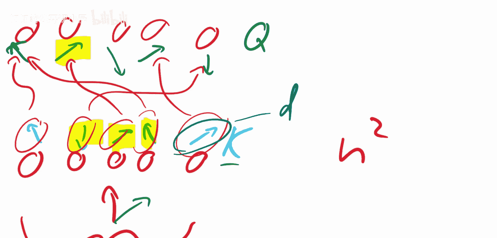

Maybe 512 tokens go into a transformer like this and the hidden dimension here。

Also is in the same order of magnitude， so you can also imagine this to be something like 512。

 Now if you think of these matrices， if you multiply the keys by the queries。

 however you want to let's do it like this， then you have the keys are N by D and the queries are D by N okay。

Now， since N and D in this case are the same dimension。

 this matrix is of rank that of rank 512 doesn't have to be。

 but it's a pretty good bet that it's of rank 512， maybe it's approximately lower rank， but。Now。

This isn't actually the modern way of transformers as such。

 because usually what we have is multi head attention。

 which means that we're going to split this inner dimension right here。

 We're going to split these vectors into many， many lower dimensional vectors。

 and then have attention mechanism on these lower dimensional vectors。 and that's so such that。

You don't only have one attention mechanism， you have multiple attention mechanism so you can route different kinds of information with these multiple attention heads。

Now， sometimes you would split this， you could split this in a modern transformer up to like 16 different heads。

 but here we're going to， let's say we're going to split this into four sub vectorctors each of 128 dimensions。

Okay， so we're going to split this up。 And now if this in this product here is only computed on these lower dimensional vectors。

 So all of a sudden。You no longer have n by D， but you have like n by d over 4。

And now this is 512 still， but this now is 128， so the rank of this matrix is going to be 128。

Mind it's still the thing that comes out is still a 512 by 512 matrix， but it is of rank 128。

 And that means even though this matrix contains vectors that are of size 512， they could be。

 they could be represented。Accurately。By a matrix that's just 128 dimensions。 Okay， so these。

 these 512 dimensions actually only contain information that is 128 dimensional in nature。

It's just distributed over 512 dimensions， but most of these are redundant。So， in fact。

 in these modern transformers， this thing here， this matrix here is low rank。 and therefore。

 that's what this paper sort of exploits。 We could。We could approximate this by 128 dimensions。Okay。

 this is our starting point。

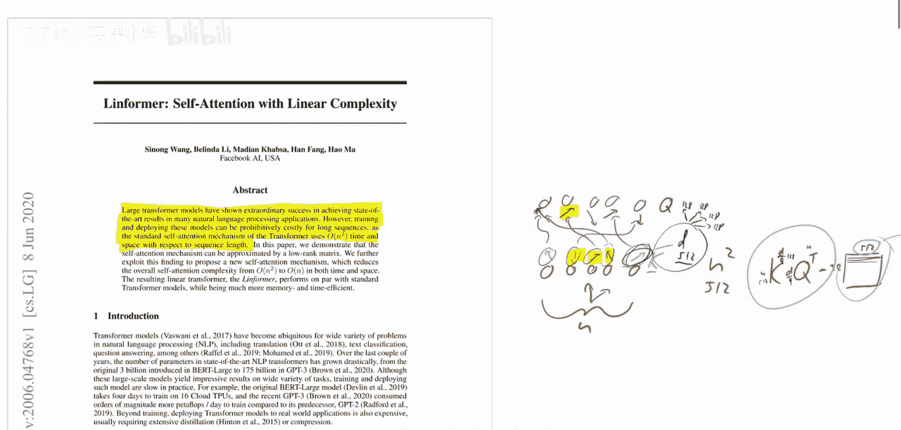

They go on， and they say in this paper， we demonstrate that the self attention mechanism can be approximated by a low rank matrix。

 We further exploit this finding to propose a new self attention mechanism。

 which reduces the overall self attention complexity from n squared to n in both time and space。

 The resulting linear transformer， the linearformer performs on par with standard transformer models while being much more memory and time efficient。

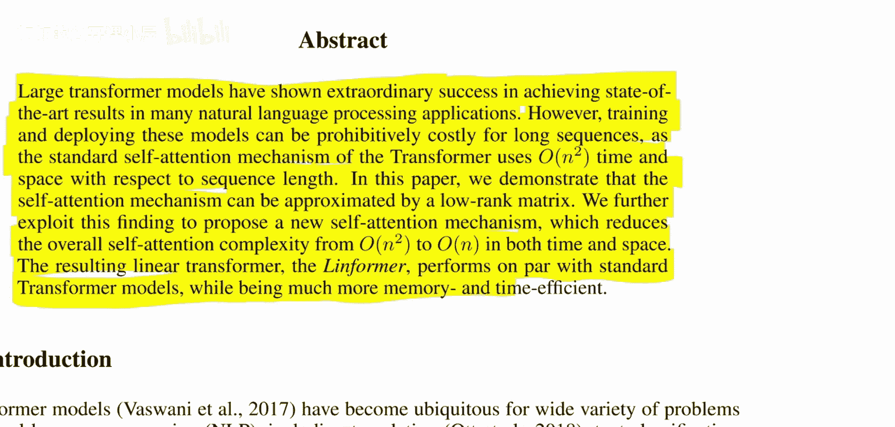

All right。So let's dive into their thing。 This is how they formulate the attention mechanism。

 So right here the attention has queries and keys， as you can see here now these W matrices you can largely ignore the W simply maps the queries to so these are simply D by D matrices that are linear transformation of the queries。

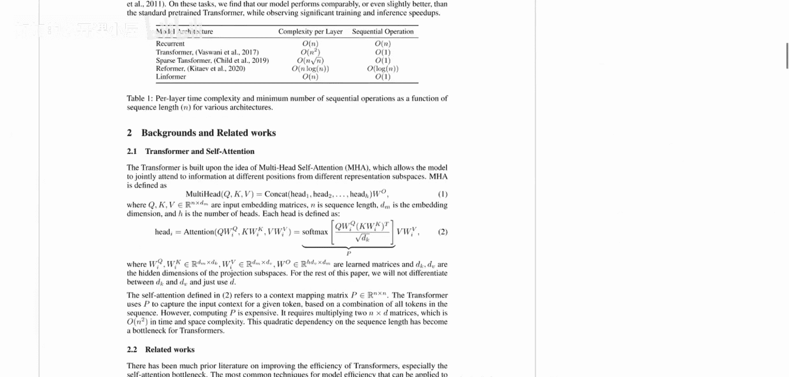

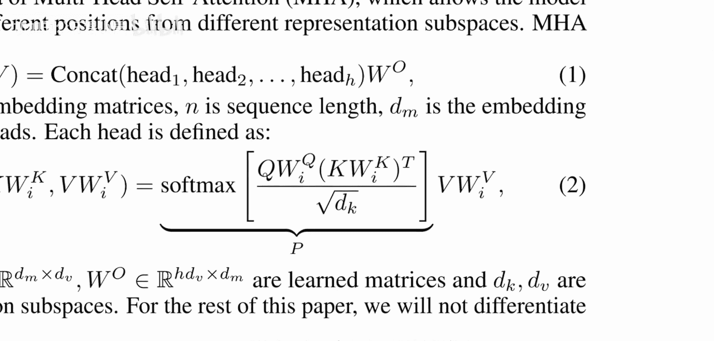

You can sort of overlook them for the arguments in this paper。

So these are the keys and the queries we talked about， the values here。

 this is the actual information that's being routed。

 so what we want to do is we want to compute this product between queries and keys right here and scale it appropriately。

 but ultimately this is this product。

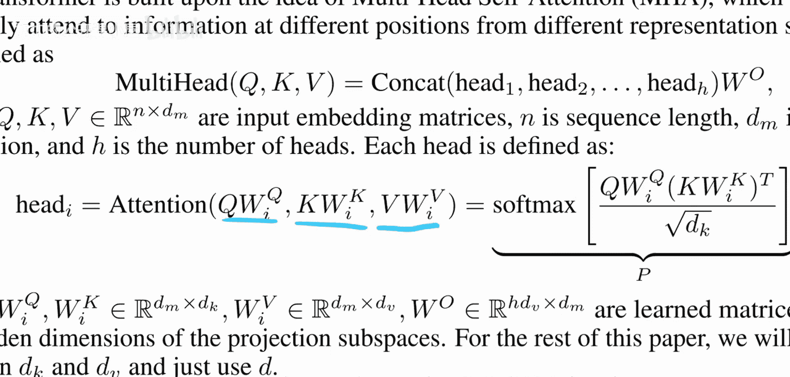

Then run this through a softmax operation。That means we we normalize it such that it sums to one。

 the distribution sums to one。And then we want to route this information according to that distribution。

 okay。So that's how they formulate an attention mechanism。 Now notice something this thing in here。

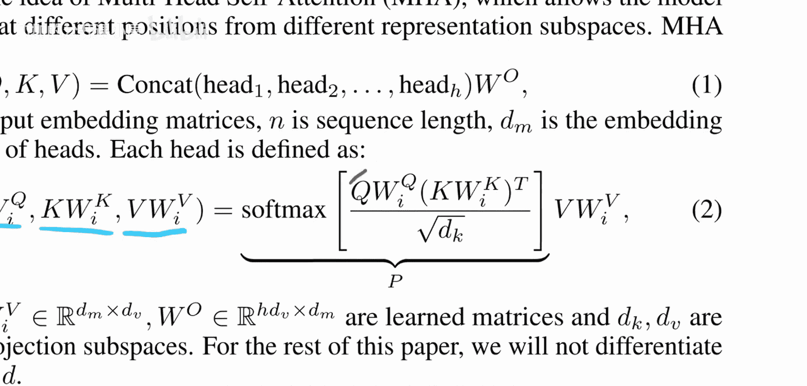

Is what they call the matrix A， and this is what I've demonstrated。

