# YannicKilcher【中英⚡AI经典论文领读(全203篇)(上)｜Papers Explained】 p31 P36 VirTex：通过文本注释学习视觉表示（论文解读） [BV1o3xLznExj_p31]

Hi there。 Today we're looking at vertex learning visual representations from textual annotations by Karen Deai and Justin Johnson of the University of Michigan。

 So this paper at its core is pretty simple on high level it proposes to take the task of image captioning which is where you're given an image and you're asked to produce a caption for the image and basically train a model to do this and then just take the visual part of it as a baseline to transfer learn on other visual tasks and that appears to works works surprisingly well if you don't have much data。

So if you don't have much data to pre train on， this appears to work very well。All right， as always。

 if you like content like this， then consider sharing it out， subscribing to the channel。

 or tell me what you think in the comments。So as I already said， the the idea here is pretty simple。

 So people have been looking for pretrain tasks for visual tasks。

 So a visual task is anything where the input is an image and then you usually have some sort of neural network that processes the image and then at the end you can have many things so you could have a classifier that classifies the image into one of many classes。

 if you know image net that's a。ThinkSo if there is a cat here。

 then the imagenet classifier here would say cat， or you could have something like an object detector that tries to predict on the image where the cat is like with a bounding box you could have a it could have a semantic segmentation where it's like all of these pixels here are cat and maybe all of these pixels here are sky and so it labels every pixel。

 There is many visual tasks that you can formulate。 and they all sort of share the same architecture。

 and specifically they all share this part right here。 if you will， This is the visual encoder。

 It's usually a convolutional neural network。 And what's really different between the tasks is mostly this last part here that does the actual task。

 But this and is often called the backbone。 So this is the backbone and。The idea now is。

If I have a bunch of these tasks， sometimes I don't have money labels for these tasks。

 I don't have many labeled images so that I could train this big architecture from scratch。

 like in medical images or。Just in domains where you don't have many images。

 So couldn't I somehow come up with a method to create this backbone beforehand。

 So to create backbone given another data set。 and the simplest variant here is you take a big image data set。

 such as imagenet。And then you train a classifier， like we said， to predict some classes on it。

 and then because an INe has a lot of images， then this is your backbone and then whenever you have a different task。

 you simply take the backbone， transfer it over， and then train the other。

 basically you continue training on the other task， that's called transfer learning。The question is。

 how do you get a good backbone？ So if you train on something like Iagenet。

Then this is of course the supervised task so you would have a very good learning signal。

 but even IageNet has like 1 million images。But for example， the Internet has many more images。

 So what you could do is you could train on this much bigger data set that you collected from the Internet。

 let's just call it Internet。But there you don't have labels， right。

 So what you'll have to resort to is instead of supervised learning is self supervised learning where you have an image and maybe you rotate it to the right。

 So here is our cat。It rotated to the right。 and then you have a classifier that predicts that these。

 this image was rotated to the right。 and then that will become your backbone。

 These self supervised methods， they work very well。There is a different number of them， for example。

 moco， things like this and there is also a number of techniques that do supervise pretrain and then transfer learning you can maybe watch my video on big transfer。

 which is a very large attempt to pretrain a backbone for visual tasks。Alright。

 now you can see right here that the sort of direction is that the more data， the better。

 So that's sort of the idea here that Inet is a big data set we can train a really good backbone。

 but you know， the internet is an even bigger data set， we don't have labels， so there's a tradeoff。

 but we potentially can train an even better visual backbone to then transfer learn with。

 This paper goes into a different direction。 They say， look， if you go in this direction right here。

You get more images， but you get less information per image so with Iagenet at least you have the label right per image。

 but if you simply take a photo of the internet， you don't even have the label you have to resort to self-svised What if we go into the other direction and we look for images that have very high quality annotations but maybe we don't have as many。

 can we can we do the same thing， Can we learn good backbones by trading off quality for quality in this case。

And their quantity and quality trade off is they go for descriptions。 so they'll go。

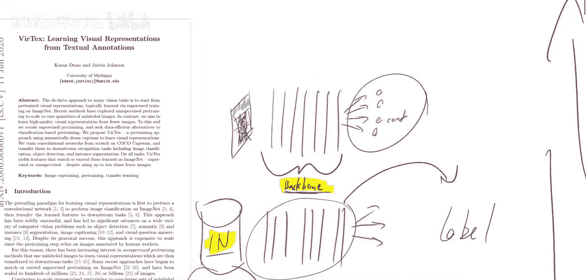

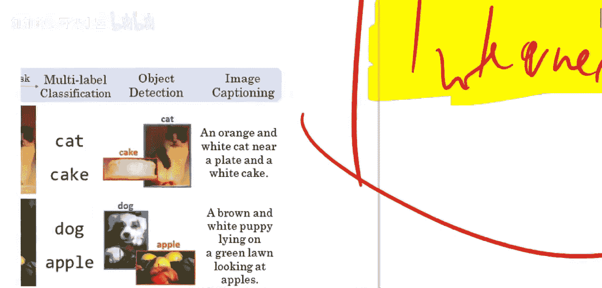

4。Something like this， where you'll have an image and you'll have a caption for the image。And。

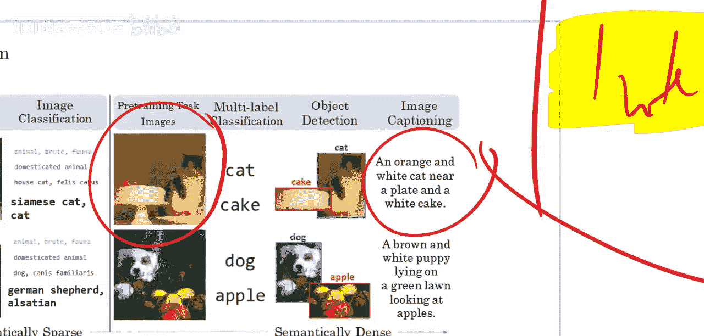

So they they show these on on a line here， semantically dense， semantically sparse。

 but their task is going to be caption generation。 So their back their their task is。Given an image。

 I want to produce a caption， and there are data sets that you can train this from in a supervised fashion。

 which， of course， these are very expensive to create。 I mean。

 if you want to create an imagenet data set。 then you have to label each image。

 but if you want to create a caption data set。 that's even harder because human really needs to sit down。

 look at the image and an imagenet， everything is like one class。

 but here you need to look at the image and then you'll have to come up with like an adequate description here。

 the adequate description is an orange sorry an orange and white。

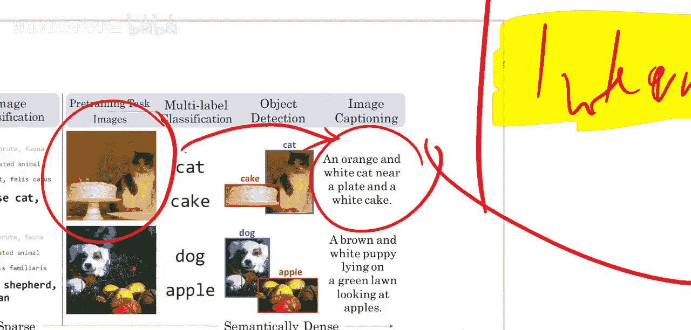

An orange and white cat near a plate and a white cake， okay。

So that's the caption right here and of course the caption is ambiguous so you'll have to collect multiple captions per image and you'll have to make sure that the humans that do this do a good job and so on。

 so these are very very expensive data sets， but they are very high quality if you think of what does single label。

 let's just take image in that imagenet has a single label per class。

Let's say this is cat or cake for that matter。 It just sort of gives you。

Very few bits of information， but if you consider the text here， an orange cat and a white cat。

 an orange and white cat， you know that there is a cat。Right， you know that it's one cat。

 You know what its color is， orange and white。Then you know that there is a white cake so you know the other object and you know the relation they are near each other。

 same for here， a brown and white puppy。 So this is one object and the description of the object。

There is a。There are apples， there is a green lawn， and the relations between them are also clear。

 the puppies lying on the green lawn and looking at the apples。

So the information in captions is so much more dense than just labels。

 and that's the back here to say， hey， can we can we do can we pretrain a backbone from maybe a small data set。

 but that has so much information like a caption image caption data set。

Okay so their method is nothing more。 they train image captioning and then they use the visual backbone for transfer learning。

 So this is the model。 there' is an image。 The image goes into this visual backbone right here。

 which is a resnet 50。 so this is a very， very standard convolutional neural network。

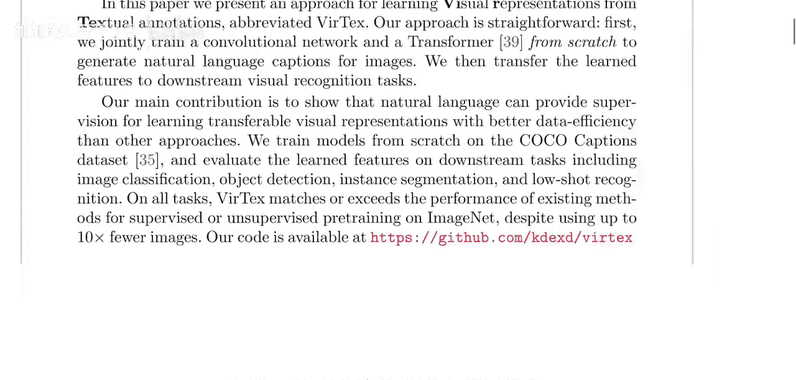

And that gives you these features， so these features are 7 by7 by 2048。

 This is the standard output of a resnet 50。And then。

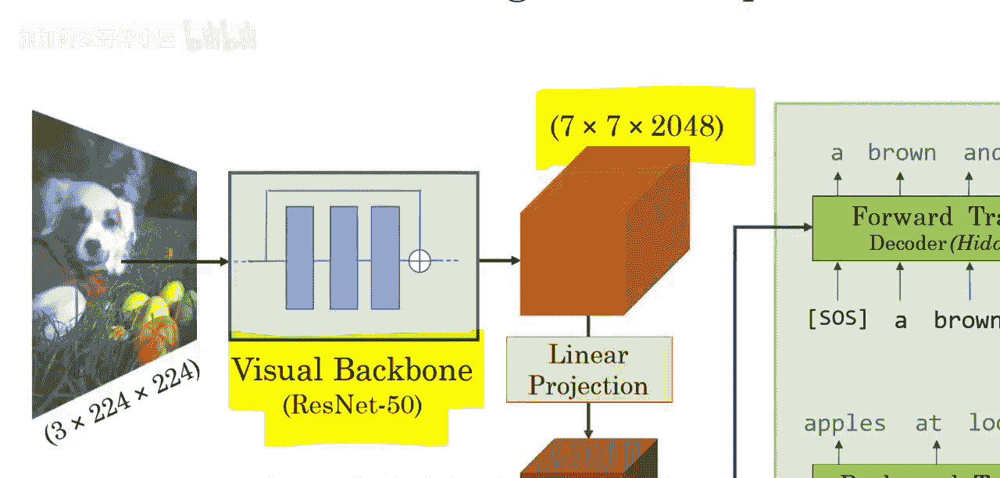

From this part on， they do a linear projection such that they can now input it into a language model。

 So they have visual features， and now they feed those into the language model。

 and the language model is just a transformer。

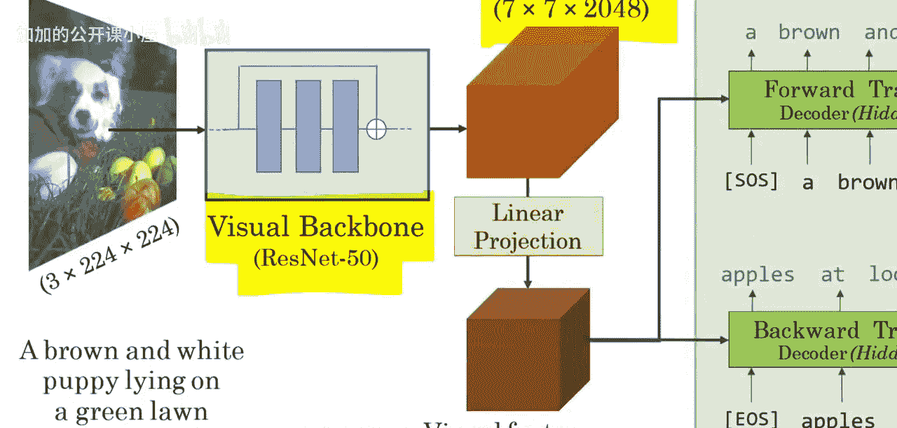

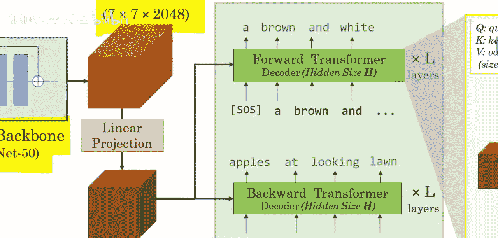

Actually， two transformers。So one transformer， they're both autoregressive。

 One transformer tries to predict the caption in a forward way。

 and the other transformer tries to predict the caption in a backward way。 And that's down here。

 So in this direction is backward because the caption has been reversed if you don't know what a transformer is。

 I've made several videos on transformers， the first one is attention is all you need。

 And that's sort of the same， the same kind of transformer they use here。

 So as you can see right here， you have this。

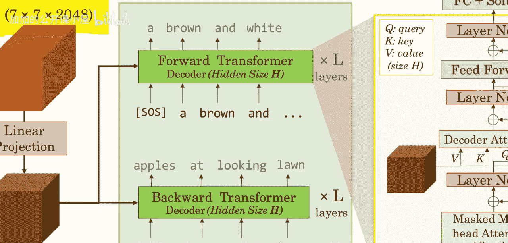

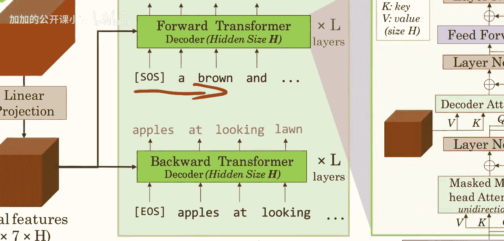

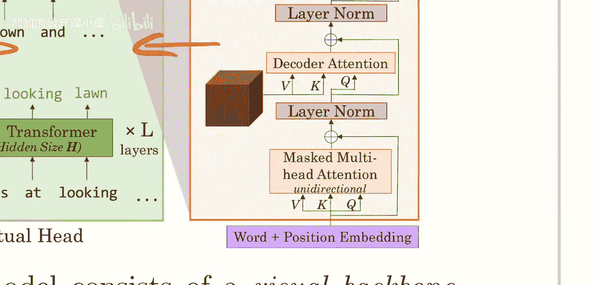

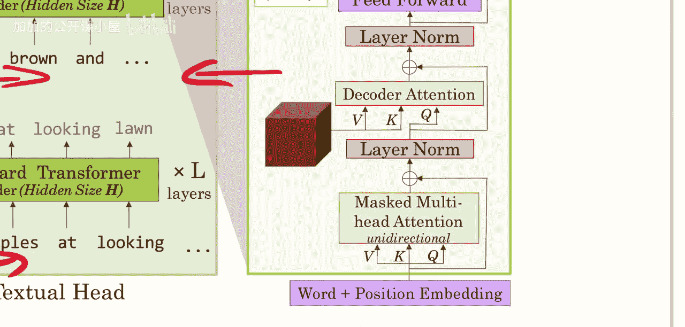

Multied attention。