# YannicKilcher【中英⚡AI经典论文领读(全203篇)(上)｜Papers Explained】 p32 P38 弗朗索瓦·肖莱《论智能的衡量》第二部分：人类先验（论文解析） [BV1o3xLznExj_p32]

Hi there。 Today， we're going to continue with on the measure of intelligence by Fransoa Sli。 Now。

 if you remember last time， if you haven't seen last time， go watch part 1， if you're interested。

 this is a multipart series on this paper。 why because the paper itself is very long。 It's 40 pages。

 the main part。 and it's a big wall of text。 So I've opted to basically pull out notes and show you the notes that I have pulled out。

 and to divide this into multiple parts。 So last time we went over sort of the history of assessing intelligence and the basics。

 and I know I said this time I'm going to get into the math。 but I lied。

 So I realized that there's still a lot that comes up in part two of the paper before we get into the actual math。

 So this part is going to be about the prerequisites to that。 And then next time math。

 I'm sorry to disappoint anyone。 you might just skip this one if you want。

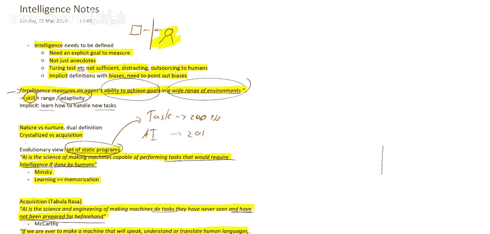

You have to shout out Tim Sf， who， of course， runs the machine learning street talk channel podcast with me and Connor Shorten together。

 Tim has just made an entire video about this paper about on the measure of intelligence and his videos are usually like super high quality。

 like higher than mine and。It's the entire paper。 So if you want to you know。

 know the end of the story or you know， have a different take on the paper。

 definitely can recommend his video。 I do make a guest appearance there so。😊，Yeah。

 that's that's a given and I will still finish the paper on this channel just in my regular in this style right here。

 so all the options are available to you。

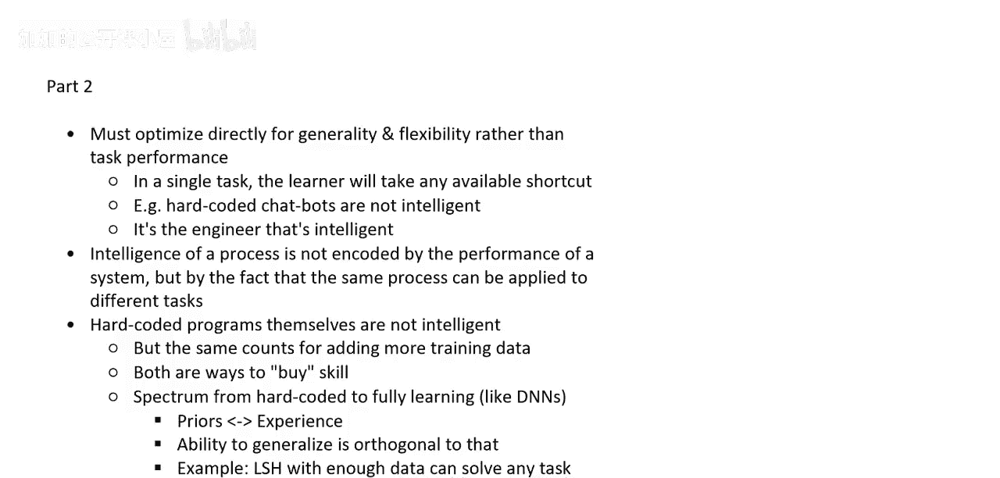

Let's dive into part 2。 So if you remember part 1， we sort of went over。

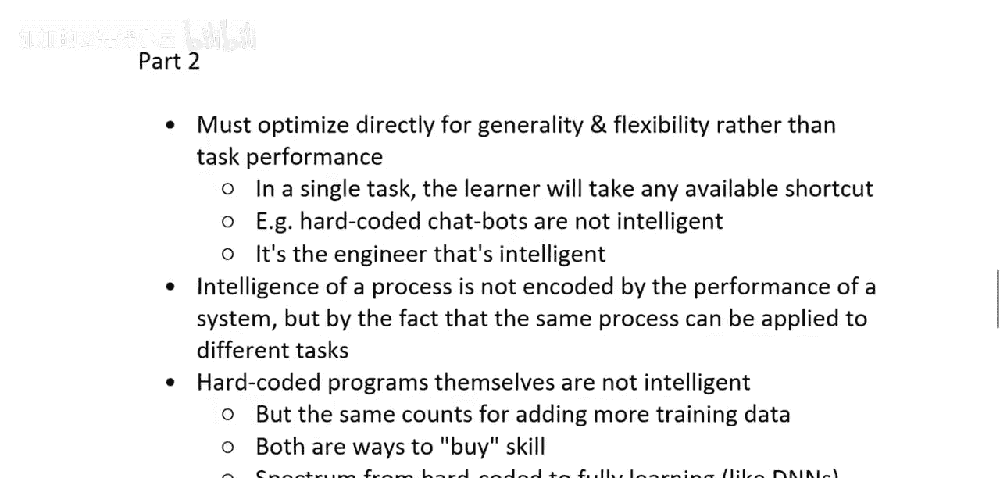

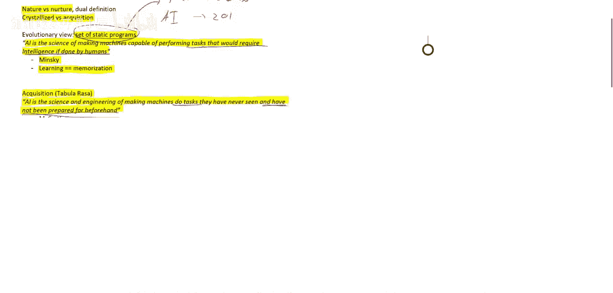

What it means to be intelligent。 And we differentiated basically two things。

 which are skills and abilities。 So a skill is how well you achieve a given task or how well you can do in a given task。

 So this could be chess or， you know， go or。

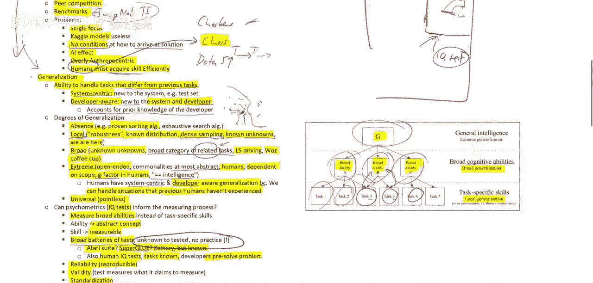

I like something very， very measurable。 an IQ test is a is a specific task。

 So these things right here they' all task， but these tasks aren't the thing we're interested in just because the machine is good at chess doesn't mean it's intelligent。

 what we want is sort of a generalizable。

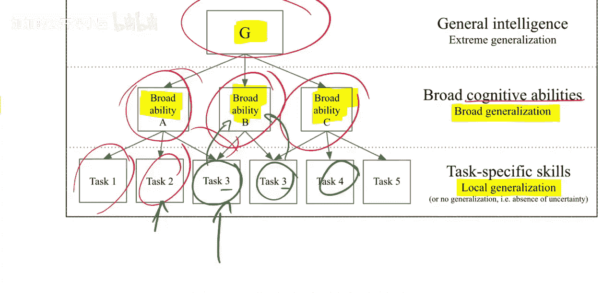

Skill， so we want to assess how generalizable is that an ability。

 So can I throw a computer at a new problem that it has never seen before and it can solve that。

 And that's going to be this generalizability， this notion of can you solve things that you have never encounter before and weren't prepared for that is going to be the basis for us to measure intelligence。

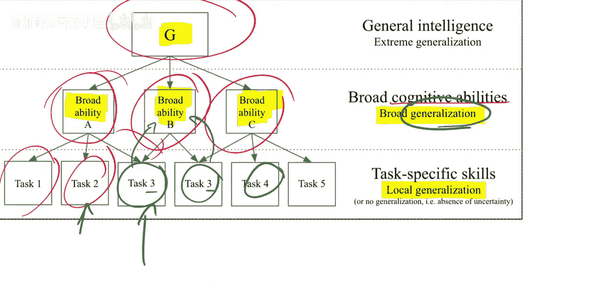

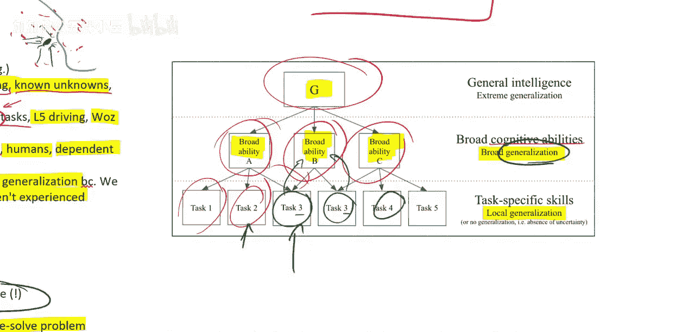

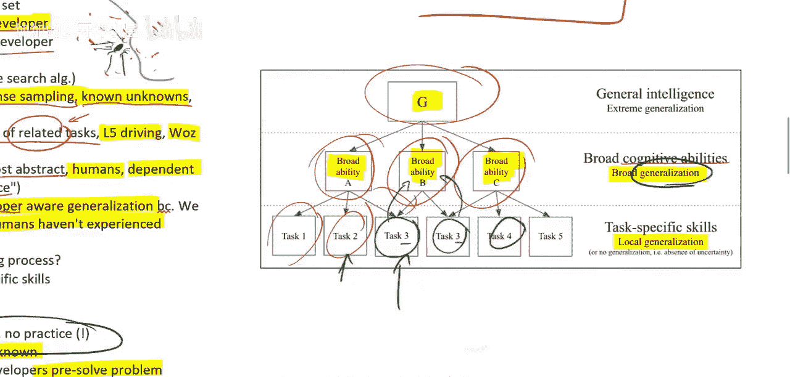

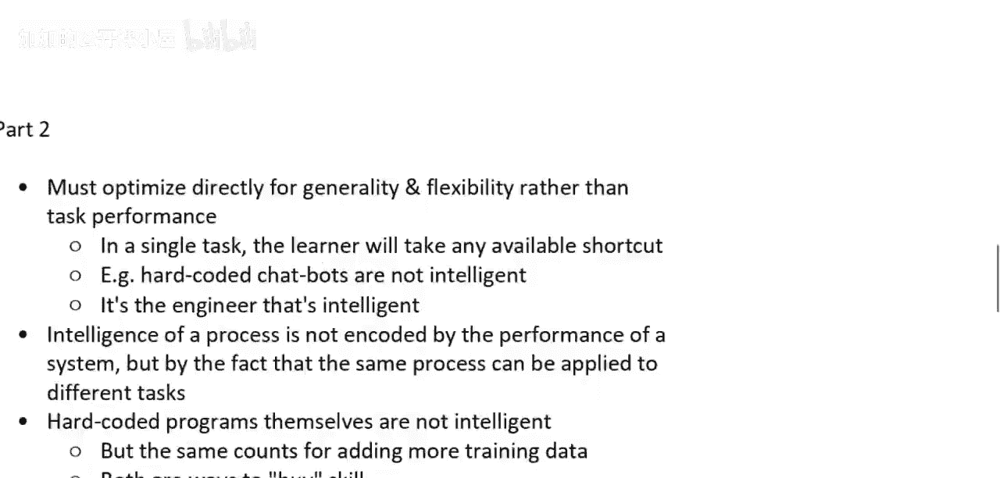

So Chalet says， you have to optimize directly for generality and flexibility。

 rather than task performance。 If you want to build a an intelligent agent。

 you have to sort of build something that is not just good at a thing。

 It is good at getting good at things。 That's that's almost a worthy thing。

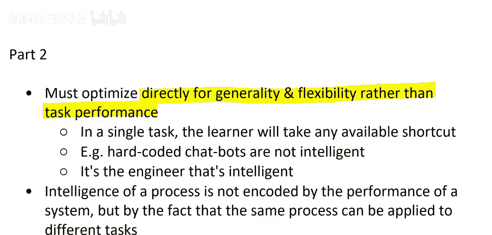

嗯。

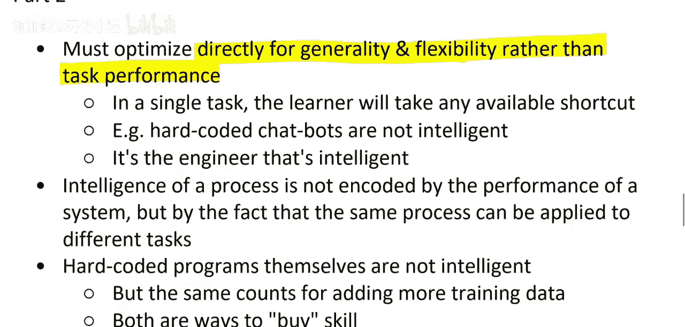

So if you just give it a single task， it says the the learner will will just take any available shortcut。

 So if you just say you have to be good at chess。 you can the developer of a system can exploit all the tricks that make you good at chess。

 And you you don't have to be smart， you just know， basically， if you had enough memory。

 you could just memorize all the moves of all the chess games ever。 Okay。

 that's why we say hardcoded chatbots are not intelligent。 So hardcoded chatbots。

 they simply match your input to a database of reex and then they answer。

 and we're not very impressed because as soon as I give them something that is not covered by their reex。

 they， they， they fail。 They just say， I don't know or something like this。

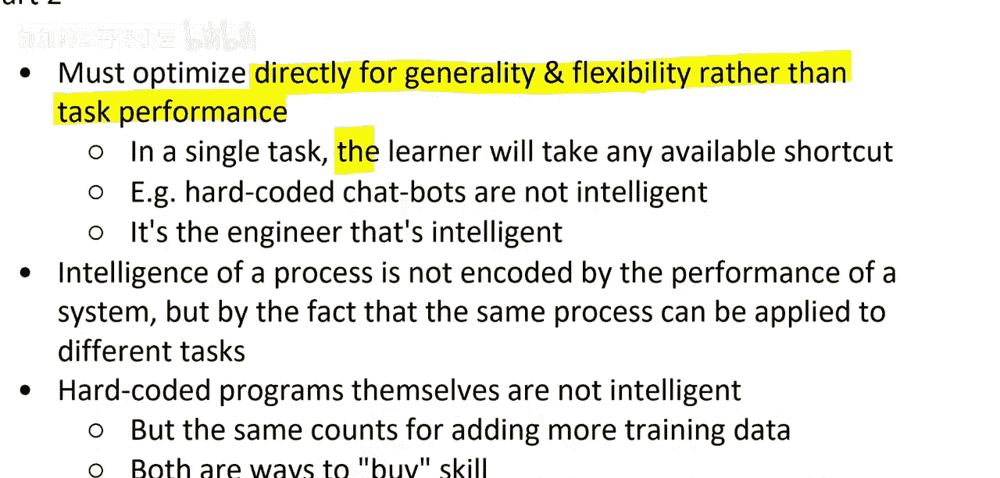

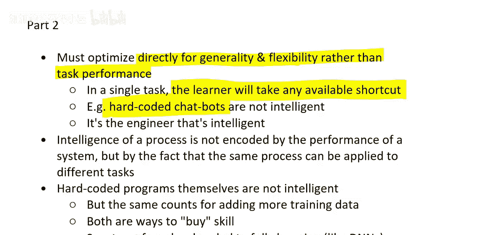

In fact， what is intelligent is the engineer in that case。

 so the engineer that makes the program is intelligent。

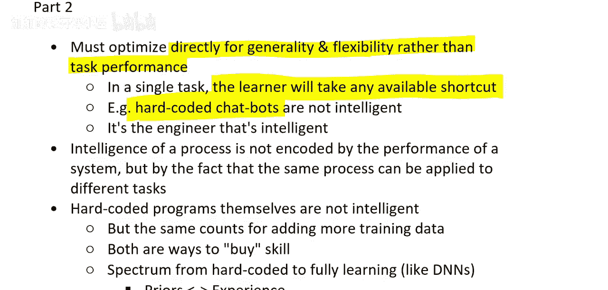

So he has this drawing， I think I've shown it last time where you have the environment。

And there is this agent and if the agent is really good with the environment。

 you might consider that intelligent， but in Chalet's mind。

 you have to also consider here the developer of the agent。

 it could be that the developer is very intelligent and just builds the agent to interact with the environment in a matter that it gets a lot of reward is very good at a skill。

 but the agent itself might not be intelligent。

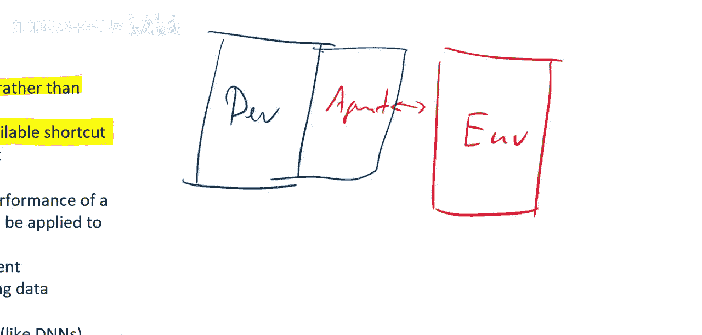

So it says intelligence。The intelligence of a process is not encoded by the performance of a system。

 but by the fact that the same process can be applied to different tasks。 So in this case。

 if I have a new task， a new environment。 So E2 right here。 The question is。

 could I throw the same agent at that， even if it hasn't seen it before。

 or would I be able to take the same developer that develops me a new agent agent too。

 that then can solve the task， in the case where I can throw over the agent that would make an argument that the agent is intelligent。

 but if I can't you'd have to make the argument that the developer is the intelligent part here。

 which of course， is the point of what he's saying right here。

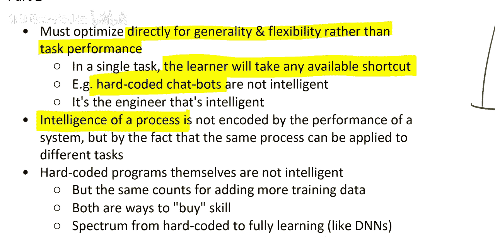

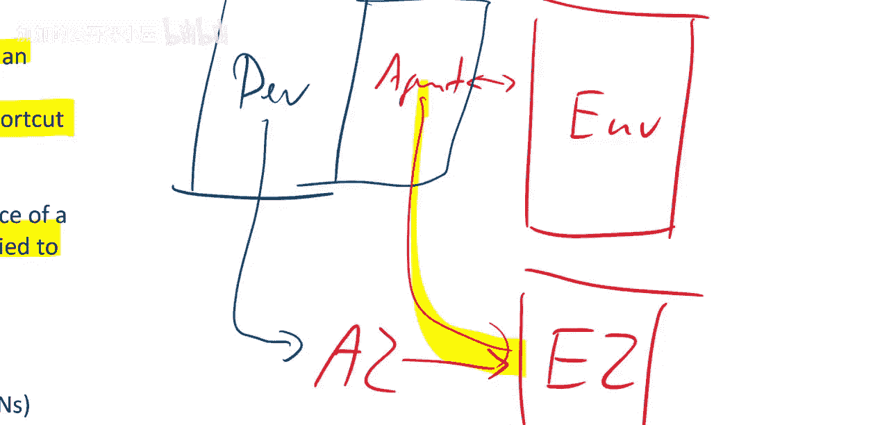

So hard coded programs themselves are not intelligent。

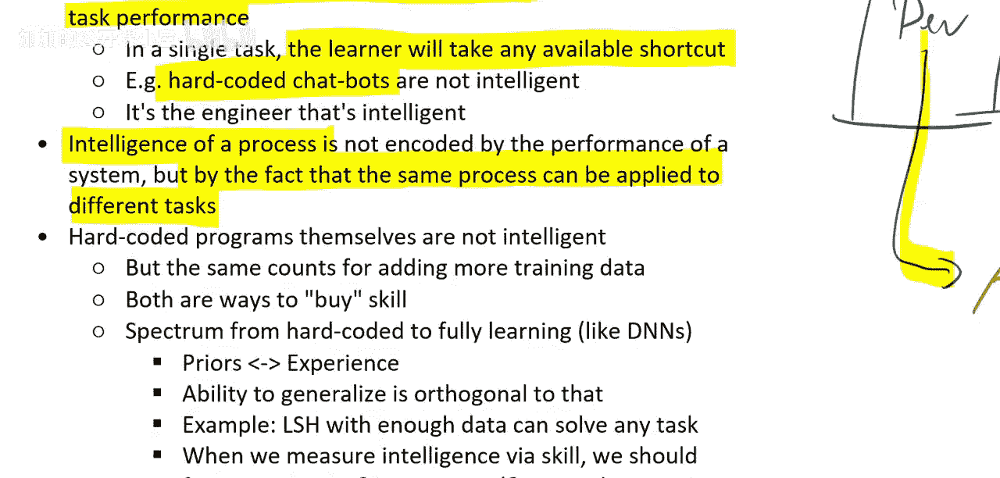

ButAnd this is the case， the same counts for adding more training data。Not only is the hard coding。

 not intelligent。 It's also Chalet says not intelligence。 if you simply add more training data。

 So a machine learning system that sort of learns to how how to interact with these environments。

 if you can you can imagine that you have lots of environment， environment， environment， environment。

 environment and so on that give you a dense sampling of the environment space So you have all of these environments。

 you build all of them， and you train this agent to interact well with all of them。

 So you give it lots of compute lots of data and the environments are really a dense sampling of the environment space。

 it will be able， even though it has never seen environment， too， this environment right here。

 it might be just able to generalize to this environment。

 given that it has been trained on all the environments here。

 like it has been trained on every possible environment around this environment that is similar to this。

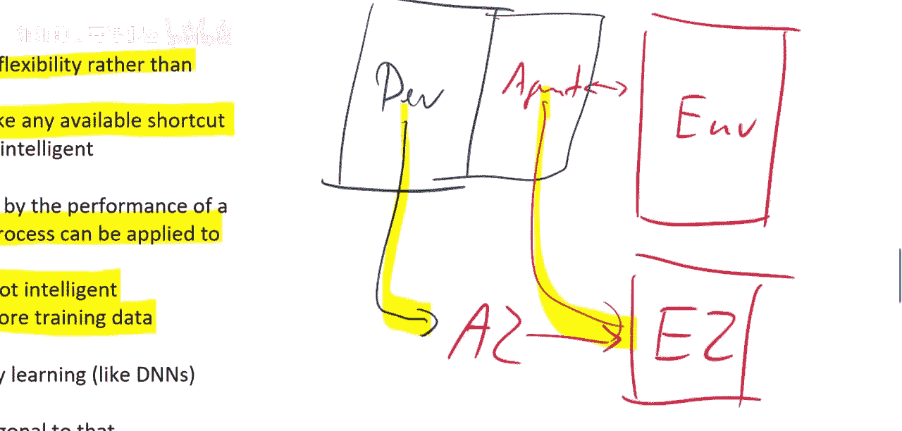

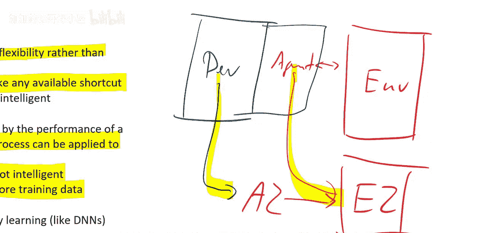

Environment， it could generally generalize to environment too。

 but also we wouldn't view that as intelligent because it in a sense。

 this skill has been bought with data。

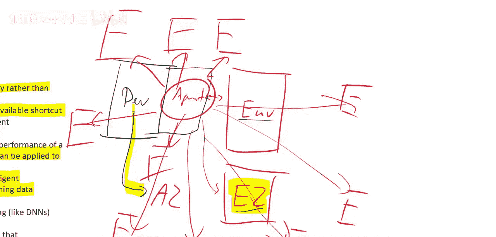

And this notion of buying skill is comes up a lot in this paper。

 So Chalet says there are two ways to buy a skill and by buying。

 he basically meanss you don't buying as opposed to intelligently solving the skill。

 So whenever you buy a skill that's not intelligent。

 Chalet says and you can buy a skill by either hard coding the solution or giving lots of data and there is like this spectrum where you hard code completely hard code a solution and here is where you completely only feed data So here would be something like G3。

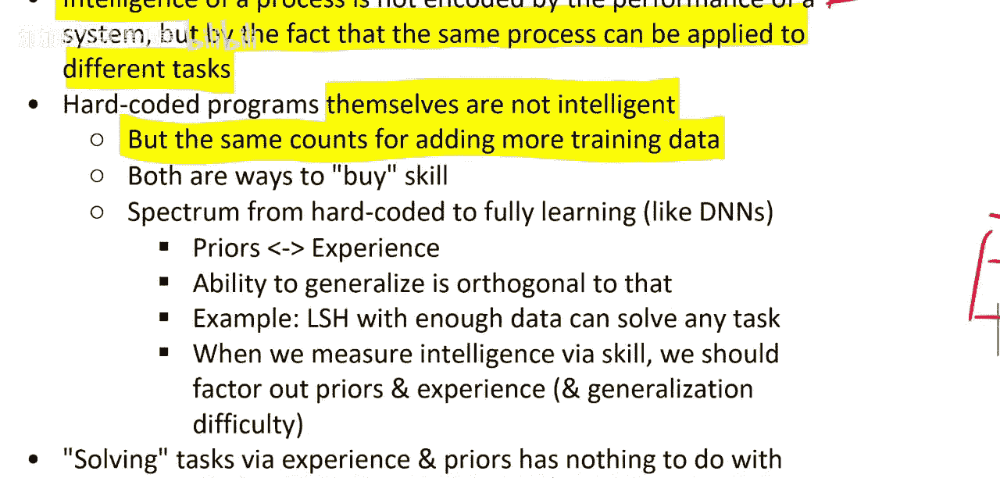

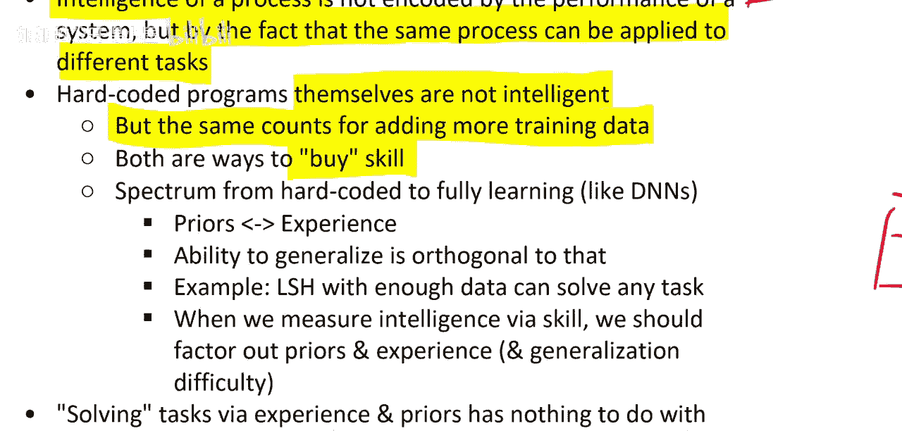

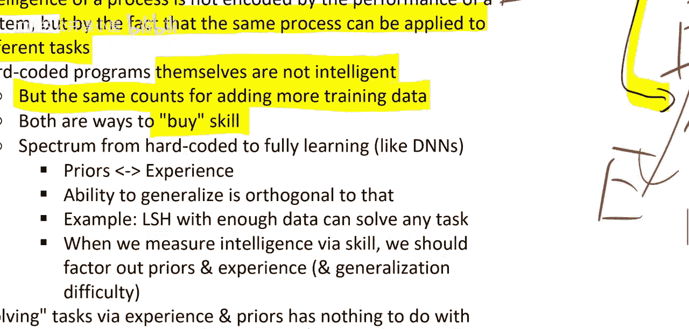

Right，There are almost no priors there。 It's just a transformer。

 big transformer and and you just throw in data lots and lots and lots and lots and lots of data。

 So in this measure， last time I've had lots of people when G3 came out。

 I've had people commenting on the part1 of this paper saying， isn't G3 intelligent because you know。

 it can sort of generalize to these tasks that it hasn't been trained on， by the way。

 if you haven't seen the G3 video， you should go watch it。

 some something tells me this video is popular， it might be the。

Five times as many views as any other video。 So at least it's not a terrible video。But in essence。

 G3 can solve these tasks that it wasn't trained for right and therefore you might argue in this definition right here it could be intelligent because it can generalize。

 but there is this counter action where Shilet says maybe you have just bought that skill with lots and lots of data now I actually don't know what to say to this because I mean it really seems like GP3 generalized tasks it has never seen before but also it has had a lot of data and。

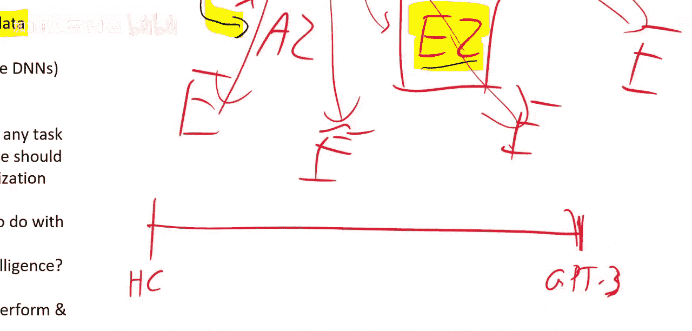

So as of right now， it is not really clear where the line is here like when when are we going argue that G3 is actually like it could be that it has had lots of data。

 but also it is intelligent How are we going to make that distinction and I guess we're going to get into the math part。

 but I can tell you right now the math part is so abstract as it is not really practical。

 it is like a theoretical framework that you might be able to approximate but。

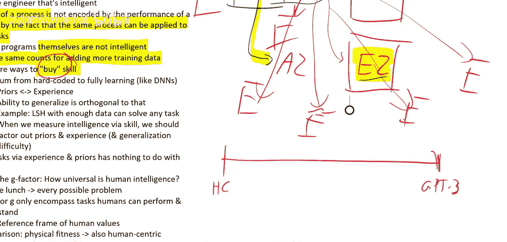

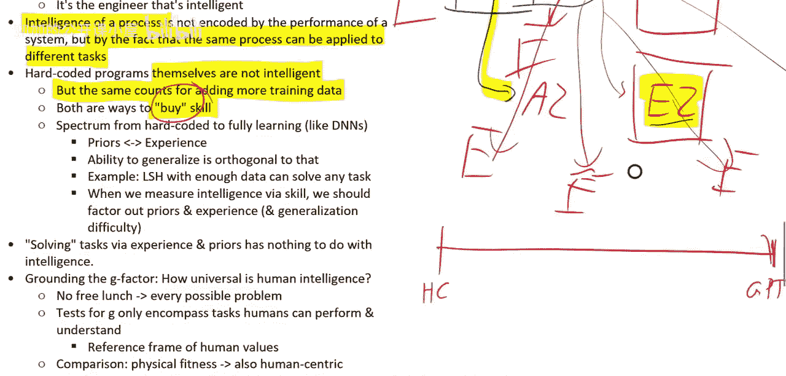

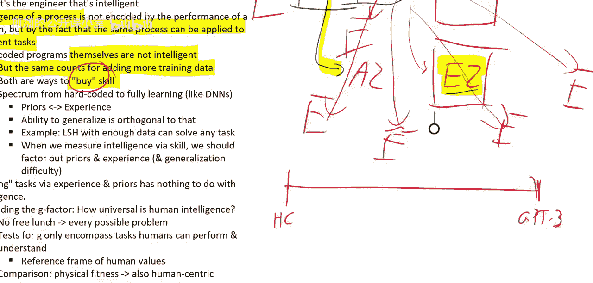

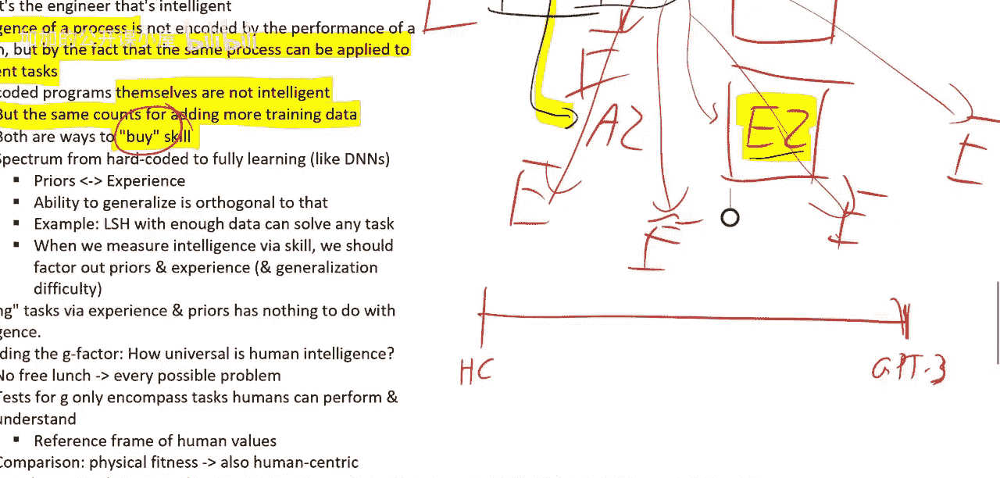

You know， there， there is， there is like a wishy washy thing going on。 but he basically says， okay。

 there's this spectrum of hard coding。Over here and then fully learning from data and with all of these methods and you know in between methods。

 like a CNNN would be here because it has like considerable priors。

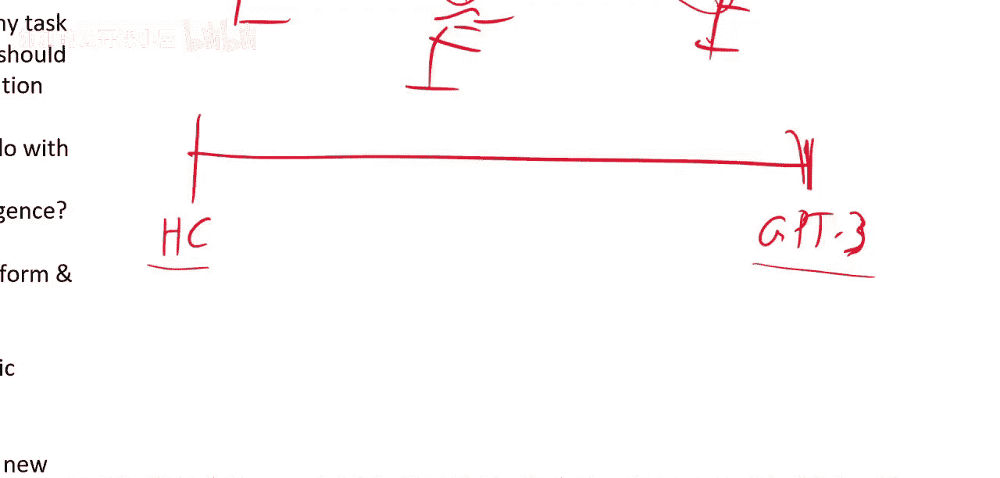